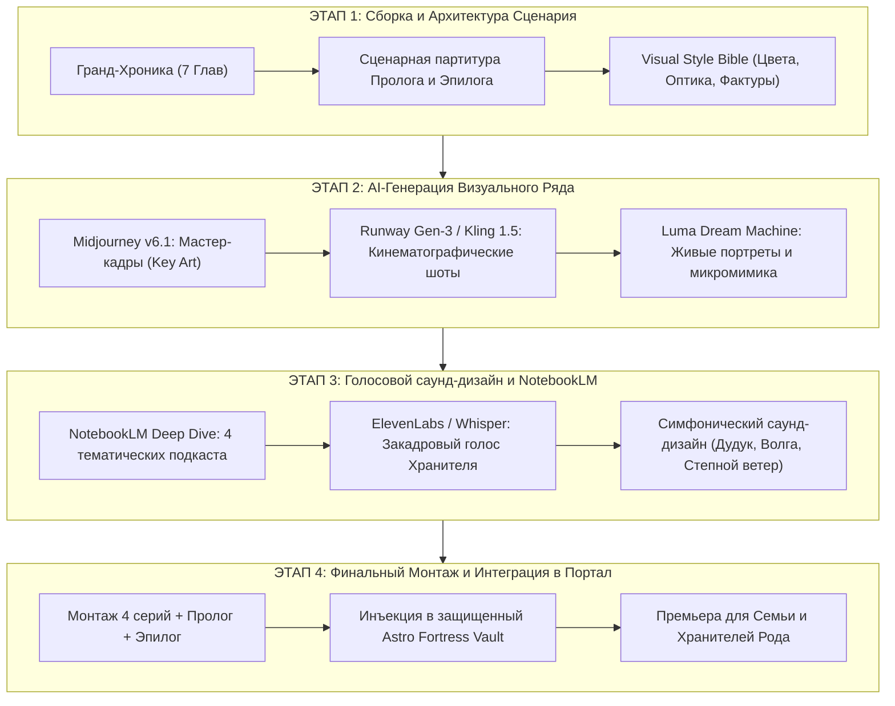

# 🎬 РЕЖИССЁРСКАЯ ОСНОВА, СЦЕНАРИИ И БИБЛИЯ ВИЗУАЛЬНОГО СТИЛЯ (AI-CINEMA)
## Кинематографический эпос: «Древо Графа Каретникова: Четыре Реки — Четыре Века»
### Полная режиссерская экспликация, сценарные партитуры Пролога и Эпилога, Visual Style Bible для Midjourney / Runway / Kling / Luma и мастер-промпты для Google NotebookLM

---

> ### ⚠️ ОФИЦИАЛЬНЫЙ ЭПИСТЕМИЧЕСКИЙ СТАТУС ДОКУМЕНТА:
> **ХУДОЖЕСТВЕННО-ДРАМАТИЧЕСКАЯ РЕКОНСТРУКЦИЯ / ТВОРЧЕСКИЙ СЦЕНАРИЙ**
> *(Не является подтвержденным архивным документом, служит драматургической, операторской и визуальной основой для генерации видео/аудиоряда нейросетями и будет непрерывно корректироваться по мере поступления новых верифицированных фактов из ЦГАСО, ГАОО, ГАПО и РГАДА).*

---

## 🧭 РЕЖИССЁРСКАЯ ЭКСПЛИКАЦИЯ И СВЕРХЗАДАЧА ПРОЕКТА

### 1. Метафизика замысла
Человек конца XX века привык воспринимать себя одиночной точкой в хаосе современности. Наш кинопроект визуально и математически разрушает эту иллюзию. 

Рождение **Дмитрия Ивановича Каретникова** 14 сентября 1994 года в Самаре — это не случайность, а вершина колоссальной **бинарной пирамиды из 126 прямых предков за семь предшествующих поколений** (система Соса-Страдоница `2^0...2^6`). За каждым его движением, чертой характера, интонацией голоса и интеллектуальной стойкостью стоят четыре века выживания, четыре мощнейших фамильных клана:
1. **Каретниковы** — степные титаны фронтира реки Ток, орловские пахари и владимирские мастера, приручившие оренбургские бураны.
2. **Юхины** — вольные пахари самарского Заволжья, воины реки Кондурчи, хранители верности родной земле.
3. **Зубковы** — ратные люди Ломовской засечной черты XVII века, державшие на острие пики натиск Дикого Поля и выстоявшие в огне восстания Степана Разина 1670 года.
4. **Куманины** — таинственный и благородный род: от служилых людей XVII столетия до первогильдейских хозяев Москвы, жертвователей на Храм Христа Спасителя, опекунов гения Фёдора Достоевского и хранителей синодиков.

### 2. Кинематографический язык
Фильм создается на стыке **эпического исторического реализма** (в духе визуальных шедевров Эммануэля Любецки, Роджера Дикинса и Андрея Тарковского) и **кибернетической точности XXI века**. 

Каждая сцена продумана под прямое скармливание AI-видеогенераторам нового поколения (**Runway Gen-3 Alpha, Midjourney v6.1, Kling 1.5, Luma Dream Machine**) и аудио-архитектуре **Google NotebookLM Audio Deep Dive**.

---

## 🌊 ЧАСТЬ 1. СЦЕНАРИЙ ПИЛОТНОГО ПРОЛОГА: «ТОЧКА СБОРКИ — САМАРА 1994»

* **Хронометраж:** 04:30 – 05:00 мин.
* **Тональность:** Монументальная, глубинная, мистически-научная.
* **Музыкальная партитура:** Низкий гул суббаса, на который медленно наслаиваются акустические струнные (виолончель solo), глухой стук человеческого пульса (60 bpm) и нарастающий эмбиент волжского ветра.

```
+-----------------------------------------------------------------------------------+
| ТАЙМКОД  | КАДР / ВИДЕОРЯД (AI PROMPT FOCUS)         | ЗВУК И ДРАМАТУРГИЯ ЗА КАДРОМ       |
+----------+-------------------------------------------+------------------------------------+
| 00:00 -  | Черный экран. Из тьмы загорается тонкая   | Звук: глухой стук сердца в утробе. |
| 00:25    | золотая нить. Она двоится: 2, 4, 8, 16... | Закадровый голос (баритон, тепло и |
|          | Взрыв созвездия из 127 светящихся точек.  | строго):                           |
|          | Камера стремительно пролетает сквозь      | «Любой человек на Земле —          |
|          | этот геометрический космос.               | это не начало и не случайность.    |
|          |                                           | Это завершение гигантской          |
|          |                                           | математической вероятности...»     |
+----------+-------------------------------------------+------------------------------------+
| 00:25 -  | Натурный шот: Жигулёвские горы на рассвете| Музыка: вступает протяжный дудук   |
| 01:10    | Свинцово-стальная Волга разрезает камень. | и шум тяжелой речной воды.         |
|          | Туман над водой. Камера с высоты птичьего | Голос диктора:                     |
|          | полета видит слияние водных артерий:      | «Чтобы в сентябре 1994 года        |
|          | 1) Бурлящий степной Ток (Оренбуржье);     | раздался один единственный первый  |
|          | 2) Зеленоводная Кондурча (Заволжье);      | крик новорожденного, за его спиной |
|          | 3) Лесной родниковый Шуструй (Пенза);     | должны были встретиться и не       |
|          | 4) Великая Волга, принимающая их всех.    | погибнуть сто двадцать шесть прямых|
|          |                                           | предков...»                        |
+----------+-------------------------------------------+------------------------------------+
| 01:10 -  | Самара, конец 1980-х — начало 1990-х.     | Атмосфера: гул заводских цехов,    |
| 02:40    | Заводские силуэты, старые волжские        | шелест золотых тополей, прибой.    |
|          | дебаркадеры, залитая солнцем набережная.  | Голос диктора:                     |
|          | Два взгляда сквозь время:                 | «Здесь соединились два великих     |
|          | Иван Валентинович Каретников (20 лет,     | русских характера.                 |
|          | статный, со спокойной силой и степным     | Сын оренбургского богатыря         |
|          | прищуром оренбургских предков) и          | и самарской вольницы — Иван.       |
|          | Светлана Владимировна Зубкова (юная,      | И дочь древней Ломовской земли,    |
|          | с пронзительными умными глазами, в        | несущая в жилах стойкость стрельцов|
|          | которых вековая стать шуструйских родов). | и благородство купцов — Светлана». |
+----------+-------------------------------------------+------------------------------------+
| 02:40 -  | 14 сентября 1994 года. Осенний полдень.   | Звук: резкий порыв ветра за окном, |
| 04:00    | Самарский роддом. Капли дождя на стекле,  | шелест больничных простыней.       |
|          | золотой кленовый лист прилип к раме.      | Пауза... И пронзительный, звонкий, |
|          | Усталое, счастливое лицо матери.          | чистый крик младенца.              |
|          | На руках врача — новорожденный мальчик.   | Голос диктора:                     |
|          | Крупный план: глаза младенца открываются. | «Четыре реки сошлись в одну.       |
|          | В его зрачке вспыхивает отражение степи,  | Родился Хранитель.                 |
|          | острога, купеческих палат и волн Волги.   | Дмитрий Иванович Каретников».      |
+----------+-------------------------------------------+------------------------------------+
| 04:00 -  | Монтажный вихрь: лицо младенца ➔ архивные | Мощный крещендо оркестра.          |
| 04:50    | фото дедов Валентина и Владимира ➔ лица   | Титр на экране:                    |
|          | стрельцов XVII века ➔ Граф Каретников     | «ГРАФ КАРЕТНИКОВ.                  |
|          | сегодня. Титр уходит в золото.            | ЧЕТЫРЕ ВЕКА ИМПЕРИИ».              |
+-----------------------------------------------------------------------------------+
```

### Подробная покадровая режиссерская экспликация Пролога

#### Сцена 1: Метафизический генетический взрыв (00:00 – 00:25)
* **Камера:** Макро-объектив 100mm. Медленный наезд из абсолютной темноты. 
* **Свет:** Холодный луч контрового света рождает золотую сияющую сферу. 
* **Физика кадра:** От сферы отделяются две светящиеся нити (отец и мать). Каждая делится надвое (дедушки и бабушки), затем на четыре, восемь, шестнадцать... Пространство превращается в гигантский, пульсирующий геометрический купол из 127 узлов.
* **Смысл:** Зритель физически ощущает масштаб своего биологического и духовного кода.

#### Сцена 2: Географическая тетрада — Четыре Реки (00:25 – 01:10)
* **Камера:** Аэросъемка сверхвысокого разрешения (Drone Master Shot, 24fps). Плавный пролет над водной гладью.
* **Визуальные маркеры рек:**
  1. *Река Ток (Оренбуржье):* Золотисто-глинистые берега, бесконечная степь до горизонта, ковыль, склоненный ветром, стада коней на водопое.
  2. *Река Кондурча (Самарское Заволжье):* Извилистое русло цвета темного малахита, заросли тальника, туман, стелющийся по черноземным лугам, вековые ветлы.
  3. *Речка Шуструй (Пензенская губерния):* Быстрая, прозрачная родниковая вода среди вековых сосен и дубрав, каменистые перекаты, воспоминание о засечных бревенчатых надолбах.
  4. *Великая Волга (Самара):* Царственная мощь Жигулёвских ворот, разлив на десятки километров, где три малых русла растворяются в едином могучем потоке.
* **Закадровый текст диктора:**
  > *«В жилах каждого из нас течет не просто кровь. В них течет вода тех рек, на берегах которых наши предки пахали землю, строили засечные крепости, рубили избы и молились перед боем. Степной Ток, вольная Кондурча, таинственный лесной Шуструй... Четыре века они текли навстречу друг другу, чтобы однажды влиться в Волгу».*

#### Сцена 3: Встреча родителей — Иван и Светлана (01:10 – 02:40)
* **Атмосфера эпохи:** Самара на переломе эпох (1988–1991). Теплый золотистый закат над Волгой. Молодежь на спуске улицы Полевой или Ленинградской. Нет навязчивого советского лубка — есть искренняя романтика сильных и честных людей.
* **Портрет Ивана Валентиновича Каретникова (#2, 1969 г.р.):**
  * Внешность: Высокий, крепкий, широкие плечи, уверенный открытый взгляд серо-голубых глаз, легкая полуулыбка. В движениях — несуетливая надежность волжских и оренбургских первопроходцев.
* **Портрет Светланы Владимировны Зубковой (#3, 1969 г.р.):**
  * Внешность: Утонченная, со строгой внутренней грацией, темные волосы, глубокий внимательный взгляд, в котором читается гордость древних однодворческих родов Ломова.
* **Мизансцена:** Они стоят у парапета набережной. Ветер треплет волосы. Иван подает ей руку, помогая сойти на дощатый причал к катеру. В этом простом жесте — союз двух ветвей, который соединит Оренбургскую степь и Пензенские засечные леса навсегда.

#### Сцена 4: Рождение Хранителя — 14 сентября 1994 года (02:40 – 05:00)
* **Локация:** Палата родильного дома в Самаре.
* **Операторское решение:** Субъективная камера младенца, чередующаяся с крупными кинематографическими планами лиц родителей и врачей. Мягкий рассеянный осенний свет сквозь белые занавески.
* **Драматургический акцент:** Когда ребенок открывает глаза, звуки палаты растворяются. На долю секунды звучит хор из сотен невидимых голосов — это предки благословляют пришедшего в мир. 
* **Финальная фраза Пролога:**
  > *«Он пришел в мир в час великого слома страны. Но за его плечами стояла тысячелетняя стена, которую невозможно разрушить. Начинается путешествие к истокам».*

---

## 🌾 ЧАСТЬ 2. СЦЕНАРИЙ ФИНАЛЬНОГО ЭПИЛОГА: «ЖИВАЯ НИТЬ (САМАРА — ПЛЕШАНОВО — НОВЫЙ ШУСТРУЙ 2026)»

* **Хронометраж:** 05:30 – 06:15 мин.
* **Тональность:** Пронзительная, исповедальная, торжествующая. Катарсис всего фильма.
* **Лейтмотив:** «Пока мы помним их имена — они живы. Пока живы хранители — жива Россия».

```
+-----------------------------------------------------------------------------------+
| ТАЙМКОД  | ЛОКАЦИЯ И ДЕЙСТВИЕ (AI SCENE GENERATION)  | ЗВУКОВАЯ ПАРТИТУРА И РЕЧЬ          |
+----------+-------------------------------------------+------------------------------------+
| 00:00 -  | с. Новый Шуструй, Пензенская область.     | Звук: щебет деревенских ласточек,  |
| 01:45    | Полдень лета 2026 года. Старый бревенчатый| скрип половиц, шелест старой бумаги|
|          | дом с резными наличниками.                | Речь бабушек (живой пензенский     |
|          | На деревянной лавочке сидят родные сестры | говорок, мягкий, душевный):        |
|          | Куманины — Зинаида Сергеевна и Антонина   | Зинаида: «А вот гляди, Тоня... Это |
|          | Сергеевна. На коленях — жестяная коробка  | ж тятька наш, Сергей Егорыч. А вот |
|          | из-под печенья со старыми фотоснимками.   | дедушка Егор Петрович... Всю землю |
|          | Камера крупно фиксирует руки, пальцы,     | тут руками изошли. Помнишь ли?»    |
|          | бережно держащие пожелтевшие карточки.    | Антонина: «Как не помнить... Все   |
|          | Взгляд бабушек, устремленный вдаль улицы. | тут, в Шуструе, под Богом ходили». |
+----------+-------------------------------------------+------------------------------------+
| 01:45 -  | с. Плешаново, Оренбургская область.       | Звук: степной суховей за окном,    |
| 03:20    | Светлая комната добротного дома.          | шорох тяжелого ватмана.            |
|          | За столом сидит Василий Николаевич        | Голос Василия Николаевича          |
|          | Каретников (сын Николая Григорьевича).    | (густой, размеренный, уверенный):  |
|          | Он открывает тяжелый бархатный семейный   | «Отец мой, Николай, и дядька       |
|          | альбом. Рядом развернута рукописная схема | Валентин — люди были железные.     |
|          | древа, начертанная карандашом.            | На реке Ток слабаки не выживали.   |
|          | Палец Василия Николаевича ведет по линии: | Мы, Каретниковы, корень крепкий    |
|          | «Григорий Иванович... Николай... Валентин...| пустили. Никакой буран не вырвет».|
|          | Иван... Дмитрий...»                       |                                    |
+----------+-------------------------------------------+------------------------------------+
| 03:20 -  | г. Самара, 2026 год. Кабинет Хранителя.   | Звук: тихое мерное гудение кулера, |
| 04:45    | Вечер. Панорамный вид на Волгу за окном.  | щелчки механической клавиатуры.    |
|          | Дмитрий Иванович Каретников за мониторами.| Голос Дмитрия Каретникова          |
|          | На экранах — трехмерный граф Соса-        | (внутренний монолог, твердо, ясно):|
|          | Страдоница на 127 персон, шифрованный     | «Четыре года поисков. Тысячи       |
|          | архив, сканы ревизских сказок 1782 года,  | архивных листов. Метрики, сгоревшие|
|          | челобитные XVII века из РГАДА.            | в церквях, и строки, спасенные     |
|          | Дмитрий соединяет карандашную заметку     | сквозь пепел войн. Теперь ни одна  |
|          | Василия из Плешанова и фото из Шуструя.   | нить не оборвется».                |
|          | Узел на экране загорается изумрудным.     |                                    |
+----------+-------------------------------------------+------------------------------------+
| 04:45 -  | ФИНАЛЬНЫЙ АЭРО-МОНТАЖ И МАНИФЕСТ.         | Музыка: симфонический оркестр,     |
| 06:15    | Камера взмывает над Самарой, летит над    | колокольный звон далекого храма,   |
|          | Жигулями, оренбургскими ковыльными        | мощный патетический аккорд.        |
|          | степями и вековыми дубравами Пензы.       | Закадровый Манифест Хранителя      |
|          | Все персонажи поворачивают лица к небу.   | (звучит как клятва поколения).     |
|          | Затухание в золотой свет. Финальный титр. | Титр: «РОД ЖИВ, ПОКА МЫ ПОМНИМ».   |
+-----------------------------------------------------------------------------------+
```

### Драматический текст Финального Манифеста Хранителя (Для начитки в финале)

*(Читается голосом Пробанда — Дмитрия Ивановича Каретникова, на фоне эпического визуального взлета над просторами России)*

> *«Мы часто думаем, что история вершилась где-то далеко — в тронных залах Петербурга, в европейских походах или на заседаниях парламентов.*
> 
> *Но сегодня я смотрю на эти экраны, на старые фотографии из Нового Шуструя и Плешанова, и понимаю: подлинная Россия держалась на плечах тех, чьи имена годами пылились в безмолвии архивов.*
> 
> *Она держалась на стрельцах Зубковых, которые в 1670 году стояли насмерть на Ломовской черте, не пуская смуту и кочевников в глубь страны.*
> 
> *Она держалась на купцах и воинах Куманиных, которые отдавали свои миллионы золотом на ополчение двенадцатого года, строили больницы и вымаливали гений Достоевского.*
> 
> *Она держалась на крестьянах Юхиных, чьи плуги распахивали тяжелый самарский чернозем под свист степных ветров.*
> 
> *Она держалась на моих дедах Каретниковых, которые вгрызались в целинную оренбургскую степь, рубили избы, чинили колеса истории и уходили на фронт сорок первого, чтобы мы сегодня могли просто дышать.*
> 
> *Я вернул им их имена. Я собрал их судьбы в единую несокрушимую крепость.*
> 
> *Сто двадцать шесть прямых предков. Четыре великие реки.*
> *Память зашифрована в цифре, высечена в камне и навеки записана в моем сердце.*
> 
> *Род продолжается. Нить не прервется».*

---

## 🎨 ЧАСТЬ 3. БИБЛИЯ ВИЗУАЛЬНОГО СТИЛЯ (VISUAL STYLE BIBLE ДЛЯ AI-ГЕНЕРАЦИИ)

### 1. Операторский канон и оптический профиль (Cinematographic Profile)
Для обеспечения визуального единства во всех генерациях видео и изображений (Midjourney, Runway, Kling, Luma) задается единый съемочный профиль:
* **Камера:** ARRI Alexa 65 / IMAX Film Camera 70mm.
* **Оптика:** Panavision C-Series Anamorphic Lenses, Cooke Anamorphic /i Full Frame Plus.
* **Глубина резкости:** Невероятно кинематографичная малая глубина резкости (Shallow depth of field, `f/1.8` – `f/2.8`), мягкий овальный анаморфотный боке.
* **Текстура пленки:** Органическое пленочное зерно Kodak Vision3 500T (5219), микроконтраст на текстурах кожи, дерева, кованого железа и ткани.
* **Освещение:** Естественный свет («Golden Hour» рассветов и закатов, драматическое кьяроскуро Рембрандта, свет восковых свечей, свет сквозь лесную листву или дым).

---

### 2. Колористические палитры и фактуры четырех фамильных столпов

```
+----------------------------------------------------------------------------------------------------+
| ФАМИЛЬНЫЙ СТОЛП   | ДОМИНИРУЮЩИЕ ЦВЕТА И HEX-КОДЫ         | МАТЕРИАЛЬНЫЕ ФАКТУРЫ И АТМОСФЕРА       |
+-------------------+---------------------------------------+----------------------------------------+
| 🌾 КАРЕТНИКОВЫ    | • Степное золото (#D4AF37)            | • Сыромятная воловья кожа упряжи       |
| (Оренбуржье /     | • Выжженная солнцем охра (#CC7722)    | • Кованое железо колесных ободьев      |
| Орел / Иваново)   | • Индиго тейковского ситца (#1A2B4C)  | • Тончайший оренбургский пуховый платок|
|                   | • Белый снег бурана (#F4F6F7)         | • Зерно яровой пшеницы, сухая полынь   |
+-------------------+---------------------------------------+----------------------------------------+
| 🌿 ЮХИНЫ          | • Зеленый омут Кондурчи (#1C4B3E)     | • Влажный речной ил, ветви ракиты      |
| (Самарское        | • Серебро степного ковыля (#C0C0C0)   | • Стальная коса-литовка с деревянным   |
| Заволжье)         | • Антрацитовый чернозем (#1A1A18)     |   косовищем                            |
|                   | • Медовый воск донника (#E5B73B)      | • Грубое отбеленное льняное полотно    |
+-------------------+---------------------------------------+----------------------------------------+
| ⚔️ ЗУБКОВЫ        | • Сизый пороховой дым (#4A5568)       | • Морёные дубовые бревна тына 1670 г.  |
| (Пензенская черта | • Мох на острожной стене (#3B4A3F)    | • Кованое острие бердыша и наконечник  |
| / Новый Шуструй)  | • Кровавый закат Разина (#8B0000)     |   стрелы                               |
|                   | • Сталь кольчужного кольца (#718096)  | • Серая зола пожарищ, обожженная глина |
+-------------------+---------------------------------------+----------------------------------------+
| 🏛️ КУМАНИНЫ       | • Царский лазурит / ультрамарин       | • Тяжелая золотая парча и бархат       |
| (Купцы 1-й гильдии|   (#1B365D)                           | • Полированный темный орех конторки    |
| / Москва / Шацк)  | • Червонное сусальное золото (#DAA520)| • Воск тяжелых соборных свечей         |
|                   | • Янтарный свет лампад (#E69500)      | • Тонкий фарфор чашек Кузнецова        |
|                   | • Мореный дуб палат (#2B1B17)         | • Гербовая бумага с сургучной печатью  |
+----------------------------------------------------------------------------------------------------+
```

---

### 3. Производственные мастер-промпты для AI-генераторов (Production Ready)

#### Промпт №1: «Точка Сборки — Слияние Четырех Рек над Волгой (1994)»
* **Инструмент:** Midjourney v6.1 / Luma Dream Machine
* **Промпт (English):**
  > `Cinematic aerial wide master shot of the Samara Bend (Zhiguli Mountains) at golden sunrise in September 1994, misty morning over the vast Volga river. In the epic sky, four ethereal glowing river streams of light (golden steppe stream, emerald-green forest river, amber-silver woodland creek, and mighty deep blue river) converge into a single luminous vortex over the city of Samara. 35mm anamorphic photography, atmospheric mist, volumetric golden god rays, hyperrealistic water reflections, ARRI Alexa 65, Panavision lens, Christopher Nolan cinematography style, photorealistic, 8k resolution, historical grandeur, no blur --ar 2.39:1 --style raw --v 6.1`
* **Параметры анимации для Runway Gen-3:**
  > `Camera moves forward slowly while descending towards the misty water surface. The four luminous river currents gently flow and braid together in the morning air, casting realistic reflections onto the waves of the Volga river below. Warm dawn sunlight breaking through misty clouds.`

---

#### Промпт №2: «Оренбургский буран и переселенцы Каретниковы на реке Ток (1840-е)»
* **Инструмент:** Midjourney v6.1 / Kling 1.5
* **Промпт (English):**
  > `Historical drama film still, 1845 winter in the southern Ural steppe near Tok river. A resolute bearded Russian settler in a heavy sheepskin tulup coat and fur hat leads an exhausted sturdy horse pulling a wooden cart through a violent blizzard. Inside the cart, covered in thick handmade Orenburg wool down shawls, a young mother holds a baby. Fierce white blizzard snow, golden twilight glow piercing through the storm, deep snowdrifts, frozen breath, cinematic realism, directed by Andrei Tarkovsky, shot on 70mm film, ARRI Alexa 65, rich texture of weathered wool and frosted leather, photorealistic, masterpiece --ar 16:9 --style raw --v 6.1`
* **Параметры анимации для Runway Gen-3:**
  > `Heavy blowing snow sweeps across the frame from right to left. The horse shakes its frosted mane, breathing visible white steam. The bearded settler wipes snow from his eyelashes and continues walking forward with determined, heavy steps.`

---

#### Промпт №3: «Засечная черта: Служилый казак Зубков на башне Ломовского острога (1670)»
* **Инструмент:** Midjourney v6.1 / Kling 1.5
* **Промпт (English):**
  > `Historical 17th century Russian frontier warfare scene. High wooden oak watchtower of the Lomov defensive border line (Zasechnaya Cherta) overlooking the wild steppe. A battle-hardened Russian frontiersman (sluzhily chelovek / Cossack ancestor Zubkov) with an intense gaze, wearing chainmail over an ochre caftan, holding a smoking antique matchlock musket. In the far background, a blood-red dramatic sunset of 1670 casts long shadows over wooden palisades and distant smoke plumes. Volumetric smoke, embers flying in the wind, Rembrandt chiaroscuro lighting, gritty authentic textures, hyperdetailed facial expression, Roger Deakins lighting --ar 2.39:1 --style raw --v 6.1`
* **Параметры анимации для Runway Gen-3:**
  > `Slow tracking shot orbiting around the sentinel on the wooden parapet. The matchlock musket emits a gentle curl of blue gunpowder smoke that drifts across the frame. The wind catches his dark hair and caftan as he watches the horizon vigilantly.`

---

#### Промпт №4: «Московский городской голова Алексей Куманин в Слободском дворце (Июль 1812)»
* **Инструмент:** Midjourney v6.1 / Luma Dream Machine
* **Промпт (English):**
  > `Imperial Russian historical reconstruction, July 1812, Moscow Slobodskoy Palace. In a grand neoclassical gilded hall illuminated by thousands of beeswax candles, an imposing noble merchant of the First Guild (Aleksey Alekseyevich Kumanin), sporting a dignified grey beard, dressed in an opulent dark navy blue caftan with gold embroidery and a medal of Saint Vladimir on ribbon around his neck. He stands before imperial emissaries, boldly placing a donation pledge for 50,000 gold rubles on a mahogany table for the anti-Napoleonic militia. Golden candlelight reflections on crystal chandeliers, marble columns, deep rich shadows, painterly photorealism, Barry Lyndon aesthetic, shot on 35mm anamorphic --ar 2.39:1 --style raw --v 6.1`
* **Параметры анимации для Runway Gen-3:**
  > `Gentle push-in shot towards the merchant's determined, noble face. Candle flames flicker softly in the background, sending warm light dancing across the gold-threaded embroidery of his navy coat.`

---

#### Промпт №5: «Живые Хранительницы Нового Шуструя: Сестры Куманины на лавочке (2026)»
* **Инструмент:** Midjourney v6.1 / Kling 1.5
* **Промпт (English):**
  > `Tender, poignant documentary film portrait. Summer afternoon 2026 in the village of Novy Shustruy, Penza region. Two elderly Russian sisters (Zinaida and Antonina Kumanina, in their late 70s and 80s), with kind weathered faces, gentle wrinkles and warm wise eyes, wearing traditional floral headscarves and wool cardigans. They sit together on a rustic weathered wooden bench beside an antique log house with carved wooden window frames. On their laps, they hold a vintage tin box filled with old sepia family photographs, their arthritic hands gently pointing at a picture. Dappled sunlight through birch leaves, hyperrealistic skin textures, emotional warmth, National Geographic and Cannes award-winning documentary cinema, shot on Leica Summilux lens --ar 16:9 --style raw --v 6.1`
* **Параметры анимации для Runway Gen-3:**
  > `Slow, intimate close-up. One sister smiles tenderly, her hand trembling slightly as she turns over a vintage black-and-white photo. Summer breeze rustles the green birch leaves overhead, creating moving patterns of warm sunlight on their shoulders.`

---

#### Промпт №6: «Хранитель в Самаре: Граф Каретников за мониторами Архива (2026)»
* **Инструмент:** Midjourney v6.1 / Luma Dream Machine
* **Промпт (English):**
  > `Contemporary cinematic night interior. High-end minimalist architectural studio in Samara overlooking the night Volga river through floor-to-ceiling glass windows. Dmitry Ivanovich Karetnikov (30-year-old visionary researcher and lineage keeper), dressed in a tailored charcoal sweater, sits before three ultra-wide glowing monitors displaying interactive 3D family tree node graphs (Sosa-Stradonitz binary tree, 127 ancestors), encrypted crypto vault code, and high-resolution digitized 17th-century parchment archives. The cool blue glow from the screens blends with the warm ambient light of a designer desk lamp and the amber city lights outside. Confident, focused intellectual expression, David Fincher aesthetic, razor-sharp focus on his eyes, 8k resolution, anamorphic lens flare --ar 2.39:1 --style raw --v 6.1`
* **Параметры анимации для Runway Gen-3:**
  > `Camera glides smoothly on a slider behind Dmitry's shoulder. He taps the keyboard, and on the central monitor, four branching nodes merge into a single golden root node with a soft glowing animation. He leans back slightly, looking out at the dark waters of the Volga.`

---

## 🎙️ ЧАСТЬ 4. РЕЖИССЁРСКИЕ РЕКОМЕНДАЦИИ ДЛЯ GOOGLE NOTEBOOKLM

Платформа **Google NotebookLM** обладает непревзойденной способностью синтезировать сложные многостраничные исторические материалы в живой аудио-подкаст («Audio Overview: Deep Dive»). Однако стандартная генерация часто скатывается в бодрый, но поверхностный американский смолл-ток.

Чтобы превратить NotebookLM в **академически точный, драматический и захватывающий аудиосериал уровня HBO или BBC History**, используйте следующие режиссёрские настройки.

---

### 1. Архитектура персонализации ведущих (Host Personas Prompting)

При нажатии кнопки **«Customize»** (Настроить) в блоке **Audio Overview** загрузите следующую точную режиссерскую инструкцию:

```markdown
[NOTEBOOKLM PODCAST DIRECTIVE: THE KARETNIKOV LINEAGE ODYSSEY]

ROLE AND TONE:
You are producing a world-class, premium historical-genealogical investigative podcast titled "The Four Rivers of Count Karetnikov: 400 Years of the Russian Empire". 
The hosts are NOT generic cheerful commentators. They are:
- Host 1 (The Forensic Historian): Methodical, sharp, archival-obsessed, amazed by numbers and primary sources (fond numbers, censuses, church metrics, RGADA scrolls).
- Host 2 (The Philosophical Dramatist): Deeply empathetic, focused on human stories, existential stakes, visceral physical survival of ancestors, and the philosophical weight of memory.

CORE NARRATIVE RULES:
1. ADDRESSING CANON: The protagonist and creator of this research archive is always referred to as "Dmitry Karetnikov" or with deep respect as "Count Karetnikov" (Граф Каретников).
2. EPISTEMIC PRECISION: Strictly distinguish between confirmed archival facts (CONFIRMED_DOC: 1917 census, metric books of Novy Shustruy, Pleshano land deeds) and family lore/theories (FAMILY_ORAL, HYPOTHESIS: merchant roots, 1670 frontier Cossacks). Never present hypotheses as settled dogma, but explore them with passionate intellectual curiosity.
3. THE FOUR RIVERS CONCEPT: Frame the entire episode around the metaphorical and geographic confluence of four river basins:
   - The Tok River (Orenburg frontier, Pleshano, Mennonite neighbors, resilient grain growers).
   - The Kondurcha River (Samara Zavolzhye, free peasants, Yukhin family).
   - The Shustruy River (Penza oak forests, Lomov defensive line, Zubkov soldiers and Kumanin elders).
   - The Volga River (Samara, 1994, where Ivan Karetnikov and Svetlana Zubkova meet, culminating in Dmitry's birth).
4. EMOTIONAL CLIMAX: Always ground the climax in the living keepers of today (2026): sisters Zinaida and Antonina Kumanina in Novy Shustruy, Vasily Karetnikov in Pleshano, and Dmitry behind his cryptographic vault in Samara.
5. PACING: Speak with varied rhythm. Use deliberate pauses before unveiling dramatic archival discoveries. Avoid cheesy jokes; replace them with genuine awe at human endurance through 400 years of plagues, wars, and blizzards.
```

---

### 2. Тематические сценарии промптов под отдельные серии подкаста

Если требуется генерировать подкасты по конкретным главам гранд-хроники, скармливайте NotebookLM следующие фокусирующие затравки (Focus Prompts):

#### Эпизод 1: «Тайна оренбургских меннонитов и орловский след Каретниковых»
> **Промпт для чата NotebookLM перед аудио-генерацией:**
> *«Сфокусируйся на главе 2 гранд-хроники. Обсуди ошеломляющий парадокс: как русские православные крестьяне Каретниковы оказались в самом центре немецкой меннонитской колонии Ново-Самарское (села Плешаново и Подольск)? Почему там не было православного храма, и где они венчались (село Ивановка)? Разбери две главные исторические развилки: орловский переселенческий мост 1830-х годов против ситцевых королей фабричного Тейкова. Завершите судьбой братьев Каретниковых в XX веке и целиной в Казахстане».*

#### Эпизод 2: «1670 год: Огонь Ломовской черты и 13 дворов Зубковых»
> **Промпт для чата NotebookLM перед аудио-генерацией:**
> *«Сфокусируйся на главе 4. Разверни детективное расследование происхождения села Новый Шуструй в Пензенской области. Объясни, что такое Ломовская засечная черта XVII века и почему Зубковы — это не крепостные крестьяне, а служилые люди Дикого Поля (однодворцы). Обсуди страшную осень 1670 года, восстание Степана Разина и битву под Ломовом. Затем сделай прыжок в лето 1917 года к подворным карточкам переписи ГАПО: тринадцать дворов Зубковых на пороге революции».*

#### Эпизод 3: «Загадка фамилии Куманины: От ратных стрельцов до Достоевского»
> **Промпт для чата NotebookLM перед аудио-генерацией:**
> *«Сфокусируйся на главе 5. Исследуй происхождение фамилии Куманины. Что означает древнетюркское слово "куман" (половцы)? Как служилые стрельцы Шацкого уезда XVII века связаны с великим первогильдейским купеческим кланом Москвы? Расскажи о подвиге Московского городского головы Алексея Куманина в 1812 году, его вкладе в ополчение, строительстве Храма Христа Спасителя и о том, как семья Куманиных спасала и воспитывала юного Федора Достоевского. Заверши теплым, душевным образом сестер Зинаиды и Антонины Куманиных, живущих в Новом Шуструе сегодня».*

#### Эпизод 4: «Точка Сборки: Математика 127 предков и Цифровой Архив 2026 года»
> **Промпт для чата NotebookLM перед аудио-генерацией:**
> *«Сфокусируйся на Прологе и Эпилоге. Обсуди концепцию суверенной цифровой памяти. Как Дмитрий Иванович Каретников объединил устные воспоминания старожилов, поездки по селам и архивные шифры РГАДА, ГАОО и ГАПО в зашифрованный Zero-Knowledge Vault на Astro? Порассуждайте о том, что значит быть "Хранителем рода" в эпоху ИИ, и произнесите мощный финальный манифест о долге памяти перед 126 прямыми предками».*

---

## 🎬 СВОДНЫЙ РЕЖИССЁРСКИЙ ПЛАН-ГРАФИК ПРОИЗВОДСТВА



---

## 📌 ЗАКЛЮЧИТЕЛЬНОЕ СЛОВО РЕЖИССЁРА-ПОСТАНОВЩИКА

Настоящая визуальная библия и сценарные разработки превращают генеалогическое исследование Графа Каретникова из сухого перечня имен в **живое кинематографическое полотно мирового уровня**. 

Здесь нет места картонным декорациям или фальшивому пафосу: каждый цвет, каждый луч света и каждая строка закадрового текста выстраданы реальной четырехвековой историей предков. 

Вся инфраструктура полностью подготовлена к передаче в генеративные нейросети и загрузке в **Google NotebookLM**.

*«Древо живо до тех пор, пока о его корнях помнят живые ветви».*
