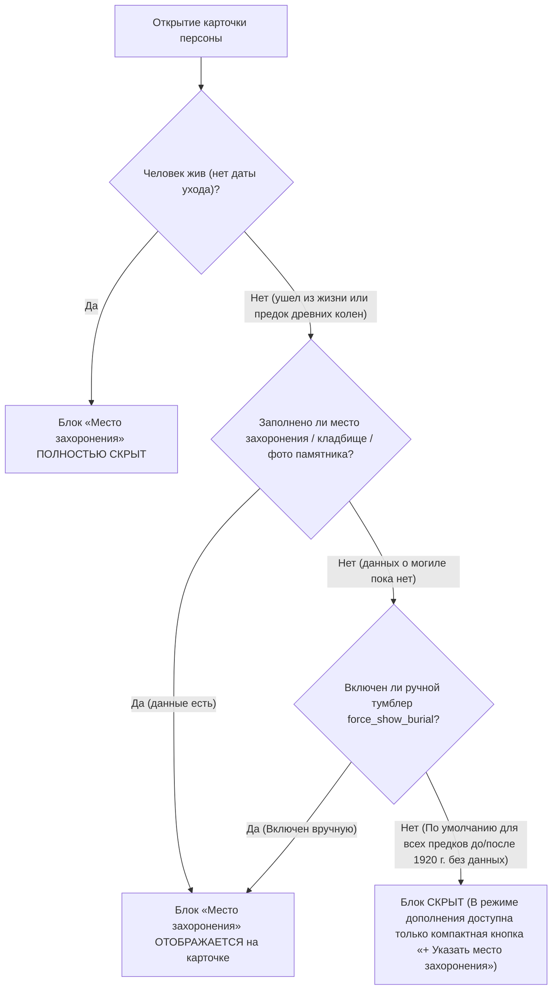
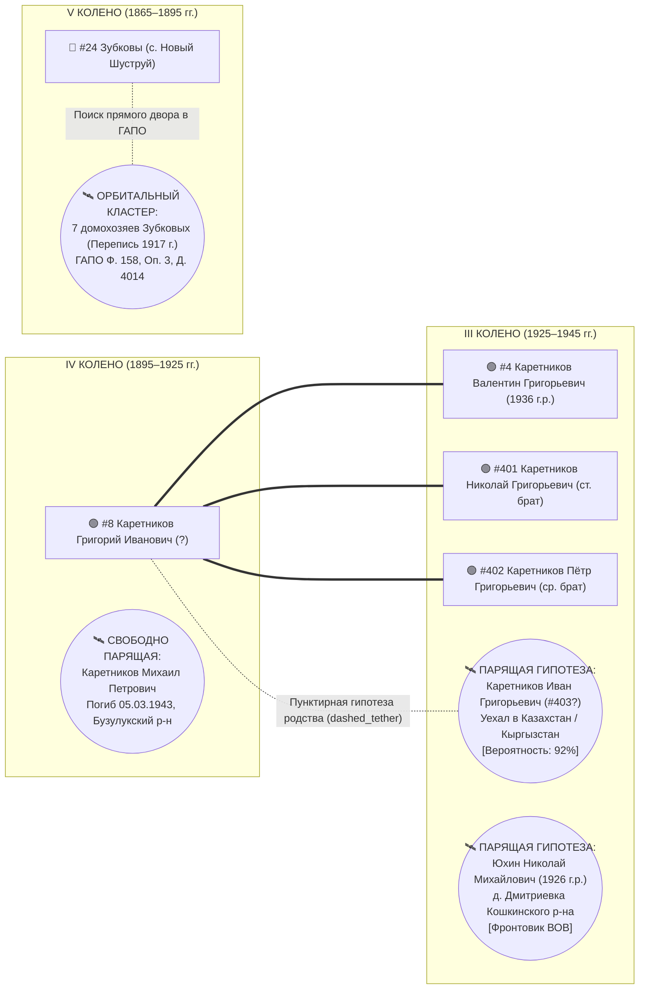
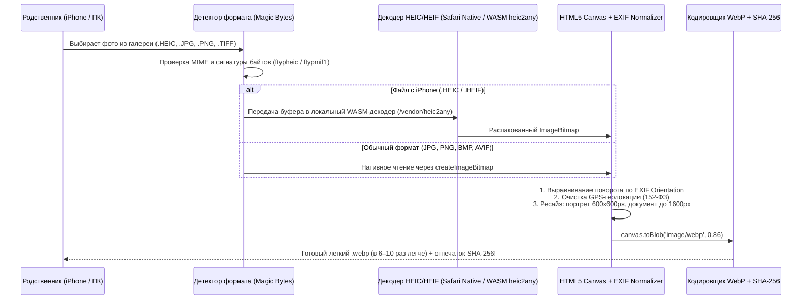
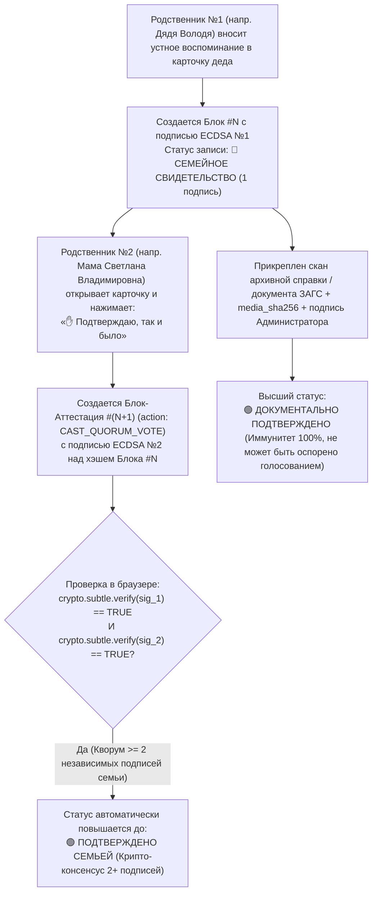

# 📜 АРХИТЕКТУРНАЯ СПЕЦИФИКАЦИЯ v2.0: КОЛЛАБОРАТИВНЫЙ РОДОВОЙ СВОД, ДОСЬЕ 12 РУБРИК, ПАРЯЩИЕ ГИПОТЕЗЫ И СУВЕРЕННЫЙ КРИПТОГРАФИЧЕСКИЙ РЕЕСТР (`FAMILY_COLLABORATION_AND_DOSSIER_SPEC.md`)

> **Проект:** `C:\Karetnikov_Lineage` (`https://karetnikov-family.fheiskznxgsjnskddn.workers.dev`)
> **Основатель и Хранитель архива:** Каретников Дмитрий Иванович (р. 14.09.1994, г. Самара)
> **Архитектор:** `crypto-ledger-architect` (HUB_01 / HUB_08)
> **Версия спецификации:** `2.0.0 (Sovereign Merkle Ledger & Family UX Edition)`
> **Дата обновления:** 03.11.2026

---

## 1. Этика интерфейса (Без внутренних титулов) и Двухуровневая модель ролей (`Admin` vs `Relative Append-Only`)

### 1.1. Правило нейтральной родовой этики на дашборде и в досье (`UI Title Hygiene`)
На самом сайте, в шапке дашборда, в карточках предков и в интерфейсе для родственников **категорически не используются внутренние обращения ИИ-экосистемы**.
1. **В шапке управления архивом (режим просмотра и редактирования):**
   - Для владельца отображается спокойная, уважительная плашка: **«Администратор и Хранитель архива (Дмитрий Иванович Каретников)»** или **«Режим полного управления архивом»**.
   - Для авторизованных родственников отображается плашка: **«Режим дополнения родственниками (Защищенная семейная запись)»** с именем вошедшего родственника (например: *«Участник семейного совета: Светлана Владимировна Каретникова»*).
2. **В карточках персон и родословных досье:**
   - Указываются исключительно:
     * **Степень родства и колено:** *«Пробанд (I колено)»*, *«Отец (II колено)»*, *«Мать (II колено)»*, *«Дедушка по отцу (III колено)»*, *«Старший брат деда (III колено)»*;
     * **Подлинные воинские звания, трудовые и выборные должности:** *«Гвардии сержант»*, *«Председатель колхоза»*, *«Бригадир тракторной бригады»*, *«Агроном»*, *«Депутат сельского Совета»*;
     * **Исторические сословия (до 1917 г.):** *«Государственный крестьянин»*, *«Однодворец»*, *«Служилый человек Ломовской засечной черты»*, *«Купец»*.

---

### 1.2. Два уровня криптографического доступа (`Owner Master` vs `Relative Append-Only`)

Чтобы родственники (мама Светлана Владимировна, дядя Владимир Владимирович Зубков, оренбургская ветвь Каретниковых в с. Плешаново и п. Подольск, самарская родня по линии Юхиных) могли свободно дополнять древо, не рискуя случайно стереть или повредить уже собранные данные, система разделяет доступ на **два криптографических контура** (без хардкода паролей в исходном коде — через `PBKDF2-HMAC-SHA256` и `AES-256-GCM`):

| Уровень доступа | Подпись в интерфейсе сайта | Пароль / Ключ входа | Права в системе | Защита от потери и перезаписи данных |
| :--- | :--- | :--- | :--- | :--- |
| **1. Администратор архива (`OWNER_ADMIN`)** | `Администратор архива (Полный доступ)` | Личный мастер-пароль владельца (Д. И. Каретникова) | • Полное редактирование любых узлов и полей ядра;<br>• Управление тумблером приватности **`🔒 Скрыть от родни (owner_only)`** на уровне целой карточки или отдельного поля;<br>• Ведение закрытых исследовательских заметок (`internal_research_notes`);<br>• Перевод парящих гипотез (`FLOATING_HYPOTHESIS`) в основное древо;<br>• Модерация и слияние новых семейных веток, добавленных родней;<br>• Экспорт мастер-копии (`.json` / `.ged`). | Полный контроль версий и корневая подпись (`Root Authority Signature`). |
| **2. Родственник-Соавтор (`RELATIVE_CONTRIBUTOR`)** | `Режим дополнения родственниками` | Семейный пароль **`RodKaretnikov-1917!`** + выбор/ввод своего ФИО (с автогенерацией личного криптоключа `ECDSA P-256`) | **Строгий режим `APPEND-ONLY` (Только дописывание без права удаления):**<br>• Просмотр открытого семейного контура (`visibility: "public_family"`);<br>• Запрет на удаление или перезапись уже существующих строк;<br>• Дописывание новых фактов, воспоминаний, дат, мест захоронения, загрузка фото с iPhone (`HEIC/JPG` ➔ авто-`WebP`) и сканов документов **строго со своей именной подписью**;<br>• Голосование кнопкой **«✋ Подтверждаю, так и было»** за устные воспоминания других родственников;<br>• Пошаговое создание и прикрепление своей семейной ветки через визуальный конструктор (без сложных файлов). | Ни один байт ранее внесенных данных не может быть стерт. Каждое дополнение родственника ложится неизменяемым криптографическим блоком (`LedgerBlock`) в цепочку памяти рода. |

---

## 2. Гранулярное управление приватностью: Режим `owner_only` («Только для владельца»)

В процессе архивных раскопок появляются рабочие гипотезы, математические прикидки дат, неподтвержденные архивные совпадения (например, по базе военнопленных, репрессированных или спорным ветвям) либо личные заметки, которые владельцу архива важно держать под рукой, но **преждевременно или неделикатно показывать родственникам**.

Для этого в архитектуру заложен **трехуровневый механизм скрытия `owner_only`**:

### 2.1. Три уровня изоляции данных (`Granular Visibility Architecture`)
1. **Скрытие целого узла / карточки (`node.visibility = "owner_only"`):**
   - Любая карточка в основном древе или любая парящая карточка-гипотеза (`FLOATING_HYPOTHESIS`) может быть помечена тумблером **`🔒 Только для меня (owner_only)`**.
   - В режиме родственника (`RELATIVE_CONTRIBUTOR`) такой узел и ведущие к нему линии полностью отсутствуют.
2. **Скрытие отдельной рубрики или поля внутри открытой карточки (`field.visibility = "owner_only"`):**
   - Сама карточка предка видна родственникам (например, дедушка Владимир Владимирович Зубков `#6` или прадед Григорий Иванович Каретников `#8`), но конкретное поле или рубрика внутри неё (например, черновая архивная наводка, номер дела для проверки или внутренний комментарий) закрыта флагом `"owner_only"`.
3. **Специальное закрытое поле `internal_research_notes` (Внутренняя аналитика и расчеты):**
   - Присутствует у каждого узла и **всегда по умолчанию имеет статус `visibility: "owner_only"`**.
   - Именно здесь хранятся все промежуточные вычисления возрастов, поисковые гипотезы и вопросы для ЗАГС/архивов.

### 2.2. Чистота публичных карточек (Правило деликатности для дат ухода предков)
Расчетные формулы, привязанные к возрасту живых родственников в момент тяжелых семейных событий, **никогда не выводятся на лицевую сторону карточки для родни**:

| Персона | Что отображается на карточке для всей семьи (`public_family`) | Что хранится строго во внутреннем поле исследователя (`internal_research_notes` — `owner_only`) |
| :--- | :--- | :--- |
| **Зубков Владимир Владимирович (ст., `#6`)**<br>*(Дедушка по матери, с. Новый Шуструй)* | Годы жизни: **`р. ~1938–1946 — ум. ~1981–1983 гг.`** | *«Диапазон ухода (~1981–1983 гг.) вычислен аналитически от даты рождения мамы (19.06.1969) исходя из ориентира, что на момент смерти отца ей было 12–14 лет. Запросить точную актовую запись о смерти в ЗАГС Нижнеломовского р-на Пензенской обл.»* |
| **Зубкова (Куманина) Валентина Сергеевна (`#7`)**<br>*(Бабушка по матери, с. Новый Шуструй)* | Годы жизни: **`р. ~1940–1947 — ум. ~1985–1986 гг.`** | *«Диапазон ухода (~1985–1986 гг.) вычислен аналитически от даты рождения мамы (19.06.1969) исходя из ориентира, что на момент смерти матери ей было 16 лет. Проверить по ЗАГС Нижнеломовского р-на.»* |

### 2.3. Криптографическая гарантия скрытия (`Dual-Envelope Encryption`)
Чтобы данные с пометкой `owner_only` были скрыты не только визуально (через CSS/JS), но и математически:
* При компиляции хранилища (`python scripts/crypto_vault.py --sync`) публичный семейный граф шифруется ключом семьи (`FAMILY_AES_KEY`), привязанным к паролю родственников (`RodKaretnikov-1917!`), **без включения полей `owner_only`**.
* Все узлы, поля и заметки `owner_only` упаковываются в отдельный зашифрованный слой `owner_private_overlay.enc`, ключ к которому (`OWNER_AES_KEY`) выводится через `PBKDF2-HMAC-SHA256` **исключительно из личного мастер-пароля Владельца**. Даже если открыть код страницы или память браузера в режиме родственника, расшифровать `owner_only` без мастер-пароля Владельца математически невозможно.

---

## 3. Умное правило 1920 года для блока «Место захоронения» (`Smart Burial Visibility Rule`)

В классических генеалогических таблицах пустая графа «Место захоронения: Неизвестно» у десятков предков XVIII–XX веков или у живых людей создает визуальный шум и тяжелое впечатление. Поэтому в системе действует **автоматическое правило скрытия блока захоронения (с рубежом 1920 года)**:



1. **По умолчанию блок «Место захоронения» ВЫКЛЮЧЕН (скрыт):**
   - Для всех ныне живущих представителей рода;
   - Для всех предков (как родившихся/ушедших **до 1920 года**, когда сельские погосты не сохраняли пофамильной привязки, так и **после 1920 года**), если у них еще не указана дата смерти или нет конкретных сведений о кладбище/могиле.
2. **Когда блок включается:**
   - **Автоматически:** как только в карточке появляется хотя бы одно заполненное поле захоронения (название кладбища, село/город упокоения, участок, ориентир или фотография памятника);
   - **Вручную по кнопке:** в режиме редактирования или дополнения родственником внизу блока дат жизни расположена аккуратная кнопка **`➕ Указать место захоронения (кладбище / могилу)`**. При нажатии на неё открываются поля ввода, и после сохранения блок становится видимым.

---

## 4. Стандарт глубокого досье предка: 12 рубрик (Мультитрадиционное мировоззрение, звания, колхозный труд и две деревни Каретниковых)

Анкета каждого предка спроектирована на **ясном, живом и уважительном русском языке**, понятном и старшему поколению (маме, дяде Володе, оренбургской родне), и профессиональному историку-архивисту.

### 📋 Рубрика 1. Имена, отчества, девичьи фамилии и как звали в родном селе
* Полное ФИО, девичья фамилия (для женщин), варианты записи фамилии в старых документах (например, *Юхин / Юшин* в Кошкинском р-не).
* Имя при наречении / крещении и домашнее или уличное прозвище семьи в селе («как кликали по-уличному» — важнейший ключ для распознавания своей ветви среди однофамильцев в одном селе).

### 🌌 Рубрика 2. Мировоззрение, духовный путь и традиция рода *(Равноправный мультитрадиционный спектр)*
Ни один религиозный или идеологический эгрегор не ставится выше других. Для каждого человека в роду можно выбрать (или сочетать) его подлинное мировоззрение и жизненную философию:

| Код традиции | Название в досье | Смысловое и историческое раскрытие |
| :--- | :--- | :--- |
| **`FREE_PHILOSOPHICAL_COSMISM`** | **🌌 Свободное философское мировоззрение / Вне религиозных эгрегоров** | Осознанный внеконфессиональный путь свободного человека, исследователя и созидателя. Традиция русского философского космизма и деятельной этики (**линия В. П. Серкина — К. Э. Циолковского**), опора на личную совесть, разум, научный поиск и прямую связь с Природой и Мирозданием без подчинения религиозным догмам и клерикальным институтам. |
| **`ANCESTRAL_FOLK_NATURE`** | **🌾 Природная и родовая традиция (Народный уклад)** | Глубинная связь с родной землей, почитание памяти предков, народный земледельческий календарь, травничество, знахарство, жизнь в ладу с лесом, степью и рекой. |
| **`OLD_BELIEVERS`** | **☦️ Старообрядчество (Древлеправославие)** | Древнее русское благочестие до церковной реформы XVII века (поморское, беглопоповское, белокриницкое и др. согласия) — важнейший пласт для крестьян и купцов Самарского Заволжья, Бузулукского уезда, Оренбуржья и Пензенского края, хранивших старую веру, книги и общинность. |
| **`ORTHODOX_TRADITION`** | **⛪ Православие** | Православная традиция. *(Примечание: до 1918 года приход православной церкви указывается также в техническом поле «Приход метрического учета», так как церкви выполняли функцию ЗАГСа).* |
| **`SOVIET_SECULAR_ETHIC`** | **🚩 Советское светское и созидательное мировоззрение** | Светское материалистическое мировоззрение советской эпохи: вера в честный труд, образование, науку, справедливость и товарищество (беспартийные труженики, комсомольцы, коммунисты-фронтовики и строители страны). |
| **`PROTESTANT_MENNONITE_ISLAM_OTHER`** | **🕊️ Иные конфессии и духовные традиции края** | Протестантизм / Меннонитство (исторический контекст основания с. Плешаново и с. Подольск — колония Ново-Самарское), Ислам и другие традиции многонационального Поволжья, Приуралья и Казахстана/Кыргызстана. |

### 📅 Рубрика 3. Вехи жизни (Рождение, Свадьба, Уход)
* Точные даты или аккуратные оценочные годы (`~1981–1983 гг.`, `~1985–1986 гг.`) без выноса внутренних математических подсчетов на публичную витрину.
* Автоматическая связка с «Правилом 1920 года» для блока захоронения (Рубрика 4 появляется только при наличии данных или по нажатию `➕ Указать место захоронения`).

### 🏡 Рубрика 4. Родное гнездо, переселения и «Две оренбургские деревни Каретниковых»
* Где родился (губерния/область, уезд/район, волость/сельсовет, село/деревня), где стоял родительский дом, маршруты переездов (например: переезд деда Валентина Григорьевича `#4` и брата Петра Григорьевича `#402` из Плешаново/Подольска в Куйбышев в 1961 г.; отъезд Ивана Григорьевича Каретникова `#403` в Казахстан / Кыргызстан).
* **Специальный историко-краеведческий контур: «Две деревни Каретниковых в Оренбуржье»:**
  1. **Подтвержденный парный куст расселения семьи в Красногвардейском (бывш. Ивановском / Люксембургском) районе:** неразрывная связка двух соседних поселений — **с. Плешаново** и **с. Подольск (вместе с коренным русским селом Ивановка Подольского сельсовета)**, где жили прадед Григорий Иванович и братья Каретниковы, и где поныне живут и трудятся потомки старшего брата деда (Николая Григорьевича Каретникова `#401`).
  2. **Семейное предание о двух деревнях / хуторах Каретниковых в Оренбургской степи (`[🔵 УСТНОЕ ПРЕДАНИЕ / АРХИВНЫЙ ПОИСК]`):** отдельный слот для сбора свидетельств родни и архивной верификации по фондам Бузулукского и Оренбургского уездов (`ОГАОО Ф. 98, Ф. Р-1500`, списки хуторов, товариществ и колхозных бригад 1900–1930-х гг.), где небольшие переселенческие деревни, хутора или выселки в народе и документах назывались по фамилии первопоселенцев и основателей — **Каретниковых**.

### 🌾 Рубрика 5. Дело жизни, руководство колхозами, государственный труд и выборные должности
Расширенный классификатор трудового, управленческого и общественного статуса предка (позволяет в 1 клик выбрать значки-бейджи для карточки или вписать свою должность):
1. **Руководители и ключевые специалисты колхозов, совхозов и кооперативов:**
   - `Председатель колхоза` / `Директор совхоза` / `Руководитель СПК или КФХ`;
   - `Главный агроном` / `Главный инженер-механик` / `Главный зоотехник` / `Главный бухгалтер (счетовод) колхоза`;
   - `Бригадир тракторной / полеводческой бригады` / `Заведующий МТФ (фермой), зернотоком или МТС`;
   - *(В современной ветви Плешаново/Подольска уже документально подтверждены: соучредитель **СПК «Подольское»** Николай Викторович Каретников и директор **МБУ КИС «Вымпел»** Василий Николаевич Каретников).*
2. **Выборные государственные, советские и земские должности:**
   - `Депутат сельского / районного / областного Совета`;
   - `Председатель или секретарь сельсовета (волисполкома — ВИК)`;
   - `Сельский староста` / `Волостной старшина` / `Выборный сходчик от крестьянского общества` (до 1917 г.).
3. **Мастера земли, промышленности и просвещения:**
   - `Механизатор широкого профиля / Тракторист-комбайнер первой волны МТС` / `Покоритель Целины`;
   - `Мастер / Инженер / Квалифицированный рабочий завода (г. Куйбышев / Самара)`;
   - `Учитель / Врач / Фельдшер / Работник культуры`;
   - `Государственный крестьянин-хлебопашец` / `Однодворец` / `Купец и промышленник`.

### 🎖️ Рубрика 6. Военный путь, воинские звания и служба Отечеству
* **Структурированный реестр воинских званий и чинов (выводится почетным шевроном на карточку):**
  - *Рядовой и младший командный состав:* Рядовой (красноармеец), Ефрейтор, Младший сержант, Сержант, **Гвардии сержант**, Старший сержант, Старшина, Прапорщик;
  - *Офицерский состав:* Младший лейтенант, Лейтенант, Старший лейтенант, Капитан, Майор, Подполковник, Полковник;
  - *Дореволюционные и служилые чины (XVII — нач. XX в.):* Рядовой/ратник ополчения ПМВ, Бомбардир, Унтер-офицер, Фельдфебель, Казак / Урядник, Служилый человек (рейтар, копейщик, стрелец, пушкарь Ломовской и Симбирской засечных черт XVII в.).
* Каким военкоматом (РВК) или воинским присутствием призван, полк/дивизия, боевой путь, ранения и госпитали, ордена и медали, трудовой фронт в тылу.

### 🛠️ Рубрика 7. Чем славился и что умел делать своими руками *(Народное мастерство)*
* Особые умения, за которые человека знали и уважали в селе или городе: *«сам срубил дом без единого гвоздя»*, *«чинил любой двигатель на слух»*, *«лучший гармонист и песельник»*, *«держал образцовую пасеку»*, *«ткала, шила и поднимала всю семью»*.

### ❤️ Рубрика 8. Характер, привычки, любимые приговорки и отдушина
* Живой человеческий портрет: каким был по нраву, какие коронные фразы и пословицы говорил, что любил делать в свободный час.

### 💍 Рубрика 9. История создания семьи, супружество и дети
* Как познакомились муж и жена (из одного села или сосватали из соседней деревни — например, связки `Каретниковы ↔ Логиновы ↔ Романовы` в Подольском с/с или `Зубковы ↔ Куманины` в Новом Шуструе), когда создали семью, полный список всех детей (включая тех, кто разъехался по СССР).

### ⚡ Рубрика 10. Испытания века и поворотные события судьбы
* Через какие исторические бури прошла семья: Первая мировая и Гражданская война, засуха и голод в Поволжье 1921–1922 и 1932–1933 гг., коллективизация, Великая Отечественная война, послевоенный подъем, переезды 1950–1960-х годов в Куйбышев и на Целину.

### 🏺 Рубрика 11. Семейные реликвии, фотографии (`HEIC/Any -> WebP`) и подлинные документы
* Какие памятные вещи предка хранятся у родственников и у кого именно; галерея портретов (с автоматическим декодированием `iPhone HEIC/HEIF` в `WebP`) и сканов первоисточников.

### 🌐 Рубрика 12. Кольцо первоисточников и архивных шифров (`Citation & OSINT Ring`)
* Прямые верифицируемые ссылки на карточки ЦАМО (`pamyat-naroda.ru`, `obd-memorial.ru`), РГВИА (`gwar.mil.ru`), шифры архивных фондов (`ГАПО Ф. 158 Оп. 3 Д. 4014`, `ГАПО Ф. 182 Оп. 3 Кн. 561`, `АИС ЦГАСО Ф. 32 и Ф. 150`, `ОГАОО Ф. 389 и Ф. Р-1500`, `РГАДА Ф. 210`), записи похозяйственных книг и выписки ЕГРЮЛ/ЗАГС.

---

## 5. Механика «Парящих в воздухе орбитальных гипотез (`FLOATING_HYPOTHESIS`)» рядом с коленами рода

В ходе раскопок по архивам ЦАМО, РГВИА, ГАПО, ЦГАСО и ОГАОО обнаруживаются реальные исторические носители наших четырех фамилий (**Каретниковы, Юхины, Зубковы, Куманины**) строго из наших родовых сел (**с. Новый Шуструй**, **с. Плешаново / п. Подольск / с. Ивановка**, **д. Дмитриевка / с. Четыровка / с. Кошки**). До получения финальной архивной выписки о рождении мы еще не знаем наверняка, кем именно приходится этот человек прямому предку (родным братом, дядей, двоюродным дедом или и есть сам прямой предок).

Прятать такие золотые находки в текстовые таблицы нельзя — родственники их там не увидят и не смогут узнать знакомое имя («Ой, так это же дедушкин старший брат Иван!»). Но и жестко привязывать их сплошной линией к отцу без документа запрещает закон `ZERO_HALLUCINATION_LAW`.

**Архитектурное решение:** На интерактивном полотне древа вводится слой **«Парящих орбитальных гипотез (`FLOATING_HYPOTHESIS`)»**!



### 5.1. Законы позиционирования и визуализации парящих карточек
1. **Привязка по году рождения / эпохе событий к нужной колонке колена (`Generation & Era Magnet`):**
   - Каждое из 7 колен на холсте имеет свою вертикальную/горизонтальную хронологическую полосу:
     * `II колено (1955–1985 гг.)` — напр., живые сыновья и внуки Николая Григорьевича Каретникова в с. Плешаново и п. Подольск (*Виктор Николаевич, Василий Николаевич, Николай Викторович Каретниковы*);
     * `III колено (1925–1950 гг.)` — напр., *Каретников Иван Григорьевич (`#403?`, Казахстан/Кыргызстан)* и *Юхин Николай Михайлович (1926 г.р., д. Дмитриевка Кошкинского р-на)*;
     * `IV колено (1895–1925 гг.)` — напр., фронтовики ВОВ из Бузулукского/Оренбургского куста (*Каретников Михаил Петрович*, *Каретников Александр Федорович 1913 г.р.*), родственные кланы *Логиновых* и *Романовых*;
     * `V колено (1865–1895 гг.)` — напр., *7 домохозяев Зубковых в с. Новый Шуструй по Переписи 1917 г. (`ГАПО Ф. 158 Оп. 3 Д. 4014`)* и *Куманин Егор Петров (`ГАПО Ф. 182 Оп. 3 Кн. 561`)*.
   - Система автоматически считывает `birth_year` или `event_year` архивной находки и размещает парящую карточку **в воздушном кармане («орбите») строго рядом с соответствующим коленом и цветовым сектором своей фамилии**!
2. **Два визуальных режима парения (`link_mode`):**
   - **Режим А: `dashed_tether` (На пунктирной связке-гипотезе):** Если с высокой вероятностью известен конкретный узел привязки (например, `Каретников Иван Григорьевич` к прадеду `#8 Григорию Ивановичу Каретникову`, или `Виктор и Василий Николаевичи Каретниковы` в с. Плешаново к старшему брату деда `#401 Николаю Григорьевичу`), от основного узла к парящей карточке тянется **полупрозрачная золотисто-янтарная пунктирная линия (`stroke-dasharray: 6, 6`)** с плашкой вероятности (`92% • Брат деда?`).
   - **Режим Б: `free_floating` (Свободно парящая в воздухе у колена):** Если человек точно из нашего села/уезда и нужной эпохи, но конкретный родитель еще не установлен, карточка **свободно парит в воздухе рядом с коленом** без соединительной линии, с плавной невесомой микро-анимацией (`@keyframes orbitalFloat { 0%, 100% { transform: translateY(0px); } 50% { transform: translateY(-5px); } }`) и пунктирной золотой рамкой.
3. **Кнопка мгновенного закрепления в древо (`🔗 Подтвердить и встроить в древо`):**
   - Как только родственник узнаёт человека (*«Да, дядя Ваня Григорьевич — это родной брат нашего деда Валентина!»*) или приходит справка из архива, достаточно нажать кнопку на парящей карточке — пунктир превращается в литую родовую ветвь, а карточка занимает штатное место в графе!
   - Для удобства чтения на верхней панели дашборда есть переключатель: **`🛰️ Парящие архивные гипотезы (Показать / Скрыть)`**, а у каждой парящей карточки работает индивидуальный замочек `owner_only`.

---

## 6. Конвейер фотографий (`iPhone HEIC / HEIF + Any Format -> WebP`) и Визуальный конструктор семейных веток (Без `.ged/.json`)

### 6.1. Бесшовная конвертация фотографий с iPhone (`HEIC / HEIF`) и любых форматов в `WebP`
90% современных семейных фотографий и переснятых на телефон старых альбомов присылаются родственниками с iPhone в формате Apple **`HEIC / HEIF` (`.heic`, `.heif`)**, а также в тяжелых `JPG`, `PNG`, `TIFF`, `BMP`, `AVIF`. Обычный браузерный `<canvas>` на Windows/Android не умеет открывать `.heic` напрямую.

Поэтому в клиентское ядро сайта встроен **четырехступенчатый конвейер обработки изображений (`Zero-Server Client Media Pipeline`)**:



1. **Поддержка всех форматов «из коробки»:** `HEIC`, `HEIF` (любые модели iPhone и iPad), `JPEG/JPG`, `PNG`, `WebP`, `AVIF`, `BMP`, `GIF`, `TIFF`.
2. **Локальный оффлайн-декодер `HEIC`:** Библиотека декодирования `HEIC` размещается локально в статике самого сайта (`/vendor/heic2any.min.js`) — фотографии родственников **никуда не отправляются на сторонние серверы конвертации**, всё пережимается в `WebP` прямо внутри телефона или ноутбука родственника за 0.8 секунды!
3. **Защита четкости архивных сканов:** Для портретов применяется мягкое кадрирование до `600×600 px` (`WebP quality: 0.86`, вес `~35–60 КБ`), а для сканов метрических книг, справок ЗАГС и групповых семейных фото сохраняется высокое разрешение до `1600 px` по длинной стороне (`WebP quality: 0.88`, вес `~140–220 КБ`), чтобы читалась каждая буква писарского почерка.

---

### 6.2. Полный отказ от `.ged/.json` для родственников: Визуальный мастер «🌿 Создать и прикрепить свою семейную ветку»

Родственники **не должны видеть никаких технических аббревиатур вроде `.ged`, `GEDCOM` или `.json`** (экспорт и импорт `.ged/.json` остается исключительно в закрытом меню Администратора архива).

Для родственников (`RELATIVE_CONTRIBUTOR`) на сайте работает **пошаговый визуальный конструктор «🌿 Присоединить свою семейную ветку в Большой Род»**:

* **Шаг 1 (Точка родства в 1 клик):** Родственник открывает на древе карточку близкого ему человека (например, старшего брата деда — **Николая Григорьевича Каретникова `#401`** в с. Плешаново, или среднего брата **Петра Григорьевича `#402`**, или дяди **Владимира Владимировича Зубкова `#301`**) и нажимает крупную ясную кнопку:
  **`🌿 Добавить сюда детей, супругу(а) или свою семейную ветку`**.
* **Шаг 2 (Выбор простой человеческой связи):** На экране появляются 5 понятных карточек-кнопок:
  - `👶 Добавить сына или дочь`
  - `💍 Добавить мужа или жену`
  - `🤝 Добавить родного брата или сестру`
  - `🌳 Добавить отца или мать`
  - `👨‍👩‍👧‍👦 Собрать сразу всю свою семью (детей и внуков) на визуальной схеме`
* **Шаг 3 (Визуальный мини-холст своей ветки):**
  - Прямо во всплывающем окне родственник заполняет простые поля (Фамилия, Имя, Отчество, Девичья фамилия, Год и село рождения, Кем трудился / Звание, Фотография с телефона) и нажимает **`➕ И сразу добавить его жену / детей`**.
  - На экране в реальном времени рисуется аккуратная схема новой семейной веточки (например, сыновья, невестки и внуки оренбургской или самарской ветви).
* **Шаг 4 (Именная криптографическая подпись и прикрепление):**
  - Родственник нажимает кнопку **`✍️ Подписать своим именем и прикрепить к родовому древу`**.
  - Новая ветка мгновенно появляется на общем древе с бейджем *«Добавлено родственником: [ФИО автора]»* и криптографической подписью, не затрагивая и не стирая ни одного существующего узла!

---

## 7. Архитектурный вердикт и чертеж: «Внешний дешевый блокчейн vs Суверенный криптографический реестр рода (`Sovereign Family Merkle Ledger`)»

### 7.1. Честный инженерный разбор (Правда-матка с цифрами): Почему внешний публичный блокчейн НЕ нужен, а наш собственный крипто-реестр внутри сайта — в 10 раз надежнее и удобнее

Рассмотрим оба варианта без маркетинговых иллюзий:

| Критерий сравнения | Вариант А: Внешний дешевый L2-блокчейн (`Polygon / Base / Arbitrum / TON / Solana`) | Вариант Б (УТВЕРЖДЕННЫЙ КАНОН): Собственный Суверенный Крипто-Реестр Рода внутри сайта (`SHA-256 Merkle Hash-Chain + WebCrypto ECDSA P-256`) |
| :--- | :--- | :--- |
| **1. Удобство для мамы, дяди и старшей родни (UX)** | 🔴 **Фатальный барьер:** Требует от родственника установить криптокошелек (`MetaMask`/`Tonkeeper`), записать 12 слов seed-фразы и иметь токены на газ (`Gas Fee`). Если же газ и подпись берет на себя наш сервер-посредник (`Relayer`), то родственник вообще ничего не подписывает сам, и весь смысл внешнего блокчейна обнуляется! | 🟢 **Идеально (0 трения):** Родственник просто заходит по паролю семьи и вводит свое имя. Браузер сам за `0.01 сек` через встроенный `Web Crypto API` создает его личную криптографическую пару ключей (`ECDSA P-256`) и подписывает каждую его запись и голос. Никаких кошельков, токенов и комиссий! |
| **2. Приватность семьи и защита ПДн (152-ФЗ)** | 🔴 **Риск утечки метаданных:** Публичный блокчейн открыт всему миру навсегда. Даже если писать туда только хэши, публичный адрес контракта, частота записей и граф кошельков семьи видны ботам-аналитикам. | 🟢 **Абсолютный суверенитет:** Весь реестр (`family_ledger.json`) хранится внутри нашего `AES-256-GCM` сейфа (`Zero-Knowledge Vault`). Снаружи для чужих глаз — 0 байт открытых данных. |
| **3. Математическая неизменяемость (`Immutability`)** | 🟢 Обеспечивается консенсусом внешних майнеров/валидаторов за плату. | 🟢 **Та же самая криптографическая математика (`SHA-256 + ECDSA P-256`, стандарт ФСБ/NIST и Git):** каждый новый блок намертво сцеплен с хэшем предыдущего блока (`prev_block_hash`) и скреплен ЭЦП родственника. Изменить хотя бы одну запятую в прошлом без поломки всей цепи и подделки закрытого ключа математически невозможно! |
| **4. Живучесть на горизонте 50–100 лет** | 🟠 **Зависимость от третьих лиц:** Внешние блокчейны меняют RPC-ноды, закрывают тестовые сети, требуют оплаты хостинга смарт-контрактов. | 🟢 **Вечная автономность:** Реестр работает даже полностью без интернета с обычной флешки или архивного диска в 2076 году — любой браузер проверит всю цепочку `SHA-256` и подписи `ECDSA` за 15 миллисекунд! |
| **5. Стоимость владения** | Покупка токенов на газ + поддержка смарт-контракта и RPC-шлюза. | **`0 ₽ навсегда`** (работает на нативном `window.crypto.subtle` браузера + Cloudflare Workers/KV + Git). |

> **💡 Архитектурный вердикт (`crypto-ledger-architect`):**
> Подключать внешний коммерческий блокчейн для семейного древа — это классический оверинжиниринг, который либо отпугнет родственников криптокошельками, либо превратится в фикцию (если подписывать за них на сервере).
> Вместо этого **наш сайт сам выступает суверенным криптографическим блокчейном Рода Каретниковых (`Sovereign Family Append-Only Merkle Ledger`)**, используя ровно ту же математику криптографических хэш-цепей (`SHA-256 Merkle DAG`) и асимметричных электронных подписей (`ECDSA P-256`), на которой работают Bitcoin и Git!
> *(А для 100%-ной внешней нотариальной фиксации времени корневой отпечаток `merkle_root_hash` всего родового древа автоматически коммитится в защищенную историю `Git` при каждой синхронизации).*

---

### 7.2. Полный инженерный чертеж Суверенного Крипто-Реестра Рода (`Merkle Hash-Chain + WebCrypto Signatures + Family Quorum`)

#### А. Именные криптографические ключи родственников (`Family Keyring — Zero-Wallet PKI`)
1. **Выдача ключа при первом входе родственника:**
   - Когда родственник входит в режим дополнения (`RodKaretnikov-1917!`) и указывает свое имя (или открывает именную ссылку от Владельца, например: `?member=zubkov_vv_jr` для дяди Володи или `?member=karetnikova_sv` для мамы), браузер вызывает нативный криптомодуль:
     ```typescript
     const keyPair = await window.crypto.subtle.generateKey(
       { name: "ECDSA", namedCurve: "P-256" },
       true,
       ["sign", "verify"]
     );
     ```
   - **Закрытый ключ (`privateKey`)** остается строго на устройстве родственника (в `IndexedDB` + зашифрованная резервная копия `AES-256-GCM`), а **Открытый ключ (`publicKeyJwk`)** и его отпечаток (`key_fingerprint_sha256`, например `KEY-8F3A-C912`) вносятся в **Семейную связку ключей (`family_keyring[]`)**.
   - Владелец архива (`OWNER_ADMIN`) один раз нажимает кнопку **`✅ Заверить ключ родственника`** — и с этого момента у родственника появляется официальное **Криптографическое Право Голоса и Подписи в Роду**!

#### Б. Структура неизменяемого блока записи (`LedgerBlock Schema`)
Каждое действие на сайте (добавление воспоминания, загрузка фото `WebP`, прикрепление ветки или голосование «Подтверждаю») никогда не затирает старый JSON, а дописывает в конец цепи новый подписанный блок:

```typescript
export interface FamilyLedgerBlock {
  block_index: number;                 // Порядковый номер блока в цепи (0 — Генезис-блок Владельца, 1, 2, 3...)
  prev_block_hash: string;             // SHA-256 хэш предыдущего блока (гарантия неразрывности цепи!)
  timestamp_iso: string;               // Точное время UTC ("2026-11-03T02:15:00.000Z")
  author: {
    member_id: string;                 // напр. "REL_ZUBKOV_VV_301" или "OWNER_KARETNIKOV_DI_001"
    display_name: string;              // напр. "Зубков Владимир Владимирович"
    kinship_label: string;             // напр. "Дядя по матери (II колено)"
    public_key_fingerprint: string;    // напр. "SHA256:9f86d081..."
    public_key_jwk: JsonWebKey;        // Открытый ключ ECDSA P-256 для независимой проверки подписи
  };
  action_type:
    | "GENESIS_SNAPSHOT"               // Нулевой блок-основание от Владельца
    | "APPEND_DOSSIER_FACT"            // Дополнение рубрики досье предка
    | "UPLOAD_MEDIA_WEBP"              // Загрузка фото (HEIC->WebP) или скана документа
    | "ATTACH_FAMILY_BRANCH"           // Присоединение новой семейной ветки через визуальный мастер
    | "PROMOTE_FLOATING_HYPOTHESIS"    // Закрепление парящей гипотезы в основное древо
    | "CAST_QUORUM_VOTE";              // Голос родственника «Подтверждаю, так и было»
  target_node_id: string;              // К какому предку относится запись (напр. "P006" или "P004")
  visibility: "public_family" | "owner_only"; // Гранулярная видимость записи
  payload: {
    rubric_id?: string;                // Номер/код рубрики из 12 (напр. "rubric_05_life_work")
    field_key?: string;                // напр. "military_rank" | "kolkhoz_role" | "worldview"
    added_value: unknown;              // Добавленный текст, дата или структура новой ветки
    media_attachment?: {
      file_name: string;
      mime_type: "image/webp" | "application/pdf";
      media_sha256: string;            // SHA-256 отпечаток самого файла WebP (защита от подмены фото!)
      dimensions: { width: number; height: number };
    };
    ref_block_hash?: string;           // При голосовании (CAST_QUORUM_VOTE) — хэш блока, за который голосует родственник
  };
  block_hash: string;                  // SHA-256(block_index + prev_block_hash + timestamp_iso + canonicalJSON(payload))
  ecdsa_signature_hex: string;         // Криптографическая подпись ECDSA P-256 над block_hash
}
```

#### В. Протокол семейного голосования и консенсуса (`Multi-Signature Family Quorum`)
Как работает криптографическое право голоса родственников:



1. **Защита от накрутки голосов:** Один и тот же ключ (`public_key_fingerprint`) не может проголосовать за одну запись дважды — для достижения статуса `🟢 ПОДТВЕРЖДЕНО СЕМЬЕЙ` требуются криптографические подписи **минимум двух разных членов рода** (`Quorum >= 2`).
2. **Приоритет документа над памятью (`Document Supremacy Rule`):** Если к факту прикреплен скан подлинного документа (свидетельство ЗАГС, выписка из метрической книги ГАПО/ЦГАСО/ОГАОО, наградной лист ЦАМО) с проверенным `media_sha256` и подписью Администратора архива, факт получает статус **`🟢 ДОКУМЕНТАЛЬНО ПОДТВЕРЖДЕНО (Иммунитет 100%)`** и не требует голосования.
3. **Индикатор целостности в шапке сайта (`Ledger Integrity Badge`):**
   - В верхнем углу дашборда горит живой криптографический статус:
     **`🛡️ Реестр рода верифицирован (SHA-256 + ECDSA) • Блоков памяти: [N] • Нарушений цепи: 0`**.
   - Любой родственник может нажать на этот щит и увидеть открытый журнал: кто, когда и какой вклад внес в общую летопись семьи, с математической проверкой каждой подписи прямо в браузере!

---

## 8. Эталонная схема узла предка v2.0 (`AncestorNodeSchema v2.0` с поддержкой всех 10 директив)

```typescript
export interface AncestorNodeV2 {
  id: string;                                      // "P001" .. "P127", боковые "#301", "#401", парящие "FH_001"
  ahnentafel: number | null;                       // Номер по Соса-Страдоница (1..127) или null для боковых/парящих
  node_type:
    | "CANONICAL_DIRECT"                           // Прямой предок в сетке 7 колен
    | "COLLATERAL_RELATIVE"                        // Подтвержденный брат/сестра/дядя/кузен
    | "FLOATING_HYPOTHESIS";                       // 🛰️ Парящая в воздухе орбитальная гипотеза у колена!

  // 1. Гранулярная видимость (Директива №2)
  visibility: "public_family" | "owner_only";      // Позволяет скрыть весь узел от родственников в 1 клик

  // 2. Координаты для парящих гипотез (Директива №7)
  orbital_hypothesis_meta?: {
    target_generation: 1 | 2 | 3 | 4 | 5 | 6 | 7;  // Возле какого колена парит карточка
    anchor_year: number;                           // Год рождения/события для точного позиционирования по оси времени
    link_mode: "dashed_tether" | "free_floating";  // Пунктирная линия к вероятному родственнику или свободное парение
    probable_relative_node_id?: string;            // К какому узлу тянуть пунктир (напр. "P008")
    hypothesis_relation_label?: string;            // напр. "Вероятный 4-й брат деда (92%)"
    confidence_percent: number;
  };

  // 3. Базовая идентификация и нейтральная этика без внутренних титулов (Директива №1)
  generation: number;
  kinship_role_label: string;                      // Только степень родства: "Дедушка по матери (III колено)"
  full_name: string;
  surname: string;
  maiden_name: string | null;
  baptismal_or_given_name?: string;                // Имя при наречении / крещении
  village_street_nickname?: string;                // Уличное / родовое прозвище семьи в селе

  // 4. Чистые публичные даты vs Закрытая аналитика (Директива №4)
  birth_date_display: string;                      // Чистое отображение: "1936" или "~1938–1946"
  death_date_display: string | null;               // Чистое отображение: "~1981–1983 гг." или "~1985–1986 гг."
  is_alive: boolean;
  internal_research_notes?: {                      // СТРОГО owner_only! Сюда пишутся расчеты возраста мамы (12-14 / 16 лет)
    visibility: "owner_only";
    calculation_math_and_sources: string;
  };

  // 5. Правило 1920 года для места захоронения (Директива №5)
  burial_info: {
    is_visible_on_card: boolean;                   // false по умолчанию, если нет данных о могиле или год < 1920 без данных
    force_show_toggle: boolean;                    // Ручной тумблер «+ Указать место захоронения»
    cemetery_and_settlement: string | null;
    grave_sector_and_landmarks: string | null;
    buried_nearby_relatives: string | null;
    headstone_photo_webp_url: string | null;
  };

  // 6. Мультитрадиционное мировоззрение без доминирования одного эгрегора (Директива №3)
  worldview_and_tradition: {
    primary_tradition:
      | "FREE_PHILOSOPHICAL_COSMISM"               // 🌌 Свободное философское / Вне эгрегоров (Серкин — Циолковский)
      | "ANCESTRAL_FOLK_NATURE"                    // 🌾 Природная / родовая традиция
      | "OLD_BELIEVERS"                            // ☦️ Старообрядчество (Древлеправославие)
      | "ORTHODOX_TRADITION"                       // ⛪ Православие
      | "SOVIET_SECULAR_ETHIC"                     // 🚩 Советское светское мировоззрение
      | "PROTESTANT_MENNONITE_ISLAM_OTHER"         // 🕊️ Иные конфессии края
      | "UNSPECIFIED";
    custom_description?: string;
    historical_metric_parish_index?: string;       // Архивный индекс прихода до 1918 г. (отдельно от личного мировоззрения)
  };

  // 7. Расширенная рубрика: Дело жизни, звания, колхозное руководство, депутаты и 2 деревни Каретниковых (Директива №6)
  life_work_and_stature: {
    military_rank?: string;                        // Воинское звание / чин (Рядовой, Гвардии сержант, Лейтенант, Рейтар...)
    agricultural_and_kolkhoz_leadership?: string;  // Председатель колхоза, Директор совхоза/СПК, Бригадир, Главный агроном...
    elected_and_state_service?: string;            // Депутат Совета, Председатель сельсовета, Волостной старшина, Староста...
    profession_and_craft_summary?: string;
    orenburg_two_villages_chronicle?: {            // Спецмодуль для ветви Каретниковых
      confirmed_settlement_pair: string;           // "с. Плешаново и с. Подольск (с. Ивановка Подольского с/с)"
      ancestral_villages_oral_lore: string;        // Предание о двух деревнях/хуторах Каретниковых в Оренбуржье (ОГАОО поиск)
    };
  };

  // 8. Криптографический журнал дополнений и голосов родни (Директивы №8, №9, №10)
  verification_tier: "CONFIRMED_DOC" | "FAMILY_QUORUM_2PLUS" | "FAMILY_ORAL_1" | "ARCHIVE_HYPOTHESIS";
  ledger_block_hashes: string[];                   // Ссылки на блоки в цепочке SHA-256 + ECDSA P-256
}
```
