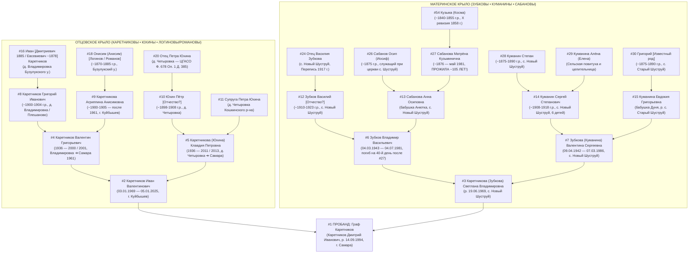

# 🗺️ ГЕНЕРАЛЬНАЯ ДОРОЖНАЯ КАРТА НАХОЖДЕНИЯ ВСЕХ БЕЗ ИСКЛЮЧЕНИЯ ПРЕДКОВ (I–XII КОЛЕНА)
## Персональный операционный навигатор Графа Каретникова: ИИ-разведка 7 контуров, Живой Золотой Круг, ЕГР ЗАГС, РГАДА и ДНК-триангуляция

> **Владелец и Пробанд:** Граф Каретников (Каретников Дмитрий Иванович, р. 14.09.1994, г. Самара)  
> **Проект:** Боевая платформа родословной (`C:\Karetnikov_Lineage`)  
> **Версия стандарта:** `Master Action Standard v2.0 (Post-Wave 1 Verification — 04.11.2026)`  
> **Цель:** 100% документальное закрытие всех 127 слотов восходящего древа Соса-Страдоница (I–VII колена) и исторической вертикали до XII колена (1640–1762 гг.) по **5 родовым кланам**: **Каретниковы, Юхины, Зубковы, Куманины, Сабановы** *(+ родственные союзы: **Логиновы, Романовы, Самулины, Четвериковы**)*.

---

## 🏆 1. ИТОГИ ПЕРВОЙ ВОЛНЫ ВЕРИФИКАЦИИ (03–04.11.2026): НОВЫЙ ФУНДАМЕНТ ДРЕВА

Полевое интервью Графа Каретникова с матерью — **Светланой Владимировной Каретниковой (урожд. Зубковой, `#3`, р. 19.06.1969, с. Новый Шуструй)** (`Msg#297`, `Msg#298`, `Msg#299` от 03.11.2026) — полностью закрыло **III–V колена материнского крыла**, вывело на **VI колено (`#54`)** и открыло **5-ю прямую родовую фамилию — Сабановы**:

1. **Дед по матери (`#6`):** Исправлено отчество — **`Зубков Владимир Васильевич`** (а не «Владимир Владимирович ст.»), точные даты жизни: **`04.03.1943 — 04.07.1981`** (с. Новый Шуструй). Воспитывался родной бабушкой по матери — 105-летней **Матрёной Кузьминичной Сабановой (`#27`)**, пока мать Анна Осиповна уезжала на заработки. Трагически погиб в возрасте 38 лет **ровно на 40-й день** после кончины бабушки Матрёны Кузьминичны (`04.07.1981`).
2. **Бабушка по матери (`#7`):** **`Зубкова (урожд. Куманина) Валентина Сергеевна`**, точные даты жизни: **`09.04.1942 — 07.03.1986`** (с. Новый Шуструй). Одна из шестерых детей Сергея Степановича и Евдокии Григорьевны Куманиных. Две её родные сестры — **Зинаида Сергеевна (`#701`)** и **Антонина Сергеевна (`#702`)** — живы и проживают в родовом гнезде с. Новый Шуструй!
3. **Прадед по линии Зубковых (`#12`):** Исправлено имя — **`Зубков Василий [Отчество уточняется]`** (`~1910–1923 г.р.`, с. Новый Шуструй), отец деда Владимира Васильевича Зубкова (`#6`).
4. **Прабабушка по линии Зубковых — Сабановых (`#13`):** Открыта 5-я родовая ветвь — **`Сабанова Анна Осиповна («бабушка Анютка»)`** (`~1912–1924 г.р.`, с. Новый Шуструй), дочь церковнослужителя Осипа Сабанова (`#26`) и 105-летней Матрёны Кузьминичны Сабановой (`#27`).
5. **Прадед по линии Куманиных (`#14`):** Исправлено отчество — **`Куманин Сергей Степанович`** (`~1908–1918 г.р.`, с. Новый Шуструй) — сын **Степана Куманина (`#28`)** и знаменитой шуструйской повитухи и целительницы **Алёны (Алёнушки / Елены) Куманиной (`#29`)**, принявшей роды всех 6 внуков! *(Егор Петрович Куманин из метрики 1907 г. переведен в статус родного дяди / двоюродного прапрадеда `#2801`).*
6. **Прабабушка по линии Куманиных (`#15`):** Раскрыта **`Куманина Евдокия Григорьевна («бабушка Дуня»)`** (`~1910–1920 г.р.`) — уроженка **с. Старый Шуструй** из очень известного местного рода, дочь прапрадеда **Григория (`#30`, с. Старый Шуструй)**.
7. **Прапрадед и Прапрабабушка по линии Сабановых (`#26` и `#27`) + Прапрапрадед VI колена (`#54`):**
   - **`#26 Сабанов Осип (Иосиф)`** (`~1870–1880 г.р.`, с. Новый Шуструй) — **работник / служащий при церкви** в Шуструе.
   - **`#27 Сабанова Матрёна Кузьминична`** (**`~1876 — кон. мая 1981`**, `~25–26.05.1981`, с. Новый Шуструй) — патриарх и легендарная долгожительница рода, **прожившая ~105 лет** (от эпохи императора Александра II до 1981 года!) и вырастившая внука Владимира Васильевича Зубкова (`#6`).
   - **`#54 Кузьма (метрич. Косма)`** (`~1840–1855 г.р.`, Нижнеломовский уезд) — отец Матрёны Кузьминичны Сабановой (`#27`), прямой участник IX (1850 г.) и X (1858 г.) ревизий!

---

## 🧭 2. СЕМЬ КОНТУРОВ ПОИСКОВОЙ РАЗВЕДКИ (ИИ-АГЕНТЫ + ПОЛЕВАЯ И ЮРИДИЧЕСКАЯ ВЕРИФИКАЦИЯ)

Вся дальнейшая работа разделена на **7 специализированных контуров**, которые выполняются параллельно:

| Контур | Исполнитель / Инструмент | Главная цель контура |
| :--- | :--- | :--- |
| **Контур 1** | **`archive-osint-scout` + Web-to-API Harvesters** | Автономный парсинг баз `pamyat-naroda.ru`, `gwar.mil.ru`, `openlist.wiki`, `familio.org` по новым фигурам: `Зубков Василий` (`#12`), `Куманин Сергей Степанович` (`#14`), `Куманин Степан` (`#28`), `Сабанов Осип` (`#26`), `Каретников Иван Григорьевич` (`#403`, Чуйская долина / Чалдовар) и `Каретников Дмитрий Иванович` (`#802`, р. `19.09.1913`). |
| **Контур 2** | **`1917-bridge-navigator` + Playwright Persistent Session** | Полистная выемка в **АИС ЦГАСО** (`Ф. 678 Оп. 1 Д. 385 лл. 239–261`, `Ф. 32 Оп. 35 ДД. 201, 272, 278`, `Ф. 150 Оп. 1 Д. 168`, `Ф. 149`), **Яндекс.Архивах** (`ОГАОО Ф. 389` — разрешение главной дилеммы прадеда Григория Ивановича `#8` и девичьей фамилии Агриппины Анисимовны `#9`) и **АИС ГАПО / ЦГА РМ** (`Ф. 158 Оп. 3 Д. 4014`, клировые ведомости `Ф. 182 Оп. 1, 3, 6`). |
| **Контур 3** | **`paleography-htr-pipeline` (Скоропись XVII–XIX вв.)** | ИИ-расшифровка (`scripts/htr/paleography_ocr_runner.py`: Gemini Vision + Kraken/Transkribus + словарь РГАДА) сканов **ГИС УИАД (`online.archives.ru`)**: `РГАДА Ф. 350 Оп. 1 Д. 61` (1714 г., Шуструй), `Оп. 2 Д. 562` (1748 г.), `ДД. 3792, 2917, 2936` (Тепловка 1719–1762 гг.), `Ф. 210 Шацкий и Белгородский столы`. |
| **Контур 4** | **`imperial-masonic-rgada-hunter` (Контур Б «Имперский невод»)** | Проверка предания от двоюродного брата о связи с текстильными фабрикантами **Каретниковыми из с. Тейково** (ономастический маркер: **Логин Иванович Каретников 1770–1842** $\leftrightarrow$ родня **Логиновы**; торговля бухарским хлопком через Оренбург и Бузулук) и купеческой династии 1-й гильдии + дворянского герба **Куманиных (`ОГ XI, 65`)**. |
| **Контур 5** | **Полевой опрос Живого Золотого Круга** | Протокол из **5 точечных вопросов** бабушкам **Зинаиде Сергеевне (`#701`)**, **Антонине Сергеевне (`#702`)** в с. Новый Шуструй и дяде **Владимиру Зубкову (`#301`)**, плюс протокол сверки рукописного древа с дядей **Василием Николаевичем Каретниковым (`#4011`, с. Плешаново)** и **Валерием Николаевичем (`#4012`, г. Тольятти)**. |
| **Контур 6** | **Юридический контур ЕГР ЗАГС и Похозяйственных книг** | **Золотой ключ №1:** Выемка актовой записи о смерти 105-летней **Сабановой Матрёны Кузьминичны (`~25–26 мая 1981 г.`, Нижнеломовский ЗАГС)** с точной датой её рождения в `~1876 году`! Плюс справки формы №4/№12 и выписки из похозяйственных книг Нижнеломовского, Красногвардейского и Кошкинского районов. |
| **Контур 7** | **Генетическая триангуляция (Аутосомный + Big Y-700)** | Аутосомное ДНК-тестирование бабушек **Зинаиды Сергеевны (`#701`)** и **Антонины Сергеевны (`#702`)** (50% генома прадеда Сергея Степановича Куманина и прабабушки Евдокии Григорьевны!) + **Big Y-700** прямой мужской линии Каретниковых. |

---

## 📞 3. КОНТУР 5 В ДЕТАЛЯХ: ЧТО ВЕРИФИЦИРОВАТЬ У ЖИВЫХ РОДСТВЕННИКОВ (ЗОЛОТОЙ КРУГ)

### 3.1. Село Новый Шуструй и Самара: Двоюродные бабушки Зинаида Сергеевна (`#701`), Антонина Сергеевна (`#702`) и дядя Владимир Владимирович Зубков (`#301`)
После блестящего интервью со Светланой Владимировной (`Msg#297–299`) нам осталось задать ровно **5 снайперских вопросов** бабушке Зине (`#701`), бабушке Тоне (`#702`) и дяде Володе (`#301`), которые без ожидания архивов закроют V и VI колена:

| № | Адресат | Точная формулировка вопроса (под запись) | Какой слот закрывает |
| :-: | :--- | :--- | :--- |
| **1** | **Дядя Володя (`#301`)** и **бабушка Зина (`#701`)** | **«Какое отчество было у деда Василия Зубкова — отца Владимира Васильевича Зубкова (`04.03.1943 — 04.07.1981`)? В какие годы он жил и воевал ли в Великую Отечественную?»** | Закрывает отчество прадеда **`#12` (`Зубков Василий [N-ович]`)** и мгновенно определяет прапрадеда **`#24`** среди 19 дворов Зубковых переписи 1917 г. (`ГАПО Ф. 158 Оп. 3 Д. 4014`, вкл. проверку Василия Федоровича Зубкова — сына Федора Петровича Зубкова и Вассы Ивановны Сабановой!). |
| **2** | **Дядя Володя (`#301`)** и **бабушка Зина (`#701`)** | **«Какая девичья фамилия была у бабушки Дуни — Куманиной Евдокии Григорьевны из села Старый Шуструй? Мама сказала, что Володя помнит их известную фамилию в Старом Шуструе — чьих она была кровей и кем был её отец Григорий?»** | Закрывает девичью фамилию прабабушки **`#15` (`Евдокия Григорьевна`)** и фамилию прапрадеда **`#30` (`Григорий из с. Старый Шуструй`)**. |
| **3** | **Бабушка Зина (`#701`)** и **бабушка Тоня (`#702`)** | **«Как по отчеству и по девичьей фамилии звали вашу родную бабушку — повитуху и целительницу Алёну (Алёнушку / Елену) Куманину, которая приняла роды всех 6 детей у бабушки Дуни? И какое отчество было у её мужа — вашего деда Степана Куманина?»** | Закрывает отчество прапрадеда **`#28` (`Степан Куманин`)** (выводит на прапрапрадеда VI колена `#56`) и девичью фамилию + отчество прапрабабушки-повитухи **`#29` (`Алёна Куманина`)**. |
| **4** | **Дядя Володя (`#301`)** и **бабушка Зина (`#701`)** | **«В какой церкви служил прапрадед Осип (Иосиф) Сабанов — муж 105-летней Матрёны Кузьминичны (в Никольской церкви Нового Шуструя или в храме Старого Шуструя), кем именно он там служил (псаломщик, староста, звонарь, сторож) и какое у него было отчество?»** | Дает точный приход и должность прапрадеда **`#26` (`Осип Сабанов`)** для выемки клировых ведомостей `ГАПО Ф. 182` и уточняет девичью фамилию 105-летней **`#27` (`Матрёны Кузьминичны`)**. |
| **5** | **Бабушка Зина (`#701`)** и **Светлана Владимировна (`#3`)** | **«Как звали всех шестерых детей Сергея Степановича и Евдокии Григорьевны Куманиных по старшинству (помимо Валентины `09.04.1942 г.р.`, Зинаиды и Антонины), и были ли родные братья и сёстры у Владимира Васильевича Зубкова (`04.03.1943 г.р.`)?»** | Полностью комплектует боковые ветви III и IV колен материнского крыла. |

### 3.2. Село Плешаново и г. Тольятти: Дядя Василий Николаевич (`#4011`) и дядя Валерий Николаевич (`#4012`) Каретниковы
* **Статус:** Сыновья старшего брата деда — **Николая Григорьевича Каретникова (`#401`)**. Василий Николаевич (директор МБУ КИС «Вымпел» с. Плешаново) — главный хранитель родового архива Каретниковых в Оренбуржье.
* **Чек-лист сверки:**
  1. **Разрешение главной дилеммы прапрадеда Ивана (`#16`):** Чей именно сын прадед **Григорий Иванович Каретников (`#8`)** по собранным Василием Николаевичем бумагам — сын **Ивана Дмитриевича Каретникова (р. 21.02.1885, Тепловская ветвь, отец Дмитрия Ивановича `#802` р. 19.09.1913)** или сын **Ивана Евсевиевича / Кирилловича (Автохтонная Владимировская ветвь + брат Фёдор Иванович р. 18.03.1923)**?
  2. **Прабабушка Агриппина Анисимовна (`#9`):** Какова была её девичья фамилия — **Логинова** или **Романова** (дочь Онисима `#18`)?
  3. **Ветвь Ивана Григорьевича Каретникова (`#403`):** Подтвердить контакты его потомков в **с. Чалдовар / Чуйской долине** (Казахстан / Кыргызстан).
  4. **Фотоархив:** Оцифровать сохранившиеся в Плешаново прижизненные фотографии прадеда **Григория Ивановича (`#8`)**, прабабушки **Агриппины Анисимовны (`#9`)** и братьев деда.

---

## 💻 4. КОНТУРЫ 1, 2 И 3 В ДЕТАЛЯХ: ИИ-РАЗВЕДКА, ОНЛАЙН-ШТУРМ АИС И HTR-ПАЛЕОГРАФИЯ

### Шаг 4.1. АИС ЦГАСО (`cgaso.regsamarh.ru` — вход через Госуслуги): Юхины и Каретниковы
1. **Дело №1 (Губерния выхода Юхиных):** **`ЦГАСО, Фонд 678, Опись 1, Дело 385, листы 239–261`** (1863 г., *«Самарский VI дачи ... д. Четыровка Петровской волости, семейный рекрутский список переселенцев»*):
   - Открыть листы 239–261 ➔ выписать все дворы **Юхиных** (возраст по X ревизии 1858 г. и на 1863 г.) и графу **«Из какой губернии и уезда переведены»**.
2. **Дело №2 (Рождение Петра Юхина `#10`):** **`ЦГАСО, Фонд 32, Опись 35, Дела 201, 272, 278`** (и `Оп. 40, Д. 194`):
   - Метрические книги Архангельской церкви **с. Русская Васильевка** (приход д. Четыровка) за `1895–1916 гг.` ➔ найти запись о рождении прадеда **Петра Юхина (`#10`)** и выписать полное имя его отца (`#20`) и матери (`#21`).
3. **Дело №3 (Ревизия 1858 г. по Владимировке):** **`ЦГАСО, Фонд 150, Опись 1, Дело 168`** (X ревизия 1858 г.) и `ДД. 23, 75, 153б, 166` (1834, 1850 гг.):
   - Найти по **д. Владимировка** Ивановской волости Бузулукского уезда двор казенного крестьянина **Кирилла Каретникова** и его сына **Евсевия Кирилловича (р. ок. 1853 г.)**, а также причисленных переселенцев из Орловской и Пензенской губерний.
4. **Дело №4 (Крестьянский поземельный банк):** **`ЦГАСО, Фонд 149, Опись 1`**:
   - Посемейные списки товариществ крестьян д. Владимировка, с. Ивановка, с. Подольск и с. Плешаново (1885–1917 гг.).

### Шаг 4.2. Яндекс.Архивы (`ya.ru/archive` — ОГАОО Фонд 389): Метрики с. Ивановка
- В оцифрованных метрических книгах **Михайло-Архангельской церкви с. Ивановка Бузулукского уезда (`ОГАОО Ф. 389, Оп. 1`)** за `1898–1906 гг.`:
  1. Найти запись о рождении **Григория Ивановича Каретникова (`#8`)** по д. Владимировка ➔ установить полное имя и отчество его отца **Ивана Каретникова (`#16`)** и матери (`#17`), а также проверить восприемников из семей **Логиновых** и **Романовых**!
  2. Найти запись о рождении **Агриппины (Аграфены) Онисимовны (`#9`)** ➔ установить её девичью фамилию и полное имя прапрадеда **Онисима (`#18`)**.

### Шаг 4.3. АИС ГАПО (`ais.arhivpnz.ru`) и ЦГА РМ: Новый Шуструй и Старый Шуструй
1. **`ГАПО, Фонд 158, Опись 3, Дело 4014` (Всероссийская с/х перепись 1917 г.):**
   - Поднять подворные карточки по **с. Новый Шуструй** и **с. Старый Шуструй**:
     * Двор **Степана Куманина (`#28`)**, жены **Елены/Алёны (`#29`)** и сына **Сергея Степановича (`#14`)**;
     * Двор церковнослужителя **Осипа (Иосифа) Сабанова (`#26`)**, жены **Матрёны Кузьминичны (`#27`, ~41 год в 1917 г.)** и дочери **Анны Осиповны (`#13`)**;
     * Все **19 дворов Зубковых** (особенно подворье №1 отставного рядового Федора Петровича Зубкова и Вассы Ивановны урожд. Сабановой, где записан сын **Василий Федорович Зубков** — главный кандидат на слот `#12`!);
     * Дворы домохозяев по имени **Григорий (`#30`)** в **с. Старый Шуструй** (отец Евдокии Григорьевны `#15`).
2. **`ГАПО, Фонд 182, Описи 1, 3, 6` (Клировые ведомости и Метрические книги):**
   - Выписать из **клировых ведомостей** Никольской церкви с. Шуструй за `1895–1917 гг.` должность, возраст и отчество **Осипа (Иосифа) Сабанова (`#26`)**;
   - Найти в метрических книгах за **`1874–1878 гг.`** запись о рождении долгожительницы **Матрёны Кузьминичны (`#27`)** у отца **Космы/Кузьмы (`#54`)**!

### Шаг 4.4. ГИС УИАД (`online.archives.ru`) + ИИ-палеография (`paleography_ocr_runner.py`): РГАДА Ф. 350 и Ф. 210
1. **`РГАДА, Фонд 350, Опись 1, Дело 61, листы 22–23` (1714 г., Верхнеломовский уезд):**
   - Переписная книга **села и деревни Шуструй (Шуструя)**: дворы казаков и однодворцев **Куманиных** (потомки Алёшки Антонова сына Куманина и сына Артюшки), **Зубковых** и **Сабановых**.
2. **`РГАДА, Фонд 350, Опись 2, Дело 562, лист 289 об. и далее` (1746–1748 гг., II ревизия):**
   - Поименные сказки однодворцев **села Шуструй Верхнеломовского уезда** (с указанием возраста по I ревизии 1719 г.).
3. **`РГАДА, Фонд 350, Опись 2, Дела 3792 (1719 г.), 2917 (1748 г.), 2936 (1762 г., л. 221 / кадр 224, двор №14)`:**
   - I, II и III ревизии по **с. Тепловка Саранского уезда**: установление имени и отчества отца патриарха **Никиты [Каретника]** (XII колено, `~1680–1695 г.р.`) и сыновей Василия и Макара Никитиных.

---

## 🏛️ 5. КОНТУР 6 В ДЕТАЛЯХ: ОФИЦИАЛЬНЫЕ ЗАПРОСЫ В ЕГР ЗАГС И ПОХОЗЯЙСТВЕННЫЕ КНИГИ

### 5.1. Пять приоритетных запросов в ЕГР ЗАГС (через любой МФЦ г. Самары)
> [!IMPORTANT]
> **КРИТИЧЕСКОЕ ПРАВИЛО ЗАГС:** Всегда запрашивать строго **«СПРАВКУ о рождении / браке / смерти (формы №4, №6, №11, №12) с указанием ВСЕХ иных сведений из актовой записи»** (а не повторное свидетельство, где графы возраста родителей и точного села опускаются!).

| Приоритет | Персона и Слот | Какую справку запрашиваем в МФЦ | Какой прорыв дает документ |
| :---: | :--- | :--- | :--- |
| **🔥 №1 (ЗОЛОТОЙ КЛЮЧ)** | **`Сабанова Матрёна Кузьминична` (`#27`)** | **Справка о смерти (форма №12)** за **`май–июнь 1981 г.`** (`~25–26.05.1981`, с. Новый Шуструй Нижнеломовского р-на Пензенской обл.) | Советский акт о смерти 1981 года на 105-летнюю прапрабабушку содержит **точную дату и место её рождения в `~1876 году`**! Это мгновенно перебрасывает 100% документальный мост на 105 лет назад в эпоху Александра II к её отцу **Кузьме (`#54`, VI колено)**! |
| **🔴 №2** | **`Зубков Владимир Васильевич` (`#6`)** | **Справка о рождении** (`04.03.1943`, с. Новый Шуструй) + **Справка о смерти** (`04.07.1981`, Нижнеломовский ЗАГС) | В графе «Отец» за 1943 год записано полное ФИО и **точное отчество прадеда `Зубкова Василия [N-овича]` (`#12`)** и данные матери **Сабановой Анны Осиповны (`#13`)**! |
| **🔴 №3** | **`Зубкова (Куманина) Валентина Сергеевна` (`#7`)** | **Справка о рождении** (`09.04.1942`, с. Новый Шуструй) + **Справка о смерти** (`07.03.1986`, Нижнеломовский ЗАГС) | Документально фиксирует прадеда **Куманина Сергея Степановича (`#14`)** и прабабушку **Куманину Евдокию Григорьевну (`#15`)** с их возрастом в 1942 году! |
| **🔴 №4** | **`Каретникова Агриппина Анисимовна` (`#9`)** и **`Каретников Валентин Григорьевич` (`#4`)** | **Справка о смерти `#9`** (г. Куйбышев/Самара, после 1961 г.) + **Справка о рождении `#4`** (`1936 г.`, Оренбургская / Чкаловская обл.) | Открывает точную дату и село рождения прабабушки Агриппины Анисимовны (`~1898–1905 гг.`), её **девичью фамилию (`Логинова / Романова`)** и точные данные прадеда **Григория Ивановича (`#8`)**! |
| **🔴 №5** | **`Каретникова (Юхина) Клавдия Петровна` (`#5`)** | **Справка о рождении** (`1936 г.`, д. Четыровка Кошкинского р-на) + **Справка о смерти** (`2011 / 2013 г.`, г. Самара) | Открывает **точное отчество прадеда `Юхина Петра [N-овича]` (`#10`)** и полное имя + девичью фамилию прабабушки (`#11`)! |

### 5.2. Три запроса в муниципальные архивы по Похозяйственным книгам (1934–1975 гг.)
1. **Архивный отдел администрации Нижнеломовского района Пензенской области** (`442150, г. Нижний Ломов, ул. Ленина, 54`):
   - *Предмет:* Архивные выписки из похозяйственных книг **Ново-Шуструйского и Старо-Шуструйского сельсоветов за 1934–1975 гг.** на дворы:
     1) **Зубкова Василия (`#12`)** и **Сабановой Анны Осиповны (`#13`)** (с сыном Владимиром Васильевичем `р. 04.03.1943`);
     2) **Сабанова Осипа (`#26`)** и 105-летней **Сабановой Матрёны Кузьминичны (`#27`, `р. ~1876 — ум. май 1981`)**;
     3) **Куманина Сергея Степановича (`#14`)**, **Куманиной Евдокии Григорьевны (`#15`)**, **Куманина Степана (`#28`)** и повитухи **Куманиной Алёны/Елены (`#29`)**.
2. **Архивный отдел администрации Красногвардейского района Оренбургской области** (`461150, с. Плешаново, ул. Советская, 28`):
   - *Предмет:* Выписки из похозяйственных книг **Владимировского, Залесовского, Подольского и Плешановского сельсоветов за 1934–1961 гг.** по дворам **Каретникова Григория Ивановича (`#8`)** и **Агриппины Анисимовны (`#9`)**, **Каретникова Фёдора Ивановича (`р. 18.03.1923`)** и **Каретникова Ивана Дмитриевича (`р. 1885`)**.
3. **Архивный отдел администрации м.р. Кошкинский Самарской области** (`446800, с. Кошки, ул. Советская, 32`):
   - *Предмет:* Выписка из похозяйственных книг по **деревне Четыровка за 1934–1955 гг.** на семью **Юхина Петра (`#10`)** и его дочери **Юхиной Клавдии Петровны (`#5`)**.

---

## 🧬 6. СКВОЗНАЯ МАТРИЦА ПРЕДКОВ И ИСТОЧНИКОВ (I–XII КОЛЕНА ПО 5 РОДОВЫМ КЛАНАМ)

| Колено (Ahnentafel) | Персона / Предок | Родовое гнездо / Регион | Точный архивный шифр / Источник | Статус и целевое действие |
| :---: | :--- | :--- | :--- | :--- |
| **I (`#1`)** | **Граф Каретников** (Дмитрий Иванович, р. 14.09.1994) | г. Самара | Паспорт РФ, Свидетельство о рождении ЗАГС г. Самары | `[🟢 ФАКТ 100%]` Пробанд |
| **II (`#2, #3`)** | **Каретников Иван Валентинович** (03.01.1969 — 05.01.2025) + **Каретникова (Зубкова) Светлана Владимировна** (р. 19.06.1969) | г. Самара / с. Новый Шуструй Нижнеломовского р-на | Акты ЗАГС г. Куйбышева и Нижнеломовского р-на; прямое интервью `Msg#297–299` | `[🟢 ФАКТ 100%]` Родители Пробанда |
| **III (`#4, #5`)** | **Каретников Валентин Григорьевич** (1936 — 2000 / 2001) + **Каретникова (Юхина) Клавдия Петровна** (1936 — 2011 / 2013) | д. Владимировка ➔ г. Самара (1961) / д. Четыровка Кошкинского р-на | ЗАГС Самары, ЗАГС Красногвардейского и Кошкинского р-нов | `[🟢 ФАКТ 100%]` Дедушка и бабушка по отцу |
| **III (`#6, #7`)** | **Зубков Владимир Васильевич** (`04.03.1943 — 04.07.1981`) + **Зубкова (Куманина) Валентина Сергеевна** (`09.04.1942 — 07.03.1986`) | с. Новый Шуструй Нижнеломовского р-на Пензенской обл. | Верификация Светланы Владимировны (`Msg#297, #299`); ЗАГС Нижнеломовского р-на | `[🟢 ФАКТ 100%]` Дедушка (погиб на 40-й день после бабушки Матрёны `#27`) и бабушка по матери |
| **IV (`#8, #9`)** | **Каретников Григорий Иванович** (~1900–1904) + **Каретникова Агриппина Анисимовна** (~1900–1905 — после 1961) | д. Владимировка / с. Плешаново ➔ г. Куйбышев | Похозяйственные книги Плешановского и Залесовского с/с; `ОГАОО Ф. 389 Оп. 1`; ЗАГС Самары | `[🟢 ФАКТ 100%]` Уточнить девичью фамилию `#9` (Логинова / Романова) в ЗАГС и метриках с. Ивановка |
| **IV (`#10, #11`)** | **Юхин Пётр [Отчество?]** (~1898–1908) + **[Прабабушка Юхина `#11`]** | д. Четыровка Кошкинского р-на Самарской обл. | `ЦГАСО Ф. 32 Оп. 35 ДД. 201, 272, 278` (с. Русская Васильевка); ЗАГС Кошкинского р-на | `[🟢 ФАКТ 100% / 🔵 85%]` Выемка метрики рождения Петра и справки формы №4 о рождении `#5` |
| **IV (`#12, #13`)** | **Зубков Василий [Отчество?]** (~1910–1923) + **Сабанова Анна Осиповна («бабушка Анютка»)** (~1912–1924) | с. Новый Шуструй Нижнеломовского р-на | Верификация `Msg#297–299`; `ГАПО Ф. 158 Оп. 3 Д. 4014`; Похозяйственные книги Шуструя | `[🟢 ФАКТ 100%]` Уточнить отчество Василия Зубкова у дяди Володи `#301`, бабушки Зины `#701` и в справке о рождении `#6` (1943 г.) |
| **IV (`#14, #15`)** | **Куманин Сергей Степанович** (~1908–1918) + **Куманина Евдокия Григорьевна («бабушка Дуня»)** (~1910–1920) | с. Новый Шуструй и **с. Старый Шуструй** Нижнеломовского р-на | Верификация `Msg#297`; `ГАПО Ф. 182 Оп. 3 Кн. 561`; `ГАПО Ф. 158 Оп. 3 Д. 4014` | `[🟢 ФАКТ 100%]` Родители 6 детей. Уточнить девичью фамилию бабушки Дуни (`#15`, из Старого Шуструя) у дяди Володи `#301` |
| **V (`#16, #17`)** | **Каретников Иван [Дмитриевич р. 21.02.1885 / Евсевиевич р. ~1878]** + супруга (`Марина Капрова` / `[?]`) | д. Владимировка Бузулукского уезда | **`ОГАОО Ф. 389 Оп. 1`** (МК с. Ивановка за 1885, 1894, 1898–1906 гг.); сверка с архивом дяди Василия `#4011` | `[🟠 ДИЛЕММА ВЕТВИ А vs Б]` Проверить метрику рождения Григория Ивановича `#8` (1898–1906) в Яндекс.Архиве (`ОГАОО Ф. 389`) |
| **V (`#18`)** | **Онисим (Анисим) [Логинов? / Романов?]** (~1870–1885) | Бузулукский уезд Самарской губ. | По отчеству прабабушки Агриппины Анисимовны (`#9`); `ОГАОО Ф. 389 Оп. 1` | `[🟢 ФАКТ ИМЕНИ 100%]` Установить фамилию по записи о браке `#8` и `#9` или смерти `#9` |
| **V (`#20`)** | **[Отец Петра Юхина — Михаил / Пётр / Иван Юхин]** (~1865–1880) | д. Четыровка на р. Кондурче | **`ЦГАСО Ф. 678 Оп. 1 Д. 385 лл. 239–261`** (1863 г.); `ЦГАСО Ф. 32 Оп. 35` | `[🟠 80%]` Онлайн-выемка листов 239–261 в АИС ЦГАСО |
| **V (`#24`)** | **[Отец Василия Зубкова — Фёдор Петрович / Степан / Пётр Зубков]** (~1865–1890) | с. Новый Шуструй Нижнеломовского уезда | **`ГАПО Ф. 158 Оп. 3 Д. 4014`** (19 дворов Зубковых в переписи 1917 г.; в дворе №1 у Федора Петровича Зубкова и Вассы Ивановны Сабановой — сын Василий!) | `[🟠 85%]` Мгновенно замкнется после получения отчества Василия Зубкова (`#12`) |
| **V (`#26, #27`)** | **Сабанов Осип (Иосиф)** (~1870–1880, **служащий при церкви**) + **Сабанова Матрёна Кузьминична** (**`~1876 — кон. мая 1981`, прожила ~105 лет!**) | с. Новый Шуструй Нижнеломовского уезда | Верификация `Msg#297–298`; **Акт о смерти `#27` за май 1981 г. в ЗАГС Нижнего Ломова**; Клировые ведомости `ГАПО Ф. 182 Оп. 1, 3, 6`; `Ф. 158 Оп. 3 Д. 4014` | `[🟢 ФАКТ 100%]` Запросить в МФЦ справку о смерти Матрёны Кузьминичны за май 1981 г. (откроет точную дату рождения в `~1876 г.`) и клировые ведомости на Осипа Сабанова! |
| **V (`#28, #29`)** | **Куманин Степан [Отчество?]** (~1875–1890) + **Куманина Алёна (Елена)** (~1875–1892, **сельская повитуха и целительница**) | с. Новый Шуструй / с. Старый Шуструй Нижнеломовского уезда | Верификация `Msg#297`; `ГАПО Ф. 158 Оп. 3 Д. 4014` (перепись 1917 г.); `ГАПО Ф. 182 Оп. 3 Кн. 561` | `[🟢 ФАКТ 100%]` Уточнить отчество Степана и девичью фамилию повитухи Алёны у бабушки Зины (`#701`) + карточка 1917 г. |
| **V (`#30`)** | **Григорий [Известный род с. Старый Шуструй]** (~1875–1890) | **с. Старый Шуструй** Нижнеломовского уезда | Верификация `Msg#297` (отец Евдокии Григорьевны `#15`); `ГАПО Ф. 158 Оп. 3` | `[🟢 ФАКТ ИМЕНИ 100%]` Уточнить фамилию у дяди Володи (`#301`) и в переписи 1917 г. по с. Старый Шуструй |
| **VI (`#54`)** | **Кузьма (метрич. Косма) [Фамилия уточняется]** (~1840–1855) | с. Новый Шуструй / Нижнеломовский уезд | Верификация `Msg#297` (отец 105-летней Матрёны Кузьминичны `#27`); **`ГАПО Ф. 60 Оп. 4`** (IX и X ревизии 1850 и 1858 гг.); `ГАПО Ф. 182` (МК 1874–1878 гг.) | `[🟢 ФАКТ ИМЕНИ 100%]` Найти метрику рождения Матрёны (`~1876 г.`) и ревизскую сказку 1858 г. по двору Космы (`#54`)! |
| **VI (`#56`, Куманины)** | **[Отец Степана Куманина — Пётр? Куманин]** (~1835–1855) | с. Новый Шуструй / с. Старый Шуструй | **`ГАПО Ф. 60 Оп. 4`** (X ревизия 1858 г.); `ГАПО Ф. 158 Оп. 3 Д. 4014` | `[🟠 85%]` Подтверждается отчеством Степана Куманина (`#28`) в переписи 1917 г. |
| **VI–VII (Владимировка)** | **Евсевий Кириллович Каретников** (р. ок. 1853) + **Феодосия Никитична Самулина** ➔ отец **Кирилл Каретников** (р. ок. 1825–1832) | д. Владимировка Бузулукского уезда | **`ОГАОО Ф. 389 Оп. 1`** (МК 1894 г.); **`ЦГАСО Ф. 150 Оп. 1 Д. 168`** (X ревизия 1858 г.) и `ОГАОО Ф. 98 Оп. 2` | `[🟠 АРХИВНЫЙ КАНДИДАТ В ОПОРНОМ СЕЛЕ]` Выемка ревизской сказки 1858 г. (`Д. 168`) по д. Владимировка |
| **VI–XII (Тепловка)** | **Дмитрий Семёнович** (1862) ➔ **Семён Мокеевич** (~1828) + **Варвара Филимоновна** (1830) ➔ **Филимон Степанович** (1809) ➔ **Степан Макарович** (1776) ➔ **Макар Никитович** (1740) ➔ **Никита** (~1710) ➔ **Отец Никиты** (~1685) | с. Тепловка Саранского уезда ➔ д. Владимировка | **`РГАДА Ф. 350 Оп. 2 Д. 3792`** (1719 г.), **`Д. 2917`** (1748 г.), **`Д. 2936 л. 221`** (1762 г.); `ГАПО Ф. 60 Оп. 4` | `[🟢 ДОКУМЕНТАЛЬНАЯ ВЕРТИКАЛЬ]` Расшифровка листов I ревизии 1719 г. (`Д. 3792`) через `paleography_ocr_runner.py` |
| **VIII–XII (Шуструй, 1640–1748)** | **Алёшка Антонов сын Куманин** (~1640 г.р.) + сын **Артюшка Алексеевич** (~1665 г.р.) + первопоселенцы **Зубковы** и **Сабановы** | с. Шуструй Верхнеломовского уезда (Шацкая черта) | **`РГАДА Ф. 210 Оп. 9`** (Шацкий стол, 1670 г.); **`Ф. 210 Оп. 6-б Д. 25`** (1696 г.); **`РГАДА Ф. 350 Оп. 1 Д. 61 лл. 22–23`** (1714 г.); **`Оп. 2 Д. 562 л. 289 об.`** (1748 г.) | `[🟢 ФАКТ 100%]` Полистная HTR-транскрипция `Д. 61` (1714 г.) и `Д. 562` (1748 г.) на `online.archives.ru` |

---

## 🎯 7. БОЕВОЙ ПЛАН ДЕЙСТВИЙ ГРАФА КАРЕТНИКОВА НА БЛИЖАЙШИЕ 72 ЧАСА

1. **ШАГ 1 — «Золотой звонок» в Шуструй и дяде Володе (`15 минут`):**
   - Опросить **дядю Владимира Владимировича Зубкова (`#301`)**, **бабушку Зинаиду Сергеевну (`#701`)** и **бабушку Антонину Сергеевну (`#702`)** по **5 точечным вопросам Контура 5** (отчество прадеда Василия Зубкова `#12`, девичья фамилия бабушки Дуни `#15` из Старого Шуструя, отчество Степана Куманина `#28`, девичья фамилия повитухи Алёны `#29` и церковная должность Осипа Сабанова `#26`).
2. **ШАГ 2 — Звонок дяде Василию Николаевичу Каретникову в с. Плешаново (`15 минут`):**
   - Сверить его рукописное древо по прадеду **Григорию Ивановичу (`#8`)**, прабабушке **Агриппине Анисимовне (`#9`)**, прапрадеду **Ивану (`#16`)** и контактам ветви **Ивана Григорьевича (`#403`)** в Чалдоваре.
3. **ШАГ 3 — Визит в МФЦ г. Самары за «Золотым ключом ЕГР ЗАГС» (`30 минут`):**
   - Заказать **Справку о смерти формы №12 с иными сведениями** на 105-летнюю прапрабабушку **Сабанову Матрёну Кузьминичну (ум. в конце мая 1981 г., с. Новый Шуструй)** — получить точную дату её рождения в `~1876 году`!
   - Одновременно подать заявления на справки формы №4/№12 по **Зубкову Владимиру Васильевичу (`04.03.1943 — 04.07.1981`)**, **Зубковой Валентине Сергеевне (`09.04.1942 — 07.03.1986`)**, **Каретниковой Агриппине Анисимовне (`#9`)** и **Каретниковой (Юхиной) Клавдии Петровне (`#5`)**.
4. **ШАГ 4 — Запуск онлайн-выемки Контуров 2 и 3 (с домашнего ПК через Госуслуги):**
   - Открыть в **АИС ЦГАСО (`cgaso.regsamarh.ru`)** дело **`Ф. 678, Оп. 1, Д. 385, лл. 239–261`** (Четыровка 1863 г. — губерния выхода Юхиных) и **`Ф. 150, Оп. 1, Д. 168`** (Владимировка 1858 г. — двор Кирилла и Евсевия Каретниковых).
   - Открыть в **ГИС УИАД (`online.archives.ru`)** дела **`РГАДА Ф. 350, Оп. 1, Д. 61, лл. 22–23`** (Шуструй 1714 г.), **`Оп. 2, Д. 562, л. 289 об.`** (Шуструй 1748 г.) и **`Оп. 2, Д. 3792`** (Тепловка 1719 г.) и передать сканы локальному ИИ-конвейеру `scripts/htr/paleography_ocr_runner.py`.

---
*Навигатор актуализирован Главным Архитектором Поисковой Разведки (`Chief Search Roadmap Architect`) 04.11.2026 в полном соответствии с конституцией `C:\Karetnikov_Lineage\GEMINI.md`.*
