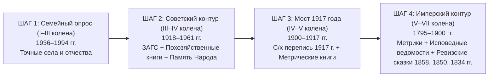

# 🧭 ДОРОЖНАЯ КАРТА АРХИВНОГО ПОИСКА РОДА ДО VII КОЛЕНА (`SEARCH_MASTER_ROADMAP.md`)

> **Владелец:** Граф Каретников (Каретников Дмитрий Иванович, р. 14.09.1994, г. Самара)
> **Цель:** 100% документальное закрытие 127 прямых слотов восходящего древа (I–VII колена, 1800–2026 гг.) и боковых родственных ветвей по 4 фамильным кластерам: **Каретниковы, Юхины, Зубковы, Куманины**.

---

## 1. Общая логика прохождения («Правило Моста через 1917 год»)

Генеалогический поиск в России делится на **два разных мира документов**, граница между которыми проходит в **декабре 1917 — 1918 году**:

- **Ошибка 95% новичков:** Пытаться сразу искать фамилию в XVIII–XIX веках, не зная точного имени прадеда (`1900–1917 г.р.`) и конкретного села/прихода.
- **Наше преимущество:** Мы уже знаем **точные населенные пункты и районы по всем 4 ветвям** (`с. Плешаново / с. Подольск`, `Кошкинский район`, `с. Новый Шуструй`) и имена 3 из 4 прадедов (`Григорий Каретников`, `Пётр Юхин`, `Владимир Зубков`)!

---

## 2. ЭТАП 1: С ЧЕГО НАЧИНАЕМ СЕГОДНЯ (Быстрые победы за 24–48 часов)

### Шаг 1.1. Опрос мамы (Светланы Владимировны, р. 19.06.1969) — когда проснется
Узнаем ровно **5 коротких фактов**, которые мгновенно свяжут III и IV колена с нашими архивными находками 1917 года:
1. **Точное отчество и дата рождения бабушки по маме** — **Зубковой (в девичестве Куманиной) Валентины** (`#7`).
   - *Что это дает:* Отчество бабушки Валентины автоматически называет нам **имя прадеда Куманина (`#14`)** из с. Новый Шуструй! Например, если она *Валентина Алексеевна* или *Валентина Дмитриевна*, мы сразу проверяем найденных нами фронтовиков с. Новый Шуструй (**Куманин Алексей Иванович 1908 г.р.** и **Куманин Дмитрий Михайлович 1912 г.р.**)!
2. **Точная дата рождения дедушки по маме** — **Зубкова Владимира Владимировича (`#6`)** и как звали его маму (`#13`) и отчество его отца **Владимира Зубкова (`#12`)**.
   - *Что это дает:* По отчеству прадеда Владимира Зубкова (`#12`) мы сразу вычисляем, в каком из 7 найденных нами дворов Зубковых в **Переписи 1917 года по с. Новый Шуструй (ГАПО Ф. 158, Оп. 3, Д. 4014)** он родился (*у Василия Петровича, Федора Петровича, Захара Семеновича, Якова Ионовича, Степана Ефимовича, Ивана Нестерова или Евстафия Александровича Зубкова*)!
3. **Уточнение по бабушке по отцу — Каретниковой (Юхиной) Клавдии Петровне (`#5`, 1936 г.р., Кошкинский р-н):**
   - В каком именно селе/деревне Кошкинского района она родилась (*с. Кошки, д. Дмитриевка, с. Богдановка, с. Надеждино, с. Старая Кармала*) и как звали её маму (`#11`) и отчество отца **Петра Юхина (`#10`)**?
4. **Уточнение по деду по отцу — Каретникову Валентину Григорьевичу (`#4`, 1936 г.р., Оренбургская обл.):**
   - Какое именно село указано местом рождения у него или у его братьев (**Николая Григорьевича `#401`** и **Петра Григорьевича `#402`**): **с. Плешаново** или **с. Подольск** (Красногвардейский / бывший Люксембургский район)? И как звали их маму (`#9`, жену прадеда Григория Каретникова)?
5. **Семейные фотографии и документы на руках:**
   - Сфотографировать на телефон любые сохранившиеся свидетельства о рождении/браке/смерти, военные билеты, трудовые книжки и портреты — и прикрепить портреты прямо в карточки на Дорожной Карте (`📷 Фото`).

---

### Шаг 1.2. Авторизация Playwright-профиля для автономной работы ИИ-агента (10 минут)
Чтобы наш агент сам заходил в архивы и вытаскивал описи и сканы без капч и ручного копипаста:
1. Запустить в терминале:
   `python C:\Karetnikov_Lineage\scripts\scouts\playwright_research_engine.py --login`
2. В открывшемся браузере войти в 3 вкладки:
   - **`cgaso.regsamarh.ru`** — нажать «Войти через ЕСИА (Госуслуги)» (бесплатный доступ ко всем сканам метрик Самарской губернии).
   - **`familio.org`** — войти через Telegram или email.
   - **`forum.vgd.ru`** — войти по логину/почте.
3. Закрыть окно браузера — сессия сохранится в зашифрованном локальном контуре `.secrets/browser_profile`.

---

## 3. ЭТАП 2: КАК ПРОДОЛЖАЕМ ПО КАЖДОЙ ИЗ 4 ВЕТВЕЙ (Советский и Военный контур 1918–1961 гг.)

Когда у нас есть ответы мамы, мы бьем одновременно по **трем документальным базам советского периода**, чтобы закрыть 100% IV колена (всех 8 прадедов и прабабушек) с точными датами рождения до 1917 года:

### Направление А: ЕГР ЗАГС (Через МФЦ — Справки с «иными сведениями»)
> **Важное правило:** При запросе в ЗАГС берется **НЕ повторное свидетельство**, а именно **«Справка о рождении / браке / смерти (формы №1, №4, №5, №6, №11, №12) с указанием ВСЕХ иных сведений из актовой записи»** (в свидетельстве половину граф не печатают, а в справке выписывают возраст родителей, точное село, род занятий и девичью фамилию!).

1. **Справка о рождении Каретникова Валентина Григорьевича (`1936 г.р.`, Оренбургская / Чкаловская обл.)** и **справка о его смерти (`2000 / 2001 г.`)**:
   - Дает: точное село рождения в Оренбургской области, полное ФИО отца (**Каретников Григорий Иванович**) и полное ФИО и девичью фамилию матери (`#9`), а также их возраст в 1936 году!
2. **Справка о рождении Юхиной Клавдии Петровны (`1936 г.р.`, Кошкинский р-н Куйбышевской обл.)** и **справка о её смерти (`2011 / 2013 г.`)**:
   - Дает: точное село Кошкинского района, полное ФИО и отчество прадеда **Юхина Петра (`#10`)** и девичью фамилию прабабушки (`#11`)!

### Направление Б: Похозяйственные книги сельсоветов (1934–1961 гг.) — Золотая жила советской генеалогии!
Похозяйственные книги велись в каждом селе с 1934 года каждые 3 года. В одной карточке двора записаны **все члены семьи разом**: глава семьи (прадед), его жена (прабабушка), все дети (включая братьев деда!) с точными годами рождения, грамотностью, местом работы и отметкой о выбытии (переезд 1961 г. или призыв в РККА)!

| Ветвь | Куда писать / где лежит похозяйственная книга | Что именно запрашиваем |
| :--- | :--- | :--- |
| **Каретниковы** (`#4, #8, #9, #401, #402`) | **Архивный отдел администрации Красногвардейского района Оренбургской области** (461150, Оренбургская обл., с. Плешаново, пр. Гагарина, 23) + **ГАОО (Фонд Р-1500 — Плешановский волисполком)** | Выписка из похозяйственных книг по **Плешановскому и Подольскому сельсоветам** за **1934–1961 гг.** на семью **Каретникова Григория Ивановича** и его сыновей: **Николая Григорьевича**, **Петра Григорьевича** и **Валентина Григорьевича (1936 г.р., выбыл в 1961 г.)**. |
| **Юхины** (`#5, #10, #11`) | **Архивный отдел администрации м.р. Кошкинский Самарской области** (446800, Самарская обл., с. Кошки, ул. Советская, 32) | Выписка из похозяйственных книг за **1934–1955 гг.** на семью **Юхина Петра** и его дочери **Юхиной Клавдии Петровны (1936 г.р.)**. |
| **Зубковы и Куманины** (`#6, #7, #12, #14`) | **Архивный отдел администрации Нижнеломовского района Пензенской области** (442150, Пензенская обл., г. Нижний Ломов, ул. Ленина, 54) | Выписка из похозяйственных книг **Ново-Шуструйского сельсовета (с. Новый Шуструй)** за **1934–1970 гг.** на семьи **Зубковых (Владимир Владимирович, отец Владимир)** и **Куманиных (Валентина и её родители)**. |

---

## 4. ЭТАП 3: ПРОРЫВ ДО VII КОЛЕНА (Дореволюционные архивы 1795–1917 гг.)

Как только из Шага 1 и Шага 2 у нас на руках отчества прадедов (`1900–1917 г.р.`), мы переходим мост 1917 года и идем по уже разведанным нами архивным шифрам вглубь до 1800 года:

### Ветка 1 и 2: ЗУБКОВЫ и КУМАНИНЫ (Пензенская губерния, Нижнеломовский уезд, Старо-Толковская волость, с. Новый Шуструй)
Здесь у нас уже найдена полная цепочка фондов в **ГБУ «Государственный архив Пензенской области» (ГАПО)**:
1. **Колено V (`1875–1917 гг.` — Прапрадеды `#24` и `#28`):**
   - **Шифр №1:** **`ГАПО, Фонд 158, Опись 3, Дело 4014`** — *Всероссийская сельскохозяйственная и поземельная перепись 1917 года по селу Новый Шуструй Нижнеломовского уезда*.
     - В этом деле лежат подворные карточки всех домохозяев **Зубковых** (*Василий Петрович, Фёдор Петрович, Захар Семенович, Яков Ионович, Степан Ефимович, Иван Нестеров, Евстафий Александрович*) и **Куманиных** с указанием возрастов всех членов семьи в 1917 году!
   - **Шифр №2:** **`ГАПО, Фонд 182, Опись 3, Книга 561`** — *Метрические книги Никольской церкви с. Новый Шуструй за 1907–1917 гг.*
     - Здесь записаны рождения прадеда **Владимира Зубкова (`#12`)** и прадеда **Куманина (`#14`)**, а также венчания их родителей (в т.ч. проходит **Егор Петров Куманин `#28`** и отставной рядовой **Фёдор Петрович Зубков**).
2. **Колено VI и VII (`1795–1875 гг.` — Прапрапрадеды `#48, #56` и Прапрапрапрадеды `#96, #112`):**
   - **Шифр №3:** **`ГАПО, Фонд 60 (Пензенская казенная палата — Ревизские сказки)`** по селу **Новый Шуструй Нижнеломовского уезда**:
     - Поднимаем **10-ю ревизию (1858 г.)**, **9-ю ревизию (1850 г.)**, **8-ю ревизию (1834 г.)** и **7-ю ревизию (1816 г.)** по государственным крестьянам / однодворцам с. Новый Шуструй.
     - Каждая ревизская сказка дает сразу **2–3 колена вглубь** в одном развороте листа (дед — отец — внуки с возрастами)!
   - **Бонус по роду Куманиных (XVII век):** Род служилых людей Куманиных в Нижнеломовском уезде прослеживается по десятням и писцовым книгам **РГАДА (Фонд 210)** вплоть до **1640–1670-х годов** (в документах Верхнего и Нижнего Ломова записан *Алешка Антонов сын Куманин*).

---

### Ветка 3: ЮХИНЫ (Самарская губерния, Самарский / Ставропольский уезд — Кошкинский район)
Здесь работаем прямо из дома бесплатно через **АИС ЦГАСО (`https://cgaso.regsamarh.ru`)**:
1. **Колено V (`1870–1917 гг.` — Прапрадед Юхин `#20`, отец Петра Юхина):**
   - **Шифр №1:** **`ЦГАСО, Фонд 32 «Самарская духовная консистория», Описи 28, 32, 35`** — *Метрические книги приходов Кошкинского ареала (с. Кошки, д. Дмитриевка, с. Богдановка, с. Надеждино)*.
   - Находим запись о рождении прадеда **Петра Юхина (`#10`, ~1900–1915 г.р.)** — в графе «Родители» читаем полное имя и отчество прапрадеда **Юхина (`#20`)** и прапрабабушки (`#21`).
2. **Колено VI и VII (`1816–1858 гг.` — Прапрапрадеды `#40` и `#80`):**
   - **Шифр №2:** **`ЦГАСО, Фонд 150 «Самарская казенная палата — Ревизские сказки»`** — 10-я ревизия (1858 г.), 9-я ревизия (1850 г.) и 8-я ревизия (1834 г.) по тому же селу Кошкинского района. Все сканы оцифрованы и читаются онлайн!

---

### Ветка 4: КАРЕТНИКОВЫ (Оренбургская обл., Красногвардейский р-н, с. Плешаново / с. Подольск — бывший Бузулукский уезд Самарской губ.)
1. **Колено V (`1870–1918 гг.` — Прапрадед Каретников Иван `#16`, отец Григория Ивановича):**
   - **Шифр №1:** **`ГАОО (г. Оренбург), Фонд Р-1500`** — *Плешановский волостной исполнительный комитет (1918–1922 гг.)* — посемейные списки жителей Плешановской волости.
   - **Шифр №2:** **`ГАОО, Фонд 389 (Самарская духовная консистория — по Бузулукскому уезду)`** и **`ГАОО, Фонд 173 (Оренбургская духовная консистория)`** + дубликаты в **`АИС ЦГАСО (Фонд 32)`** — метрические книги православных приходов округи сел Плешаново и Подольск за 1885–1917 гг.
   - *Особый контрольный пункт:* Так как Плешаново и Подольск возникли в 1890-х гг., в записи о рождении прадеда Григория Каретникова или браке его родителей будет написано: **«крестьянин [такой-то губернии, уезда и села] Иван [Отчество] Каретников»** — это сразу откроет и VI–VII колена (`#32`, `#64`) по месту выхода семьи!
2. **Живая связь с Оренбургской веткой (Боковая линия `#401`):**
   - В с. Плешаново Красногвардейского района проживают **Каретников Виктор Николаевич** и **Каретников Василий Николаевич** (руководитель МБУ КИС «Вымпел» с. Плешаново). Поскольку старший брат вашего деда — **Николай Григорьевич Каретников** — остался в Плешаново/Подольске, у его сыновей в семейном альбоме могут храниться подлинные фотографии прадеда **Григория Ивановича Каретникова (`#8`)** и прабабушки (`#9`)!
