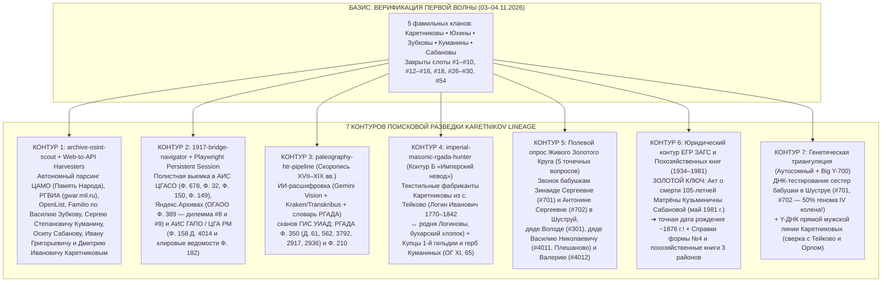
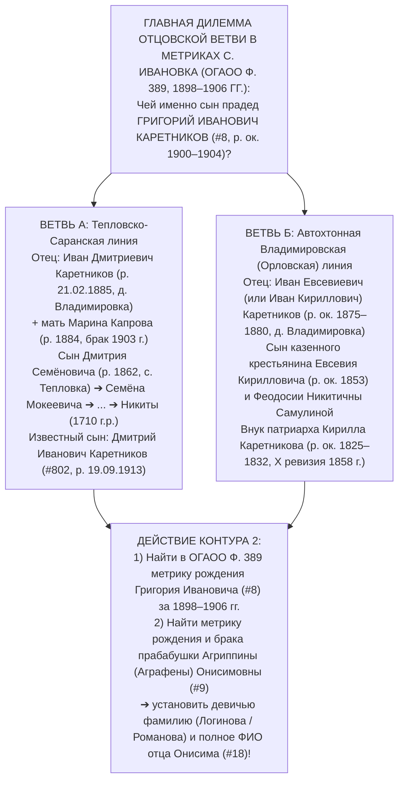

# 🧭 ГЕНЕРАЛЬНАЯ ДОРОЖНАЯ КАРТА ИИ- И АРХИВНОЙ РАЗВЕДКИ РОДА ДО XII КОЛЕНА (`SEARCH_MASTER_ROADMAP.md`)

> **Владелец и Пробанд:** Граф Каретников (Каретников Дмитрий Иванович, р. 14.09.1994, г. Самара)  
> **Версия стандарта:** `v2.0 (Post-Wave 1 Verification — 04.11.2026)`  
> **Цель:** 100% документальное закрытие всех 127 прямых слотов восходящего древа Соса-Страдоница (I–VII колена, 1795–2026 гг.), исторической вертикали до XII колена (1640–1795 гг.) и боковых ветвей по **5 родовым фамильным кластерам**: **Каретниковы, Юхины, Зубковы, Куманины, Сабановы** *(+ боковые союзы: **Логиновы, Романовы, Самулины, Четвериковы**)*.  
> **Главный канон:** `ZERO HALLUCINATION LAW` — каждое имя, дата и гипотеза опираются строго на первичные семейные свидетельства и верифицированные архивные шифры (`РГАДА`, `РГИА`, `ЦАМО`, `РГВИА`, `ГАПО`, `ЦГАСО`, `ОГАОО`, `ЦГА РМ`, `ЕГР ЗАГС`).

---

## 🔴 1. ИТОГИ ПЕРВОЙ ВОЛНЫ ВЕРИФИКАЦИИ (03–04.11.2026): ПРОРЫВ ПО МАТЕРИНСКОМУ КРЫЛУ

Полевое генеалогическое интервью Графа Каретникова с матерью — **Светланой Владимировной Каретниковой (урожд. Зубковой, `#3`, р. 19.06.1969, с. Новый Шуструй)** (`Msg#297`, `Msg#298`, `Msg#299` от 03.11.2026, расшифровка `ЛендOS faster-whisper large-v3-turbo`) — произвело тектонический сдвиг в исследовании: оно **на 100% верифицировало III–V колена материнского крыла**, устранило 3 критические ошибки предварительной реконструкции и открыло **5-ю прямую родовую фамилию — Сабановы**, а также вывело на **VI колено (`#54`)**!

### 1.1. Сводная таблица открытий и исправлений Первой Волны (`Msg#297–299`)

| Слот Ahnentafel | Прежняя гипотеза (до 03.11.2026) | Подтвержденный факт Первой Волны (Светлана Владимировна + Граф Каретников) | Архивный и генеалогический эффект |
| :---: | :--- | :--- | :--- |
| **`#6` (Дед по матери, III колено)** | `Зубков Владимир Владимирович (ст.)`, даты `~1938–1982` | **`Зубков Владимир Васильевич`**, точные даты жизни: **`04.03.1943 — 04.07.1981`** (38 лет, с. Новый Шуструй). Воспитывался бабушкой Матрёной Кузьминичной Сабановой (`#27`). Трагически погиб **ровно на 40-й день** после её смерти (`04.07.1981`). | Исправлен патроним деда (`Васильевич`), что автоматически меняет имя прадеда `#12` с Владимира на **Василия Зубкова**! |
| **`#7` (Бабушка по матери, III колено)** | `Зубкова (Куманина) Валентина Сергеевна`, даты `~1940–1986` | **`Зубкова (урожд. Куманина) Валентина Сергеевна`**, точные даты жизни: **`09.04.1942 — 07.03.1986`** (43 года, с. Новый Шуструй). Одна из 6 детей Сергея Степановича и Евдокии Григорьевны Куманиных. Живые сёстры в Новом Шуструе: **Зинаида Сергеевна (`#701`)** и **Антонина Сергеевна (`#702`)**. | Точная привязка к актовым книгам ЗАГС Нижнеломовского р-на за 1942 и 1986 гг. |
| **`#12` (Прадед, IV колено)** | `Зубков Владимир [Старший]` | **`Зубков Василий [Отчество уточняется]`** (`~1910–1923 г.р.`, с. Новый Шуструй) — отец Владимира Васильевича Зубкова (`#6`), муж Анны Осиповны Сабановой (`#13`). | Фокус поиска в переписи 1917 г. (`ГАПО Ф. 158 Оп. 3 Д. 4014`) переключен на **Василиев Зубковых** (Кандидат №1: **Василий Федорович Зубков** — сын отставного рядового Федора Петровича Зубкова и Вассы Ивановны урожд. Сабановой!). |
| **`#13` (Прабабушка, IV колено)** | `Вакантный слот #13` (`UNKNOWN_SLOT`) | **`Сабанова Анна Осиповна («бабушка Анютка»)`** (`~1912–1924 г.р.`, с. Новый Шуструй) — мать деда Владимира Васильевича (`#6`). Уезжала на заработки (отходничество), оставляя сына Володю на воспитание своей матери Матрёне Кузьминичне (`#27`). | **Открыта 5-я родовая фамилия — САБАНОВЫ!** В метрике 1907 г. (`ГАПО Ф. 182 Оп. 3 Кн. 561`) уже зафиксирован брак Дмитрия Ивановича Сабанова и Алимпиады Григорьевны Зубковой при поручительстве Федора Зубкова и Егора Куманина! |
| **`#14` (Прадед, IV колено)** | `Куманин Сергей Егорович` (гипотеза по метрике 1907 г.) | **`Куманин Сергей Степанович`** (`~1908–1918 г.р.`, с. Новый Шуструй) — отец 6 детей (вкл. Валентину `#7`, Зинаиду `#701`, Антонину `#702`), сын Степана Куманина (`#28`) и повитухи Алёны Куманиной (`#29`). | Критическое исправление отчества (`Егорович` ➔ **`Степанович`**). Егор Петрович Куманин (поручитель 1907 г.) переведен в статус двоюродного прапрадеда / родного дяди (`#2801`). |
| **`#15` (Прабабушка, IV колено)** | `Вакантный слот #15` (`UNKNOWN_SLOT`) | **`Куманина Евдокия Григорьевна («бабушка Дуня»)`** (`~1910–1920 г.р.`) — уроженка **с. Старый Шуструй** из очень известной местной семьи (девичью фамилию помнят дядя Володя `#301` и бабушка Зина `#701`). Мать 6 детей. | Локализация корней прабабушки `#15` и её отца Григория `#30` непосредственно в историческом ядре казачьей слободы — **с. Старый Шуструй**! |
| **`#26` (Прапрадед, V колено)** | `Вакантный слот #26` (`UNKNOWN_SLOT`) | **`Сабанов Осип (канон. Иосиф) [Отчество уточняется]`** (`~1870–1880 г.р.`, с. Новый Шуструй) — муж 105-летней Матрёны Кузьминичны (`#27`), отец Анны Осиповны (`#13`). **Работник / служащий при церкви в Шуструе!** | Прямой выход на **Клировые ведомости** Никольской церкви с. Шуструй (`ГАПО Ф. 182 Оп. 1, 3, 6` и `Пензенские епархиальные ведомости`), где поименно учитывались все церковнослужители и работники причта! |
| **`#27` (Прапрабабушка, V колено)** | `Вакантный слот #27` (`UNKNOWN_SLOT`) | **`Сабанова Матрёна Кузьминична`** (**`~1876 — кон. мая 1981`**, `~25–26.05.1981`, с. Новый Шуструй). **Прожила ~105 лет!** Лично вырастила внука Владимира Васильевича Зубкова (`#6`), погибшего ровно на 40-й день после её кончины. | **Главный хронологический якорь древа:** человек, умерший в мае 1981 г. при советском ЗАГСе, родился в `~1876 году` при императоре Александре II! Справка о её смерти за май 1981 г. перебрасывает документальный мост сразу на 105 лет вглубь! |
| **`#28` (Прапрадед, V колено)** | `Куманин Егор Петрович` | **`Куманин Степан [Отчество уточняется]`** (`~1875–1890 г.р.`, с. Новый Шуструй / Старый Шуструй) — отец Сергея Степановича Куманина (`#14`), муж повитухи Алёны (`#29`). | Целевой поиск в `ГАПО Ф. 158 Оп. 3 Д. 4014` (Перепись 1917 г.) перенаправлен на подворную карточку домохозяина **Степана Куманина**. |
| **`#29` (Прапрабабушка, V колено)** | `Вакантный слот #29` (`UNKNOWN_SLOT`) | **`Куманина Алёна (Алёнушка, метрич. Елена)`** (`~1875–1892 г.р.`, с. Шуструй) — мать Сергея Степановича (`#14`). Знаменитая в Шуструе **сельская повитуха и народная целительница / знахарка**, лично принявшая роды всех 6 детей у невестки Евдокии Григорьевны (`#15`). | Девичью фамилию и отчество бабушки Алёнушки хранит в памяти её родная внучка — живая **бабушка Зинаида Сергеевна (`#701`)** в с. Новый Шуструй. |
| **`#30` (Прапрадед, V колено)** | `Вакантный слот #30` (`UNKNOWN_SLOT`) | **`Григорий [Известный род с. Старый Шуструй]`** (`~1875–1890 г.р.`) — отец прабабушки Евдокии Григорьевны Куманиной (`#15`). | Подлежит проверке по подворным карточкам **с. Старый Шуструй** в переписи 1917 г. (`ГАПО Ф. 158 Оп. 3`) и опросу дяди Володи (`#301`). |
| **`#54` (Прапрапрадед, VI колено)** | `Вакантный слот #54` (`UNKNOWN_SLOT`) | **`Кузьма (метрич. Косма) [Фамилия уточняется]`** (`~1840–1855 г.р.`, Нижнеломовский уезд) — отец 105-летней Матрёны Кузьминичны Сабановой (`#27`, р. ~1876). | Родился до отмены крепостного права (`~1840–1855`) — гарантированный фигурант **IX ревизии (1850 г.)** и **X ревизии (1858 г.)** в `ГАПО Ф. 60 Оп. 4`! |

---

## 🤖 2. АРХИТЕКТУРА 7 АВТОНОМНЫХ И ПОЛУАВТОНОМНЫХ КОНТУРОВ РАЗВЕДКИ ИИ-АГЕНТОВ

Для полного закрытия оставшихся белых пятен IV–XII колен по всем 5 фамилиям (**Каретниковы, Юхины, Зубковы, Куманины, Сабановы**) развернута эшелонированная система из **7 контуров разведки**, где ИИ-агенты проекта (`archive-osint-scout`, `1917-bridge-navigator`, `paleography-htr-pipeline`, `imperial-masonic-rgada-hunter`) работают синхронно с полевыми и юридическими инструментами Графа Каретникова:

---

## 🕵️‍♂️ 3. ДЕТАЛЬНЫЙ ПРОТОКОЛ ПО КАЖДОМУ ИЗ 7 КОНТУРОВ РАЗВЕДКИ

### КОНТУР 1: `archive-osint-scout` + Web-to-API Harvesters (Автономный парсинг баз XX века)
**Инструментарий:** Локальные Python-харвестеры (`scripts/scouts/`) с перехватом JSON/XHR-эндпоинтов баз `pamyat-naroda.ru`, `gwar.mil.ru`, `openlist.wiki`, `bessmertnybarak.ru`, `familio.org`, `vgd.ru`.

| № | Целевая персона / Кластер | Поисковый запрос и фильтр локации | Какую загадку древа решает |
| :-: | :--- | :--- | :--- |
| **1.1** | **`Зубков Василий [N-ович]` (`#12`)** | Все `Зубковы Василии` `1900–1925 г.р.`, уроженцы `с. Новый Шуструй / с. Старый Шуструй` Нижнеломовского р-на Пензенской обл. в ЦАМО РФ (ВОВ: наградные листы, УПК, карточки ранений, списки призыва Нижнеломовского РВК) и РГВИА (`gwar.mil.ru` — для старших возрастов). | Устанавливает **отчество прадеда Василия Зубкова (`#12`)** и проверяет главного архивного кандидата из Переписи 1917 г. (`ГАПО Ф. 158 Оп. 3 Д. 4014`): **Василия Федоровича Зубкова** (сына отставного рядового Федора Петровича Зубкова и Вассы Ивановны, урожденной **Сабановой**!), а также **Василия Степановича** и **Василия Петровича Зубковых**. |
| **1.2** | **`Куманин Сергей Степанович` (`#14`)** и **`Куманин Степан` (`#28`)** | Все `Куманины Сергеи Степановичи` (`1905–1922 г.р.`) и `Куманины Степаны` (`1870–1895 г.р.`) по Нижнеломовскому уезду / р-ну (`с. Новый Шуструй`, `с. Старый Шуструй`) в ЦАМО РФ (ВОВ), РГВИА (ПМВ `1914–1918`) и базах репрессированных/раскулаченных (`openlist.wiki`). | Дает точный год рождения прадеда **Сергея Степановича (`#14`)**, проверяет его участие в ВОВ и находит **отчество прапрадеда Степана Куманина (`#28`)** в карточках Первой мировой войны (`gwar.mil.ru`). |
| **1.3** | **`Сабанов Осип (Иосиф)` (`#26`)** и клан **Сабановых** | Все носители фамилии `Сабанов / Собанов` по `с. Новый Шуструй`, `с. Старый Шуструй` Нижнеломовского уезда и смежному **Атюрьевскому / Торбеевскому / Темниковскому ареалу Мордовии** (бывший Краснослободский и Шацкий уезды) в `familio.org`, `gwar.mil.ru`, `openlist.wiki` (репрессии против церковнослужителей 1929–1938 гг.!). | Поскольку прапрадед **Осип (Иосиф) Сабанов (`#26`)** был служащим при церкви, он с высокой вероятностью попадал в списки лишенцев или церковного актива 1920–1930-х гг., а его сыновья (братья Анны Осиповны `#13` с отчеством `Осипович / Иосифович`) — в базы призыва ВОВ! |
| **1.4** | **`Каретников Иван Григорьевич` (`#403`)** и **`Каретников Дмитрий Иванович` (`#802`)** | 1) `Каретников Иван Григорьевич` (`1918–1935 г.р.`, уроженец Ивановского / Люксембургского р-на Чкаловской обл., мигрировавший в **с. Чалдовар / Чуйскую долину на границе Казахстана и Кыргызстана**); 2) `Каретников Дмитрий Иванович` (**р. `19.09.1913`**, д. Владимировка — сын Ивана Дмитриевича Каретникова 1885 г.р. и Марины Капровой) + `Каретников Фёдор Иванович` (**р. `18.03.1923`**, д. Владимировка). | Проверяет судьбу старшего брата деда **Ивана Григорьевича (`#403`)** и документально сшивает братьев прадеда Григория Ивановича (`#8`) — **Дмитрия Ивановича (`#802`, р. 1913)** и **Фёдора Ивановича (р. 1923)** — через графу «Ближайшие родственники / Мать / Отец» в донесениях и УПК ЦАМО! |

---

### КОНТУР 2: `1917-bridge-navigator` + Playwright Persistent Session (Штурм региональных АИС и Яндекс.Архивов)
**Инструментарий:** Авторизованный через ЕСИА (Госуслуги) постоянный профиль `scripts/scouts/playwright_research_engine.py --login` (`.secrets/browser_profile`).

#### 2.1. Полистная выемка в АИС ЦГАСО (`cgaso.regsamarh.ru`) — Ветви Юхиных и Каретниковых
1. **`ЦГАСО, Фонд 678, Опись 1, Дело 385, листы 239–261` (1863 г.):**
   - *Наименование:* «Посемейный рекрутский список переселенцев Самарской VI казенной дачи Петровской волости (в т.ч. **д. Четыровка** на р. Кондурча)».
   - *Целевая задача:* Выписать все дворы **Юхиных** на лл. 239–261 с указанием возрастов по X ревизии (1858 г.) и на 1863 г., и главное — прочитать графу **«Из какой губернии, уезда и села переведены»** (ключ к прародине рода Юхиных до 1840-х гг.!).
2. **`ЦГАСО, Фонд 32, Опись 35, Дела 201, 272, 278` (и `Оп. 40, Д. 194`):**
   - *Наименование:* Метрические книги Архангельской церкви **с. Русская Васильевка** (приход д. Четыровка) и Казанско-Богородицкой церкви с. Петропавловка Самарского уезда за `1895–1916 гг.`
   - *Целевая задача:* Найти актовую запись о рождении и браке прадеда **Петра Юхина (`#10`)** ➔ установить полное имя и отчество прапрадеда (`#20`) и девичью фамилию прапрабабушки (`#21`).
3. **`ЦГАСО, Фонд 150, Опись 1, Дело 168` (1858 г.) и `ДД. 23, 75, 153б, 166` (1834, 1850 гг.):**
   - *Наименование:* Ревизские сказки X (1858 г.), IX (1850 г.) и VIII (1834 г.) ревизий государственных крестьян Бузулукского уезда по **д. Владимировка** Ивановской волости.
   - *Целевая задача:* Поднять подворную запись казенного крестьянина **Кирилла Каретникова** и его малолетнего сына **Евсевия Кирилловича Каретникова** (р. ок. 1853 г.), а по сказке 1850 г. — указ Оренбургской казенной палаты о причислении из Орловской губернии.
4. **`ЦГАСО, Фонд 149, Опись 1` (1883–1917 гг.):**
   - *Наименование:* Самарское отделение Крестьянского поземельного банка.
   - *Целевая задача:* Выемка посемейных списков крестьян-заемщиков Владимировского, Ивановского, Плешановского и Подольского товариществ Бузулукского уезда.

#### 2.2. Веб-штурм Яндекс.Архивов (`ya.ru/archive` — ОГАОО Фонд 389): Разрешение Главной Дилеммы Отцовской Ветви
В метрических книгах **Михайло-Архангельской церкви с. Ивановка Бузулукского уезда (`ОГАОО Ф. 389, Оп. 1`)** за `1898–1906 гг.` сфокусирован главный исследовательский вопрос по слоту прапрадеда **`#16` (`Иван Каретников`)**:

#### 2.3. Выемка в АИС ГАПО (`ais.arhivpnz.ru`) и ЦГА РМ (Саранск) — Ветви Зубковых, Куманиных и Сабановых
1. **`ГАПО, Фонд 158, Опись 3, Дело 4014` (1917 г.):**
   - *Наименование:* Подворные карточки Всероссийской сельскохозяйственной и поземельной переписи 1917 года по **с. Новый Шуструй** и **с. Старый Шуструй** Старо-Толковской волости Нижнеломовского уезда.
   - *Целевая выемка:*
     * Карточка двора **Степана Куманина (`#28`)** с женой **Еленой/Алёной (`#29`)** и сыном **Сергеем Степановичем (`#14`)**;
     * Карточка двора церковнослужителя **Осипа (Иосифа) Сабанова (`#26`)** с женой **Матрёной Кузьминичной (`#27`, в 1917 г. ей ~41 год!)** и дочерью **Анной Осиповной (`#13`)**;
     * Все **19 дворов Зубковых** (поиск малолетнего **Василия Зубкова `#12`**, в т.ч. в подворье №1 Федора Петровича Зубкова и Вассы Ивановны Сабановой);
     * Карточки домохозяев по имени **Григорий (`#30`)** по **с. Старый Шуструй** (у которых в 1910–1917 гг. растет дочь **Евдокия Григорьевна `#15`**).
2. **`ГАПО, Фонд 182, Описи 1, 3, 6` (и фонды духовных правлений в ЦГА РМ, г. Саранск):**
   - *Наименование:* **Клировые ведомости** и метрические книги Никольской церкви с. Старый/Новый Шуструй (`Кн. 561` за 1907–1917 гг. и книги за `1874–1906 гг.`).
   - *Целевая выемка:*
     * В клировых ведомостях: точная церковная должность, возраст, сословие и отчество **Осипа (Иосифа) Сабанова (`#26`)**;
     * В метрических книгах за `1874–1878 гг.`: запись о крещении **Матрёны Кузьминичны (`#27`)** — устанавливает полное ФИО её отца **Космы/Кузьмы (`#54`)** и матери (`#55`)!

---

### КОНТУР 3: `paleography-htr-pipeline` (ИИ-расшифровка скорописи XVII–XIX вв.)
**Инструментарий:** Локальный мультимодальный пайплайн `scripts/htr/paleography_ocr_runner.py` (связка `Gemini Vision Pro` + `Kraken / Transkribus` + морфологический словарь сокращений, титл и выносных букв приказной скорописи РГАДА из `C:\Серкин, Циолковский\references\archaic_codex`).

**Целевые оцифрованные дела в ГИС УИАД (`online.archives.ru` — вход через Госуслуги):**
1. **`РГАДА, Фонд 350, Опись 1, Дело 61` (1714 г., Верхнеломовский уезд, листы 22–23 и далее):**
   - Автоматическая транскрипция переписной книги казаков, солдат и однодворцев **села и деревни Шуструй (Шуструя)**: сшивка двора служилого казака **Алёшки Антонова сына Куманина** и его сына **Артюшки (Артемия) Алексеевича** с первичными дворами **Зубковых** и **Сабановых**.
2. **`РГАДА, Фонд 350, Опись 2, Дело 562` (1746–1748 гг., II ревизия, лист 289 об. и далее):**
   - Полистное HTR-распознавание сказок однодворцев **села Шуструй Верхнеломовского уезда** (поколения VIII–X колен Куманиных, Зубковых и Сабановых).
3. **`РГАДА, Фонд 350, Опись 2, Дела 3792 (1719 г.), 2917 (1748 г.), 2936 (1762 г., л. 221 / кадр 224, двор №14)`:**
   - Расшифровка I, II и III ревизий по **с. Тепловка Заинзарского стана Саранского уезда** (вотчина Якова Теплова): извлечение имени и отчества отца патриарха **Никиты [Каретника]** (XII колено, `~1680–1695 г.р.`) и сыновей **Василия Никитина** и **Макара Никитина (1740–1802)**.
4. **`РГАДА, Фонд 210 (Разрядный приказ), Оп. 6-б, Д. 25 (1696–1697 гг.)` + `Столбцы Шацкого (Оп. 9), Белгородского (Оп. 6-д) и Севского (Оп. 14) столов`:**
   - Дешифровка смотренных списков Верхнего и Нижнего Ломова (казаки Куманины, Зубковы, Сабановы) и сметных книг Пушкарской слободы г. Мценска (служилые пушкари Каретниковы).

---

### КОНТУР 4: `imperial-masonic-rgada-hunter` (Контур Б «Имперский невод» — `[ГИПОТЕЗА]`)
Параллельно с региональным ядром агент ведет разработку двух фундаментальных сословно-купеческих гипотез старших ветвей:

#### 4.1. Текстильная империя фабрикантов Каретниковых из с. Тейково (`[🔵 СЕМЕЙНОЕ ПРЕДАНИЕ ОТ ДВОЮРОДНОГО БРАТА / ГИПОТЕЗА]`)
- **Устный инсайт Графа Каретникова (`Запись #4`):** Независимое свидетельство двоюродного брата о родстве с купеческой династией текстильных фабрикантов Каретниковых (с. Тейково Шуйского уезда Владимирской / Иваново-Вознесенской губ., основатели мануфактуры в 1787 г.).
- **Ономастический детектор «ЛОГИН»:** Один из ключевых патриархов Тейковской династии — купец 1-й гильдии и потомственный почетный гражданин **Логин Иванович Каретников (1770–1842)** (редчайшее крестильное имя с частотностью `<0.3%`). В то же время в оренбургском роду деда Валентина Григорьевича зафиксирована близкая родственная ветвь **Логиновых**!
- **Экономический мост «Тейково $\leftrightarrow$ Оренбург / Бузулук»:** «Товарищество Мануфактур Александра Каретникова с Сыном» вело прямую закупку среднеазиатского и бухарского хлопка-сырца через **Оренбургский меновой двор, Бузулук и Ташкентскую железную дорогу**. Проверяются списки доверенных приказчиков и младших нетитулованных ветвей Тейковских Каретниковых в Оренбуржье и Самаре (`РГИА Ф. 577 Оп. 5`, `РГИА Ф. 1343 Оп. 39`, `ГАИО`), а также высылка/исход членов династии после национализации фабрики в 1918 г.

#### 4.2. Купеческая династия 1-й гильдии и Дворянский герб Куманиных (`ОГ XI, 65` — `[🟡 ГИПОТЕЗА СТАРШЕЙ ВЕТВИ]`)
- **Исторический след:** Проверка единого генеалогического корня между служилыми людьми Куманиными Шацкой/Ломовской засечной черты и первогильдейскими московскими/переславскими купцами, меценатами и дворянами **Куманиными** (Василий Алексеевич, Алексей Алексеевич, Константин Алексеевич Куманины — родня Ф. М. Достоевского, жалованная дворянским гербом в **«Общем Гербовнике Российской Империи», часть XI, стр. 65**: *в лазоревом щите золотое орлиное крыло и серебряная шестиугольная звезда*).
- **Целевые фонды:** `РГИА Ф. 1343 Оп. 24 и Оп. 39` (дела о дворянстве и почетном гражданстве Куманиных), `РГАДА Ф. 350` (Переславль-Залесский и Шацкий уезды).

---

### КОНТУР 5: Полевой опрос Живого Золотого Круга (5 точечных вопросов в Шуструй и сверка с Плешаново)

#### 5.1. Протокол «Золотого звонка» в с. Новый Шуструй
**Адресаты:** Живые родные сёстры бабушки Валентины Сергеевны — двоюродные бабушки **Куманина Зинаида Сергеевна (`#701`)** и **Куманина Антонина Сергеевна (`#702`)** (с. Новый Шуструй), а также родной дядя **Зубков Владимир Владимирович-младший (`#301`)**.

| № | Точная формулировка вопроса для разговора | Какой слот закрывает на 100% |
| :-: | :--- | :--- |
| **1** | **«Какое отчество было у деда Василия Зубкова — отца Владимира Васильевича Зубкова (`04.03.1943 — 04.07.1981`)? В какие годы он жил и воевал ли в Великую Отечественную?»** | Закрывает отчество прадеда **`#12` (`Зубков Василий [N-ович]`)** и мгновенно указывает на конкретного прапрадеда **`#24`** среди 19 дворов Зубковых переписи 1917 г. |
| **2** | **«Какая девичья фамилия была у бабушки Дуни — Куманиной Евдокии Григорьевны из села Старый Шуструй? Говорили, что её род в Старом Шуструе был очень известным — чьих она была кровей и кем был её отец Григорий?»** | Закрывает девичью фамилию прабабушки **`#15` (`Евдокия Григорьевна`)** и фамилию прапрадеда **`#30` (`Григорий из с. Старый Шуструй`)**. |
| **3** | **«Как по отчеству и по девичьей фамилии звали вашу родную бабушку — повитуху и целительницу Алёну (Алёнушку / Елену) Куманину, принявшую всех 6 детей у бабушки Дуни? И какое отчество было у её мужа — вашего деда Степана Куманина?»** | Закрывает отчество прапрадеда **`#28` (`Степан Куманин`)** (выход на VI колено `#56`) и девичью фамилию + отчество прапрабабушки-повитухи **`#29` (`Алёна Куманина`)**. |
| **4** | **«В какой церкви служил прапрадед Осип (Иосиф) Сабанов — муж 105-летней Матрёны Кузьминичны (в Никольской церкви Нового Шуструя или в Старом Шуструе), кем именно он служил (псаломщик, староста, сторож, звонарь) и какое у него было отчество?»** | Дает точный приход и должность прапрадеда **`#26` (`Осип Сабанов`)** для выемки клировых ведомостей `ГАПО Ф. 182` и уточняет девичью фамилию 105-летней **`#27` (`Матрёны Кузьминичны`)**. |
| **5** | **«Как звали всех шестерых детей Сергея Степановича и Евдокии Григорьевны Куманиных по старшинству (помимо Валентины, Зинаиды и Антонины), и были ли родные братья и сёстры у Владимира Васильевича Зубкова (`1943 г.р.`)?»** | Полностью закрывает боковые ветви III и IV колен (`collateral_relatives`) материнского крыла. |

#### 5.2. Протокол сверки с Оренбургским и Самарским кругом (Род Каретниковых)
- **Двоюродный дядя `Каретников Василий Николаевич` (`#4011`, с. Плешаново Красногвардейского р-на, директор МБУ КИС «Вымпел» — главный хранитель рукописного древа Каретниковых)** и **дядя `Каретников Валерий Николаевич` (`#4012`, г. Тольятти):**
  1. Сверить собранное Василием Николаевичем фамильное древо: как в его записях указано отчество прапрадеда **Ивана Каретникова (`#16`)** (Дмитриевич 1885 г.р. или Евсевиевич/Кириллович?) и девичья фамилия прабабушки **Агриппины Анисимовны (`#9` — Логинова или Романова?)**.
  2. Уточнить точные даты жизни прадеда **Григория Ивановича Каретникова (`#8`)** и наличие его фотографий в семейном альбоме в с. Плешаново.
  3. Получить точные контакты потомков брата деда — **Ивана Григорьевича Каретникова (`#403`)** (с. Чалдовар / Чуйская долина, Казахстан / Кыргызстан).

---

### КОНТУР 6: Юридический контур ЕГР ЗАГС и Похозяйственных книг (100% документальный бетон)

> [!IMPORTANT]
> **ЗОЛОТОЙ КЛЮЧ ЕГР ЗАГС №1 (Прыжок на 105 лет назад в эпоху Александра II!):**  
> Прапрабабушка **Сабанова Матрёна Кузьминична (`#27`)** скончалась в **конце мая 1981 года** (`~25–26.05.1981`, ровно за 40 дней до гибели внука Владимира Васильевича Зубкова `04.07.1981`) в возрасте **~105 лет**.  
> Поскольку смерть наступила в **1981 году**, её актовая запись о смерти оцифрована в федеральной базе **ЕГР ЗАГС** (Нижнеломовский ЗАГС Пензенской обл.)! Запрос **Справки о смерти формы №12 с «иными сведениями»** на Сабанову Матрёну Кузьминичну (ум. май–июнь 1981 г.) даст **точную дату и место её рождения в `~1876 году`**, перебросив юридически неоспоримый мост сразу к метрикам 1876 года и 10-й ревизии 1858 года (`#54 Косма`)!

#### 6.1. Пакет запросов в ЕГР ЗАГС (подается в любом МФЦ г. Самары за 1 визит)
*Правило:* Запрашивать строго **«Справку о рождении / браке / смерти (формы №4, №6, №11, №12) с указанием ВСЕХ иных сведений из актовой записи»**!

| № | На кого запрашивается справка | Тип актовой записи и год | Что открывает в древе |
| :-: | :--- | :--- | :--- |
| **1** | **`Сабанова Матрёна Кузьминична` (`#27`)** | **Справка о смерти** (`май–июнь 1981 г.`, с. Новый Шуструй, Нижнеломовский р-н) | Точная дата и село рождения в **`~1876 году`** (V колено) + выход на метрику крещения у отца **Кузьмы (`#54`, VI колено)**! |
| **2** | **`Зубков Владимир Васильевич` (`#6`)** | **Справка о рождении** (`04.03.1943`) + **Справка о смерти** (`04.07.1981`, Нижнеломовский р-н) | Полное ФИО и **отчество отца — `Зубкова Василия [N-овича]` (`#12`)**, точный возраст родителей в 1943 г. и данные матери **Анны Осиповны Сабановой (`#13`)**! |
| **3** | **`Зубкова (Куманина) Валентина Сергеевна` (`#7`)** | **Справка о рождении** (`09.04.1942`) + **Справка о смерти** (`07.03.1986`, Нижнеломовский р-н) | Документальная фиксация родителей: **Куманина Сергея Степановича (`#14`)** и **Куманиной Евдокии Григорьевны (`#15`)** с указанием их возраста в 1942 г.! |
| **4** | **`Каретникова Агриппина Анисимовна` (`#9`)** и **`Каретников Валентин Григорьевич` (`#4`)** | **Справка о смерти `#9`** (г. Куйбышев/Самара, после 1961 г.) + **Справка о рождении `#4`** (`1936 г.`, Оренбургская обл.) | Точная дата и место рождения прабабушки Агриппины Анисимовны (`~1898–1905 гг.`), её **девичья фамилия (`Логинова / Романова`)** и полное ФИО прадеда Григория Ивановича (`#8`)! |
| **5** | **`Каретникова (Юхина) Клавдия Петровна` (`#5`)** | **Справка о рождении** (`1936 г.`, д. Четыровка Кошкинского р-на) + **Справка о смерти** (`2011 / 2013 г.`, г. Самара) | Полное ФИО и **отчество прадеда `Юхина Петра [N-овича]` (`#10`)** и полное имя + девичья фамилия прабабушки (`#11`)! |

#### 6.2. Пакет запросов по Похозяйственным книгам сельсоветов (1934–1975 гг.)
1. **Архивный отдел администрации Нижнеломовского района Пензенской области** (`442150, г. Нижний Ломов, ул. Ленина, 54`):
   - Выписки из похозяйственных книг **Ново-Шуструйского и Старо-Шуструйского сельсоветов за 1934–1975 гг.** по дворам:
     * **Зубкова Василия (`#12`)** и **Сабановой Анны Осиповны (`#13`)** (с сыном Владимиром Васильевичем `04.03.1943 г.р.`);
     * **Сабанова Осипа (`#26`)** и **Сабановой Матрёны Кузьминичны (`#27`, `~1876 г.р.`)**;
     * **Куманина Сергея Степановича (`#14`)**, **Евдокии Григорьевны (`#15`)**, **Куманина Степана (`#28`)** и повитухи **Алёны Куманиной (`#29`)**.
2. **Архивный отдел администрации Красногвардейского района Оренбургской области** (`461150, с. Плешаново, пр. Гагарина, 23` / `ул. Советская, 28`):
   - Выписки из похозяйственных книг **Владимировского, Залесовского, Подольского и Плешановского сельсоветов за 1934–1961 гг.** по дворам **Каретникова Григория Ивановича (`#8`)** и **Агриппины Анисимовны (`#9`)** (с сыновьями Николаем, Петром, Валентином `1936 г.р.` и Иваном), а также **Каретникова Фёдора Ивановича (`18.03.1923 г.р.`)** и **Ивана Дмитриевича (`1885 г.р.`)**.
3. **Архивный отдел администрации м.р. Кошкинский Самарской области** (`446800, с. Кошки, ул. Советская, 32`):
   - Выписки из похозяйственных книг **Четыровского сельсовета (д. Четыровка) за 1934–1955 гг.** на семью **Юхина Петра (`#10`)** и его дочери **Клавдии Петровны (`#5`)**.

---

### КОНТУР 7: Генетическая триангуляция (Аутосомный ДНК-профиль + Big Y-700)

Генетическая генеалогия дает математически неопровержимую верификацию архивных ветвей XVI–XIX веков:
1. **Аутосомное тестирование (`FamilyTreeDNA Family Finder` / `MyHeritage DNA`) двоюродных бабушек в с. Новый Шуструй — `Зинаиды Сергеевны (#701)` и `Антонины Сергеевны (#702)`:**
   - *Уникальная научная ценность:* Зинаида Сергеевна и Антонина Сергеевна принадлежат к **III колену** (поколению родной бабушки Валентины Сергеевны `#7`). Каждая из них несет **ровно 50% аутосомного ДНК прадеда Сергея Степановича Куманина (`#14`) и 50% ДНК прабабушки Евдокии Григорьевны (`#15`)**, а их совместный фазированный профиль позволяет реконструировать **до 75% генома IV колена Куманиных и старошуструйского рода Григория (`#30`)**!
2. **Тестирование Y-хромосомы (`FTDNA Big Y-700`) прямой мужской линии Каретниковых:**
   - Тестирование **Графа Каретникова (`#1`)** (или отца **Ивана Валентиновича `#2`** / дяди **Василия Николаевича `#4011`** в Плешаново).
   - *Что решает:* Y-хромосома передается строго от отца к сыну без рекомбинации (`Никита ~1710 ➔ Макар ➔ Степан ➔ Филимон ➔ Семён ➔ Дмитрий ➔ Иван ➔ Григорий #8 ➔ Валентин #4 ➔ Иван #2 ➔ Дмитрий #1`). Сравнение терминального снипа (SNP) и STR-маркеров с базой протестированных потомков **Тейковских Каретниковых** и **Орловско-Мценских Каретниковых** со 100% точностью ответит на вопрос о кровном единстве с фабрикантами Тейково!

---

## 📊 4. СВОДНАЯ МАТРИЦА ДОРЕВОЛЮЦИОННЫХ ФОНДОВ ПО 5 РОДОВЫМ ФАМИЛИЯМ (XVII–XIX ВВ.)

| Родовой клан | Родовое гнездо | Ревизии 1714–1764 гг. (РГАДА Ф. 350) | Приказные книги XVII в. (РГАДА Ф. 210 / 1209) | Ревизии 1782–1858 гг. и Перепись 1917 г. | Метрические книги и Клировые ведомости |
| :--- | :--- | :--- | :--- | :--- | :--- |
| **1. Каретниковы** (`#1, #2, #4, #8, #16`) | д. Владимировка, с. Плешаново, с. Подольск (Бузулукский у.) $\leftrightarrow$ с. Тепловка / г. Мценск | `РГАДА Ф. 350 Оп. 2 ДД. 3792 (1719), 2917 (1748), 2936 л. 221 (1762)` (Тепловка); `Д. 1894` (Мценск) | `РГАДА Ф. 210 Оп. 14` (Севский стол — пушкари Мценска); `Оп. 6-д` (Белгородский стол) | `ЦГАСО Ф. 150 Оп. 1 Д. 168` (1858 г., двор Кирилла и Евсевия); `ДД. 23, 75, 166` (1834, 1850); `ОГАОО Ф. 98 Оп. 2`; `ЦГАСО Ф. 149` (Банк) | **`ОГАОО Ф. 389 Оп. 1`** (МК Михайло-Архангельской ц. с. Ивановка 1885, 1894, 1898–1906, 1913 гг.) + `ЦГАСО Ф. 32 Оп. 33` |
| **2. Юхины** (`#5, #10, #20`) | д. Четыровка на р. Кондурче (Самарский / Ставропольский у.) | `РГАДА Ф. 350 Оп. 2 ДД. 2892–2897` (1724–1748 гг., Самарский уезд и Закамская линия) | `РГАДА Ф. 210` (Ландмилиция и служилые люди Закамской черты) | **`ЦГАСО Ф. 678 Оп. 1 Д. 385 лл. 239–261`** (Рекрутский список Четыровки 1863 г. с губернией выхода!); `ЦГАСО Ф. 150 Оп. 1` (1850, 1858) | **`ЦГАСО Ф. 32 Оп. 35 ДД. 201, 272, 278`** и `Оп. 40 Д. 194` (МК Архангельской ц. с. Русская Васильевка 1895–1916 гг.) |
| **3. Зубковы** (`#3, #6, #12, #24`) | с. Новый Шуструй (Нижнеломовский / Верхнеломовский у.) | **`РГАДА Ф. 350 Оп. 1 Д. 61 лл. 22–23`** (1714 г., Шуструй); **`Ф. 350 Оп. 2 Д. 562 л. 289 об.`** (1748 г.) | `РГАДА Ф. 210 Оп. 6-б Д. 25` (Смотренные списки Ломова 1696–1697 гг.); `Оп. 9` (Шацкий стол) | **`ГАПО Ф. 158 Оп. 3 Д. 4014`** (Перепись 1917 г.: 19 дворов Зубковых, в т.ч. Василий Федорович); `ГАПО Ф. 60 Оп. 4` (IV–X ревизии 1782–1858) | **`ГАПО Ф. 182 Оп. 3 Кн. 561`** (МК Никольской ц. с. Шуструй 1907–1917 гг.) |
| **4. Куманины** (`#7, #14, #15, #28, #29, #30`) | с. Новый Шуструй и **с. Старый Шуструй** (Нижнеломовский у.) | **`РГАДА Ф. 350 Оп. 1 Д. 61 лл. 22–23`** (1714 г., казак Алёшка Антонов сын Куманин и сын Артюшка); **`Оп. 2 Д. 562`** (1748 г.) | **`РГАДА Ф. 210 Оп. 9`** (Столбцы Шацкого стола 1670 г. — Алёшка Куманин на 25 четях в д. Шуструй); `Ф. 1209 Оп. 1 Д. 530` | **`ГАПО Ф. 158 Оп. 3 Д. 4014`** (Перепись 1917 г.: поиск двора Степана Куманина `#28` и Григория `#30` в Старом Шуструе); `ГАПО Ф. 60 Оп. 4`; `РГИА Ф. 1343 Оп. 24` (`ОГ XI, 65`) | **`ГАПО Ф. 182 Оп. 3 Кн. 561`** (МК Никольской ц. с. Старый и Новый Шуструй) |
| **5. Сабановы** (`#13, #26, #27, #54`) | с. Новый Шуструй (Нижнеломовский у. / стык с Мордовией) | `РГАДА Ф. 350 Оп. 1 Д. 61` (1714 г.) и `Оп. 2 Д. 562` (1748 г., Верхнеломовский у.); `ДД. 1929, 1934` (Нижнеломовский у.) | `РГАДА Ф. 210 Оп. 6-б Д. 25` (Служилые люди Верхнего и Нижнего Ломова 1696 г.) | **`ГАПО Ф. 158 Оп. 3 Д. 4014`** (1917 г.: двор Осипа Сабанова `#26` и Матрёны Кузьминичны `#27`); **`ГАПО Ф. 60 Оп. 4`** (X ревизия 1858 г. — двор **Кузьмы/Космы `#54`**!) | **`ГАПО Ф. 182 Оп. 1, 3, 6`** (**Клировые ведомости** прихода с. Шуструй — служба Осипа Сабанова `#26`; МК `1874–1878 гг.` — рождение 105-летней Матрёны `#27`) + `ЦГА РМ` |

---
*Документ синхронизирован со спецификацией `01_SPEC_KARETNIKOV_LINEAGE_ZUBKOV_KUMANIN_SABANOV.md` и навигационным сводом `MASTER_ANCESTOR_FINDER_ROADMAP.md` (04.11.2026).*
