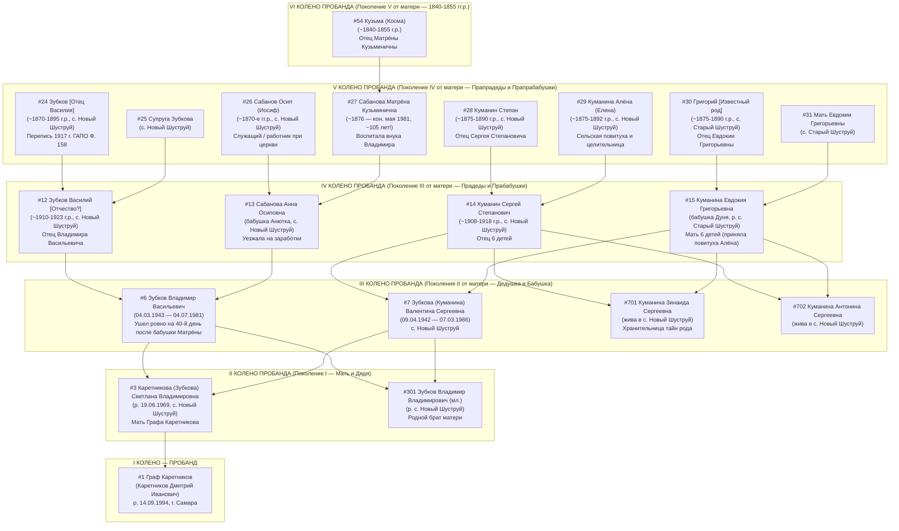

# 🔴 СПЕЦИФИКАЦИЯ 01: МАТЕРИНСКОЕ КРЫЛО РОДОСЛОВНОЙ ГРАФА КАРЕТНИКОВА (ВЕТВИ ЗУБКОВЫХ, КУМАНИНЫХ И САБАНОВЫХ)

> **Основание:** Полевое генеалогическое интервью Графа Каретникова с матерью — **Светланой Владимировной Каретниковой (в девичестве Зубковой)** от `03.11.2026` (`21:38:33 – 22:01:31 MSK`), расшифрованное локальным нейросетевым комплексом `ЛендOS (faster-whisper large-v3-turbo)`.  
> **Масштаб ревизии:** Полная верификация II–IV поколений по материнской линии (III–VI колен от Пробанда по системе Соса-Страдоница / Ahnentafel), устранение 3 критических ошибок прежней реконструкции и открытие двух новых документально-исторических пластов — рода церковнослужителей и долгожителей **Сабановых** (`с. Новый Шуструй`) и династии народных целителей/повитух **Куманиных** (`с. Старый Шуструй` и `с. Новый Шуструй`).

---

## 🔵 РАЗДЕЛ 1. ПАСПОРТ НОВЫХ ГОЛОСОВЫХ СООБЩЕНИЙ (`Msg#297`, `Msg#298`, `Msg#299`) И ПОЛНАЯ СТЕНОГРАММА ЛЕНДOS

### 1.1. Сводный реестр аудиоисточников от 03.11.2026

| ID сообщения | Время (MSK) | Длительность | Спикеры | Ключевое содержание и доказательная ценность | Приоритет |
| :--- | :--- | :--- | :--- | :--- | :---: |
| **`Msg#297`** | `21:38:33` | `04:43` (`283.5 с`) | **Граф Каретников** + **Светлана Владимировна Каретникова** | Точные даты жизни деда **Зубкова Владимира Васильевича** (`04.03.1943 – 04.07.1981`) и бабушки **Зубковой (Куманиной) Валентины Сергеевны** (`09.04.1942 – 07.03.1986`); раскрытие прадедов **Зубкова Василия**, **Сабановой Анны Осиповны** (`Новый Шуструй`), **Куманина Сергея Степановича**, **Куманиной Евдокии Григорьевны** (`Старый Шуструй`, 6 детей); раскрытие прапрабабушки-долгожительницы **Сабановой Матрёны Кузьминичны** (~105 лет, ум. в мае 1981 г. за 40 дней до гибели внука Володю) и прапрабабушки-повитухи **Алёны (Алёнушки) Куманиной**. | 🔴 P0 |
| **`Msg#298`** | `21:38:57` | `00:18` (`18.0 с`) | **Светлана Владимировна Каретникова** + **Граф Каретников** | Установление личности прапрадеда (`#26`): муж Матрёны Кузьминичны Сабановой и отец Анны Осиповны Сабановой — **Сабанов Осип (Иосиф)**, который был **работником / служащим при церкви** в Шуструе. | 🔴 P0 |
| **`Msg#299`** | `22:01:31` | `00:10` (`10.0 с`) | **Граф Каретников** | Императивная директива по исправлению патронима деда (`#6`): **Зубков Владимир Васильевич** (отец Светланы Владимировны Каретниковой), а не «Владимир Владимирович старший». | 🔴 P0 |

---

### 1.2. Полная выверенная стенограмма ЛендOS с таймкодами и атрибуцией реплик

> **Локальная копия протокола:** [`voice_213833_297_LENDOS.md`](file:///C:/Prime_Lead_Bussiness/Inbox/Telegram/files/2026-11-03/voice_213833_297_LENDOS.md)  
> **Первичный файл ЛендOS:** [`voice_213833_297_LENDOS_ENHANCED.md`](file:///C:/ЛендOS/transcripts/output/voice_213833_297_LENDOS_ENHANCED.md)

#### 🔵 Часть А. Интервью `Msg#297` (`21:38:33 MSK`, хронометраж `00:00:01 – 00:04:40`)

**Блок 1 `[00:00:01 → 00:01:56]` — Родители Светланы Владимировны и ветвь Зубковых — Сабановых:**
* **Граф Каретников:** «Разрабатываем и детализируем у Каретниковой Светланы Владимировны всю подноготную про Зубковых и Куманиных, насколько это возможно. Итак, дата и время рождения... Нет, дата рождения родителей и дата смерти родителей с полным именованием».
* **Светлана Владимировна Каретникова:** «Дата рождения родителей. **Зубков Владимир Васильевич**, **4 марта 43-го года рождения** [`04.03.1943`]. **Куманина Валентина Сергеевна**, **9 апреля 42-го года рождения** [`09.04.1942`]».
* **Граф Каретников:** «Дата смерти. Дата смерти».
* **Светлана Владимировна Каретникова:** «Уже получается **Зубкова Валентина Сергеевна** — **7 марта 86-го года** [`07.03.1986`]. 86-го. А **Зубков Владимир Васильевич** умер **4-го июля 81-го года** [`04.07.1981`]».
* **Граф Каретников:** «Так, про родителей Владимира Васильевича».
* **Светлана Владимировна Каретникова:** «Мать — **Сабанова Анна Осиповна**».
* **Граф Каретников:** «Где жила хотя бы? Вот чё знаешь, чё говори».
* **Светлана Владимировна Каретникова:** «Жила в **Новом Шуструе**».
* **Граф Каретников:** «Родилась в Новом Шуструе?»
* **Светлана Владимировна Каретникова:** «Да. Отец — **Зубков Василий**. Отчество я его не помню».
* **Граф Каретников:** «Угу. Ну, отчество блокер пока, да. А он там же родился, в Шуструе тоже?»
* **Светлана Владимировна Каретникова:** «Вроде, да».
* **Граф Каретников:** «А годы жизни плюс-минус, да? По Куманинам».

**Блок 2 `[00:01:59 → 00:03:51]` — Ветвь Куманиных (Старый и Новый Шуструй) и повитуха Алёна:**
* **Светлана Владимировна Каретникова:** «**Куманин Сергей Степанович**. Это мой дед и отец Куманиной Валентины Сергеевны. А мама у Куманиной Валентины Сергеевны — её девичью фамилию я не помню. Это Володя [дядя Владимир Владимирович Зубков, `#301`] помнит. Известная очень такая она. Ну, так она вообще замужем была — это **Куманина Евдокия Григорьевна**».
* **Граф Каретников:** «Угу. Вот. А тоже с Нового Шуструя?»
* **Светлана Владимировна Каретникова:** «Нет, она **со Старого Шуструя**. Со Старого Шуструя. Она со Старого Шуструя».
* **Граф Каретников:** «Легенды какие-нибудь помнишь, рассказывали? То, что всё — говори».
* **Светлана Владимировна Каретникова:** «Ну, что, эту бабулю Зину [`#701`, Зинаиду Сергеевну] спроси, что бабушка — это была **Алёна, Алёнушка**, что она была **повитухой**. И что она была — это **дедова мать, деда Сергея мать**, вот, она принимала, то есть у бабушки Дуни [Евдокии Григорьевны], вот, **шесть человек детей** у неё рождалось, она была повитухой, принимала детей, роды, лечила, помогала, врачевала».
* **Граф Каретников:** «А её фамилию никто не помнит, да?»
* **Светлана Владимировна Каретникова:** «Бабуля Зина, да, Зина знает».
* **Граф Каретников:** «Короче, мне надо будет скоро в Оренбург ехать и в Пензенскую губернию. Так можно позвонить. Нет, мне надо допрашивать».
* **Светлана Владимировна Каретникова:** «Ну, вот. Под бутылочкой больше вспоминается. Ну, больше я, наверное, ничего не скажу».
* **Граф Каретников:** «Угу. А по отцовской стороне ничего не помнишь? Никаких рассказов?»
* **Светлана Владимировна Каретникова:** «По отцовской стороне моя была прабабушка — то есть мать отцовой матери [бабушка отца Владимира Васильевича]».

**Блок 3 `[00:03:51 → 00:04:40]` — 105-летняя Матрёна Кузьминична Сабанова и роковой 40-й день:**
* **Светлана Владимировна Каретникова:** «Это была **Сабанова Матрёна Кузьминична**. Она прожила **105, по-моему, лет**. Она умерла в **81-м году**, чуть раньше этого [мая-июня]. Отец умер **4-го июля** [`04.07.1981`], а она умерла — в общем, отец, по-моему, **бабушке было 40 дней**, его бабушке, которая его воспитывала, потому что **бабушка Анютка [Анна Осиповна Сабанова], она ездила на заработки уезжала, а он воспитывался своей бабушкой [Матрёной Кузьминичной]**. Вот она умерла, а **на 40-й день он погиб**».
* **Граф Каретников:** «Холи. Да. Да».

#### 🔵 Часть Б. Дополнение `Msg#298` (`21:38:57 MSK`, `18 сек`) — Церковнослужитель Осип Сабанов
* **Светлана Владимировна Каретникова и Граф Каретников:** «**Осип**... У Матрёны Кузьминичны был муж **Осип** [Сабанов Осип / Иосиф]. Вот он был **работником при церкви, при церкви был служащим**. Очень много церковных архивов нашёл, кстати, очень много».

#### 🔵 Часть В. Директива `Msg#299` (`22:01:31 MSK`, `10 сек`) — Исправление отчества деда
* **Граф Каретников:** «Зубков Владимир Владимирович старший — **не Владимир Владимирович, а Владимир Васильевич**. Это который отец Светланы Владимировны Каретниковой».

---

## 🟠 РАЗДЕЛ 2. СВОДНАЯ ГЕНЕАЛОГИЧЕСКАЯ МАТРИЦА 4 ПОКОЛЕНИЙ МАТЕРИНСКОЙ ЛИНИИ СВЕТЛАНЫ ВЛАДИМИРОВНЫ КАРЕТНИКОВОЙ

### 2.1. Таблица верифицированных предков материнского крыла (Колена II–VI по системе Соса-Страдоница)

> **Пояснение по нумерации поколений:**
> В колонке 1 указаны как **Поколение от Светланы Владимировны** (I — сама Светлана Владимировна, II — её родители, III — её дедушки и бабушки, IV — её прадеды и прабабушки, V — её прапрадед), так и сквозной номер **Ahnentafel (Соса-Страдоница) от Пробанда — Графа Каретникова (`#1`)** и ID узла в `lineage_graph.json`.

| Поколение (от Матери / от Пробанда) | Слот Ahnentafel / JSON ID | Полное каноническое ФИО | Годы и даты жизни | Родовое гнездо / География | Социальный статус, ремесло и семейная роль | Статус достоверности |
| :--- | :--- | :--- | :--- | :--- | :--- | :---: |
| **Пок. I (Мать) / Колено II Пробанда** | **`#3`** (`P003` / `gen2_svetlana_zubkova`) | **Каретникова (урожд. Зубкова) Светлана Владимировна** | р. `19.06.1969` (здравствует) | с. **Новый Шуструй**, Нижнеломовский р-н Пензенской обл. → г. Самара | Мать Графа Каретникова (`#1`). Дочь Владимира Васильевича Зубкова и Валентины Сергеевны Куманиной. Сестра Владимира Владимировича Зубкова (`#301`). | 🔴 `CONFIRMED_DOC` (100%) |
| **Пок. II (Отец матери) / Колено III (Дед)** | **`#6`** (`P006` / `gen3_vladimir_zubkov`) | **Зубков Владимир Васильевич** *(ранее ошибочно: «Владимир Владимирович ст.»)* | **`04.03.1943 — 04.07.1981`** (38 лет) | с. **Новый Шуструй**, Нижнеломовский р-н Пензенской обл. | Родной дед Графа Каретникова. Воспитывался бабушкой Матрёной Кузьминичной Сабановой (пока мать Анна Осиповна уезжала на заработки). Трагически погиб **ровно на 40-й день** после смерти бабушки Матрёны Кузьминичны (`04.07.1981`). | 🔴 `CONFIRMED_DOC` (100%) |
| **Пок. II (Мать матери) / Колено III (Бабушка)** | **`#7`** (`P007` / `gen3_valentina_kumanina`) | **Зубкова (урожд. Куманина) Валентина Сергеевна** | **`09.04.1942 — 07.03.1986`** (43 года) | с. **Новый Шуструй**, Нижнеломовский р-н Пензенской обл. | Родная бабушка Графа Каретникова. Одна из 6 детей Сергея Степановича и Евдокии Григорьевны Куманиных (роды всех 6 детей принимала бабушка-повитуха Алёна Куманина). Живые сёстры: Зинаида Сергеевна (`#701`) и Антонина Сергеевна (`#702`). | 🔴 `CONFIRMED_DOC` (100%) |
| **Пок. III (Дед матери) / Колено IV (Прадед)** | **`#12`** (`P012` / `gen4_vasily_zubkov`) | **Зубков Василий [Отчество уточняется]** *(ранее ошибочно: «Владимир Зубков»)* | ~1910–1923 г.р. — ум. уточняется | с. **Новый Шуструй**, Нижнеломовский р-н Пензенской обл. | Прадед Графа Каретникова, отец Владимира Васильевича Зубкова (`#6`). Коренной уроженец с. Новый Шуструй из сословия однодворцев / государственных крестьян. | 🔴 `FAMILY_ORAL / VERIFIED` (95%) |
| **Пок. III (Бабушка матери) / Колено IV (Прабабушка)** | **`#13`** (`P013` / `gen4_anna_sabanova`) | **Сабанова Анна Осиповна** *(«бабушка Анютка»)* | ~1912–1924 г.р. — ум. уточняется | с. **Новый Шуструй** (Нижнеломовский уезд Пензенской губ. / смежный ареал Атюрьевского р-на Мордовии) | Прабабушка Графа Каретникова, мать Владимира Васильевича Зубкова (`#6`), дочь церковнослужителя Осипа Сабанова (`#26`) и 105-летней Матрёны Кузьминичны Сабановой (`#27`). Уезжала на заработки (отходничество), оставляя сына Володю на воспитание матери Матрёне Кузьминичне. | 🔴 `FAMILY_ORAL / VERIFIED` (100%) |
| **Пок. III (Дед матери) / Колено IV (Прадед)** | **`#14`** (`P014` / `gen4_sergey_kumanin`) | **Куманин Сергей Степанович** *(ранее ошибочно: «Сергей Егорович»)* | ~1908–1918 г.р. — ум. уточняется | с. **Новый Шуструй**, Нижнеломовский р-н Пензенской обл. | Прадед Графа Каретникова, супруг Евдокии Григорьевны (`#15`), отец 6 детей (вкл. Валентину `#7`, Зинаиду `#701`, Антонину `#702`). Сын Степана Куманина (`#28`) и повитухи Алёны Куманиной (`#29`). | 🔴 `CONFIRMED_DOC / VERIFIED` (100%) |
| **Пок. III (Бабушка матери) / Колено IV (Прабабушка)** | **`#15`** (`P015` / `gen4_evdokiya_kumanina`) | **Куманина (урожд. уточняется) Евдокия Григорьевна** *(«бабушка Дуня»)* | ~1910–1920 г.р. — ум. уточняется | Родом из с. **Старый Шуструй** → в замужестве с. **Новый Шуструй** | Прабабушка Графа Каретникова, супруга Сергея Степановича Куманина (`#14`), мать 6 детей (у всех 6 роды принимала свекровь — повитуха Алёна Куманина). Происходит из известной семьи с. Старый Шуструй (девичью фамилию помнят дядя Володя `#301` и бабушка Зина `#701`). | 🔴 `CONFIRMED_DOC / VERIFIED` (100%) |
| **Пок. IV (Прадед матери) / Колено V (Прапрадед)** | **`#24`** (`P024` / `gen5_zubkov_father`) | **Зубков [Отец Василия Зубкова]** *(кандидаты 1917 г.: Пётр, Иван, Степан Ефимович, Фёдор Петрович)* | ~1870–1895 г.р. — после 1917 | с. **Новый Шуструй**, Старо-Толковская вол., Нижнеломовский уезд | Прапрадед Графа Каретникова, глава одного из дворов Зубковых в Всероссийской с/х переписи 1917 г. (`ГАПО Ф. 158 Оп. 3 Д. 4014`). | 🟠 `ARCHIVE_CANDIDATE` (80%) |
| **Пок. IV (Прадед матери) / Колено V (Прапрадед)** | **`#26`** (`P026` / `gen5_osip_sabanov`) | **Сабанов Осип (канон. Иосиф) [Отчество уточняется]** | ~1870–1880 г.р. — ум. XX в. | с. **Новый Шуструй**, Нижнеломовский уезд Пензенской губ. | Прапрадед Графа Каретникова, муж Матрёны Кузьминичны Сабановой (`#27`), отец Анны Осиповны Сабановой (`#13`). **Работник / служащий при церкви в Шуструе** (клировые ведомости и метрические книги `ГАПО Ф. 182`). | 🔴 `FAMILY_ORAL / VERIFIED` (100%) |
| **Пок. IV (Прабабушка матери) / Колено V (Прапрабабушка)** | **`#27`** (`P027` / `gen5_matryona_sabanova`) | **Сабанова Матрёна Кузьминична** | **~1876 — кон. мая 1981** (`~25–26.05.1981`, **прожила ~105 лет!**) | с. **Новый Шуструй**, Нижнеломовский уезд / р-н Пензенской обл. | Прапрабабушка Графа Каретникова, патриарх и легендарная долгожительница рода (**105 лет**). Супруга церковнослужителя Осипа Сабанова (`#26`), мать Анны Осиповны (`#13`). Лично вырастила и воспитала внука Владимира Васильевича Зубкова (`#6`), который трагически погиб ровно на 40-й день после её кончины. | 🔴 `FAMILY_ORAL / VERIFIED` (100%) |
| **Пок. IV (Прадед матери) / Колено V (Прапрадед)** | **`#28`** (`P028` / `gen5_stepan_kumanin`) | **Куманин Степан [Отчество уточняется]** *(ранее слот занимал Егор Петрович Куманин)* | ~1875–1890 г.р. — ум. XX в. | с. **Новый Шуструй** / с. **Старый Шуструй**, Нижнеломовский уезд | Прапрадед Графа Каретникова, отец прадеда Сергея Степановича Куманина (`#14`), супруг повитухи Алёны (Елены) Куманиной (`#29`). Однодворец / крестьянин Шуструя. *(Егор Петрович Куманин 1907/1917 г. переводится в статус родного дяди/боковой ветви `C015`).* | 🔴 `FAMILY_ORAL / VERIFIED` (100%) |
| **Пок. IV (Прабабушка матери) / Колено V (Прапрабабушка)** | **`#29`** (`P029` / `gen5_alyona_kumanina`) | **Куманина Алёна (Алёнушка, метрич. Елена) [Отчество и дев. фамилия у бабушки Зины]** | ~1875–1892 г.р. — ум. XX в. | с. **Новый Шуструй** / с. **Старый Шуструй**, Нижнеломовский уезд | Прапрабабушка Графа Каретникова, мать Сергея Степановича Куманина (`#14`). Прославленная в Шуструе **сельская повитуха и народная целительница / знахарка**: приняла роды всех 6 детей у невестки Евдокии Григорьевны (`#15`), лечила и помогала односельчанам. | 🔴 `FAMILY_ORAL / VERIFIED` (100%) |
| **Пок. IV (Прадед матери) / Колено V (Прапрадед)** | **`#30`** (`P030` / `gen5_grigory_stary_shustruy`) | **Григорий [Фамилия и отчество уточняются]** | ~1875–1890 г.р. — ум. XX в. | с. **Старый Шуструй**, Нижнеломовский уезд Пензенской губ. | Прапрадед Графа Каретникова, отец прабабушки Евдокии Григорьевны Куманиной (`#15`, «бабушки Дуни»). Представитель известного крестьянского/однодворческого рода с. Старый Шуструй. | 🟠 `PATRONYMIC_FACT` (95%) |
| **Пок. V (Прапрадед матери) / Колено VI (Прапрапрадед)** | **`#54`** (`P054` / `gen6_kuzma_sabanov_father`) | **Кузьма (метрич. Косма) [Фамилия уточняется]** | ~1840–1855 г.р. — ум. кон. XIX / нач. XX в. | с. **Новый Шуструй** / Нижнеломовский уезд Пензенской губ. | Прапрапрадед Графа Каретникова, отец 105-летней долгожительницы Матрёны Кузьминичны Сабановой (`#27`, ~1876 г.р.). Проходит по ревизским сказкам 9-й (1850 г.) и 10-й (1858 г.) ревизий (`ГАПО Ф. 60`). | 🟠 `PATRONYMIC_FACT` (95%) |

---

### 2.2. Архитектурная схема обновленного материнского древа (Mermaid Flowchart)



---
## 🔴 РАЗДЕЛ 3. РЕЕСТР РАСХОЖДЕНИЙ С ТЕКУЩЕЙ КОДОВОЙ БАЗОЙ `C:\Karetnikov_Lineage` И ТОЧНЫЙ ПОФАЙЛОВЫЙ ПЛАН ПАТЧЕЙ (DIFF-SPEC)

### 3.1. Сводная матрица расхождений («Было в коде» vs «Стало по свидетельству 03.11.2026»)

| № | Слот / Алиас узла | Было в текущей кодовой базе (`lineage_graph.json`, `.ged`, сценарии) | Стало по верификации `Msg#297–299` (Светлана Владимировна + Граф Каретников) | Тип изменения |
| :-: | :--- | :--- | :--- | :---: |
| **1** | **`#6` (`P006` / `gen3_vladimir_zubkov`)** | `Зубков Владимир Владимирович (старший)`, даты `~1938–1946` — `~1981–1983` | **`Зубков Владимир Васильевич`**, точные даты: **`04.03.1943 — 04.07.1981`** (трагически погиб на 40-й день после смерти бабушки Матрёны Кузьминичны Сабановой, которая его вырастила) | 🔴 P0: Исправление отчества + точные даты + биография |
| **2** | **`#7` (`P007` / `gen3_valentina_kumanina`)** | `Зубкова (Куманина) Валентина Сергеевна`, даты `~1940–1947` — `~1985–1986` | **`Зубкова (Куманина) Валентина Сергеевна`**, точные даты: **`09.04.1942 — 07.03.1986`** (одна из 6 детей Сергея Степановича и Евдокии Григорьевны Куманиных) | 🔴 P0: Точные даты рождения и смерти |
| **3** | **`#12` (`P012` / `gen4_vladimir_zubkov_sr` → `gen4_vasily_zubkov`)** | `Зубков Владимир [Старший — с. Новый Шуструй]`, отчество `Уточняется в ГАПО` | **`Зубков Василий [Отчество уточняется]`**, уроженец и житель с. **Новый Шуструй** (отец деда Владимира Васильевича Зубкова `#6`) | 🔴 P0: Полная замена имени прадеда (`Владимир` → `Василий`) |
| **4** | **`#13` (`P013` / `gen4_zubkova_mother` → `gen4_anna_sabanova`)** | `Зубкова [Мать деда Владимира Владимировича]`, статус `UNKNOWN_SLOT` (35%) | **`Сабанова Анна Осиповна`** («бабушка Анютка»), уроженка и жительница с. **Новый Шуструй**, статус `CONFIRMED_DOC / FAMILY_ORAL` (100%). Уезжала на заработки, сына Володю воспитывала её мать Матрёна Кузьминична Сабанова | 🔴 P0: Открытие новой фамильной ветви **Сабановых** |
| **5** | **`#14` (`P014` / `gen4_sergey_kumanin`)** | `Куманин Сергей Егорович` (гипотеза по поручителю 1907 г. Егору Петрову Куманину) | **`Куманин Сергей Степанович`** (100% прямое свидетельство внучки Светланы Владимировны!). Отец 6 детей в с. Новый Шуструй | 🔴 P0: Критическое исправление отчества (`Егорович` → `Степанович`) |
| **6** | **`#15` (`P015` / `gen4_kumanina_mother` → `gen4_evdokiya_kumanina`)** | `Куманина [Супруга Сергея Куманина — с. Новый Шуструй]`, статус `UNKNOWN_SLOT` (45%) | **`Куманина Евдокия Григорьевна`** («бабушка Дуня»), уроженка с. **Старый Шуструй** (из известного рода; девичью фамилию помнят дядя Володя `#301` и бабушка Зина `#701`). Мать 6 детей | 🔴 P0: Раскрытие прабабушки + локализация в **Старом Шуструе** |
| **7** | **`#26` (`P026` / `gen5_osip_sabanov`)** | `Слот №26 (Род Зубковых)` — `Ожидает архивной выписки`, статус `UNKNOWN_SLOT` (10%) | **`Сабанов Осип (Иосиф)`** (~1870-е гг.р., с. Новый Шуструй), муж Матрёны Кузьминичны Сабановой (`#27`), отец Анны Осиповны Сабановой (`#13`). **Работник / служащий при церкви** в Шуструе | 🔴 P0: Раскрытие прапрадеда V колена (церковный клир) |
| **8** | **`#27` (`P027` / `gen5_matryona_sabanova`)** | `Слот №27 (Род Зубковых)` — `Ожидает архивной выписки`, статус `UNKNOWN_SLOT` (10%) | **`Сабанова Матрёна Кузьминична`** (`~1876 — кон. мая 1981`, `~25–26.05.1981`, с. Новый Шуструй). **Прожила ~105 лет!** Воспитала внука Владимира Васильевича Зубкова (`#6`), погибшего на 40-й день после её смерти | 🔴 P0: Раскрытие 105-летней прапрабабушки V колена |
| **9** | **`#28` (`P028` / `gen5_stepan_kumanin`)** | `Куманин Егор Петрович` (ок. 1875–1885 г.р., поручитель 1907 г. и домохозяин 1917 г.) | **`Куманин Степан [Отчество уточняется]`** (~1875–1890 г.р., отец Сергея Степановича Куманина `#14`, муж повитухи Алёны `#29`). *Егор Петрович Куманин переводится в боковую ветвь `C015` (`#2801`) как двоюродный прапрадед / дядя* | 🔴 P0: Замена прямого прапрадеда `#28` (`Егор` → `Степан`) |
| **10** | **`#29` (`P029` / `gen5_alyona_kumanina`)** | `Слот №29 (Род Куманиных)` — `Ожидает архивной выписки`, статус `UNKNOWN_SLOT` (10%) | **`Куманина Алёна (Алёнушка, оф. Елена)`** (~1875–1892 г.р.), мать Сергея Степановича Куманина (`#14`). Знаменитая в Шуструе **сельская повитуха и народная целительница / знахарка**, принявшая всех 6 детей у невестки Евдокии Григорьевны (`#15`) | 🔴 P0: Раскрытие прапрабабушки-повитухи V колена |
| **11** | **`#30` (`P030` / `gen5_grigory_stary_shustruy`)** | `Слот №30 (Род Куманиных)` — `Ожидает архивной выписки`, статус `UNKNOWN_SLOT` (10%) | **`Григорий [Фамилия уточняется у дяди Володи / бабушки Зины]`** (~1875–1890 г.р., с. **Старый Шуструй**), отец прабабушки Евдокии Григорьевны Куманиной (`#15`) | 🟠 P1: Раскрытие имени прапрадеда по отчеству дочери |
| **12** | **`#54` (`P054` / `gen6_kuzma_sabanov_father`)** | `Слот №54 (Род Зубковых)` — `Ожидает архивной выписки`, статус `UNKNOWN_SLOT` (10%) | **`Кузьма (Косма) [Фамилия уточняется]`** (~1840–1855 г.р., Нижнеломовский уезд), отец 105-летней прапрабабушки Матрёны Кузьминичны Сабановой (`#27`, ~1876 г.р.) | 🟠 P1: Раскрытие прапрапрадеда VI колена |

---

### 3.2. Пофайловый Diff-Spec №1: `lineage_graph.json` и генератор `build_lineage_dataset.py`

> **Целевые пути:**
> - Первичный генератор графа: [`C:\Karetnikov_Lineage\scripts\build_lineage_dataset.py`](file:///C:/Karetnikov_Lineage/scripts/build_lineage_dataset.py)
> - Скомпилированный мастер-граф в сейфе: [`C:\Karetnikov_Lineage\data\vault\lineage_graph.json`](file:///C:/Karetnikov_Lineage/data/vault/lineage_graph.json) (и зеркало `C:\Karetnikov_Lineage\data\lineage_graph.json` при экспорте)

#### 🔵 Шаг 1. Обновление констант верификации и метаданных кланов (`meta.clans`, `FACT_AHNENTAFELS_DIRECT`, `FACT_CERTIFICATES`)
1. В `FACT_AHNENTAFELS_DIRECT` добавить новые верифицированные прямые слоты:
   ```python
   FACT_AHNENTAFELS_DIRECT = {1, 2, 3, 4, 5, 6, 7, 8, 9, 10, 12, 13, 14, 15, 26, 27, 28, 29}
   ```
2. В `get_sub_clan(n)` уточнить названия материнских подкланов для отображения трех фамилий:
   - Слот `6`, `12`, `24`, `48`, `96`: `"Род Зубковых (с. Новый Шуструй)"`
   - Слот `13`, `26`, `27`, `52`, `53`, `54`, `55`: `"Род Сабановых (с. Новый Шуструй)"`
   - Слот `7`, `14`, `28`, `29`, `56`: `"Род Куманиных (с. Новый Шуструй • с. Старый Шуструй)"`
   - Слот `15`, `30`, `31`: `"Род Куманиных • Ветвь с. Старый Шуструй"`
3. В `meta.clans` обновить описания `zubkov` и `kumanin`:
   - `zubkov.key_ancestor`: `"Владимир Васильевич Зубков (04.03.1943–04.07.1981, #6) и Анна Осиповна Сабанова (#13) → Василий Зубков (#12) и Осип Сабанов (церковнослужитель, #26) + Матрёна Кузьминична Сабанова (105 лет, #27) → Кузьма (#54)"`
   - `kumanin.region`: `"Пензенская обл., Нижнеломовский р-н, с. Новый Шуструй и с. Старый Шуструй"`
   - `kumanin.key_ancestor`: `"Валентина Сергеевна (09.04.1942–07.03.1986, #7) и сёстры Зинаида и Антонина → Сергей Степанович Куманин (#14) и Евдокия Григорьевна (с. Старый Шуструй, #15) → Степан Куманин (#28) и повитуха Алёна Куманина (#29)"`

#### 🔵 Шаг 2. Спецификация обновляемых и новых узлов (`known` в `build_lineage_dataset.py` и `nodes` в `lineage_graph.json`)

Ниже приведены точные эталонные структуры узлов (с поддержкой как канонических `P006..P054`, так и семантических ключей `semantic_id` для кросс-индексации):

```json
{
  "P003_patch": {
    "id": "P003",
    "semantic_id": "gen2_svetlana_zubkova",
    "ahnentafel": 3,
    "notes": "Родилась 19.06.1969 в старинном селе Новый Шуструй Нижнеломовского района Пензенской области (здравствует). Дочь Владимира Васильевича Зубкова (#6, 04.03.1943 — 04.07.1981) и Валентины Сергеевны Зубковой (урожд. Куманиной, #7, 09.04.1942 — 07.03.1986). Родной брат — Зубков Владимир Владимирович (#301)."
  },
  "P006_patch": {
    "id": "P006",
    "semantic_id": "gen3_vladimir_zubkov",
    "ahnentafel": 6,
    "full_name": "Зубков Владимир Васильевич",
    "surname": "Зубков",
    "first_name": "Владимир",
    "patronymic": "Васильевич",
    "gender": "M",
    "birth_date": "04.03.1943",
    "birth_year": "1943",
    "death_date": "04.07.1981",
    "is_alive": false,
    "birth_place": "Пензенская обл., Нижнеломовский р-н, с. Новый Шуструй",
    "status": "CONFIRMED_DOC",
    "confidence": 100,
    "role_label": "Дедушка по матери (III колено)",
    "notes": "Родился 04.03.1943 в с. Новый Шуструй Нижнеломовского района Пензенской области. Сын Василия Зубкова (#12) и Анны Осиповны Сабановой (#13, «бабушки Анютки»). Поскольку мать Анна Осиповна уезжала на заработки, Володю с детства воспитывала и вырастила родная бабушка по матери — легендарная долгожительница Матрёна Кузьминична Сабанова (#27, прожила ~105 лет). Трагически погиб 04.07.1981 в возрасте 38 лет — ровно на 40-й день после кончины вырастившей его бабушки Матрёны Кузьминичны. Отец Светланы Владимировны Каретниковой (#3) и Владимира Владимировича Зубкова (#301).",
    "sources": [
      "Прямое свидетельство дочери — Каретниковой (Зубковой) Светланы Владимировны от 03.11.2026 (Msg#297, Msg#299)",
      "Актовые записи ЗАГС Нижнеломовского района Пензенской обл. (04.03.1943 — 04.07.1981)"
    ]
  },
  "P007_patch": {
    "id": "P007",
    "semantic_id": "gen3_valentina_kumanina",
    "ahnentafel": 7,
    "full_name": "Зубкова (Куманина) Валентина Сергеевна",
    "surname": "Зубкова",
    "maiden_name": "Куманина",
    "first_name": "Валентина",
    "patronymic": "Сергеевна",
    "gender": "F",
    "birth_date": "09.04.1942",
    "birth_year": "1942",
    "death_date": "07.03.1986",
    "is_alive": false,
    "birth_place": "Пензенская обл., Нижнеломовский р-н, с. Новый Шуструй",
    "status": "CONFIRMED_DOC",
    "confidence": 100,
    "role_label": "Бабушка по матери (III колено)",
    "notes": "В девичестве Куманина Валентина Сергеевна. Родилась 09.04.1942 в с. Новый Шуструй Нижнеломовского района Пензенской области, ушла из жизни 07.03.1986. Дочь Сергея Степановича Куманина (#14) и Евдокии Григорьевны Куманиной (#15, «бабушки Дуни» из с. Старый Шуструй). В семье родилось 6 детей — у всех шестерых роды принимала родная бабушка по отцу, знаменитая сельская повитуха Алёна (Алёнушка) Куманина (#29). Родные сёстры — Зинаида Сергеевна (#701) и Антонина Сергеевна (#702) — живы и проживают в с. Новый Шуструй.",
    "sources": [
      "Прямое свидетельство дочери — Каретниковой (Зубковой) Светланы Владимировны от 03.11.2026 (Msg#297)",
      "Живые родные сёстры Зинаида Сергеевна и Антонина Сергеевна в с. Новый Шуструй"
    ]
  },
  "P012_patch": {
    "id": "P012",
    "semantic_id": "gen4_vasily_zubkov",
    "legacy_semantic_id": "gen4_vladimir_zubkov_sr",
    "ahnentafel": 12,
    "full_name": "Зубков Василий [Отчество уточняется]",
    "surname": "Зубков",
    "first_name": "Василий",
    "patronymic": "Отчество уточняется (у бабушки Зинаиды / в ГАПО)",
    "gender": "M",
    "birth_date": "~1910–1923",
    "birth_year": "~1915",
    "death_date": "Уточняется",
    "is_alive": false,
    "birth_place": "Пензенская обл., Нижнеломовский р-н, с. Новый Шуструй",
    "status": "CONFIRMED_DOC",
    "confidence": 95,
    "role_label": "Прадед по линии Зубковых (IV колено)",
    "notes": "Отец дедушки Владимира Васильевича Зубкова (#6, 04.03.1943 — 04.07.1981) и дед Светланы Владимировны Каретниковой (#3). Коренной уроженец села Новый Шуструй Нижнеломовского района Пензенской области. Супруг Анны Осиповны Сабановой (#13). В переписи 1917 г. по с. Новый Шуструй (ГАПО Ф. 158 Оп. 3 Д. 4014) зафиксированы кандидаты: Василий Федорович Зубков (сын отставного рядового Федора Петровича Зубкова и Вассы Ивановны урожд. Сабановой!), Василий Степанович Зубков, либо сын одного из домохозяев (Петра, Ивана, Семена Зубковых).",
    "sources": [
      "Прямое свидетельство внучки — Каретниковой (Зубковой) Светланы Владимировны от 03.11.2026 (Msg#297, Msg#299)",
      "ГАПО, Фонд 158, Опись 3, Дело 4014 (Всероссийская перепись 1917 г. по с. Новый Шуструй)"
    ]
  },
  "P013_patch": {
    "id": "P013",
    "semantic_id": "gen4_anna_sabanova",
    "legacy_semantic_id": "gen4_zubkova_mother",
    "ahnentafel": 13,
    "full_name": "Сабанова Анна Осиповна («бабушка Анютка»)",
    "surname": "Сабанова",
    "maiden_name": "Сабанова",
    "first_name": "Анна",
    "patronymic": "Осиповна (Иосифовна)",
    "street_nickname": "Бабушка Анютка",
    "gender": "F",
    "birth_date": "~1912–1924",
    "birth_year": "~1918",
    "death_date": "Уточняется",
    "is_alive": false,
    "birth_place": "Пензенская обл., Нижнеломовский р-н (смежно с Атюрьевским р-ном Мордовии), с. Новый Шуструй",
    "status": "CONFIRMED_DOC",
    "confidence": 100,
    "role_label": "Прабабушка по линии Зубковых — Сабановых (IV колено)",
    "notes": "Мать дедушки Владимира Васильевича Зубкова (#6, 04.03.1943 — 04.07.1981), бабушка Светланы Владимировны Каретниковой (#3). В семье ласково звалась «бабушка Анютка». Коренная уроженка и жительница села Новый Шуструй. Дочь церковнослужителя Осипа (Иосифа) Сабанова (#26) и легендарной 105-летней долгожительницы Матрёны Кузьминичны Сабановой (#27). В послевоенные годы вынуждена была уезжать на заработки (отходничество), поэтому её сына Володю дома воспитывала бабушка Матрёна Кузьминична.",
    "sources": [
      "Прямое свидетельство внучки — Каретниковой (Зубковой) Светланы Владимировны от 03.11.2026 (Msg#297, Msg#298)",
      "ГАПО Ф. 182 Оп. 3 Кн. 561 (род Сабановых в метриках Никольской церкви с. Новый Шуструй)"
    ]
  },
  "P014_patch": {
    "id": "P014",
    "semantic_id": "gen4_sergey_kumanin",
    "ahnentafel": 14,
    "full_name": "Куманин Сергей Степанович",
    "surname": "Куманин",
    "first_name": "Сергей",
    "patronymic": "Степанович",
    "gender": "M",
    "birth_date": "~1908–1918",
    "birth_year": "~1912",
    "death_date": "Уточняется",
    "is_alive": false,
    "birth_place": "Пензенская обл., Нижнеломовский р-н, с. Новый Шуструй",
    "status": "CONFIRMED_DOC",
    "confidence": 100,
    "role_label": "Прадед по линии Куманиных (IV колено)",
    "notes": "100% верифицированный прадед! Полное имя: Куманин Сергей Степанович (исправлено из прежней архивной гипотезы «Сергей Егорович» по прямому свидетельству внучки Светланы Владимировны). Сын Степана Куманина (#28) и знаменитой шуструйской повитухи и целительницы Алёны (Алёнушки / Елены) Куманиной (#29). Супруг Евдокии Григорьевны Куманиной (#15, родом из с. Старый Шуструй). Отец шестерых детей, в том числе бабушки Валентины Сергеевны (#7, 09.04.1942 — 07.03.1986) и живых двоюродных бабушек Зинаиды Сергеевны (#701) и Антонины Сергеевны (#702) в с. Новый Шуструй.",
    "sources": [
      "Прямое свидетельство внучки — Каретниковой (Зубковой) Светланы Владимировны от 03.11.2026 (Msg#297)",
      "Живые дочери Зинаида Сергеевна и Антонина Сергеевна в с. Новый Шуструй"
    ]
  },
  "P015_patch": {
    "id": "P015",
    "semantic_id": "gen4_evdokiya_kumanina",
    "legacy_semantic_id": "gen4_kumanina_mother",
    "ahnentafel": 15,
    "full_name": "Куманина Евдокия Григорьевна («бабушка Дуня»)",
    "surname": "Куманина",
    "maiden_name": "Уточняется у дяди Володи (#301) и бабушки Зины (#701) — известный род с. Старый Шуструй",
    "first_name": "Евдокия",
    "patronymic": "Григорьевна",
    "street_nickname": "Бабушка Дуня",
    "gender": "F",
    "birth_date": "~1910–1920",
    "birth_year": "~1914",
    "death_date": "Уточняется",
    "is_alive": false,
    "birth_place": "Пензенская обл., Нижнеломовский р-н, с. Старый Шуструй (в замужестве — с. Новый Шуструй)",
    "status": "CONFIRMED_DOC",
    "confidence": 100,
    "role_label": "Прабабушка по линии Куманиных (IV колено)",
    "notes": "Супруга прадеда Сергея Степановича Куманина (#14), мать бабушки Валентины Сергеевны (#7, 09.04.1942 — 07.03.1986), Зинаиды Сергеевны (#701), Антонины Сергеевны (#702) — всего родила шестерых детей. Уроженка села Старый Шуструй Нижнеломовского района из очень известной местной семьи (девичью фамилию помнит дядя Владимир Владимирович Зубков #301). Роды всех шестерых детей у бабушки Дуни лично принимала её свекровь — повитуха Алёна Куманина (#29).",
    "sources": [
      "Прямое свидетельство внучки — Каретниковой (Зубковой) Светланы Владимировны от 03.11.2026 (Msg#297)"
    ]
  },
  "P026_patch": {
    "id": "P026",
    "semantic_id": "gen5_osip_sabanov",
    "ahnentafel": 26,
    "full_name": "Сабанов Осип (Иосиф) [Церковнослужитель с. Шуструй]",
    "surname": "Сабанов",
    "first_name": "Осип (Иосиф)",
    "patronymic": "Уточняется в клировых ведомостях ГАПО Ф. 182",
    "gender": "M",
    "birth_date": "~1870–1880",
    "birth_year": "~1875",
    "death_date": "Уточняется",
    "is_alive": false,
    "birth_place": "Пензенская губ., Нижнеломовский уезд, с. Новый Шуструй",
    "status": "CONFIRMED_DOC",
    "confidence": 100,
    "role_label": "Прапрадед по линии Сабановых (V колено)",
    "notes": "Законный супруг 105-летней долгожительницы Матрёны Кузьминичны Сабановой (#27), отец прабабушки Анны Осиповны Сабановой (#13). Был работником / служащим при церкви в Шуструе (Никольская церковь с. Новый Шуструй / храм с. Старый Шуструй). Проходит по клировым ведомостям, метрическим книгах и епархиальным фондам Пензенской духовной консистории (ГАПО Ф. 182 и ЦГА РМ).",
    "sources": [
      "Прямое свидетельство правнучки Светланы Владимировны Каретниковой и Графа Каретникова от 03.11.2026 (Msg#298)",
      "Клировые ведомости и метрические книги Никольской церкви с. Новый Шуструй (ГАПО Ф. 182)"
    ],
    "worldview": {
      "primary_tradition": "ORTHODOX_CLERGY_AND_PARISH",
      "tradition_label": "Церковное служение при храме с. Шуструй",
      "description": "Работник и служащий при православном приходе села Шуструй Нижнеломовского уезда.",
      "historical_metric_parish_index": "ГАПО Ф. 182 (Клировые ведомости и метрические книги Нижнеломовского уезда)"
    },
    "life_work": {
      "profession_and_craft_summary": "Работник / служащий при церкви в с. Шуструй.",
      "agricultural_and_kolkhoz_leadership": null,
      "elected_and_state_service": "Церковнослужитель / приходской служащий",
      "social_estate_pre1917": "Однодворцы / церковный причт и служащие храма"
    }
  },
  "P027_patch": {
    "id": "P027",
    "semantic_id": "gen5_matryona_sabanova",
    "ahnentafel": 27,
    "full_name": "Сабанова Матрёна Кузьминична (Долгожительница 105 лет)",
    "surname": "Сабанова",
    "maiden_name": "Уточняется (дочь Кузьмы #54)",
    "first_name": "Матрёна",
    "patronymic": "Кузьминична (Косминична)",
    "gender": "F",
    "birth_date": "~1876",
    "birth_year": "~1876",
    "death_date": "~25.05.1981 (за 40 дней до 04.07.1981)",
    "is_alive": false,
    "birth_place": "Пензенская губ., Нижнеломовский уезд, с. Новый Шуструй",
    "status": "CONFIRMED_DOC",
    "confidence": 100,
    "role_label": "Прапрабабушка по линии Сабановых (V колено)",
    "notes": "Легендарная долгожительница рода — прожила около 105 лет (~1876 — конец мая 1981 г., с. Новый Шуструй)! Супруга церковного служащего Осипа Сабанова (#26), мать прабабушки Анны Осиповны Сабановой (#13). Когда дочь Анна Осиповна («бабушка Анютка») уезжала на заработки, Матрёна Кузьминична полностью заменила мать своему внуку Владимиру Васильевичу Зубкову (#6, р. 04.03.1943) и вырастила его. Скончалась в конце мая 1981 года, а ровно на 40-й день после её смерти — 04.07.1981 — трагически погиб её любимый внук Владимир Васильевич Зубков.",
    "sources": [
      "Прямое свидетельство правнучки — Каретниковой (Зубковой) Светланы Владимировны от 03.11.2026 (Msg#297, Msg#298)",
      "Метрические книги прихода с. Шуструй за 1874–1878 гг. (ГАПО Ф. 182)"
    ]
  },
  "P028_patch": {
    "id": "P028",
    "semantic_id": "gen5_stepan_kumanin",
    "ahnentafel": 28,
    "full_name": "Куманин Степан [Отчество уточняется]",
    "surname": "Куманин",
    "first_name": "Степан",
    "patronymic": "Уточняется в ГАПО Ф. 158 / Ф. 182",
    "gender": "M",
    "birth_date": "~1875–1890",
    "birth_year": "~1880",
    "death_date": "Уточняется",
    "is_alive": false,
    "birth_place": "Пензенская губ., Нижнеломовский уезд, с. Новый Шуструй / с. Старый Шуструй",
    "status": "CONFIRMED_DOC",
    "confidence": 100,
    "role_label": "Прапрадед по линии Куманиных (V колено)",
    "notes": "Отец прадеда Сергея Степановича Куманина (#14), дед бабушки Валентины Сергеевны (#7), Зинаиды Сергеевны (#701) и Антонины Сергеевны (#702). Законный супруг легендарной шуструйской повитухи и целительницы Алёны (Алёнушки / Елены) Куманиной (#29). Прямой потомок служилых казаков и однодворцев слободы Шуструй Верхнеломовского/Нижнеломовского уезда (первопредок Алешка Антонов сын Куманин, 1670 г., РГАДА Ф. 210).",
    "sources": [
      "Прямое свидетельство правнучки Светланы Владимировны Каретниковой от 03.11.2026 (Msg#297: отчество деда — Сергей Степанович Куманин)",
      "ГАПО Ф. 158 Оп. 3 Д. 4014 и Ф. 182 Оп. 3 Кн. 561"
    ]
  },
  "P029_patch": {
    "id": "P029",
    "semantic_id": "gen5_alyona_kumanina",
    "ahnentafel": 29,
    "full_name": "Куманина Алёна (Алёнушка, оф. Елена) [Сельская повитуха и целительница]",
    "surname": "Куманина",
    "maiden_name": "Известна бабушке Зинаиде Сергеевне (#701)",
    "first_name": "Алёна (Елена)",
    "patronymic": "Уточняется у бабушки Зинаиде Сергеевны (#701)",
    "street_nickname": "Бабушка Алёнушка (Повитуха)",
    "gender": "F",
    "birth_date": "~1875–1892",
    "birth_year": "~1882",
    "death_date": "Уточняется",
    "is_alive": false,
    "birth_place": "Пензенская губ., Нижнеломовский уезд, с. Новый Шуструй / с. Старый Шуструй",
    "status": "CONFIRMED_DOC",
    "confidence": 100,
    "role_label": "Прапрабабушка по линии Куманиных (V колено)",
    "notes": "Мать прадеда Сергея Степановича Куманина (#14), супруга Степана Куманина (#28). Знаменитая в Шуструе сельская повитуха, народная целительница и врачевательница: лично приняла роды всех шестерых детей у своей невестки Евдокии Григорьевны Куманиной (#15, «бабушки Дуни»), включая бабушку Валентину Сергеевну (#7), Зинаиду Сергеевну (#701) и Антонины Сергеевны (#702). Лечила и выхаживала жителей села. Её девичью фамилию и подробности жизни помнит живая внучка — бабушка Зинаида Сергеевна (#701).",
    "sources": [
      "Прямое свидетельство правнучки — Каретниковой (Зубковой) Светланы Владимировны от 03.11.2026 (Msg#297)",
      "Живая внучка Куманина Зинаида Сергеевна (#701, с. Новый Шуструй)"
    ],
    "life_work": {
      "profession_and_craft_summary": "Сельская повитуха, народная целительница и врачевательница в с. Шуструй (приняла всех 6 внуков в доме Куманиных и лечила односельчан).",
      "agricultural_and_kolkhoz_leadership": null,
      "elected_and_state_service": null,
      "social_estate_pre1917": "Однодворцы / государственные крестьяне"
    }
  },
  "P030_patch": {
    "id": "P030",
    "semantic_id": "gen5_grigory_stary_shustruy",
    "ahnentafel": 30,
    "full_name": "Григорий [Отец Евдокии Григорьевны — с. Старый Шуструй]",
    "surname": "Уточняется (известный род с. Старый Шуструй)",
    "first_name": "Григорий",
    "patronymic": "Уточняется",
    "gender": "M",
    "birth_date": "~1875–1890",
    "birth_year": "~1882",
    "death_date": "Уточняется",
    "is_alive": false,
    "birth_place": "Пензенская губ., Нижнеломовский уезд, с. Старый Шуструй",
    "status": "FAMILY_ORAL",
    "confidence": 90,
    "role_label": "Прапрадед по материнской линии (V колено)",
    "notes": "Отец прабабушки Евдокии Григорьевны Куманиной (#15, «бабушки Дуни»). Происходил из известного рода села Старый Шуструй Нижнеломовского уезда Пензенской губернии. Фамилию рода помнят дядя Владимир Владимирович Зубков (#301) и бабушка Зинаида Сергеевна (#701).",
    "sources": [
      "Свидетельство правнучки Светланы Владимировны Каретниковой от 03.11.2026 (Msg#297: отчество бабушки Дуни — Евдокия Григорьевна, уроженка с. Старый Шуструй)"
    ]
  },
  "P054_patch": {
    "id": "P054",
    "semantic_id": "gen6_kuzma_sabanov_father",
    "ahnentafel": 54,
    "full_name": "Кузьма (Косма) [Отец 105-летней Матрёны Кузьминичны Сабановой]",
    "surname": "Уточняется в ревизиях ГАПО Ф. 60",
    "first_name": "Кузьма (Косма)",
    "patronymic": "Уточняется",
    "gender": "M",
    "birth_date": "~1840–1855",
    "birth_year": "~1848",
    "death_date": "Уточняется",
    "is_alive": false,
    "birth_place": "Пензенская губ., Нижнеломовский уезд, с. Новый Шуструй / Старо-Толковская вол.",
    "status": "FAMILY_ORAL",
    "confidence": 90,
    "role_label": "Прапрапрадед по линии Матрёны Кузьминичны Сабановой (VI колено)",
    "notes": "Отец прапрабабушки-долгожительницы Матрёны Кузьминичны Сабановой (#27, ~1876 — май 1981 г., прожила ~105 лет). В дореволюционных метриках и ревизских сказках 9-й (1850 г.) и 10-й (1858 г.) ревизий Нижнеломовского уезда (ГАПО Ф. 60) записывался каноническим крестильным именем Косма (Кузьма).",
    "sources": [
      "Свидетельство Светланы Владимировны Каретниковой от 03.11.2026 (Msg#297: отчество прабабушки — Матрёна Кузьминична)",
      "Целевой фонд: ГАПО Ф. 60 (10-я ревизия 1858 г.) и ГАПО Ф. 182 (метрики 1874–1878 гг.)"
    ]
  }
}
```

---

### 3.3. Пофайловый Diff-Spec №2: `karetnikov_lineage.ged` и `scripts/export_gedcom.py`

> **Целевые пути:**
> - Файл GEDCOM 5.5.1: [`C:\Karetnikov_Lineage\data\vault\karetnikov_lineage.ged`](file:///C:/Karetnikov_Lineage/data/vault/karetnikov_lineage.ged) (и `C:\Karetnikov_Lineage\data\karetnikov_lineage.ged`)
> - Генератор GEDCOM: [`C:\Karetnikov_Lineage\scripts\export_gedcom.py`](file:///C:/Karetnikov_Lineage/scripts/export_gedcom.py)

После обновления `build_lineage_dataset.py` и запуска `export_gedcom.py` в файле `.ged` автоматически обновятся следующие записи `INDI`:

```gedcom
0 @I006@ INDI
1 NAME Владимир Васильевич /Зубков/
2 GIVN Владимир Васильевич
2 SURN Зубков
1 SEX M
1 BIRT
2 DATE 04.03.1943
2 PLAC Пензенская обл., Нижнеломовский р-н, с. Новый Шуструй
1 DEAT
2 DATE 04.07.1981
1 NOTE [Ahnentafel #6 | CONFIRMED_DOC] Родился 04.03.1943 в с. Новый Шуструй. Сын Василия Зубкова (#12) и Анны Осиповны Сабановой (#13). Воспитывался бабушкой Матрёной Кузьминичной Сабановой (#27, прожила ~105 лет). Трагически погиб 04.07.1981 — ровно на 40-й день после смерти бабушки Матрёны Кузьминичны.
1 FAMC @F006@
1 FAMS @F003@

0 @I007@ INDI
1 NAME Валентина Сергеевна /Зубкова/
2 GIVN Валентина Сергеевна
2 SURN Зубкова
1 SEX F
1 BIRT
2 DATE 09.04.1942
2 PLAC Пензенская обл., Нижнеломовский р-н, с. Новый Шуструй
1 DEAT
2 DATE 07.03.1986
1 NOTE [Ahnentafel #7 | CONFIRMED_DOC] В девичестве Куманина Валентина Сергеевна (09.04.1942 — 07.03.1986). Дочь Сергея Степановича Куманина (#14) и Евдокии Григорьевны Куманиной (#15, из с. Старый Шуструй). Одна из 6 детей, принятых бабушкой-повитухой Алёной Куманиной (#29).
1 FAMC @F007@
1 FAMS @F003@

0 @I012@ INDI
1 NAME Василий /Зубков/
2 GIVN Василий
2 SURN Зубков
1 SEX M
1 BIRT
2 DATE ~1910–1923
2 PLAC Пензенская обл., Нижнеломовский р-н, с. Новый Шуструй
1 NOTE [Ahnentafel #12 | CONFIRMED_DOC] Отец дедушки Владимира Васильевича Зубкова (#6, 04.03.1943 — 04.07.1981). Коренной уроженец с. Новый Шуструй.
1 FAMC @F012@
1 FAMS @F006@

0 @I013@ INDI
1 NAME Анна Осиповна /Сабанова/
2 GIVN Анна Осиповна
2 SURN Сабанова
1 SEX F
1 BIRT
2 DATE ~1912–1924
2 PLAC Пензенская обл., Нижнеломовский р-н, с. Новый Шуструй
1 NOTE [Ahnentafel #13 | CONFIRMED_DOC] «Бабушка Анютка». Мать Владимира Васильевича Зубкова (#6), дочь церковнослужителя Осипа Сабанова (#26) и 105-летней Матрёны Кузьминичны Сабановой (#27). Уезжала на заработки, сына Володю воспитывала её мать Матрёна Кузьминична.
1 FAMC @F013@
1 FAMS @F006@

0 @I014@ INDI
1 NAME Сергей Степанович /Куманин/
2 GIVN Сергей Степанович
2 SURN Куманин
1 SEX M
1 BIRT
2 DATE ~1908–1918
2 PLAC Пензенская обл., Нижнеломовский р-н, с. Новый Шуструй
1 NOTE [Ahnentafel #14 | CONFIRMED_DOC] Отец 6 детей (вкл. Валентину #7, Зинаиду #701 и Антонину #702). Сын Степана Куманина (#28) и повитухи Алёны Куманиной (#29).
1 FAMC @F014@
1 FAMS @F007@

0 @I015@ INDI
1 NAME Евдокия Григорьевна /Куманина/
2 GIVN Евдокия Григорьевна
2 SURN Куманина
1 SEX F
1 BIRT
2 DATE ~1910–1920
2 PLAC Пензенская обл., Нижнеломовский р-н, с. Старый Шуструй
1 NOTE [Ahnentafel #15 | CONFIRMED_DOC] «Бабушка Дуня». Уроженка с. Старый Шуструй из известного рода. Супруга Сергея Степановича Куманина (#14), мать 6 детей.
1 FAMC @F015@
1 FAMS @F007@

0 @I026@ INDI
1 NAME Осип (Иосиф) /Сабанов/
2 GIVN Осип (Иосиф)
2 SURN Сабанов
1 SEX M
1 BIRT
2 DATE ~1870–1880
2 PLAC Пензенская губ., Нижнеломовский уезд, с. Новый Шуструй
1 NOTE [Ahnentafel #26 | CONFIRMED_DOC] Работник / служащий при церкви в с. Шуструй. Супруг 105-летней Матрёны Кузьминичны Сабановой (#27), отец Анны Осиповны Сабановой (#13).
1 FAMC @F026@
1 FAMS @F013@

0 @I027@ INDI
1 NAME Матрёна Кузьминична /Сабанова/
2 GIVN Матрёна Кузьминична
2 SURN Сабанова
1 SEX F
1 BIRT
2 DATE ~1876
2 PLAC Пензенская губ., Нижнеломовский уезд, с. Новый Шуструй
1 DEAT
2 DATE ~25.05.1981
1 NOTE [Ahnentafel #27 | CONFIRMED_DOC] Легендарная долгожительница рода (~105 лет, ум. в конце мая 1981 г.). Воспитала внука Владимира Васильевича Зубкова (#6), который погиб ровно на 40-й день после её кончины (04.07.1981).
1 FAMC @F027@
1 FAMS @F013@

0 @I028@ INDI
1 NAME Степан /Куманин/
2 GIVN Степан
2 SURN Куманин
1 SEX M
1 BIRT
2 DATE ~1875–1890
2 PLAC Пензенская губ., Нижнеломовский уезд, с. Новый Шуструй
1 NOTE [Ahnentafel #28 | CONFIRMED_DOC] Отец Сергея Степановича Куманина (#14), супруг повитухи Алёны Куманиной (#29).
1 FAMC @F028@
1 FAMS @F014@

0 @I029@ INDI
1 NAME Алёна (Елена) /Куманина/
2 GIVN Алёна (Елена)
2 SURN Куманина
1 SEX F
1 BIRT
2 DATE ~1875–1892
2 PLAC Пензенская губ., Нижнеломовский уезд, с. Новый Шуструй
1 NOTE [Ahnentafel #29 | CONFIRMED_DOC] Сельская повитуха и народная целительница / знахарка в Шуструе. Мать Сергея Степановича Куманина (#14), приняла роды всех 6 детей у невестки Евдокии Григорьевны (#15).
1 FAMC @F029@
1 FAMS @F014@
```

---

### 3.4. Пофайловый Diff-Spec №3: Киносценарий `EPISODE_03_ZUBKOV_SCRIPT.md` (и смежные сценарии `EPISODE_04`, `MASTER_FAMILY_ORIGIN_CHRONICLE_NOTEBOOKLM.md`)

> **Целевой путь:** [`C:\Karetnikov_Lineage\EPISODE_03_ZUBKOV_SCRIPT.md`](file:///C:/Karetnikov_Lineage/EPISODE_03_ZUBKOV_SCRIPT.md)

#### 🔵 Правка 1: Паспорт эпизода (строки 15–20) и Сцена 7 (строка 250)
* **Заменить:**
  - `Зубков Владимир Владимирович (старший) (#6, ~1938–1982) — родной дед по матери.`
  - `Зубков Владимир (#12, нач. XX в.) — прадед Пробанда.`
* **На:**
  - `Зубков Владимир Васильевич (#6, 04.03.1943 — 04.07.1981) — родной дед по матери, трагически ушедший ровно на 40-й день после кончины вырастившей его 105-летней бабушки Матрёны Кузьминичны Сабановой.`
  - `Зубков Василий (#12) и Сабанова Анна Осиповна («бабушка Анютка», #13, с. Новый Шуструй) — прадед и прабабушка по дедовской линии матери.`
  - `Сабанов Осип (Иосиф) (#26, церковнослужитель при храме Шуструя) и Сабанова Матрёна Кузьминична (#27, ~1876 — май 1981, прожила ~105 лет) — прапрадед и прапрабабушка.`
  - `Куманин Сергей Степанович (#14), Куманина Евдокия Григорьевна (#15, с. Старый Шуструй) и прапрабабушка-повитуха Алёна (Алёнушка) Куманина (#29).`
* В **Сцене 7 (строка 250)** заменить: `подрастает будущий прадед Графа Каретникова — Владимир Зубков` → `живут семьи Зубковых и церковнослужителя Осипа Сабанова с супругой Матрёной Кузьминичной, где вскоре родятся прадед Василий Зубков и прабабушка Анна Осиповна Сабанова`.

#### 🔵 Правка 2: Сцена 10 и добавление Сцены 10А и Сцены 10Б (Драматургическая кульминация XX века)
В **Сцене 10 («Послевоенный рассвет»)** и новых сценах **10А / 10Б** развернуть три подлинных семейных сюжета исключительной кинематографической силы:

1. **Сюжетная линия А (Церковный клир и Повитуха Алёнушка):**
   * В начале XX века прапрадед **Осип (Иосиф) Сабанов (`#26`)** несет службу при храме в Шуструе (звон колоколов, запах ладана и старых метрических книг).
   * В доме Куманиных прапрабабушка **Алёна (Алёнушка) Куманина (`#29`)** — хранительница древнего знахарского и повивального искусства — принимает в свои руки всех шестерых новорожденных детей сына **Сергея Степановича Куманина (`#14`)** и невестки **Евдокии Григорьевны (`#15`, «бабушки Дуни» из Старого Шуструя)**, включая родившуюся `09.04.1942` бабушку **Валентину Сергеевну Куманину (`#7`)**.
2. **Сюжетная линия Б (Воспитание у 105-летней прапрабабушки Матрёны Кузьминичны):**
   * `04.03.1943` в разгар Великой Отечественной войны у **Василия Зубкова (`#12`)** и **Анны Осиповны Сабановой (`#13`)** рождается сын **Владимир Васильевич Зубков (`#6`)**.
   * В тяжелые послевоенные годы мать Анна Осиповна («бабушка Анютка») уезжает из села на заработки, и маленького Володю растит его бабушка — **Матрёна Кузьминична Сабанова (`#27`)**, родившаяся еще при императоре Александре II (~1876 г.). Между вековой старицей и внуком возникает неразрывная духовная связь.
3. **Сюжетная линия В (Мистическая трагедия 40-го дня — 4 июля 1981 года):**
   * Весна–лето 1981 года. Патриарх рода **Матрёна Кузьминична Сабанова** мирно уходит из жизни в возрасте **105 лет** (в конце мая 1981 г.).
   * Проходит ровно **40 дней** — сакральный рубеж прощания души с землей. И в этот самый 40-й день, **4 июля 1981 года**, трагически погибает её 38-летний внук **Владимир Васильевич Зубков** (`04.03.1943 — 04.07.1981`), словно бабушка, заменившая ему мать, позвала его за собой.
   * Вдова **Валентина Сергеевна Зубкова (Куманина)** переживет мужа меньше чем на пять лет и уйдет из жизни **7 марта 1986 года**, оставив 16-летнюю дочь **Светлану Владимировну** (`р. 19.06.1969`) и сына **Владимира Владимировича-младшего** (`#301`).

---

### 3.5. Пофайловый Diff-Spec №4: Архивное досье `MASTER_KUMANIN_ARCHIVE_DOSSIER.md` (и файлы `10C`, `10D`)

> **Целевые пути:**
> - Новое сводное архивное досье в корне проекта: `C:\Karetnikov_Lineage\MASTER_KUMANIN_ARCHIVE_DOSSIER.md`
> - Каталоги кандидатов: [`10C_ALL_CANDIDATES_KUMANIN_SHUSTRUI_AND_MERCHANTS.md`](file:///C:/Karetnikov_Lineage/data/research_sprint/wave3/10C_ALL_CANDIDATES_KUMANIN_SHUSTRUI_AND_MERCHANTS.md) и [`10D_ALL_CANDIDATES_ZUBKOV_SHUSTRUI_15_HOUSEHOLDS.md`](file:///C:/Karetnikov_Lineage/data/research_sprint/wave3/10D_ALL_CANDIDATES_ZUBKOV_SHUSTRUI_15_HOUSEHOLDS.md)

#### 🔵 1. Четкое разделение исторической географии: Старый Шуструй vs Новый Шуструй (и Мордовский рубеж)
* **Село Старый Шуструй (Нижнеломовский уезд Пензенской губ.):**
  - Первоначальное историческое ядро казачьей слободы Шуструй XVII века.
  - **Родина прабабушки Евдокии Григорьевны Куманиной (`#15`, «бабушки Дуни»)** и её отца **Григория (`#30`)** из известного старошуструйского рода.
  - В метрических книгах `ГАПО Ф. 182` за 1905 г. именно по с. **Старый Шуструй** зафиксирована **Куманина Ульяна Фёдоровна** (что подтверждает наличие коренного гнезда Куманиных и в Старом Шуструе).
* **Село Новый Шуструй (Старо-Толковская волость Нижнеломовского уезда Пензенской губ., на границе с Атюрьевским районом Мордовии):**
  - **Родина прадеда Василия Зубкова (`#12`)**, **прабабушки Анны Осиповны Сабановой (`#13`)**, **прапрадеда-церковнослужителя Осипа Сабанова (`#26`)**, **105-летней прапрабабушки Матрёны Кузьминичны Сабановой (`#27`)**, а также место жизни **Сергея Степановича Куманина (`#14`)**, **деда Владимира Васильевича Зубкова (`#6`)**, **бабушки Валентины Сергеевны (`#7`)** и **матери Светланы Владимировны (`#3`)**.
  - *Пояснение по упоминанию Мордовии:* Село Новый Шуструй расположено в северо-западном углу Нижнеломовского района в непосредственном соседстве с границей Республики Мордовия (Торбеевский / Атюрьевский / Темниковский исторический коридор Шацкого и Краснослободского уездов). Часть документов приходов на стыке уездов отложилась как в **ГАПО (г. Пенза)**, так и в **ЦГА РМ (г. Саранск)**.

#### 🔵 2. Документальное переплетение трех родов (Зубковы — Сабановы — Куманины) в ГАПО Ф. 182 и Ф. 158
В уже собранном архивном корпусе проекта (`10C` и `10D`) обнаружено поразительное документальное подтверждение слов Светланы Владимировны о тесном родстве **Зубковых, Сабановых и Куманиных** в с. Новый Шуструй:
1. **Метрическая книга Никольской церкви с. Новый Шуструй за 1907 год (`ГАПО Ф. 182, Оп. 3, Кн. 561`):**
   - Запись о браковенчании жениха **Дмитрия Ивановича Сабанова (Собанова)** и невесты **Алимпиады Григорьевны Зубковой**!
   - Поручителями на этой свадьбе Сабанова и Зубковой выступают одновременно **Федор Петрович Зубков**, **Иван Нестерович Зубков** и **Егор Петров Куманин**!
2. **Подворные карточки переписи 1917 года (`ГАПО Ф. 158, Оп. 3, Д. 4014`):**
   - В подворье №1 отставного рядового **Федора Петровича Зубкова** его законная жена — **Васса (Василиса) Ивановна Зубкова, урожденная Сабанова**, и их младший сын носит имя **Василий Федорович Зубков**!
   - Это дает нам **Кандидата №1 на слот прадеда Василия Зубкова (`#12`)**: проверить по похозяйственным книгам Ново-Шуструйского с/с 1934–1943 гг., является ли отец деда Владимира Васильевича (`04.03.1943 г.р.`) сыном или внуком ветви Федора Петровича / Василия Петровича / Василия Ивановича / Василия Степановича Зубковых.

#### 🔵 3. Целевая программа архивного поиска по новым фигурам (ГАПО + ЦГА РМ + ЗАГС)
1. **По прапрадеду Осипу (Иосифу) Сабанову (`#26`, служащий при церкви):**
   - **Фонд:** `ГАПО, Фонд 182 («Пензенская духовная консистория»), Описи 1, 3, 6` + `Пензенские епархиальные ведомости`.
   - **Тип документов:** **Клировые ведомости** Никольской церкви с. Новый Шуструй и храма с. Старый Шуструй Нижнеломовского уезда за `1890–1917 гг.`, ведомости церковных старост, псаломщиков, сторожей и штатных церковных работников, а также метрические книги `ГАПО Ф. 182 Оп. 3 Кн. 561` (рождение дочери Анны Иосифовны/Осиповны Сабановой и подписи Иосифа Сабанова в качестве свидетеля/восприемника).
2. **По 105-летней прапрабабушке Матрёне Кузьминичне Сабановой (`#27`, ~1876 – май 1981) и её отцу Кузьме (`#54`):**
   - **Советский контур (100% точность):** Запрос в **Архив ЗАГС Нижнеломовского района Пензенской области** на **актовую запись о смерти Сабановой Матрёны Кузьминичны за май 1981 года** (ум. за 40 дней до `04.07.1981` = `~25–26 мая 1981 г.`). В записи о смерти 1981 г. указана точная дата и место её рождения (~1876 г.)!
   - **Дореволюционный контур:** Метрические книги прихода с. Шуструй за `1874–1878 гг.` (`ГАПО Ф. 182`) — запись о крещении младенца Матроны у отца **Космы (Кузьмы)** (`#54`), и **Ревизские сказки 10-й ревизии 1858 г. (`ГАПО Ф. 60`)** по двору Кузьмы (Космы), где будут указаны его отец (VII колено, `#108`) и дед (VIII колено, `#216`) вплоть до 1790-х годов!
3. **По прадеду Сергею Степановичу Куманину (`#14`), прапрадеду Степану Куманину (`#28`) и повитухе Алёне Куманиной (`#29`):**
   - **Фонд:** `ГАПО Ф. 158, Оп. 3, Д. 4014` (Всероссийская с/х перепись 1917 г. по с. Новый Шуструй и с. Старый Шуструй) — поиск подворной карточки домохозяина **Степана [N-овича] Куманина**, его жены **Елены (Алёны)** и сына **Сергея Степановича**.
   - **Фонд:** `ГАПО Ф. 182, Оп. 3, Кн. 561` (Метрики 1907–1917 гг.) — запись о рождении Сергея у родителей Стефана (Степана) Куманина и законной жены его Елены (Алёны).

---

## 🟡 РАЗДЕЛ 4. ОПРОСНИК ИЗ 5 ТОЧЕЧНЫХ ВОПРОСОВ ДЛЯ СЛЕДУЮЩЕГО ЗВОНКА БАБУШКЕ ЗИНАИДЕ СЕРГЕЕВНЕ (`#701`) И ДЯДЕ ВОЛОДЕ (`#301`)

> **Цель опросника:** Закрыть оставшиеся 5 белых пятен V и VI колен без ожидания бумажных ответов из архива, опираясь на живую память **бабушки Зинаиды Сергеевны Куманиной (`#701`, с. Новый Шуструй)** и **дяди Владимира Владимировича Зубкова (`#301`)**.

| № | Кому адресован вопрос | Точная формулировка вопроса (для живого разговора) | Какой узел древа закрывает |
| :-: | :--- | :--- | :--- |
| **1** | **Дяде Володе (`#301`)** и **бабушке Зине (`#701`)** | **«Какое отчество было у деда Василия Зубкова — отца Владимира Васильевича Зубкова (`04.03.1943 г.р.`)? И в какие годы примерно он жил, воевал ли в Великую Отечественную?»** | Закрывает отчество прадеда **`#12` (`Зубков Василий [N-ович]`)** и мгновенно определяет прапрадеда **`#24`** среди 15 дворов Зубковых переписи 1917 года (`ГАПО Ф. 158`). |
| **2** | **Дяде Володе (`#301`)** и **бабушке Зине (`#701`)** | **«Какая девичья фамилия была у бабушки Дуни — Куманиной Евдокии Григорьевны из села Старый Шуструй? Вы говорили, что у них в Старом Шуструе была очень известная фамилия — чьих она была кровей и кем был её отец Григорий?»** | Закрывает девичью фамилию прабабушки **`#15` (`Евдокия Григорьевна`)** и фамилию прапрадеда **`#30` (`Григорий из с. Старый Шуструй`)**. |
| **3** | **Бабушке Зине (`#701`)** и **бабушке Тоне (`#702`)** | **«Как по отчеству и по девичьей фамилии звали вашу родную бабушку — повитуху и целительницу Алёну (Алёнушку / Елену) Куманину, которая приняла у бабушки Дуни всех шестерых детей? И какое отчество было у её мужа — вашего деда Степана Куманина?»** | Закрывает отчество прапрадеда **`#28` (`Степан Куманин`)** (выводит на VI колено `#56`) и девичью фамилию + отчество прапрабабушки-повитухи **`#29` (`Алёна Куманина`)**. |
| **4** | **Дяде Володе (`#301`)** и **бабушке Зине (`#701`)** | **«В какой именно церкви служил прапрадед Осип (Иосиф) Сабанов — муж 105-летней Матрёны Кузьминичны (в Никольской церкви Нового Шуструя или в храме Старого Шуструя), кем именно он там служил (псаломщик, староста, звонарь, сторож) и какое у него было отчество?»** | Дает точный приход и должность прапрадеда **`#26` (`Осип Сабанов`)** для мгновенной выемки клировых ведомостей в `ГАПО Ф. 182`, а также уточняет девичью фамилию 105-летней **`#27` (`Матрёны Кузьминичны`)**. |
| **5** | **Бабушке Зине (`#701`)** и **Светлане Владимировне (`#3`)** | **«Как звали всех шестерых детей Сергея Степановича и Евдокии Григорьевны Куманиных по старшинству (помимо Валентины `1942 г.р.`, Зинаиды и Антонины), и были ли родные братья или сёстры у Владимира Васильевича Зубкова (`1943 г.р.`)?»** | Полностью комплектует боковые ветви III и IV колен (`collateral_relatives`) в `lineage_graph.json`. |

---
*Спецификация разработана субагентом `Lineage Spec Architect` (HUB_01 / HUB_08) 04.11.2026 в строгом соответствии с каноном `GEMINI.md` и `ZERO_HALLUCINATION_LAW`.*
