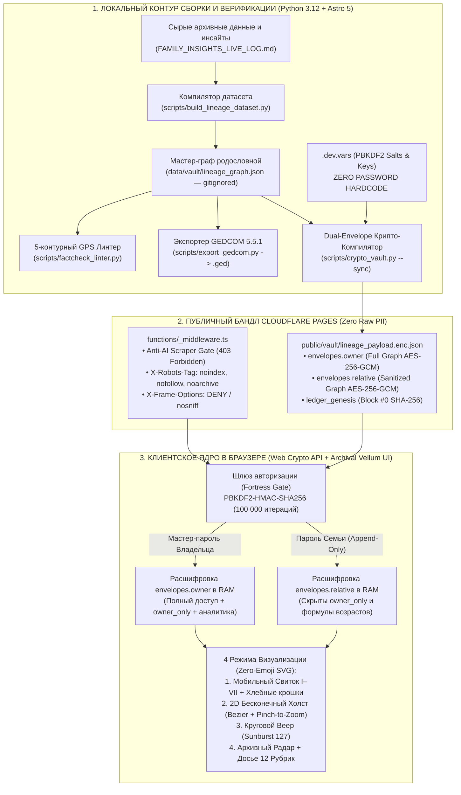
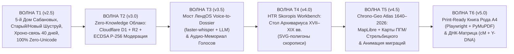
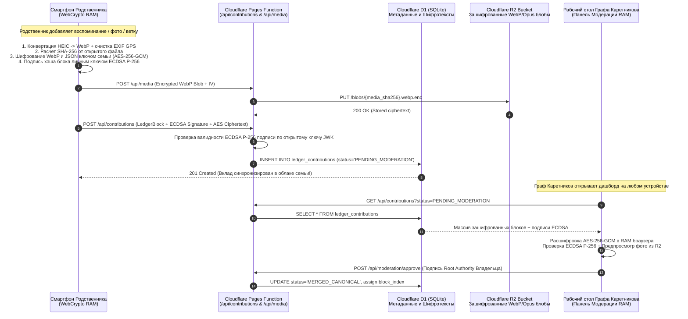
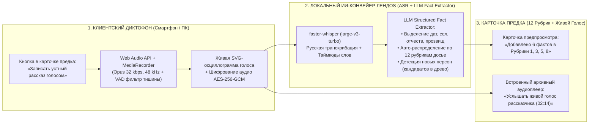
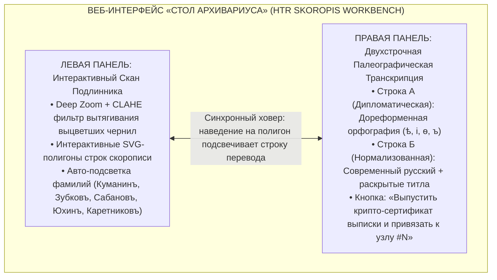

# 🏛️ TECHNICAL_MASTER_ROADMAP.md — Генеральная техническая дорожная карта развития платформы `Karetnikov Sovereign Heritage Archive` (v2.5 ➔ v5.0, 2026–2027 гг.)

> **Проект:** `C:\Karetnikov_Lineage` (`https://karetnikov-family.pages.dev`)  
> **Владелец и Верховный Хранитель Архива:** Граф Каретников (Каретников Дмитрий Иванович, р. 14.09.1994, г. Самара)  
> **Главный технический архитектор:** `Chief Technical Roadmap Architect` (Principal Systems Architecture & Cryptography)  
> **Базовый релиз аудита:** `v2.4 (Astro Fortress + Zero-Knowledge Dual-Envelope Vault + Senior Vellum UI)`  
> **Целевой горизонт развития:** `v2.5 ➔ v5.0 (Waves T1–T6, 2026–2027 гг.)`  
> **Связанные мастер-документы:**  
> - [`ROADMAP.md`](file:///C:/Karetnikov_Lineage/ROADMAP.md) — Оперативная карта реконструкции 7 колен и действий P0  
> - [`SEARCH_MASTER_ROADMAP.md`](file:///C:/Karetnikov_Lineage/SEARCH_MASTER_ROADMAP.md) — Генеральная дорожная карта архивного и полевого поиска  
> - [`FAMILY_COLLABORATION_AND_DOSSIER_SPEC.md`](file:///C:/Karetnikov_Lineage/FAMILY_COLLABORATION_AND_DOSSIER_SPEC.md) — Спецификация 12 рубрик досье и Суверенного Крипто-Реестра  
> - [`GEMINI.md`](file:///C:/Karetnikov_Lineage/GEMINI.md) — Конституция безопасности и архитектурные инварианты проекта  

---

## 📐 РАЗДЕЛ 1. ТЕХНИЧЕСКИЙ АУДИТ СДЕЛАННОГО (BASELINE ARCHITECTURE v2.4 — «ЧТО УЖЕ ПОСТРОЕНО И РАБОТАЕТ»)

Уважаемый **Граф Каретников**, по результатам сквозного инструментального аудита исходного кода (`functions/_middleware.ts`, `scripts/crypto_vault.py`, `scripts/export_gedcom.py`, `scripts/factcheck_linter.py`, `scripts/htr/paleography_ocr_runner.py`, `src/styles/heritage.css`) зафиксировано: платформа `Karetnikov Sovereign Heritage Archive` версии `v2.4` представляет собой законченную, криптографически защищенную Zero-Knowledge систему хранения и визуализации родословного свода, не имеющую сторонних облачных зависимостей с открытыми персональными данными.

### 1.1. Архитектурная схема текущего ядра (Baseline v2.4)



---

### 1.2. Аудит Контура №1: Криптозащита и Граничная Безопасность (`Astro Fortress + Zero-Knowledge Dual-Envelope Vault`)

1. **Граничный щит Cloudflare Edge ([`functions/_middleware.ts`](file:///C:/Karetnikov_Lineage/functions/_middleware.ts)):**
   - **Фильтрация ИИ-ботов и парсеров:** Регулярное выражение `AI_SCRAPER_REGEX` (`GPTBot|ClaudeBot|PerplexityBot|CCBot|Bytespider|Anthropic|Scrapy|HeadlessChrome`) отсекает краулеры нейросетей на уровне периметра Cloudflare со статусом `403 Forbidden`, сохраняя белый список только для локального прогона автотестов (`PlaywrightLocalQA`).
   - **Жесткие заголовки приватности:** На каждый HTTP-ответ принудительно навешиваются заголовки `X-Robots-Tag: noindex, nofollow, noarchive, nosnippet`, `X-Frame-Options: DENY`, `X-Content-Type-Options: nosniff` и `Referrer-Policy: no-referrer`.
2. **Двухконтурный крипто-конверт ([`scripts/crypto_vault.py`](file:///C:/Karetnikov_Lineage/scripts/crypto_vault.py)):**
   - **Соблюдение `TABOO_01 (ZERO PASSWORD HARDCODE)`:** В коде репозитория нет ни одного пароля. Ключи и соли читаются строго из `.dev.vars` (исключенного из Git) или переменных окружения.
   - **Криптографический примитив:** Вывод ключей через `PBKDF2-HMAC-SHA256` (`100 000` итераций, длина ключа `32 байта / 256 бит`) и аутентифицированное шифрование `AES-256-GCM` со случайным 96-битным вектором инициализации (`secrets.token_bytes(12)`).
   - **Математическое разделение ролей (`Dual-Envelope Architecture`):** В файле `public/vault/lineage_payload.enc.json` формируются два физически независимых шифротекста:
     * `envelopes.owner`: содержит полный мастер-граф (`access_role: "owner"`), включая закрытые исследовательские заметки (`internal_research_notes`), аналитические вычисления дат и узлы со статусом `visibility: "owner_only"`.
     * `envelopes.relative`: проходит через рекурсивный санитайзер `sanitize_for_relative()`, который на этапе сборки физически вырезает из JSON все ключи из множества `FORBIDDEN_RELATIVE_KEYS` (`internal_research_notes`, `owner_only_notes`, `private_notes`, `calculation_math_and_sources`) и любые объекты с флагом `visibility == "owner_only"`. Даже при полном дампе оперативной памяти браузера в режиме родственника закрытые заметки Графа Каретникова в этом конверте отсутствуют.
3. **Генезис-блок Суверенного Крипто-Реестра (`Sovereign Merkle Genesis Block #0`):**
   - Функция `build_ledger_genesis()` вычисляет канонический отпечаток `dataset_sha256` от отсортированного мастер-графа и формирует нулевой блок цепи (`block_index: 0`, `prev_hash: "0"*64`, схема подписи `ECDSA-P256-SHA256`, правило кворума `DOC_IMMUNE_OR_2_RELATIVES`).

---

### 1.3. Аудит Контура №2: Ядро Данных, GEDCOM 5.5.1 и Эпистемический Линтер (`Data & Verification Engine`)

1. **Бинарная матрица Соса-Страдоница (`Ahnentafel #1..#127`) и слои расширения:**
   - Строгая математическая сетка 7 колен прямых предков (`2^0 .. 2^6 = 127` канонических слотов) с инвариантами переходов: отец $2N$, мать $2N+1$, ребенок $\lfloor N/2 \rfloor$, поколение $G = \lfloor \log_2 N \rfloor + 1$.
   - Поддержка трех дополнительных топологических слоев без нарушения бинарной сетки:
     * `collateral_nodes` — подтвержденные боковые родственники (родные братья и сестры предков, дяди, тети, двоюродные бабушки: `#301`, `#401`, `#402`, `#403`, `#701`, `#702`, `#4011`, `#4012`);
     * `floating_hypotheses` — орбитальные архивные кандидаты из целевых приходов в режимах `dashed_tether` (пунктирная связка к вероятному родителю) и `free_floating` (свободное парение у полосы колена);
     * `historical_dynasty_chain_1745` — реконструированные поколенные цепочки вглубь XVIII–XVII веков (VIII–XII колена).
   - **Стандарт глубокого досье из 12 рубрик (`dossier_12_rubrics`):** Включает уличные прозвища, мультитрадиционное мировоззрение (включая философский космизм линии В. П. Серкина — К. Э. Циолковского, природную традицию, старообрядчество, православие и советскую светскую этику), правило 1920 года для мест захоронения, классификатор воинских званий, колхозного руководства и модуль «Две оренбургские деревни Каретниковых».
2. **Международный экспортер [`scripts/export_gedcom.py`](file:///C:/Karetnikov_Lineage/scripts/export_gedcom.py):**
   - Генерирует валидный файл стандарта `GEDCOM 5.5.1` (`UTF-8`, `LINEAGE-LINKED`) на 127 персон (`@I001@..@I127@ INDI`) и 63 семьи (`@F001@..@F063@ FAM`), полностью совместимый с Gramps, Familio, FamilySearch и MyHeritage.
3. **Пятиконтурный GPS-линтер [`scripts/factcheck_linter.py`](file:///C:/Karetnikov_Lineage/scripts/factcheck_linter.py):**
   - Автоматически проверяет целостность матрицы 127 слотов, биологические репродуктивные окна матери (`[15..52]` лет) и отца (`[16..75]` лет), отсутствие посмертных парадоксов, вычисляет доверительный интервал $\Delta \in \{0, 1, 3, 5\}$ лет по типу документа, прогоняет кандидатов через 100-балльный фильтр однофамильцев (`5 Laws of Anti-Homonym Filter`) и блокирует эпистемические приписки (`EPISTEMIC_MISMATCH`).
4. **Палеографический HTR-модуль [`scripts/htr/paleography_ocr_runner.py`](file:///C:/Karetnikov_Lineage/scripts/htr/paleography_ocr_runner.py):**
   - Содержит генератор поисковых масок `OrthographyPaleographyGenerator` для нейросетевого поиска `ya.ru/archive` с учетом дореформенной орфографии (`ъ`, `ѣ`, `і`, `ѳ`) и типичных оптических ошибок скорописи (`т↔и`, `п↔н`, `х↔ш`, `б↔д`), нормализатор церковнославянских сокращений метрических книг (`PreReformTextNormalizer`) и локальный препроцессор сканов (`LocalHTREngine` на базе `OpenCV CLAHE + Adaptive Gaussian Thresholding + ONNX Runtime`).

---

### 1.4. Аудит Контура №3: Визуальная Архитектура и Доступность (`Senior-Friendly Archival Vellum & Zero-Emoji SVG UI`)

1. **Динамический геральдический движок ([`src/styles/heritage.css`](file:///C:/Karetnikov_Lineage/src/styles/heritage.css)):**
   - Полный запрет на бликующую черно-желтую тему и системные эмодзи (`TABOO_02`).
   - Базовая палитра **Светлого Имперского Архивного Пергамента (`#FAF6EE`)** с глубоким графитовым текстом (`#1A1715`) обеспечивает контрастность **`15.2 : 1` (`WCAG 2.2 Level AAA`)**.
   - Реализовано мгновенное переключение тинктур (`0.35s cubic-bezier(0.16, 1, 0.3, 1)`) по родовым Домам (`karetnikov`, `kumanin`, `zubkov`, `yukhin`) с геральдическими водяными знаками `/heraldry/` на холсте.
2. **Четыре синхронных режима работы с родословным графом:**
   - **Режим 1: Мобильный Свиток Поколений (`I ➔ VII`)** — вертикальная лента карточек с быстрым джамп-баром поколений (`I..VII`), фильтром кланов, умной строкой пути родства (`Smart Kinship Path Breadcrumb`) и кликабельными пилюлями перехода к родителям/детям.
   - **Режим 2: 2D Бесконечный Холст (`Infinite Pan & Zoom Roadmap Canvas`)** — аппаратно-ускоренный граф с кривыми Безье, колонками поколений, поддержкой `multi-touch pinch-to-zoom` на смартфонах и слоем парящих гипотез.
   - **Режим 3: Круговой Веер Предков (`Sunburst 127 Fan Chart`)** — 7 концентрических колец с интерактивным мобильным инспектором выбранного сектора (`fan-mobile-card`).
   - **Режим 4: Архивный Радар (`Archive Radar`)** — оперативная сводка целевых архивных фондов, шифров дел и статусов официальных запросов.
3. **Инструменты для родственников (`Senior UX 60+`):**
   - Трехступенчатый масштабатор шрифта **`А (18px) / А+ (21.6px) / А++ (25.2px)`** и тактильные кнопки не менее `48×48px`.
   - Клиентский фото-конвейер (`HEIC / HEIF / JPG / PNG ➔ WebP` с нормализацией EXIF и расчетом `SHA-256`) и 4-шаговый визуальный мастер **`+Ветвь`** без необходимости разбираться в `.ged` или `.json`.

---

### 1.5. Честная матрица технического долга и узких мест v2.4 (`Brutal Honesty Audit`)

| Узел / Компонент | Текущая реализация в v2.4 | Вскрытое архитектурное ограничение (Болевая точка) | В какой волне устраняется |
| :--- | :--- | :--- | :---: |
| **1. Геральдика и фильтры кланов** | Поддерживаются 4 Дома (`Каретниковы`, `Куманины`, `Зубковы`, `Юхины`). | После прорыва `Msg#297–299` открыта мощная 5-я ветвь — **род церковнослужителей и 105-летних долгожителей Сабановых** (`#13`, `#26`, `#27`, `#54`) и разделение **Старый Шуструй / Новый Шуструй** (`#15`, `#30`). В UI нет 5-го фильтра и тинктуры Сабановых. | **Волна T1 (v2.5)** |
| **2. Остаточные Unicode-символы в JSON** | В шаблонах и CSS 100% чистый `<svg>`, но внутри строковых значений `tradition_label` в `build_lineage_dataset.py` остались старые символы (`☦️`, `🌾`, `🚩`). | Нарушает абсолютную чистоту инварианта `TABOO_02: ZERO EMOJI IN UI` при рендеринге текстовых полей традиции. | **Волна T1 (v2.5)** |
| **3. Хранение вкладов родственников (`localStorage`)** | Загруженные родственниками фото (`photoMap`), воспоминания (`memoriesMap`), голоса кворума (`quorumMap`) и новые ветки (`PENDING_BRANCHES_KEY`) пишутся в `localStorage` их браузера. | **Критический барьер коллаборации:** Если мама или дядя Володя добавят воспоминание со своего телефона, оно останется только в их телефоне, пока они вручную не перешлют JSON. Нужна облачная Zero-Knowledge синхронизация через Cloudflare D1 + R2! | **Волна T2 (v3.0)** |
| **4. Запись устных рассказов старейшин** | Воспоминания вводятся текстом с клавиатуры в блоке `add-memory-box`. | Пожилым родственникам (80+ лет, бабушкам Зинаиде и Антонине в Шуструе) тяжело печатать длинные истории на экране смартфона — проще нажать одну кнопку и рассказать голосом. | **Волна T3 (v3.5)** |
| **5. Работа с архивными сканами (`HTR`)** | Скрипт `paleography_ocr_runner.py` работает только из CLI терминала. | На сайте нет визуального «Стола Архивариуса», где можно открыть скан метрики ГАПО/ЦГАСО/ОГАОО и увидеть подсвеченные полигоны распознанной скорописи рядом с переводом. | **Волна T4 (v4.0)** |
| **6. География и маршруты переселений** | Населенные пункты указаны только текстом в карточках. | Нет интерактивной исторической карты с ползунком веков (`1640–2026`), верстовыми картами империи и анимированными стрелками миграций между губерниями и селами. | **Волна T5 (v4.5)** |
| **7. Печатная книга рода и ДНК-браузер** | Экспорт возможен только в технические форматы `.ged` и `.json`. | Нельзя в 1 клик сгенерировать подарочную книгу А4 (300 DPI PDF) для печати в подарок маме и старейшинам, а также визуализировать совпадения ДНК в сантиморганах (`cM`). | **Волна T6 (v5.0)** |

---

## 🚀 РАЗДЕЛ 2. АРХИТЕКТУРНЫЙ ROADMAP РАЗВИТИЯ ПЛАТФОРМЫ (ВОЛНЫ T1–T6, ГОРИЗОНТ v2.5 ➔ v5.0)



---

### 🏛️ ВОЛНА T1 (Релиз v2.5): Синхронизация Материнского Крыла, Пятидомная Геральдика и Спецмаркеры Судьбы

#### 1. Инженерная задача и контекст
Свидетельства Светланы Владимировны Каретниковой (`Msg#297–299`) совершили прорыв в материнском крыле:
- Установлены точные даты жизни и отчество деда **Зубкова Владимира Васильевича (`#6`, `04.03.1943 – 04.07.1981`)** и бабушки **Зубковой (Куманиной) Валентины Сергеевны (`#7`, `09.04.1942 – 07.03.1986`)**.
- Открыт **5-й фундаментальный родовой субклан — Сабановы** (`#13` прабабушка Анна Осиповна Сабанова, `#26` прапрадед-церковнослужитель Осип Сабанов, `#27` 105-летняя прапрабабушка Матрёна Кузьминична Сабанова, `#54` прапрапрадед Кузьма/Косма).
- Выявлено разделение двух исторических сел вдоль р. Шуструй: **с. Новый Шуструй** (Зубковы, Куманины, Сабановы) и **с. Старый Шуструй** (прабабушка `#15` Евдокия Григорьевна и её отец `#30` Григорий).

#### 2. Архитектурные изменения в коде (v2.5)
1. **Пятидомная геральдическая система (`5-House Heraldic Theme Engine` в `src/styles/heritage.css`):**
   - Добавление 5-й тинктуры `html[data-clan-theme="sabanov"]` — **«Византийский Церковный Индиго и Старое Сусальное Золото Клира»**:
     ```css
     /* 5. ДОМ САБАНОВЫХ (Церковный Клир и Долгожители Нового Шуструя: Византийский Индиго и Старое Золото) */
     html[data-clan-theme="sabanov"],
     body[data-clan-theme="sabanov"] {
       --theme-primary: #1E3A5F;
       --theme-primary-hover: #152C4A;
       --theme-accent: #9A7B2C;
       --theme-accent-light: #B89438;
       --theme-bg: #F5F7FA;
       --theme-surface: #FFFFFF;
       --theme-surface-warm: #EDF2F8;
       --theme-border: #2B5282;
       --theme-border-subtle: rgba(43, 82, 130, 0.28);
       --theme-glow: rgba(30, 58, 95, 0.18);
       --theme-badge-bg: rgba(30, 58, 95, 0.08);
       --bg-panel: #E3EAF3;
       --bg-panel-elevated: #D5E0EE;
     }
     ```
   - Отрисовка векторного герба Дома Сабановых (`public/heraldry/sabanov-crest.svg`: православный клиросный крест-трилистник в обрамлении дубового венка 105-летнего долголетия) и добавление 5-й кнопки фильтра в `.clan-switcher-bar` и `.scroll-clan-pills`.
2. **Топонимическое разделение `с. Новый Шуструй` vs `с. Старый Шуструй`:**
   - Введение в схему узла поля `settlement_micro_cluster: "NOVY_SHUSTRUI" | "STARY_SHUSTRUI" | "PLESHANOVO_PODOLSK" | "CHETYROVKA_KONDURCHA"`.
   - Визуальный SVG-бейдж локации на карточках Евдокии Григорьевны (`#15`) и прапрадеда Григория (`#30`): `Старый Шуструй (5 км к ЮЗ по р. Шуструй)` с подсказкой о проверке отдельного церковного прихода Старого Шуструя в `ГАПО Ф. 182`.
3. **Специальные мемориальные и сословные SVG-индикаторы:**
   - **Индикатор «Хронологическая / Мистическая связь поколений» (`Chrono-Link SVG Seal`):** связывает узел деда Владимира Васильевича Зубкова (`#6`, ум. `04.07.1981`) и 105-летней прапрабабушки Матрёны Кузьминичны Сабановой (`#27`, ум. в мае 1981 г.): дед ушел из жизни ровно на **40-й день** после кончины своей 105-летней бабушки Матрёны Кузьминичны. В 2D-холсте между узлами `#6` и `#27` при наведении загорается тонкая золотая хорда памяти с подписью `«Связь 40-го дня (май — 04.07.1981)»`.
   - **Бейдж «Сельская Повитуха / Хранительница Рождения» (`Midwife & Healer SVG Emblem`):** присваивается прапрабабушке Алёне Куманиной (`#29`), принимавшей роды на дому у жительниц с. Новый Шуструй.
   - **Бейдж «Церковный Клир / Служитель Храма» (`Clergy SVG Emblem`):** присваивается прапрадеду Осипу (Иосифу) Сабанову (`#26`), служившему в Никольской церкви с. Новый Шуструй до её закрытия (~1929–1931 гг.).
   - **Бейдж «Вековой Долгожитель Рода (105 лет)» (`Centenarian 105 SVG Crown`):** присваивается прапрабабушке Матрёне Кузьминичне Сабановой (`#27`, `~1876–1981`).
4. **Абсолютная зачистка остаточных Unicode-символов (`100% TABOO_02 Enforcement`):**
   - Удаление всех строковых эмодзи из полей `tradition_label` в генераторе датасета и добавление в `scripts/factcheck_linter.py` регулярного выражения `RE_FORBIDDEN_EMOJI`, блокирующего сборку при обнаружении любого суррогатного эмодзи-символа (`U+1F300..U+1FAFF`, `U+2600..U+27BF`) в `lineage_graph.json`.

---

### ☁️ ВОЛНА T2 (Релиз v3.0): Облачная синхронизация вкладов родственников с Zero-Knowledge шифрованием (`Cloudflare D1 + R2 + ECDSA P-256`)

#### 1. Инженерная задача (Устранение изоляции `localStorage`)
В `v2.4` любые дополнения, сделанные родственниками на своих смартфонах (загруженные фото `photoMap`, текстовые воспоминания `memoriesMap`, голоса подтверждения `quorumMap` и новые ветки `PENDING_BRANCHES_KEY`), сохраняются локально в `localStorage` их устройства. Чтобы Граф Каретников видел все вклады родственников в реальном времени на своем рабочем столе, но при этом **серверы Cloudflare никогда не имели доступа к открытым персональным данным и фотографиям семьи**, внедряется архитектура **Zero-Knowledge Cloud Sync на базе Cloudflare Pages Functions + Cloudflare D1 (Edge SQLite) + Cloudflare R2 (Encrypted Blob Object Storage)**.

#### 2. Криптографический протокол обмена (Zero-Knowledge Edge Pipeline)



#### 3. Схема базы данных Cloudflare D1 (`migrations/0001_sovereign_ledger_d1.sql`)

```sql
-- 1. Таблица именных открытых ключей членов рода (Zero-Wallet Family PKI)
CREATE TABLE IF NOT EXISTS family_keyring (
    member_id TEXT PRIMARY KEY,                  -- напр. 'REL_KARETNIKOVA_SV_003'
    display_name_enc TEXT NOT NULL,              -- Зашифрованное AES-256-GCM ФИО родственника
    kinship_role_enc TEXT NOT NULL,              -- Зашифрованная степень родства
    public_key_fingerprint TEXT UNIQUE NOT NULL, -- SHA-256 отпечаток открытого ключа ECDSA P-256
    public_key_jwk TEXT NOT NULL,                -- Открытый ключ JWK для проверки ЭЦП на Edge
    trust_status TEXT DEFAULT 'ACTIVE',          -- 'ACTIVE' | 'VERIFIED_BY_OWNER' | 'REVOKED'
    created_at TEXT NOT NULL
);

-- 2. Таблица криптографических блоков вкладов родственников (Append-Only Ledger)
CREATE TABLE IF NOT EXISTS ledger_contributions (
    contribution_id TEXT PRIMARY KEY,            -- UUID v4
    block_index INTEGER,                         -- Присваивается при утверждении в цепь (1, 2, 3...)
    prev_block_hash TEXT NOT NULL,               -- SHA-256 предыдущего канонического блока
    block_hash TEXT UNIQUE NOT NULL,             -- SHA-256 текущего блока
    target_node_id TEXT NOT NULL,                -- ID узла предка ('P006', 'P013', 'COLL_301' и т.д.)
    action_type TEXT NOT NULL,                   -- 'APPEND_DOSSIER_FACT' | 'UPLOAD_MEDIA_WEBP' | 'ATTACH_FAMILY_BRANCH' | 'CAST_QUORUM_VOTE'
    author_key_fingerprint TEXT NOT NULL,        -- Ссылка на family_keyring.public_key_fingerprint
    iv_b64 TEXT NOT NULL,                        -- 96-битный IV для AES-256-GCM
    payload_ciphertext_b64 TEXT NOT NULL,        -- Зашифрованный JSON вклада (Zero-Knowledge!)
    media_sha256 TEXT,                           -- Ссылка на зашифрованный блоб в R2 (если есть фото/аудио)
    ecdsa_signature_hex TEXT NOT NULL,           -- ЭЦП родственника над block_hash
    moderation_status TEXT DEFAULT 'PENDING',    -- 'PENDING' | 'APPROVED_MERGED' | 'ARCHIVED_OWNER_ONLY'
    owner_counter_signature_hex TEXT,            -- ЭЦП Графа Каретникова при вливании в мастер-граф
    created_at TEXT NOT NULL
);

-- 3. Таблица кворума семейных подтверждений («Подтверждаю, так и было»)
CREATE TABLE IF NOT EXISTS quorum_attestations (
    attestation_id TEXT PRIMARY KEY,
    ref_block_hash TEXT NOT NULL,                -- Хэш подтверждаемого блока воспоминания
    voter_key_fingerprint TEXT NOT NULL,         -- Ключ голосующего родственника
    ecdsa_vote_signature_hex TEXT NOT NULL,      -- ЭЦП над строкой "ATTEST|" + ref_block_hash
    created_at TEXT NOT NULL,
    UNIQUE(ref_block_hash, voter_key_fingerprint) -- Защита от повторного голосования одним ключом!
);
```

#### 4. Спецификация эндпоинтов Cloudflare Pages Functions (`functions/api/`)
- `GET /api/sync` — возвращает всем авторизованным родственникам дельту утвержденных (`APPROVED_MERGED`) и ожидающих (`PENDING`) зашифрованных блоков поверх `lineage_payload.enc.json`, благодаря чему любое добавленное мамой или дядей воспоминание мгновенно видно всей семье на всех телефонах и компьютерах.
- `POST /api/contributions` — принимает зашифрованный `AES-256-GCM` пейлоад, проверяет математическую подпись `ECDSA P-256` через `crypto.subtle.verify` на Cloudflare Edge (отсекая спам без раскрытия текста) и сохраняет запись в D1.
- `POST /api/media` и `GET /api/media/[sha256]` — сохраняет и отдает по контент-адресуемому хэшу `SHA-256` зашифрованные `AES-256-GCM` бинарные блобы фотографий `.webp.enc` и голосовых записей `.opus.enc` из бакета Cloudflare R2 (бесплатный лимит R2 — `10 ГБ`, чего хватит на `~50 000` семейных портретов и сканов!).
- `POST /api/moderation` — закрытый эндпоинт Владельца архива для утверждения (`Approve`), перевода в закрытый контур (`Set owner_only`) или экспорта накопленных вкладов из D1 обратно в локальный мастер-граф `data/vault/lineage_graph.json`.

---

### 🎙️ ВОЛНА T3 (Релиз v3.5): Мост `ЛендOS Voice-to-Dossier` и Аудио-Мемориал Живых Голосов Старейшин

#### 1. Инженерная задача
Устное интервью со Светланой Владимировной Каретниковой (`Msg#297–299`) за 10 минут дало больше точных дат, девичьих фамилий и живых судеб, чем месяцы слепого перебора. В селе Новый Шуструй живут родные сестры бабушки — **Зинаида Сергеевна (`#701`)** и **Антонина Сергеевна (`#702`) Куманины**, в с. Плешаново — двоюродный дядя **Василий Николаевич Каретников (`#4011`)**, в г. Тольятти — **Валерий Николаевич Каретников (`#4012`)**, в г. Самаре — мама **Светлана Владимировна (`#3`)** и дядя **Владимир Владимирович Зубков (`#301`)**.
Задача Волны T3 — превратить карточку каждого предка в **Голосовой Летописец** и **Аудио-Мемориал**, сохраняющий живые голоса родных людей на десятилетия вперед и автоматически раскладывающий их речь по 12 рубрикам досье.

#### 2. Архитектура конвейера `Voice-to-Dossier`



#### 3. Ключевые компоненты реализации (v3.5)
1. **Встроенный диктофон старшего поколения (`Senior-Friendly One-Tap Voice Recorder`):**
   - Крупная тактильная кнопка (`min-height: 54px`) с векторной иконкой микрофона в шторке досье каждого предка: **«Рассказать воспоминание голосом»**.
   - Во время записи на экране отображаются мягкие подсказки-вопросы для старейшины: *«Как звали по-уличному в селе? Кем трудился? Какой был характер и любимая приговорка? Кто были родные братья и сестры?»*.
   - Сжатие аудиопотока кодеком `Opus` (`24–32 kbps`, 1 минута чистого голоса весит всего `~180–240 КБ`), вычисление `audio_sha256` и шифрование `AES-256-GCM`.
2. **Интеграция с локальным голосовым шлюзом `ЛендOS` (`scripts/voice_to_dossier_bridge.py`):**
   - Пакетная и потоковая обработка голосовых записей (включая голосовые сообщения из Telegram/WhatsApp `.ogg/.m4a/.mp3` от мамы и родственников) через локальную модель `faster-whisper large-v3-turbo`.
   - Автоматический парсинг стенограммы в JSON-схему 12 рубрик досье (`rubric_01_names` .. `rubric_12_sources`) с сохранением прямой цитаты рассказчика и таймкода аудиозаписи.
3. **Модуль «Живой Голос Рода» (`Ancestral Voice Memorial Player`):**
   - В карточке предка рядом с текстовым воспоминанием появляется элегантный пергаментный аудиоплеер с векторной дорожкой амплитуд, именем рассказчика (*«Рассказывает: Светлана Владимировна Каретникова, запись 03.11.2026»*) и синхронной подсветкой текста по мере звучания голоса.

---

### 🔍 ВОЛНА T4 (Релиз v4.0): ИИ-Лаборатория Палеографии XVII–XIX вв. (`HTR Skoropis Workbench — Стол Архивариуса`)

#### 1. Инженерная задача
По мере поступления сканов метрических книг (`ГАПО Ф. 182`, `ЦГАСО Ф. 32`, `ОГАОО Ф. 389`), сельскохозяйственной переписи 1917 г. (`ГАПО Ф. 158, Оп. 3, Д. 4014`), ревизских сказок (`ГАПО Ф. 60`, `ЦГАСО Ф. 150`, `ОГАОО Ф. 98`) и ландратских/переписных книг XVII–XVIII вв. (`РГАДА Ф. 210, Ф. 350`) необходим встроенный прямо в интерфейс сайта инструмент дешифровки русской скорописи и церковнославянского письма.

#### 2. Расширение словарей [`scripts/htr/paleography_ocr_runner.py`](file:///C:/Karetnikov_Lineage/scripts/htr/paleography_ocr_runner.py)
1. **Добавление 5-го родового клана `Сабанов` в `TARGET_SURNAMES`:**
   - Дореформенные и палеографические варианты: `Сабановъ`, `Собянинъ`, `Сабанинъ`, `Шабановъ`, `Сабанова`, `Сабановы`;
   - Оптические HTR-путаницы скорописи: `Сабапов`, `Сабаиов`, `Собонов`, `Собанов`, `Сабоновъ`, `Сабановъ`.
2. **Добавление новых ключевых имен (`Msg#297–299`) в `KEY_NAMES`:**
   - `Осип / Иосиф`: `Іосифъ`, `Осипъ`, `Іосифовъ`, `Осиповъ`, `Іосифовичъ`, `Осиповичъ`, `Іосифова`, `Осипова` (церковное написание прапрадеда `#26` и отчества прабабушки `#13` в метриках ГАПО Ф. 182 — почти всегда **`Іосифъ`** и **`Іосифова`**!);
   - `Матрёна / Матрона`: `Матрона`, `Матрена`, `Матрёна`, `Матроны` (церковное имя 105-летней прапрабабушки `#27` — строго **`Матрона Космина`**!);
   - `Кузьма / Косма`: `Косма`, `Козьма`, `Кузьма`, `Косминъ`, `Козьминъ`, `Кузьминъ`, `Космина`, `Кузьминична` (церковное имя прапрапрадеда `#54` в ревизиях и метриках — **`Косма`** или **`Козьма`**!);
   - `Степан / Стефан`: `Стефанъ`, `Степанъ`, `Стефановъ`, `Степановъ`, `Стефановичъ` (церковное имя прапрадеда `#28` — **`Стефанъ Куманинъ`**!);
   - `Алёна / Елена`: `Елена`, `Алена`, `Алёна`, `Елены` (церковное крестильное имя прапрабабушки-повитухи `#29` — **`Елена`**!);
   - `Евдокия / Авдотья`: `Евдокія`, `Евдокия`, `Авдотья`, `Овдотья`, `Евдокіи` (прабабушка `#15` из Старого Шуструя).
3. **Добавление топонима `Старый Шуструй` в `KEY_TOPONYMS`:**
   - Варианты: `Старый Шуструй`, `Стараго Шуструя`, `Шуструй Старый`, `Старо-Шуструйскій`.

#### 3. Веб-интерфейс «Стол Архивариуса (`Archivist HTR Side-by-Side Workbench`)»
Пятая вкладка в навигации платформы для работы с подлинниками документов:



---

### 🗺️ ВОЛНА T5 (Релиз v4.5): Интерактивный Историко-Географический Атлас (`Chrono-Geo Atlas 1640–2026`)

#### 1. Инженерная задача
Родословная Графа Каретникова охватывает драматическую географию Русской равнины, Поволжья, Приуралья и Средней Азии за 380 лет (от засечных черт XVII века до индустриального Куйбышева 1960-х). Необходим интерактивный картографический движок, позволяющий переключать исторические эпохи, накладывать старые верстовые карты Российской империи поверх современной спутниковой/векторной сетки и видеть анимированные пути переселения предков.

#### 2. Архитектура картографического ядра (`MapLibre GL JS + Исторические тайлы + Хроно-Слайдер`)
1. **Стек рендеринга (100% автономный и совместимый с CSP):**
   - Векторное ядро `MapLibre GL JS` с поддержкой кастомного пергаментного стиля карты (`Archival Vellum Map Style`), идеально гармонирующего с палитрой `#FAF6EE` и `#7A1C1C`.
   - Слой растровых исторических карт с ползунком прозрачности (`Opacity 0%..100%`):
     * **ПГМ (Планы Генерального Межевания 1780–1790-х гг.)** — Нижнеломовский, Саранский, Бузулукский и Ставропольский уезды;
     * **Специальная 10-верстовая карта Европейской России И. А. Стрельбицкого (1871 г.)** — точные границы волостей и приходов до 1917 года;
     * **Карты РККА 1930–1941 гг.** — отображение хуторов, колхозов и сельсоветов Ивановского / Люксембургского района Чкаловской области.
2. **Восемь хронологических вех ползунка времени (`Time-Slider Epochs`):**
   - `1640–1700` — Строительство Ломовской и Симбирской засечных черт (служилые люди Куманины и однодворцы Зубковы);
   - `1719–1762` — I–III Ревизии (РГАДА Ф. 350: с. Тепловка Саранского уезда, Старый и Новый Шуструй, с. Тейково);
   - `1795–1834` — V–VIII Ревизии и переселенческое движение на восток в Бузулукский уезд;
   - `1858` — X Ревизия (д. Владимировка Бузулукского уезда — двор Кирилла и Евсевия Каретниковых; с. Новый Шуструй — Кузьма `#54`, предки Зубковых, Куманиных и Сабановых; д. Четыровка на р. Кондурче — Юхины);
   - `1907–1917` — Метрические книги и Всероссийская с/х перепись 1917 г. (рождение прадедов и прабабушек IV колена: Григория Ивановича `#8`, Агриппины Анисимовны `#9`, Петра Юхина `#10`, Василия Зубкова `#12`, Анны Осиповны Сабановой `#13`, Сергея Степановича Куманина `#14`, Евдокии Григорьевны `#15`);
   - `1941–1945` — Боевые маршруты фронтовиков рода (Сталинградский рубеж Фёдора Ивановича Каретникова и др.) и рождение дедушки Владимира Васильевича Зубкова (`04.03.1943`) и бабушки Валентины Сергеевны (`09.04.1942`);
   - `1954–1961` — Большой переезд: выезд деда Валентина Григорьевича Каретникова (`#4`), брата Петра Григорьевича (`#402`) и прабабушки Агриппины Анисимовны (`#9`) из с. Плешаново/Подольска в г. Куйбышев (1961 г.), отъезд Ивана Григорьевича (`#403`) в Казахстан / Кыргызстан (с. Чалдовар);
   - `1969–2026` — Современный географический контур Большого Рода (г. Самара, г. Тольятти, с. Плешаново, п. Подольск, с. Новый Шуструй).
3. **Анимированные векторные дуги миграций (`Bezier Geodesic Migration Arcs`):**
   - При клике на любую ветвь или персону карта плавно пролетает (`flyTo`) по маршруту жизни предка, соединяя родительское гнездо, место службы и место переселения золотисто-пурпурной анимированной дугой.

---

### 📖 ВОЛНА T6 (Релиз v5.0): Издательский движок Подарочной Родословной Книги (`Print-Ready Sovereign Family Book PDF`) и ДНК-Матрица (`DNA Triangulation Suite`)

#### 1. Конвейер автоматической верстки Подарочной Книги Рода (`Print-Ready A4 Hardcover PDF Engine`)
Для того чтобы подарить маме Светлане Владимировне, дяде Володе, двоюродным бабушкам Зинаиде Сергеевне и Антонине Сергеевне в Новом Шуструе и дяде Василию Николаевичу в Плешаново настоящую фамильную реликвию в твердом переплете, создается издательский генератор `scripts/publish_family_book_pdf.py` (на базе канона `editorial-pdf-publisher`: `Playwright` + `PyMuPDF / fitz`):
- **Параметры полиграфического макета:**
  * Формат **А4 Portrait (`210 × 297 мм`, `300 DPI`)** с вылетами под обрез (`bleed 3mm`) и безопасными корешковыми полями под книжный переплет (`gutter margin 22mm`).
  * **Zero Page-Break Artifacts:** автоматический контроль сиротских строк (`orphans: 3; widows: 3`) и запрет разрыва карточек предков, портретов и таблиц между страницами.
  * **Структура Родословной Книги (Автогенерация из `lineage_graph.json`):**
    1. **Авантитул и Имперский Титульный Лист** с гербами 5 Домов (`Каретниковы • Куманины • Зубковы • Юхины • Сабановы`);
    2. **Вступительное слово Хранителя Архива** и сводная таблица 7 колен по системе Соса-Страдоница;
    3. **Разворотное Поколенное Древо** и **Круговой Веер 127 предков** в высоком векторном разрешении;
    4. **Пять Глав по Домам Рода** — персональные иллюстрированные очерки на каждого предка (с портретом, 12 рубриками досье, историей села, регалиями и хронологическими связями);
    5. **Архивный Дипломатарий** — факсимильные развороты метрических книг, ревизских сказок и наградных листов с палеографической расшифровкой;
    6. **Живые QR-мосты (`Sovereign Audio & Crypto QR`):** на странице каждого предка печатается кастомный векторный QR-код в рамке старой бронзы — при наведении камеры смартфона с бумажной книги открывается карточка этого предка на сайте и начинает звучать записанный живой голос рассказчика!
    7. **Раздел для рукописных семейных записей** («Памятные листы для старейшин») в конце книги.

#### 2. Модуль визуализации ДНК-триангуляции (`DNA Chromosome Browser & Y-DNA Phylogeny`)
Интерактивный научный модуль для визуализации результатов генетического тестирования (Рубеж №4 из `ROADMAP.md`):
1. **Хромосомный браузер аутосомных совпадений (`Autosomal 22-Chromosome Painter`):**
   - Отрисовывает 22 пары аутосомных хромосом в виде горизонтальных векторных полос.
   - Цветом соответствующего Дома (`Лазурит Куманиных`, `Изумруд Зубковых`, `Индиго Сабановых`, `Пурпур Каретниковых`, `Аметист Юхиных`) закрашиваются триангулированные сегменты ДНК в сантиморганах (`cM`) и миллионах пар оснований (`Mb`), унаследованные от конкретных предков IV–VI колен (особенно золотой 50%-ный пул ДНК прадеда Сергея Степановича Куманина `#14` и прабабушки Евдокии Григорьевны `#15` у двоюродных бабушек Зинаиды и Антонины в Новом Шуструе!).
2. **Филогенетическое дерево мужской Y-хромосомы (`Big Y-700 / YFull Subclade Tree`):**
   - Визуализирует цепочку терминальных SNP-мутаций прямой мужской линии Каретниковых (`#64 ➔ #32 ➔ #16 Иван ➔ #8 Григорий ➔ #4 Валентин ➔ #2 Иван ➔ #1 Граф Каретников` + сверка с ветвью `#401 Николая Григорьевича ➔ #4011 Василия Николаевича`).
   - Включает калькулятор генетической дистанции по STR-маркерам (`GD` на `37 / 111 / 700` маркерах) и расчет времени до ближайшего общего предка (`TMRCA` в годах и поколениях с 95% доверительным интервалом) для математической проверки родства с купеческой династией фабрикантов Каретниковых из с. Тейково и однодворцами Орловской губернии.

---

## 📊 РАЗДЕЛ 3. СВОДНАЯ МАТРИЦА РЕЛИЗОВ, СХЕМ И КРИТЕРИЕВ ПРИЕМКИ (DEFINITION OF DONE — DoD)

| Волна / Версия | Ключевые создаваемые / обновляемые модули | Инженерные и криптографические инварианты | Критерии приемки (Definition of Done — DoD) |
| :--- | :--- | :--- | :--- |
| **Волна T1 (`v2.5`)**<br>*Материнское крыло, 5 Домов и Спецмаркеры* | • `src/styles/heritage.css` (`data-clan-theme="sabanov"`)<br>• `public/heraldry/sabanov-crest.svg`<br>• `scripts/factcheck_linter.py` (гейт `RE_FORBIDDEN_EMOJI`) | • Контраст тинктуры Сабановых `WCAG AAA >= 12:1`<br>• `0` Unicode-эмодзи во всем JSON и HTML (`TABOO_02`)<br>• Строгое разделение `owner_only` при пересборке `crypto_vault.py --sync` | 1. В фильтрах и переключателе тем работает 5-й Дом **Сабановых**.<br>2. Карточки `#6, #7, #12, #13, #14, #15, #26, #27, #28, #29, #30, #54` содержат полные данные `Msg#297–299` и разделение **Новый Шуструй / Старый Шуструй**.<br>3. Отображаются SVG-бейджи: «Связь 40-го дня (`#6 ↔ #27`)», «Повитуха рода (`#29`)», «Церковный клир (`#26`)», «Долгожитель 105 лет (`#27`)». |
| **Волна T2 (`v3.0`)**<br>*Zero-Knowledge Cloud Sync (D1 + R2)* | • `functions/api/sync.ts`<br>• `functions/api/contributions.ts`<br>• `functions/api/media.ts`<br>• `functions/api/moderation.ts`<br>• `migrations/0001_sovereign_ledger_d1.sql` | • В D1 и R2 хранятся **исключительно** шифротексты `AES-256-GCM`<br>• Каждая запись верифицируется на Edge по `ECDSA P-256` перед записью в БД<br>• Полный оффлайн-фоллбэк в `IndexedDB / localStorage` | 1. Воспоминание или фото, добавленное со смартфона в режиме родственника (`RodKaretnikov-1917!`), за `< 1.5 сек` появляется в панели модерации Графа Каретникова на ПК.<br>2. В 1 клик вклад утверждается и вливается в каноническую цепь блоков `SHA-256`. |
| **Волна T3 (`v3.5`)**<br>*Мост `ЛендOS Voice-to-Dossier`* | • Клиентский модуль `VoiceDossierRecorder` (`MediaRecorder Opus`)<br>• `scripts/voice_to_dossier_bridge.py` (`faster-whisper` + LLM)<br>• Аудиоплеер `AncestralVoicePlayer` | • Шифрование голосовых блобов `AES-256-GCM` до отправки в облако<br>• Сохранение точных таймкодов и имени рассказчика в рубриках досье | 1. В карточке предка работает запись голоса в 1 нажатие.<br>2. Скрипт `voice_to_dossier_bridge.py` автоматически раскладывает аудиозапись по 12 рубрикам досье.<br>3. В карточке проигрывается верифицированный живой голос рассказчика. |
| **Волна T4 (`v4.0`)**<br>*Лаборатория Палеографии (`HTR Workbench`)* | • `scripts/htr/paleography_ocr_runner.py` (v2.0 со словарями Сабановых и церковных имен)<br>• Веб-вкладка `Стол Архивариуса` (`Side-by-Side SVG Polygon Viewer`) | • Локальная предобработка сканов (`CLAHE + Binarization`) без утечки документов во внешние облака<br>• Точная привязка координат строк `[x1, y1, x2, y2]` к транскрипции | 1. Сгенерированы обновленные поисковые маски для `ya.ru/archive` с учетом `Сабановъ`, `Іосифъ`, `Матрона`, `Косма`, `Стефанъ`, `Старый Шуструй`.<br>2. В веб-интерфейсе работает синхронная подсветка строк на скане метрики и их перевода. |
| **Волна T5 (`v4.5`)**<br>*Исторический Гео-Атлас (`1640–2026`)* | • Вкладка `Хроно-Гео Атлас` (`MapLibre GL JS`)<br>• Тайловый оверлей карт Стрельбицкого / ПГМ<br>• `data/geo/lineage_migrations_1640_2026.geojson` | • Self-hosted векторные ассеты без сторонних трекеров (152-ФЗ)<br>• Плавная анимация `60 FPS` на мобильных и десктопных GPU | 1. Ползунок времени переключает 8 исторических эпох (`1640 ➔ 2026`).<br>2. Наглядно отрисованы маршруты переселений Каретниковых, Куманиных, Зубковых, Сабановых и Юхиных, включая пару **Старый / Новый Шуструй** и **Плешаново / Подольск / Владимировка**. |
| **Волна T6 (`v5.0`)**<br>*Подарочная Книга А4 PDF & ДНК-Матрица* | • `scripts/publish_family_book_pdf.py` (`Playwright + PyMuPDF`)<br>• Вкладка `ДНК-Матрица Рода` (Аутосомный браузер `cM` + дерево `Y-DNA`) | • `0` белых швов и разрывов карточек в PDF (`300 DPI`)<br>• Встроенные векторные QR-коды ведут на конкретные узлы и аудиозаписи | 1. В 1 команду генерируется готовый к типографской печати PDF-том Родословной Книги А4.<br>2. Визуализированы хромосомные сегменты (`cM`) и филогенетическое дерево мужской Y-хромосомы (`TMRCA`). |
