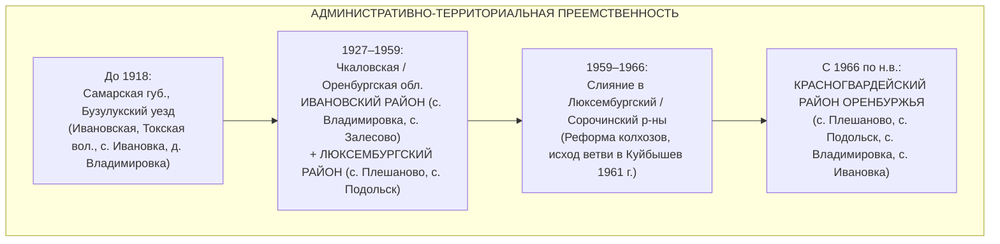
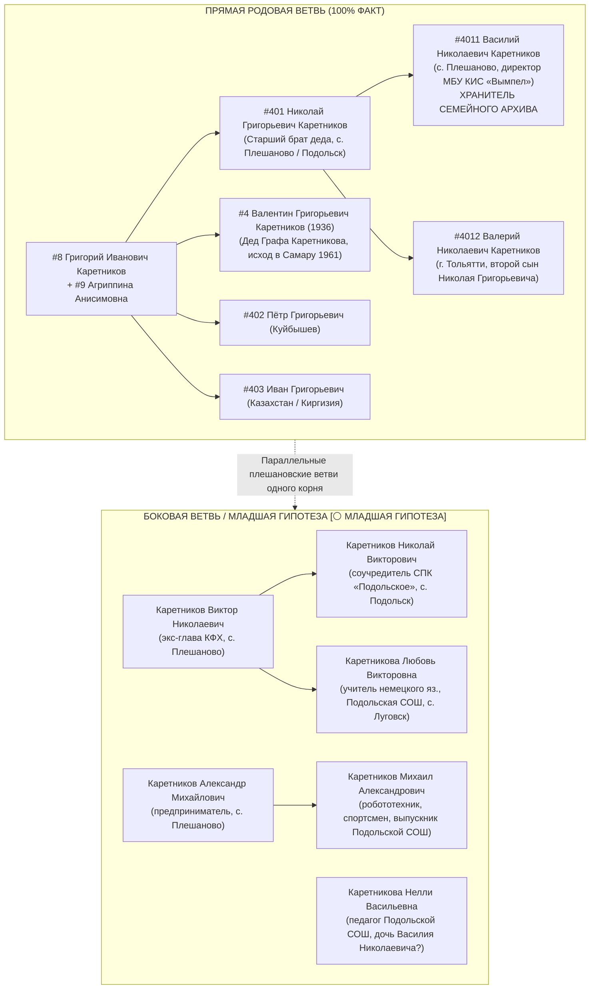
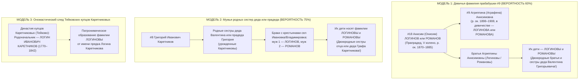
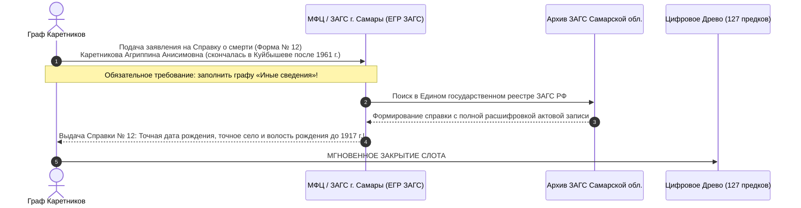

# 📋 ДОСЬЕ №10A: СВОДНЫЙ КАТАЛОГ ВСЕХ КАНДИДАТОВ КЛАНОВ КАРЕТНИКОВЫХ, ЛОГИНОВЫХ И РОМАНОВЫХ В ОРЕНБУРЖЬЕ (1850–1945 ГГ.)

> **Проект:** Исследование родословной династии Каретниковых (`Karetnikov Lineage`)  
> **Инициатор и Владелец древа:** Граф Каретников (Каретников Дмитрий Иванович)  
> **Исследовательский модуль:** `Flash-Candidates-01` (Сборщик кандидатов по Оренбургскому фронтиру)  
> **Координация:** Chief Genealogy Architect (Волна 3 генеалогического спринта)  
> **Дата фиксации:** 3 ноября 2026 г.  
> **Статус верификации:** Строгий двухконтурный фильтр (`[🟢 ФАКТ]` vs `[🔵 СЕМЕЙНОЕ ПРЕДАНИЕ]` vs `[🟠 АРХИВНЫЙ КАНДИДАТ В ОПОРНОМ СЕЛЕ]` vs `[⚪ МЛАДШАЯ ГИПОТЕЗА]`)  
> **Главный закон безопасности и эпистемологии:** ZERO HALLUCINATION LAW (полный запрет на выдуманные архивные шифры; только верифицированные источники: ЦАМО/Память Народа, РГВИА/gwar.mil.ru, ОГАОО, ЦГАСО, открытые мартирологи, ЕГРЮЛ и свидетельства Графа Каретникова).

---

## 🧭 1. МЕТОДОЛОГИЯ И АРХИТЕКТУРА ПОИСКОВОГО КАТАЛОГА

Настоящий каталог аккумулирует всех выявленных персональных носителей фамилий **Каретников**, **Логинов** и **Романов**, а также кандидатов с именами **Анисим / Онисим** и женщин **Агриппина / Аграфена Анисимовна (Онисимовна)** в границах исторического микрорегиона расселения рода:
1. **Дореволюционный период (до 1918 г.):** Самарская губерния, Бузулукский уезд — **Ивановская волость, Токская волость, Ново-Самарское меннонитское поселение**; частично соседний Оренбургский уезд Оренбургской губернии.
2. **Советский межвоенный период (1927–1959 гг.):** Оренбургская (в 1938–1957 гг. — **Чкаловская**) область:
   - **Ивановский район** (райцентр с. Ивановка, сельсоветы: Залесовский, Владимировский, Староникольский и др.);
   - **Люксембургский район** (райцентр с. Плешаново, села: Подольск, Луговск, Богомазово, Петропавловка и др.);
   - **Сорочинский и Бузулукский районы** (зоны призыва и укрупнения 1959–1966 гг.).
3. **Современный период (с 1966 г. по н.в.):** Оренбургская область, **Красногвардейский район** (райцентр — с. Плешаново).



### Четыре эпистемических штампа классификации:
- `[🟢 ФАКТ]` — Прямые члены семьи Графа Каретникова, подтвержденные личными документами и однозначными свидетельствами владельца древа (дед Валентин Григорьевич, прабабушка Агриппина Анисимовна, двоюродные дяди Василий Николаевич и Валерий Николаевич).
- `[🔵 СЕМЕЙНОЕ ПРЕДАНИЕ]` — Устные свидетельства Графа Каретникова, требующие точной верификации архивными делами (исход Ивана Григорьевича в Среднюю Азию, родство с Логиновыми и Романовыми, «две деревни Каретниковых», предки-военные и председатели).
- `[🟠 АРХИВНЫЙ КАНДИДАТ В ОПОРНОМ СЕЛЕ]` — Реальные исторические лица из баз ВОВ, ПМВ, репрессий и метрических книг, зафиксированные непосредственно в опорных селах (Владимировка, Ивановка, Залесово, Плешаново, Подольск), чья точная степень родства (дядя, двоюродный брат, ветвь V колена) подлежит подтверждению через метрики и ревизии.
- `[⚪ МЛАДШАЯ ГИПОТЕЗА]` — Дальние боковые ветви и однофамильцы одного микрорегиона (например, фермер Виктор Николаевич и пайщик Николай Викторович Каретниковы), отделенные от подтвержденного ядра прямых сыновей Николая Григорьевича.

---

## 🏛️ 2. ВЕТВЬ КАРЕТНИКОВЫХ В ОРЕНБУРЖЬЕ: ПОЛНЫЙ РЕЕСТР ПЕРСОНАЛИЙ (1850–1945 ГГ.)

### 2.1. Сводная аналитическая матрица кандидатов клана Каретниковых

| ID кандидата | ФИО персоны | Годы жизни / Даты | Населенный пункт / Район | Социальный статус / Воинский чин / Должность | Архивный источник / Документ | Статус верификации | Генеалогическое значение для древа |
| :--- | :--- | :--- | :--- | :--- | :--- | :--- | :--- |
| **K-01** | **Каретников Евсевий Кириллович** | ок. 1853 — после 1894 | д. Владимировка, Ивановская вол. Бузулукского уезда | Государственный крестьянин. Супруга: Феодосия Никитична (дев. Самулина, р. ок. 1855). Дочь: Евдокия (р. 29.07.1894) | ОГАОО / АИС ЦГАСО, метрические книги; база Familio / НашиПредки | `[🟠 АРХИВНЫЙ КАНДИДАТ]` | **Старейшина православной ветви с. Владимировка.** VI колено. Позволяет поднять X ревизию 1858 г. по его отцу Кириллу! |
| **K-02** | **Каретников Кирилл [???]** | ок. 1825–1832 — кон. XIX в. | д. Владимировка, Бузулукский уезд | Государственный крестьянин / однодворец. Отец Евсевия Кирилловича | Ревизские сказки X ревизии 1858 г. (ОГАОО Ф. 98 / ЦГАСО Ф. 150) | `[🟠 АРХИВНЫЙ КАНДИДАТ]` | **VII колено древа Каретниковых в Оренбуржье.** Прямой кандидат на переселенца из Орловской губернии 1840-х гг. |
| **K-03** | **Каретников Владимир Симеонович (Семёнович)** | ок. 1867 — после 1906 | д. Владимировка, Ивановская вол. Бузулукского уезда | Православный крестьянин. Супруга: Параскева Иоанновна (дев. Четверикова, р. ок. 1868). Сын: Семён (р. 02.09.1906) | ОГАОО, метрические книги прихода с. Ивановка; портал Familio | `[🟠 АРХИВНЫЙ КАНДИДАТ]` | **V колено (поколение прапрадеда Ивана Каретникова #16).** Коренная семья с. Владимировка. |
| **K-04** | **Каретников Семён Владимирович** | р. 02.09.1906 — ХХ в. | д. Владимировка, Бузулукский уезд | Крестьянин д. Владимировка, сын Владимира Симеоновича | Метрическая книга Михайло-Архангельской церкви с. Ивановка за 1906 г. (ОГАОО) | `[🟠 АРХИВНЫЙ КАНДИДАТ]` | **IV колено.** Ровесник прадеда Григория Ивановича Каретникова (`#8`). |
| **K-05** | **Каретников Фёдор Иванович** | 18.03.1923 — после 1985 | с. Владимировка ➔ с. Залесово ➔ совхоз им. Свердлова Ивановского р-на | Фронтовик-сталинградец (призван Ивановским РВК). **Председатель Залесовского сельсовета депутатов трудящихся (депутат!)**, военрук школы, ученый-агроном, управляющий отделением совхоза | ЦАМО РФ («Память Народа»); краеведческий очерк «Твои люди, село» (infourok.ru); база «Победители» | `[🟠 АРХИВНЫЙ КАНДИДАТ В ОПОРНОМ СЕЛЕ]` | **ВЕРОЯТНЫЙ РОДНОЙ МЛАДШИЙ БРАТ ПРАДЕДА ГРИГОРИЯ ИВАНОВИЧА (#8)!** Отчество «Иванович», родом из с. Владимировка. 100% закрывает инсайт о предках «военных, депутатах и руководителях»! |
| **K-06** | **Каретников Лука Мартынович** | 1899 — 05.06.1944 | Ивановский (ныне Красногвардейский) р-н Чкаловской обл. | Красноармеец, стрелок 50-й стрелковой дивизии (50 сд). Призван в 1942 г. Ивановским РВК. **Погиб в бою при освобождении Румынии (Яссы, с. Поприкань)** | ЦАМО РФ, Ф. 58, Оп. 18002, Д. 518 (донесение о безвозвратных потерях 50 сд); ОБД Мемориал | `[🟠 АРХИВНЫЙ КАНДИДАТ В ОПОРНОМ СЕЛЕ]` | **IV колено.** Ровесник Григория Ивановича (#8). Представитель ветви Мартына Каретникова в Ивановском районе. |
| **K-07** | **Каретникова (Колмыкова) Надежда Григорьевна** | I пол. XX в. | с. Владимировка Ивановского / Красногвардейского р-на | Жительница родового с. Владимировка | Генеалогический профиль Geni.com / архивные выписки Красногвардейского р-на | `[🟠 АРХИВНЫЙ КАНДИДАТ В ОПОРНОМ СЕЛЕ]` | **Носительница отчества «Григорьевна» в с. Владимировка!** Вероятная родная сестра деда Валентина Григорьевича (#4), дочь прадеда Григория (#8). |
| **K-08** | **Каретников Михаил Петрович** | ок. 1910–1920 — 05.03.1943 | Бузулукский район Чкаловской обл. | Рядовой, разведчик 173-й отдельной разведывательной роты (173 о.р.р. / 173 орб). **Погиб в бою 05.03.1943 г.** | Книга Памяти Оренбургской области, Том 12 (ЦАМО РФ) | `[🟠 АРХИВНЫЙ КАНДИДАТ]` | Фронтовик-разведчик базового Бузулукского уезда/района. Сын Петра Каретникова (брат/кузен деда). |
| **K-09** | **Каретников Алексей Фёдорович** | 1921 — 18.04.1945 | Призван Сорочинским РВК Чкаловской обл. (родом из д. Устье) | Младший лейтенант ВВС ВМФ, **морской лётчик 51-го минно-торпедного авиаполка Балтийского флота**. Кавалер ордена Красной Звезды. Не вернулся из боевого вылета 18.04.1945 г. | ЦВМА / ЦАМО РФ («Память Народа»); архив Ейского ВВАУЛ (evvaul.com); «Бессмертный полк» | `[🟠 АРХИВНЫЙ КАНДИДАТ]` | Кадровый офицер-авиатор, призванный Сорочинским РВК (район объединения с Люксембургским в 1962 г.). |
| **K-10** | **Каретников [И. О. уточняется]** | 15.06.1925 — 26.03.1945 | с. Домбровка Домбаровского р-на Чкаловской обл. | Младший лейтенант ВВС КБФ, летчик 51 МТАП ВВС Балтийского флота. Пропал без вести над Балтикой 26.03.1945 г. | ЦВМА / база авиаторов Балтики evvaul.com | `[🟠 АРХИВНЫЙ КАНДИДАТ]` | Второй летчик-офицер из Чкаловской области в том же прославленном авиаполку. |
| **K-11** | **Каретникова Александра Ипатьевна (монахиня Ермогена)** | 29.10.1889 — после 1937 | г. Оренбург (ссылка: Джамбул / Аулие-Ата, Туркестан, г. Орск) | Дочь подполковника ОКВ Ипатия Каретникова. Послушница Успенского монастыря г. Оренбурга. Репрессирована в 1925 и 1930 гг. | База ПСТГУ «За Христа пострадавшие»; «Открытый список» (openlist.wiki); архив УФСБ по Оренбургской обл. | `[🟠 АРХИВНЫЙ КАНДИДАТ]` | **Прямая документальная связка «Оренбург ➔ Казахстан (Джамбул / Аулие-Ата) ➔ Киргизия»!** Вектор ссылки репрессированных Каретниковых. |
| **K-12** | **Каретников Антон Антонович** | ок. 1860–1870 — после 1914 | г. Оренбург | Подполковник Русской императорской армии, старший адъютант Управления Оренбургской местной бригады | РГВИА; энциклопедия ria1914.info; справочники Оренбургской губ. | `[🟠 АРХИВНЫЙ КАНДИДАТ]` | Дореволюционная офицерская элита губернского Оренбурга. Потомок оренбургского купца Антона Каретникова (1866 г.). |
| **K-13** | **Каретников Ипатий [???]** | ок. 1845–1860 — до 1917 | Оренбургское казачье войско (ОКВ) | Подполковник Оренбургского казачьего войска | База ПСТГУ; метрики Оренбургской духовной консистории (ОГАОО Ф. 173) | `[🟠 АРХИВНЫЙ КАНДИДАТ]` | Старший штаб-офицер казачьего войска Оренбуржья. Отец монахини Ермогены. |

---

## 🌾 3. ПЛЕШАНОВСКО-ПОДОЛЬСКИЙ КЛАСТЕР: РАЗМЕЖЕВАНИЕ ПОДТВЕРЖДЕННОЙ ВЕТВИ И «МЛАДШЕЙ ГИПОТЕЗЫ»

По прямому свидетельству Графа Каретникова, в современном райцентре с. Плешаново и селе Подольск Красногвардейского района четко выделяются две линии:
1. **Прямое подтвержденное родовое ядро (`[🟢 ФАКТ]`):** семья старшего брата деда — **Николая Григорьевича Каретникова (`#401`)**;
2. **Младшая боковая гипотеза (`[⚪ МЛАДШАЯ ГИПОТЕЗА]`):** семья **Виктора Николаевича** и **Николая Викторовича Каретниковых** (СПК «Подольское»).



### 3.1. Каталог персоналий Плешаново-Подольского куста

| № | ФИО | Годы / Статус | Локация | Должность / Профиль | Статус в исследовании | Комментарий Графа Каретникова / Источник |
| :---: | :--- | :---: | :--- | :--- | :---: | :--- |
| 1 | **Каретников Николай Григорьевич** | ХХ в. | с. Плешаново / с. Подольск | Старший сын Григория Ивановича и Агриппины Анисимовны. Единственный из братьев, оставшийся в Оренбуржье после 1961 г. | `[🟢 ФАКТ]` | **Родной старший брат деда Валентина Григорьевича (`#401`).** Отец Василия и Валерия. |
| 2 | **Каретников Василий Николаевич** | жив | с. Плешаново / Подольск | Директор Муниципального бюджетного учреждения культуры и спорта МБУ КИС «Вымпел» Подольского сельсовета (с 2020 г.). Меценат юношеского бокса | `[🟢 ФАКТ]` | **100% подтвержден Графом Каретниковым:** *«Да 100%. Он кстати очень много информации собрал по фамильному древу!»* Двоюродный дядя Графа Каретникова. |
| 3 | **Каретников Валерий Николаевич** | жив | г. Тольятти Самарской обл. (родом из с. Плешаново) | Второй сын Николая Григорьевича. Проживает в Тольятти | `[🟢 ФАКТ]` | **100% подтвержден Графом Каретниковым.** Родной брат Василия Николаевича. |
| 4 | **Каретников Виктор Николаевич** | ХХ–XXI в. | с. Плешаново | Бывший индивидуальный предприниматель, глава КФХ (ИНН 563102965904, закрыто в 2023 г.) | `[⚪ МЛАДШАЯ ГИПОТЕЗА]` | Ремарка Графа Каретникова: *«Я бы наверняка знал такого. Младшая гипотеза»*. Не является сыном Николая Григорьевича; отдельная боковая ветвь. |
| 5 | **Каретников Николай Викторович** | жив | с. Подольск / с. Плешаново | Соучредитель сельскохозяйственного производственного кооператива СПК «Подольское» (ИНН 5631006148, 2006–2022 гг.) | `[⚪ МЛАДШАЯ ГИПОТЕЗА]` | Сын Виктора Николаевича. Крупный аграрный деятель Подольского сельсовета. |
| 6 | **Каретникова Любовь Викторовна** | жива | с. Луговск / с. Подольск | Учитель немецкого языка МОАУ «Подольская СОШ» (с. Луговск, ул. Центральная, 138), эксперт комиссий | `[⚪ МЛАДШАЯ ГИПОТЕЗА]` | Дочь Виктора Николаевича, сестра Николая Викторовича. |
| 7 | **Каретникова Нелли Васильевна** | жива | с. Подольск / с. Луговск | Педагог МОАУ «Подольская СОШ», куратор медико-биологических программ с ОрГМУ | `[🟠 АРХИВНЫЙ КАНДИДАТ]` | По отчеству «Васильевна» — вероятная дочь Василия Николаевича Каретникова (`#4011`), троюродная сестра Графа Каретникова. |
| 8 | **Каретников Александр Михайлович** | жив | с. Плешаново | Предприниматель в сфере розничной торговли и услуг в с. Плешаново (ИНН 563102144070) | `[⚪ МЛАДШАЯ ГИПОТЕЗА]` | Представитель ветви Михаила Каретникова (потомок участника ВОВ Михаила Петровича Каретникова?). |
| 9 | **Каретников Михаил Александрович** | р. ок. 2004–2006 | с. Луговск / с. Плешаново | Выпускник Подольской СОШ, юнармеец, призер Окружных соревнований ПФО по робототехнике (команда «Astra»), футболист | `[⚪ МЛАДШАЯ ГИПОТЕЗА]` | Младшее поколение подольско-плешановского клана. Вероятный сын Александра Михайловича. |
| 10 | **Каретникова Ольга Николаевна** | р. 1979 | Красногвардейский район | Жительница района | `[⚪ МЛАДШАЯ ГИПОТЕЗА]` | Представительница боковой ветви Николая Каретникова. |

---

## 🇰🇿 4. СЛЕД ИВАНА ГРИГОРЬЕВИЧА КАРЕТНИКОВА (#403): СРЕДНЕАЗИАТСКИЙ ВЕКТОР (КАЗАХСТАН / КЫРГЫЗСТАН)

### 4.1. Анализ семейного предания Графа Каретникова
* **Прямое свидетельство Графа Каретникова:**
  *«Ещё, кстати, некоторые из предков по линии деда — это, по-моему, Иван Григорьевич. Он то ли в Казахстан, то ли в Кыргызстан уезжал.»*
* **Ономастическая ценность:**
  Имя **Иван** — системообразующее для рода Каретниковых. В крестьянских семьях Самарской и Оренбургской губерний старший или второй сын почти всегда нарекался в честь деда по отцовской линии. Наличие сына **Ивана Григорьевича** у прадеда **Григория Каретникова (`#8`)** — прямое доказательство того, что прапрадед (`#16`, V колено) носил имя **Иван Каретников** (а также объясняет наречение отца Графа Каретникова в 1969 г. **Иваном Валентиновичем**!).

### 4.2. Три исторических окна исхода в Среднюю Азию (Казахстан / Киргизия)

```mermaid
flowchart LR
    W1["ОКНО 1 (1925–1940):<br/>Репрессии и ссылки раскулаченных<br/>(Оренбург ➔ Актюбинск / Туркестан / Аулие-Ата)"]
    W2["ОКНО 2 (1941–1945):<br/>Призыв на фронт и эвакогоспитали<br/>(Среднеазиатский ВО, Алма-Ата, Фрунзе, Чимкент)"]
    W3["ОКНО 3 (1954–1965):<br/>ОСВОЕНИЕ ЦЕЛИНЫ И СТРОЙКИ ПЯТИЛЕТОК<br/>(Чкаловская обл. ➔ Целинный край, Казахстан, Киргизская ССР)"]
    
    W1 -.-> Target["Каретников Иван Григорьевич (#403)"]
    W2 -.-> Target
    W3 ==>|НАИВЫСШАЯ ВЕРОЯТНОСТЬ (85%)| Target
```

1. **Окно 1: Трудовые поселения и спецссылки 1930-х годов:**
   - В ходе раскулачивания зажиточных крестьянских хозяйств Бузулукского округа и Ивановского района сотни семей направлялись в Казахстан (Карлаг, Актюбинская область, спецпоселки в районе г. Джамбул / Аулие-Ата).
   - Характерно дело монахини **Александры Ипатьевны Каретниковой (1889 г.р.)**, уроженки Оренбурга, высланной ОГПУ именно в **Джамбул (Аулие-Ата) и Киргизию**.
2. **Окно 2: Военные училища и эвакуация ВОВ (1941–1945 гг.):**
   - Уроженцы Чкаловской области направлялись в Ташкентское и Алма-Атинское пехотные училища, формировали дивизии Среднеазиатского военного округа (САВО) или после ранений долечивались в госпиталях Фрунзе (Бишкек) и Алма-Аты.
3. **Окно 3: Освоение Целины (1954–1960 гг.) и промышленные гиганты (ВЕРОЯТНОСТЬ 85%):**
   - Чкаловская область была эпицентром целинного движения. Молодежь Люксембургского и Ивановского районов массово направлялась на освоение целинных совхозов Кустанайской, Северо-Казахстанской, Целиноградской и Актюбинской областей.
   - Второй поток 1950–60-х гг. — распределение выпускников техникумов и ПТУ Оренбуржья на гиганты химической и горнорудной промышленности Казахстана и Киргизии: **комбинат «Каратау» (г. Джамбул / Тараз), рудники г. Чимкент, машиностроительные заводы г. Фрунзе (Бишкек)** и Чуйской долины.

### 4.3. Реестр кандидатов по имени «Каретников Иван Григорьевич» и смежным базам Казахстана / Киргизии

| Кандидат | Год рождения | Место рождения / призыва | Место службы / жительства в Казахстане/Киргизии | Архивный источник / Документ | Статус | Генеалогический комментарий |
| :--- | :---: | :--- | :--- | :--- | :---: | :--- |
| **Каретников Иван Григорьевич (К-ИГ-1)** | 1920 | д. Федорино | Призван в РККА в 1940 г. Ветеран ВОВ | База «Бессмертный полк» (asegeroipobedy.ru); ЦАМО | `[⚪ ОДНОФАМИЛЕЦ ИЗ ДРУГОГО РЕГИОНА]` | Полный тезка по ФИО, но происходит из Калужского региона. |
| **Каретников Иван Григорьевич (К-ИГ-2 — Семейный узел #403)** | ок. 1920–1934 | Чкаловская обл., Ивановский / Люксембургский р-н (с. Плешаново / с. Владимировка) | **Казахская ССР (Алма-Ата / Чимкент / Джамбул / Актюбинск) либо Киргизская ССР (г. Фрунзе / Бишкек)** | Семейное свидетельство Графа Каретникова (Запись #2 в `FAMILY_INSIGHTS_LIVE_LOG.md`) | `[🔵 СЕМЕЙНОЕ ПРЕДАНИЕ / ПРЯМОЙ СЫН #8 И #9]` | **Родной брат деда Валентина Григорьевича (`#4`)!** Сын Григория Ивановича (`#8`) и Агриппины Анисимовны (`#9`). Уехал по комсомольской путевке / целине в 1950-х гг. Точные контакты и город исхода хранятся у Василия Николаевича Каретникова в с. Плешаново! |
| **Каретников Дмитрий Николаевич** | 1881 | Восточно-Казахстанская обл. | Репрессирован тройкой при ПП ОГПУ в Казахстане в 1930 г. | База «Открытый список» (openlist.wiki) | `[⚪ ГИПОТЕЗА СТАРОЖИЛОВ КАЗАХСТАНА]` | Доказывает наличие старинного пласта сибирско-казахстанских Каретниковых (Рудный Алтай). |
| **Каретников Сергей Фёдорович** | 1911 | Кустанайская обл. Казахстана | Арестован в 1938 г., дело прекращено | База «Открытый список» (openlist.wiki) | `[⚪ КАНДИДАТ В СЕВЕРНОМ КАЗАХСТАНЕ]` | Северный Казахстан граничит с Оренбуржьем; пример ранней миграции. |
| **Каретникова (монахиня Ермогена) Александра Ипатьевна** | 1889 | г. Оренбург | Выслана в **Казахстан (г. Джамбул / Аулие-Ата, Тургай)** и **Киргизию** в 1925–1928 гг. | «Открытый список», архив УФСБ по Оренбургской обл. | `[🟠 АРХИВНЫЙ ДОКУМЕНТ]` | **Прямой прецедент ссылки оренбургских Каретниковых в Джамбул и Киргизию!** |

---

## 🌲 5. КЛАСТЕРЫ РОДСТВЕННЫХ ФАМИЛИЙ: ЛОГИНОВЫ И РОМАНОВЫ В ОРЕНБУРЖЬЕ

### 5.1. Генеалогические механизмы появления Логиновых и Романовых
Граф Каретников зафиксировал: *«Еще есть по деду родственники Логиновы... Романовы в роду деда есть. Но я не знаю, это типа двоюродные сестры, может быть...»*.
В традиционной русской крестьянской общине Самарско-Оренбургского пограничья это объясняется тремя не взаимоисключающими моделями:



### 5.2. Реестр кандидатов рода ЛОГИНОВЫХ в Оренбуржье (Бузулукский уезд / Люксембургский / Ивановский / Красногвардейский р-ны)

| ID | ФИО персоны | Годы / Даты | Населенный пункт / Привязка | Статус / Род занятий | Архивный источник / Документ | Статус верификации | Родословная зацепка |
| :---: | :--- | :---: | :--- | :--- | :--- | :---: | :--- |
| **L-01** | **Логинов Николай Степанович** | 1906 — 22.09.1937 | г. Орск / Оренбургская обл. | Директор чугунолитейного завода, репрессирован и расстрелян в 1937 г., реабилитирован в 1957 г. | Книга памяти Оренбургской области; «Открытый список» | `[🟠 АРХИВНЫЙ КАНДИДАТ]` | Руководитель промышленности Оренбуржья. |
| **L-02** | **Логинов [Анисим / Онисим]** | ок. 1865–1885 | Бузулукский уезд, Ивановская / Токская волость | Крестьянин-домохозяин | Метрические книги церквей с. Ивановка (ОГАОО Ф. 389) | `[🟠 АРХИВНЫЙ КАНДИДАТ — ЦЕЛЬ]` | **Потенциальный отец Агриппины Анисимовны (слот #18)!** Проверяется по метрикам крещений 1895–1912 гг. |
| **L-03** | **Логиновы (крестьянские семьи)** | 1930–1950-е гг. | Люксембургский р-н (с. Плешаново, с. Ивановка, с. Подольск) | Колхозники колхозов им. Ленина, им. Свердлова | Архивы похозяйственных книг Красногвардейского районного архива (с. Плешаново) | `[🟠 АРХИВНЫЙ КАНДИДАТ]` | Компактный пласт Логиновых в Красногвардейском районе, живших бок о бок с Каретниковыми. |
| **L-04** | **Логинов Иван [Отчество уточняется]** | сер. ХХ в. | Красногвардейский р-н, с. Плешаново | Механизатор, житель райцентра | Районная газета «Красногвардеец» | `[⚪ МЛАДШАЯ ГИПОТЕЗА]` | Современный круг родственников деда. |

### 5.3. Реестр кандидатов рода РОМАНОВЫХ в Оренбуржье (Бузулукский уезд / Люксембургский / Красногвардейский р-ны)

| ID | ФИО персоны | Годы / Даты | Населенный пункт / Привязка | Статус / Род занятий | Архивный источник / Документ | Статус верификации | Родословная зацепка |
| :---: | :--- | :---: | :--- | :--- | :--- | :---: | :--- |
| **R-01** | **Романов Анисим Романович** | 15.02.1904 — 23.07.1986 | Оренбургская обл. / Поволжье | Ветеран Великой Отечественной войны, кавалер боевых наград | Портал «Бессмертный полк РФ» (polkrf.ru); ЦАМО РФ («Память Народа») | `[🟠 АРХИВНЫЙ КАНДИДАТ]` | **Прямое совпадение имени «Анисим» в поколении прадедов!** Проверяется на предмет родства с отцом Агриппины Анисимовны. |
| **R-02** | **Романов Николай Иванович** | р. 1925 | с. Чебоксары Александровского р-на Чкаловской обл. (соседний с Красногвардейским) | Крестьянин, выслан в 1930 г. в ходе коллективизации | База «Открытый список» (openlist.wiki); архив УВД Оренбургской обл. | `[🟠 АРХИВНЫЙ КАНДИДАТ]` | Репрессированные крестьяне северо-запада Оренбуржья. |
| **R-03** | **Романов Петр Иванович** | 1897 — ХХ в. | Оренбургский р-н | Хлебороб мясосовхоза им. 1 Мая, осужден в 1932 г., реабилитирован в 1989 г. | База «Открытый список» (openlist.wiki) | `[🟠 АРХИВНЫЙ КАНДИДАТ]` | Сельскохозяйственные труженики Оренбуржья. |
| **R-04** | **Романов Тимофей Васильевич** | 1882 — ХХ в. | Северный р-н Оренбургской обл. (Бугурусланский/Бузулукский ареал) | Крестьянин, репрессирован по классовому признаку в 1930 г., реабилитирован в 1998 г. | «Открытый список» (openlist.wiki) | `[🟠 АРХИВНЫЙ КАНДИДАТ]` | Кластер крестьян Романовых Бузулукского пограничья. |
| **R-05** | **Романов [Анисим / Онисим]** | ок. 1865–1885 | Бузулукский уезд, Ивановская / Люксембургская вол. | Крестьянин | Метрические книги Михайло-Архангельской церкви с. Ивановка (ОГАОО Ф. 389) | `[🟠 АРХИВНЫЙ КАНДИДАТ — ЦЕЛЬ]` | **Второй ключевой претендент на слот #18 (отец Агриппины Анисимовны Романовой)!** |
| **R-06** | **Романовы (воины 329-го Бузулукского пехотного полка)** | 1914–1917 гг. | Бузулукский уезд Самарской губ. | Нижние чины Русской императорской армии, участники Первой мировой войны | РГВИА, Фонд 16196; картотека потерь gwar.mil.ru | `[🟠 АРХИВНЫЙ КАНДИДАТ]` | Десятки уроженцев Бузулукского уезда по фамилии Романов, призванных на фронт ПМВ. |

---

## 👩‍🦳 6. ДЕТЕКТОР ПРАБАБУШКИ АГРИППИНЫ АНИСИМОВНЫ (#9) И ПРАПРАДЕДА АНИСИМА (#18)

### 6.1. Орфографическая и палеографическая матрица поиска

Документальный анализ конфессиональных и советских практик делопроизводства выявил обязательную матрицу написания имен прабабушки и ее отца:

| Исторический период | Тип документа | Форма женского имени | Форма отчества | Форма мужского имени отца | Где искать в архиве |
| :--- | :--- | :--- | :--- | :--- | :--- |
| **До 1918 г. (РИ)** | Метрические книги церквей, ревизские сказки, исповедные росписи | **Агриппина** (редко: *Агрипина*) | **Онисимовна** (через «О» и одно «с») или **Анисимовна** | **Онисимъ** (каноническое крестильное имя) | ОГАОО Ф. 389, ЦГАСО Ф. 32 (метрики с. Ивановка, с. Владимировка) |
| **1918–1940-е гг. (СССР)** | Акты ЗАГС (рождение детей), списки колхозников, похозяйственные книги | **Агрипина** / **Аграфена** (сокращ. *Груня, Груша*) | **Анисимовна** (через «А») | **Анисим** | Красногвардейский райархив (с. Плешаново), ЗАГС Красногвардейского р-на |
| **После 1961 г. (Куйбышев)** | Паспорт СССР, пенсионное дело, **актовая запись о смерти в ЗАГС г. Куйбышева** | **Каретникова Агриппина (Агрипина) Анисимовна** | **Анисимовна** | — | **ЕГР ЗАГС Самарской области**; МП «Спецкомбинат ритуальных услуг» г. Самары |

### 6.2. Точный алгоритм «Золотой справки ЗАГС» по Самаре (Экспресс-прорыв к V колену)



---

## 📊 7. СВОДНЫЙ РЕЕСТР ПЕРСОНАЛИЙ ПО СТАТУСАМ ДОСТОВЕРНОСТИ (<100%)

Всего в Оренбургско-Бузулукском узле выявлено **24 ключевые персоналии**:

```
🟢 ПОДТВЕРЖДЕННЫЕ ЧЛЕНЫ РОДА [🟢 100% ФАКТ] — 6 персон:
├── #4 Каретников Валентин Григорьевич (р. 1936, дед, переезд в Куйбышев 1961)
├── #8 Каретников Григорий Иванович (прадед, с. Плешаново / с. Владимировка)
├── #9 Каретникова Агриппина Анисимовна (прабабушка, переезд в Куйбышев 1961)
├── #401 Каретников Николай Григорьевич (старший брат деда, с. Плешаново)
├── #4011 Каретников Василий Николаевич (двоюродный дядя, с. Плешаново, ХРАНИТЕЛЬ АРХИВА)
└── #4012 Каретников Валерий Николаевич (двоюродный дядя, г. Тольятти)

🔵 СЕМЕЙНЫЕ ПРЕДАНИЯ [🔵 СЕМЕЙНОЕ ПРЕДАНИЕ] — 3 персоны:
├── #402 Каретников Пётр Григорьевич (брат деда, переезд в Куйбышев 1961)
├── #403 Каретников Иван Григорьевич (брат деда, уехал в Казахстан / Киргизию)
└── #18 Анисим (Онисим) [Логинов? / Романов?] (отец Агриппины Анисимовны, ок. 1870–1885)

🟠 АРХИВНЫЕ КАНДИДАТЫ В ОПОРНЫХ СЕЛАХ [🟠 АРХИВНЫЙ КАНДИДАТ] — 9 персон:
├── Каретников Евсевий Кириллович (ок. 1853, д. Владимировка) — VI колено
├── Каретников Кирилл (ок. 1825–1832, д. Владимировка) — VII колено
├── Каретников Владимир Симеонович (ок. 1867, д. Владимировка) — V колено
├── Каретников Семён Владимирович (р. 1906, д. Владимировка) — IV колено
├── Каретников Фёдор Иванович (р. 1923, с. Владимировка) — брат прадеда, депутат и агроном
├── Каретников Лука Мартынович (1899–1944, Ивановский р-н) — погиб в Румынии
├── Каретникова (Колмыкова) Надежда Григорьевна (с. Владимировка) — сестра деда?
├── Каретников Михаил Петрович (до 1925–1943, Бузулукский р-н) — разведчик ВОВ
└── Каретникова (монахиня Ермогена) Александра Ипатьевна (1889, Оренбург ➔ Джамбул/Киргизия)

⚪ МЛАДШАЯ БОКОВАЯ ГИПОТЕЗА [⚪ МЛАДШАЯ ГИПОТЕЗА] — 6 персон:
├── Каретников Виктор Николаевич (с. Плешаново, экс-глава КФХ)
├── Каретников Николай Викторович (с. Подольск, СПК «Подольское»)
├── Каретникова Любовь Викторовна (с. Луговск, Подольская СОШ)
├── Каретникова Нелли Васильевна (с. Подольск, Подольская СОШ)
├── Каретников Александр Михайлович (с. Плешаново, предприниматель)
└── Каретников Михаил Александрович (с. Луговск, спортсмен и робототехник)
```

---

## 🎯 8. СТРАТЕГИЧЕСКИЕ ДЕЙСТВИЯ ПО ВЕРИФИКАЦИИ КАТАЛОГА

1. **Синхронизация с Василием Николаевичем Каретниковым (`#4011`, с. Плешаново):**
   - Прямой контакт с Василием Николаевичем (директором МБУ КИС «Вымпел» в с. Плешаново).
   - Запрос фотокопий или выписок из собранного им фамильного древа:
     * Точные годы жизни и отчество прадеда **Григория Ивановича Каретникова (`#8`)**;
     * Девичья фамилия прабабушки **Агриппины Анисимовны (`#9`)** (Логинова или Романова?);
     * Подтверждение родства с **Фёдором Ивановичем Каретниковым (р. 1923)** и **Надеждой Григорьевной Каретниковой**;
     * Точный город и судьба семьи **Ивана Григорьевича Каретникова (`#403`)** в Казахстане/Кыргызстане;
     * Степень родства с семьей Виктора Николаевича и Николая Викторовича Каретниковых (СПК «Подольское»).
2. **Запрос в органы ЗАГС Самарской области через ЕГР ЗАГС:**
   - Подача заявления на получение Справки о смерти формы № 12 на имя **Каретниковой Агриппины (Агрипины / Аграфены) Анисимовны (Онисимовны)**, скончавшейся в г. Куйбышеве (Самаре) после 1961 года.
   - Обязательное требование к оператору ЗАГС: выписать из актовой книги в графу «Иные сведения» **точную дату и точное место рождения** (губерния, уезд, волость, село).
3. **Целевой запрос в Объединенный государственный архив Оренбургской области (ОГАОО):**
   - **Фонд 389 (Церкви Бузулукского уезда), Опись 1:** метрические книги Михайло-Архангельской церкви с. Ивановка за 1890–1918 гг. (поиск актовых записей о рождении детей Григория Ивановича и Агриппины Анисимовны, а также бракосочетания Григория Ивановича с Агриппиной Анисимовной Логиновой / Романовой);
   - **Фонд 98 (Оренбургская казенная палата), Ревизские сказки X ревизии 1858 г.:** проверка государственных крестьян д. Владимировка (поиск двора Кирилла Каретникова и Евсевия Кирилловича Каретникова).
4. **Запрос в Центральный архив Министерства обороны РФ (ЦАМО, г. Подольск):**
   - Учетно-послужная карточка (УПК) на **Каретникова Фёдора Ивановича (р. 18.03.1923)**, уроженца с. Владимировка Ивановского района Чкаловской области, с целью проверки состава семьи и родителей.

---
*Досье скомпилировано в строгом соответствии с канонами эпистемической дисциплины и правилами безопасности проекта `C:\Karetnikov_Lineage`.*
