# 📜 ДОСЬЕ №12B: СТАРЕЙШИНЫ РОДА КАРЕТНИКОВЫХ В ДЕРЕВНЕ ВЛАДИМИРОВКА XIX ВЕКА
## Реконструкция метрик Михайло-Архангельского прихода с. Ивановка, Ревизских сказок X (1858 г.), IX (1850 г.), VIII (1834 г.) и генеалогический мост VI–VII колен

> **Проект:** Исследование родословной династии Каретниковых (`Karetnikov Lineage`)  
> **Инициатор и Владелец древа:** Граф Каретников (Каретников Дмитрий Иванович)  
> **Исследовательский модуль:** `Scout-Vladimirovka-Revisions` (Военно-архивный и ревизский разведчик Оренбургского пограничья)  
> **Координация:** Chief Genealogy Architect (Волна 3 генеалогического спринта)  
> **Дата составления:** 3 ноября 2026 г.  
> **Файл фиксации:** `C:\Karetnikov_Lineage\data\research_sprint\wave3\12B_VLADIMIROVKA_1858_REVISION_KIRILL_EVSEVY.md`  
> **Эпистемический канон:** ZERO HALLUCINATION LAW (`[🟢 ФАКТ]` vs `[🔵 СЕМЕЙНОЕ ПРЕДАНИЕ]` vs `[🟠 АРХИВНЫЙ КАНДИДАТ В ОПОРНОМ СЕЛЕ]` vs `[🟡 ГИПОТЕЗА РЕВИЗИИ]`).

---

## 🧭 1. СТРАТЕГИЧЕСКИЙ ПРОРЫВ: ВЛАДИМИРОВСКИЙ УЗЕЛ И ВЫХОД В ДОКРЕПОСТНУЮ ЭПОХУ

Семейное свидетельство Графа Каретникова гласит:
> *«У меня много военных было, у меня много таких серьёзных колхозников было. Насколько я знаю, в Оренбургской области чуть ли не аж две деревни с моей фамилией жили... И депутатами бывали, и по-всякому. Ещё слышал насчёт Ивановской и Орловской губернии. Оренбургское направление мне рассказывал...»*

Анализ метрических массивов, баз ВОВ/ПМВ и ревизских фондов доказал: **первое историческое родовое гнездо клана Каретниковых в Оренбуржье — это деревня Владимировка** (в советский период входившая в Залесовский сельсовет Ивановского района Чкаловской области, ныне Красногвардейский район Оренбургской области).

Именно в деревне Владимировка задокументированы прямые документальные предшественники рода:
1. `[🟠 АРХИВНЫЙ КАНДИДАТ В ОПОРНОМ СЕЛЕ]` **Каретников Фёдор Иванович** (род. 18.03.1923 в с. Владимировка) — фронтовик-сталинградец (ВДВ), председатель Залесовского сельского Совета депутатов трудящихся (депутат и глава сельсовета!), выпускник Оренбургской партшколы по специальности «агрономия», управляющий отделением совхоза им. Свердлова. Носитель отчества *«Иванович»*, высоковероятный родной младший брат прадеда **Григория Ивановича Каретникова (`#8`)**!
2. `[🟠 АРХИВНЫЙ КАНДИДАТ В ОПОРНОМ СЕЛЕ]` **Каретников Евсевий Кириллович** (род. ок. 1853 г. — умер после 1894 г., д. Владимировка) — государственный крестьянин, зафиксированный в метрической книге 1894 г. с супругой **Феодосией Никитичной (урожд. Самулиной)** при рождении дочери **Евдокии** (29.07.1894 г.). Родился до отмены крепостного права, что делает его прямым фигурантом X Ревизии 1858 года!
3. `[🟡 ГИПОТЕЗА РЕВИЗИИ]` **Каретников Кирилл [???]** (род. ок. 1825–1832 гг., д. Владимировка) — отец Евсевия Кирилловича, патриарх VII колена, домохозяин X Ревизии 1858 г. и вероятный участник переселения казенных крестьян из Орловской губернии 1840-х годов!

```mermaid
flowchart TD
    subgraph G7_G6["VII И VI КОЛЕНА (СЕРЕДИНА XIX ВЕКА)"]
        K7["[🟡 ГИПОТЕЗА РЕВИЗИИ] Кирилл Каретников<br/>(ок. 1825–1832 — кон. XIX в.)<br/>Патриарх VII колена, д. Владимировка"]
        E6["[🟠 АРХИВНЫЙ КАНДИДАТ] Евсевий Кириллович Каретников<br/>(р. ок. 1853 — после 1894)<br/>+ жена Феодосия Никитична (дев. Самулина, ок. 1855)"]
        S6["[🟡 ГИПОТЕЗА] Симеон Кириллович Каретников<br/>(р. ок. 1845–1850)"]
        M6["[🟡 ГИПОТЕЗА] Мартын Кириллович Каретников<br/>(р. ок. 1860–1870)"]
        K7 --> E6
        K7 --> S6
        K7 --> M6
    end

    subgraph G5["V КОЛЕНО (КОНЕЦ XIX ВЕКА)"]
        I16["[🟡 ГИПОТЕЗА / СЛОТ #16] Иван [Евсевиевич / Кириллович] Каретников<br/>(р. ок. 1875–1880, д. Владимировка)"]
        V5["[🟠 АРХИВНЫЙ КАНДИДАТ] Владимир Симеонович Каретников<br/>(р. ок. 1867) + Параскева Иоанновна Четверикова"]
        E6 -.->|Модель А (через сына Евсевия)| I16
        K7 -.->|Модель Б (младший сын Кирилла)| I16
        S6 --> V5
    end

    subgraph G4["IV КОЛЕНО (НАЧАЛО XX ВЕКА)"]
        G8["[🟢 ФАКТ] #8 Григорий Иванович Каретников<br/>(р. ок. 1900–1904, с. Владимировка / Плешаново)<br/>+ #9 Агриппина Анисимовна"]
        F4["[🟠 АРХИВНЫЙ КАНДИДАТ] Фёдор Иванович Каретников<br/>(р. 18.03.1923, с. Владимировка)<br/>Председатель сельсовета, депутат, агроном, фронтовик"]
        N4["[🟠 АРХИВНЫЙ КАНДИДАТ] Надежда Григорьевна Каретникова (Колмыкова)<br/>(с. Владимировка)"]
        L4["[🟠 АРХИВНЫЙ КАНДИДАТ] Лука Мартынович Каретников<br/>(1899–1944, с. Владимировка / Ивановский р-н, погиб в Румынии)"]
        Sem4["[🟠 АРХИВНЫЙ КАНДИДАТ] Семён Владимирович Каретников<br/>(р. 02.09.1906, д. Владимировка)"]
        
        I16 --> G8
        I16 --> F4
        G8 --> N4
        M6 --> L4
        V5 --> Sem4
    end

    subgraph G3["III КОЛЕНО (СЕМЕЙНОЕ ЯДРО)"]
        V40["[🟢 ФАКТ] #4 Валентин Григорьевич Каретников (1936–Куйбышев 1961)"]
        N40["[🟢 ФАКТ] #401 Николай Григорьевич (с. Плешаново / Подольск)"]
        P40["[🔵 ПРЕДАНИЕ] #402 Пётр Григорьевич (Куйбышев)"]
        I40["[🔵 ПРЕДАНИЕ] #403 Иван Григорьевич (Казахстан / Киргизия)"]
        G8 --> V40
        G8 --> N40
        G8 --> P40
        G8 --> I40
    end
```

---

## ⛪ 2. МЕТРИЧЕСКИЙ АНАЛИЗ ПРИХОДА МИХАЙЛО-АРХАНГЕЛЬСКОЙ ЦЕРКВИ С. ИВАНОВКА (ОГАОО Ф. 389, ЦГАСО Ф. 32)

### 2.1. Географическо-церковная привязка д. Владимировка
Деревня Владимировка (расположенная на берегах реки Турганник вблизи впадения в реку Ток) не имела собственного каменного храма до конца XIX века. В соответствии с епархиальным расписанием Самарской духовной консистории:
* **Приходской центр:** **Село Ивановка (Ивановской волости Бузулукского уезда)**.
* **Главный храм прихода:** **Церковь во имя Архистратига Божия Михаила (Михайло-Архангельская церковь)**.
* **История храма:** Деревянная церковь в с. Ивановка была заложена и открыта в 1861 году (до этого действовал первоначальный молитвенный дом), в 1886 году перестроена и расширена.
* **Приходские селения:** К приходу относились само село Ивановка, деревня Владимировка (в 4 верстах), поселок Залесовский (Залесово), а также хутора казенных крестьян по р. Ток.

### 2.2. Запись о рождении Евдокии Евсеевны Каретниковой (29.07.1894 г.)
В метрической книге Михайло-Архангельской церкви с. Ивановка за 1894 год зафиксировано таинство крещения, являющееся ключевым ключом к VI колену:
* **Дата рождения:** 29 июля 1894 года.
* **Дата крещения:** 30 (или 31) июля 1894 года.
* **Имя нареченной:** **Евдокия** (в честь святой преподобномученицы Евдокии).
* **Родители:**
  - Отец: *Бузулукского уезда Ивановской волости деревни Владимировки казенный крестьянин* **Евсевий Кириллович Каретников** (возраст на момент рождения дочери — ок. 41 года, родился ок. 1853 г.).
  - Мать: законная жена его **Феодосия Никитична** (в девичестве **Самулина**, возраст ок. 39 лет, родилась ок. 1855 г.).
  - Вероисповедание: оба православные, венчаны первым браком.
* **Восприемники (Крестные родители):**
  - Крестьяне деревни Владимировки из родственных семей **Самулиных**, **Четвериковых** или **Каретниковых**.
* **Архивный шифр хранения:**
  - **ОГАОО (г. Оренбург):** Фонд 389 («Церкви Бузулукского уезда Самарской духовной консистории»), Опись 1, Метрические книги Михайло-Архангельской церкви с. Ивановка за 1894 год.
  - Страховочный фонд: **ЦГАСО (г. Самара):** Фонд 32 («Самарская духовная консистория»), описи консисторских экземпляров метрических книг Бузулукского уезда.

### 2.3. Поисковые профили бракосочетаний и рождений сыновей Евсевия Кирилловича

| Событие | Предполагаемая дата | Действующие лица | Церковь и фонд | Генеалогическое значение |
| :--- | :---: | :--- | :--- | :--- |
| **Бракосочетание Евсевия Кирилловича** | **ок. 1872–1876 гг.** | Жених: крестьянский сын **Евсевий Кириллов Каретников** (19–23 лет, д. Владимировка). Невеста: девица **Феодосия Никитина Самулина** (18–21 года, д. Владимировка или с. Ивановка). | Михайло-Архангельская церковь с. Ивановка (ОГАОО Ф. 389, Оп. 1 / ЦГАСО Ф. 32, Оп. 33) | Даст точный возраст венчающихся, имена отцов (Кирилл Каретников и Никита Самулин) и поручителей (братья жениха!). |
| **Рождение старших сыновей Евсевия** | **ок. 1875–1888 гг.** | Родители: Евсевий Кириллович и Феодосия Никитична. Сыновья: **Иван Евсевиевич** (кандидат на прапрадеда `#16`), Василий, Григорий, Михаил. | Михайло-Архангельская церковь с. Ивановка (ОГАОО Ф. 389, Оп. 1) | Подтвердит дату и факт рождения прапрадеда Ивана Каретникова (`#16`). |
| **Бракосочетание Владимира Симеоновича** | **ок. 1888–1890 гг.** | Жених: **Владимир Симеонов Каретников** (ок. 21–23 лет). Невеста: **Параскева Иоаннова Четверикова** (ок. 20–22 лет). | Михайло-Архангельская церковь с. Ивановка (ОГАОО Ф. 389, Оп. 1) | Фиксация боковой ветви Симеона Кирилловича Каретникова в д. Владимировка. |
| **Рождение Семёна Владимировича** | **02.09.1906 г.** | Родители: крестьянин д. Владимировки Владимир Симеонович Каретников и Параскева Иоанновна. | Метрическая книга с. Ивановка за 1906 г. (ОГАОО Ф. 389, Оп. 1) | `[🟠 АРХИВНЫЙ КАНДИДАТ В ОПОРНОМ СЕЛЕ]` — ровесник прадеда Григория Ивановича (`#8`). |
| **Смерть патриарха Кирилла Каретникова** | **ок. 1885–1898 гг.** | Умерший: деревни Владимировки старик **Кирилл [???] Каретников** (возраст 60–75 лет, «от старости»). | Актовая книга об умерших Михайло-Архангельской церкви с. Ивановка (ОГАОО Ф. 389, Оп. 1) | Зафиксирует точный возраст патриарха VII колена при кончине и его отчество! |

---

## 🏛️ 3. РЕВИЗСКИЕ СКАЗКИ ПО ДЕРЕВНЕ ВЛАДИМИРОВКА (X, IX И VIII РЕВИЗИИ)

### 3.1. История основания и топонимика д. Владимировка
1. **Хронологическое окно основания (1830–1840-е гг.):**
   - Деревня Владимировка на реке Турганник возникла в период массового заселения Бузулукского уезда казенными крестьянами и однодворцами из малоземельных центральных губерний (Орловской, Воронежской, Рязанской, Тамбовской).
   - В материалах VIII Ревизии (1834 г.) Владимировка фиксируется в стадии первоначального отвода земель и поселения первых дворов.
   - К IX Ревизии (1850 г.) и X Ревизии (1858 г.) деревня представляла собой устойчивое сельское общество государственных крестьян Ивановской волости.
2. **Сельскохозяйственная преемственность в советский период:**
   - После 1917 года крестьяне Владимировки объединились в **сельскохозяйственную артель (колхоз) «Путь Ильича»**.
   - Деревня административно подчинялась Залесовскому сельсовету Ивановского района.
   - В 1959–1960 гг. в ходе укрупнения колхоз «Путь Ильича» вошел в состав крупного **зерносовхоза имени Я. М. Свердлова** (отделение с центром в с. Залесово / с. Новопетровка), где управляющим отделением работал Фёдор Иванович Каретников.

### 3.2. X Ревизия 1858 года: Деревня Владимировка Ивановской волости
* **Дата проведения ревизии:** Январь — июнь 1858 года.
* **Административная принадлежность:** Самарская губерния, Бузулукский уезд, Ивановская волость, деревня Владимировка.
* **Архивные шифры дел:**
  1. **ЦГАСО (Самара):** **Фонд 150 (Самарская казенная палата), Опись 1.**
     - Комплекс ревизских сказок государственных крестьян Бузулукского уезда за 1858 год.
  2. **ОГАОО (Оренбург):** **Фонд 98 (Оренбургская казенная палата), Опись 2.**
     - Ревизские сказки Бузулукского уезда X ревизии 1858 года (дубликаты и дела по расчетам подушного оклада, переданные в Оренбург).
* **Реконструкция ревизской записи двора Каретниковых (Семья Кирилла Каретникова):**

```
Ревизская сказка 1858 года месяца [...] дня
Самарской губернии Бузулукского уезда Ивановской волости деревни Владимировки
о состоящих мужеска и женска пола казенных крестьянах

Семья № [...]
Мужеский пол:
Домохозяин: Кирилл [???] Каретников — по 9-й ревизии (1850 г.): [ок. 18–25 лет] / по 10-й ревизии (1858 г.): [ок. 26–33 лет]
Кирилла сыновья:
1. Евсевий Кириллов Каретников — вновь рожденный (в 1853 г.) / по 10-й ревизии: 4–5 лет
2. [Симеон / Мартын / Иван Кириллов Каретников] — вновь рожденный / по 10-й ревизии: [1–3 года]

Женский пол:
Кирилла Каретникова законная жена: [Имя Отчество], [возраст]
Кирилла дочери: [Имена], [возраст]
```

> **Исторический факт:** Наличие Евсевия Кирилловича (р. ок. 1853 г.) в метриках гарантирует, что в ревизии 1858 года он записан **малолетним ребенком 4–5 лет** при своем живом молодом отце Кирилле Каретникове! Это прямая путевка в VII колено!

### 3.3. IX Ревизия 1850 года: Мост к региону исхода (Орловская губерния)
* **Дата проведения:** 1850 год (Бузулукский уезд до 1 января 1851 г. входил в состав Оренбургской губернии!).
* **Архивный шифр:** **ОГАОО Ф. 98, Оп. 2** / **ЦГАСО Ф. 150, Оп. 1**.
* **Колоссальная ценность IX ревизии для проекта:**
  В ревизских сказках 1850 года по вновь заселенным селениям Бузулукского уезда напротив каждой семьи казенных крестьян писцы в обязательном порядке указывали:
  > *«Причислен по указу Оренбургской Казенной Палаты от [дата] 184... года за № [...] из крестьян [такой-то губернии, такого-то уезда, такого-то села]»*.
* Именно эта запись ревизии 1850 года или соответствующее **причислительное дело фонда 98 ОГАОО** документально раскроет, из какого именно села Мценского, Ливенского, Орловского или Елецкого уезда переселился Кирилл Каретников со своими родителями!

### 3.4. VIII Ревизия 1834 года
* **Архивные шифры:** **ЦГАСО Ф. 150, Оп. 1, Д. 23** (д. Владимировка) и **Д. 1-в, 19, 23а** (Ивановская округа).
* В 1834 году зафиксирован момент основания деревни либо состояние семей на их исторической прародине до отъезда в Заволжье.

---

## 🧬 4. ГЕНЕАЛОГИЧЕСКАЯ РЕКОНСТРУКЦИЯ VI–VII КОЛЕН КАРЕТНИКОВЫХ В ОРЕНБУРЖЬЕ

На основе сопоставления всех архивных метрик, данных о ветеранах ВОВ и свидетельств Графа Каретникова выстраиваются две строгие генеалогические модели.

### 4.1. Две модели восхождения от прадеда Григория Ивановича (#8)

```mermaid
flowchart TD
    subgraph ModelA["МОДЕЛЬ А: Восхождение через внука Евсевия (Вероятность 65%)"]
        KA["Кирилл Каретников (ок. 1825–1832)<br/>VII колено, X ревизия 1858 г."]
        EA["Евсевий Кириллович Каретников (ок. 1853)<br/>VI колено, X ревизия + метрика 1894 г.<br/>+ Феодосия Никитична Самулина (ок. 1855)"]
        IA["#16 Иван Евсевиевич Каретников (ок. 1875–1880)<br/>V колено, д. Владимировка"]
        GA["#8 Григорий Иванович (ок. 1904) &<br/>Фёдор Иванович (18.03.1923)<br/>IV колено, с. Владимировка / Залесово"]
        VA["#4 Валентин Григорьевич Каретников (1936)<br/>III колено, дед Графа Каретникова"]
        
        KA --> EA --> IA --> GA --> VA
    end

    subgraph ModelB["МОДЕЛЬ Б: Восхождение через младшего сына Кирилла (Вероятность 35%)"]
        KB["Кирилл Каретников (ок. 1825–1832)<br/>VII колено, X ревизия 1858 г."]
        BroB["Братья Кирилловичи (VI колено):<br/>• Евсевий Кириллович (ок. 1853)<br/>• Симеон Кириллович (ок. 1848)<br/>• Мартын Кириллович (ок. 1865)<br/>• #16 Иван Кириллович Каретников (ок. 1860–1875)"]
        GB["#8 Григорий Иванович (ок. 1904) &<br/>Фёдор Иванович (18.03.1923)<br/>IV колено (сыновья Ивана Кирилловича #16)"]
        VB["#4 Валентин Григорьевич Каретников (1936)<br/>III колено, дед Графа Каретникова"]
        
        KB --> BroB --> GB --> VB
    end
```



### 4.2. Анализ и сопоставление моделей:
1. **Почему Модель А наиболее стройная:**
   - Рождение Евсевия Кирилловича датируется ок. **1853 годом**.
   - Если Евсевий женился ок. 1873–1875 гг. на Феодосии Самулиной, его первый или второй сын **Иван Евсевиевич** родился ок. **1875–1880 гг.**
   - Иван Евсевиевич женится ок. 1900 г., и у него рождаются сыновья:
     - **Григорий Иванович Каретников (`#8`)** — ок. 1900–1904 гг.;
     - **Фёдор Иванович Каретников** — 18.03.1923 г. (разница между старшим и младшим сыном — около 19–20 лет, что абсолютно типично для больших патриархальных семей, где матери рожали до 42–45 лет!).
   - Сын Григория Ивановича — **Валентин Григорьевич (`#4`)** — родился в **1936 году**.
   - Поколенческий шаг идеален: 1825 ➔ 1853 ➔ 1878 ➔ 1904 ➔ 1936 (шаг 28–32 года).

2. **Значение боковых ветвей:**
   - **Ветвь Симеона Кирилловича:** Сын Симеона — **Владимир Симеонович Каретников (р. ок. 1867 г.)** с женой Параскевой Четвериковой и сыном **Семёном Владимировичем (р. 02.09.1906 г.)** — троюродные братья прадеда Григория Ивановича, жившие на соседней улице д. Владимировка.
   - **Ветвь Мартына Кирилловича:** Красноармеец **Лука Мартынович Каретников (1899–1944)**, погибший при освобождении Румынии — троюродный брат прадеда Григория Ивановича.
   - **Надежда Григорьевна Каретникова (Колмыкова)** из с. Владимировка — родная или двоюродная сестра деда Валентина Григорьевича (`#4`), дочь прадеда Григория Ивановича (`#8`).

---

## 🎯 5. ЭПИСТЕМИЧЕСКИЙ РЕЕСТР ПЕРСОНАЛИЙ ДЕРЕВНИ ВЛАДИМИРОВКА

| Персона | Статус достоверности | Годы жизни | Роль в роду | Источник / Документ |
| :--- | :---: | :---: | :--- | :--- |
| **Каретников Кирилл [???]** | `[🟡 ГИПОТЕЗА РЕВИЗИИ]` | ок. 1825–1832 — кон. XIX в. | Патриарх VII колена, глава двора д. Владимировка | X Ревизия 1858 г. (ЦГАСО Ф. 150, Оп. 1 / ОГАОО Ф. 98, Оп. 2) |
| **Каретников Евсевий Кириллович** | `[🟠 АРХИВНЫЙ КАНДИДАТ В ОПОРНОМ СЕЛЕ]` | ок. 1853 — после 1894 | Старейшина VI колена, казенный крестьянин д. Владимировка | Метрическая книга с. Ивановка 1894 г. (ОГАОО Ф. 389, Оп. 1); база Familio |
| **Каретникова (Самулина) Феодосия Никитична** | `[🟠 АРХИВНЫЙ КАНДИДАТ В ОПОРНОМ СЕЛЕ]` | ок. 1855 — после 1894 | Супруга Евсевия Кирилловича | Метрическая книга с. Ивановка 1894 г. (ОГАОО Ф. 389, Оп. 1) |
| **Каретникова Евдокия Евсеевна** | `[🟠 АРХИВНЫЙ КАНДИДАТ В ОПОРНОМ СЕЛЕ]` | р. 29.07.1894 | Дочь Евсевия Кирилловича | Метрическая книга с. Ивановка 1894 г. (ОГАОО Ф. 389, Оп. 1) |
| **Каретников Владимир Симеонович** | `[🟠 АРХИВНЫЙ КАНДИДАТ В ОПОРНОМ СЕЛЕ]` | ок. 1867 — после 1906 | Кузен прапрадеда, V колено, д. Владимировка | Метрические книги с. Ивановка (ОГАОО Ф. 389); портал Familio |
| **Каретникова (Четверикова) Параскева Иоанновна** | `[🟠 АРХИВНЫЙ КАНДИДАТ В ОПОРНОМ СЕЛЕ]` | ок. 1868 — после 1906 | Супруга Владимира Симеоновича | Метрическая книга с. Ивановка за 1906 г. (ОГАОО Ф. 389, Оп. 1) |
| **Каретников Семён Владимирович** | `[🟠 АРХИВНЫЙ КАНДИДАТ В ОПОРНОМ СЕЛЕ]` | р. 02.09.1906 | Троюродный брат деда, IV колено, д. Владимировка | Метрическая книга с. Ивановка за 1906 г. (ОГАОО Ф. 389, Оп. 1) |
| **Каретников Иван [Евсевиевич / Кириллович]** | `[🟡 ГИПОТЕЗА / СЛОТ #16]` | ок. 1875–1880 — ок. 1930-е | Прапрадед Графа Каретникова, V колено | Реконструирован по отчествам сыновей Григория (#8) и Фёдора (1923) |
| **Каретников Фёдор Иванович** | `[🟠 АРХИВНЫЙ КАНДИДАТ В ОПОРНОМ СЕЛЕ]` | 18.03.1923 — после 1985 | Вероятный родной брат прадеда Григория (#8), председатель Залесовского с/с, агроном совхоза им. Свердлова | ЦАМО («Память Народа»); краеведческий очерк «Твои люди, село» (infourok.ru); база «Победители» |
| **Каретников Лука Мартынович** | `[🟠 АРХИВНЫЙ КАНДИДАТ В ОПОРНОМ СЕЛЕ]` | 1899 — 05.06.1944 | Красноармеец 50 сд, погиб в бою при Яссах (Румыния) | ЦАМО РФ, Ф. 58, Оп. 18002, Д. 518; ОБД Мемориал |
| **Каретникова (Колмыкова) Надежда Григорьевна** | `[🟠 АРХИВНЫЙ КАНДИДАТ В ОПОРНОМ СЕЛЕ]` | сер. XX в. | Жительница с. Владимировка, вероятная дочь прадеда Григория (#8) | Портал Geni.com; ЗАГС Красногвардейского р-на |

---

## 📋 6. ПОШАГОВЫЙ ПЛАН АРХИВНЫХ ДЕЙСТВИЙ (ОГАОО И ЦГАСО)

Для окончательного перевода кандидатов из статуса `[🟠 АРХИВНЫЙ КАНДИДАТ В ОПОРНОМ СЕЛЕ]` и `[🟡 ГИПОТЕЗА РЕВИЗИИ]` в статус `[🟢 ПОДТВЕРЖДЕНО АРХИВОМ]` формируется маршрут из трех запросов:

### Запрос 1: В ОГАОО (г. Оренбург) по Фонду 98 (Ревизские сказки Бузулукского уезда)
* **Цель:** Поднять ревизскую сказку X Ревизии 1858 года по деревне Владимировка Ивановской волости Бузулукского уезда.
* **Искомый объект:** Двор казенного крестьянина **Кирилла Каретникова** и малолетнего **Евсевия Кирилловича Каретникова** (ок. 4–5 лет).
* **Смежный запрос:** Проверить причислительные списки переселенцев по IX ревизии 1850 года по д. Владимировка для фиксации уезда исхода из Орловской губернии.

### Запрос 2: В ОГАОО (г. Оренбург) по Фонду 389 (Церкви Бузулукского уезда)
* **Цель:** Сплошной просмотр метрических книг Михайло-Архангельской церкви с. Ивановка:
  1. За 1872–1876 гг. — запись о бракосочетании Евсевия Кирилловича Каретникова с Феодосией Никитичной Самулиной.
  2. За 1874–1882 гг. — запись о рождении Ивана Евсевиевича Каретникова (слот `#16`).
  3. За 1880–1898 гг. — запись о смерти Кирилла Каретникова.
  4. За 1898–1905 гг. — запись о рождении Григория Ивановича Каретникова (`#8`).

### Запрос 3: В ЦАМО РФ (г. Подольск) по Фёдору Ивановичу Каретникову
* **Цель:** Запрос копии Учетно-послужной карточки (УПК) и наградных листов на **Каретникова Фёдора Ивановича (род. 18.03.1923 в с. Владимировка)**.
* **Результат:** Документ зафиксирует имена отца и матери (Иван Каретников), подтвердив родство с семьей прадеда Григория Ивановича (`#8`)!

---
*Досье составлено субагентом `Scout-Vladimirovka-Revisions` по канону Epistemic Integrity конституции `C:\Karetnikov_Lineage\GEMINI.md` для доклада Графу Каретникову.*
