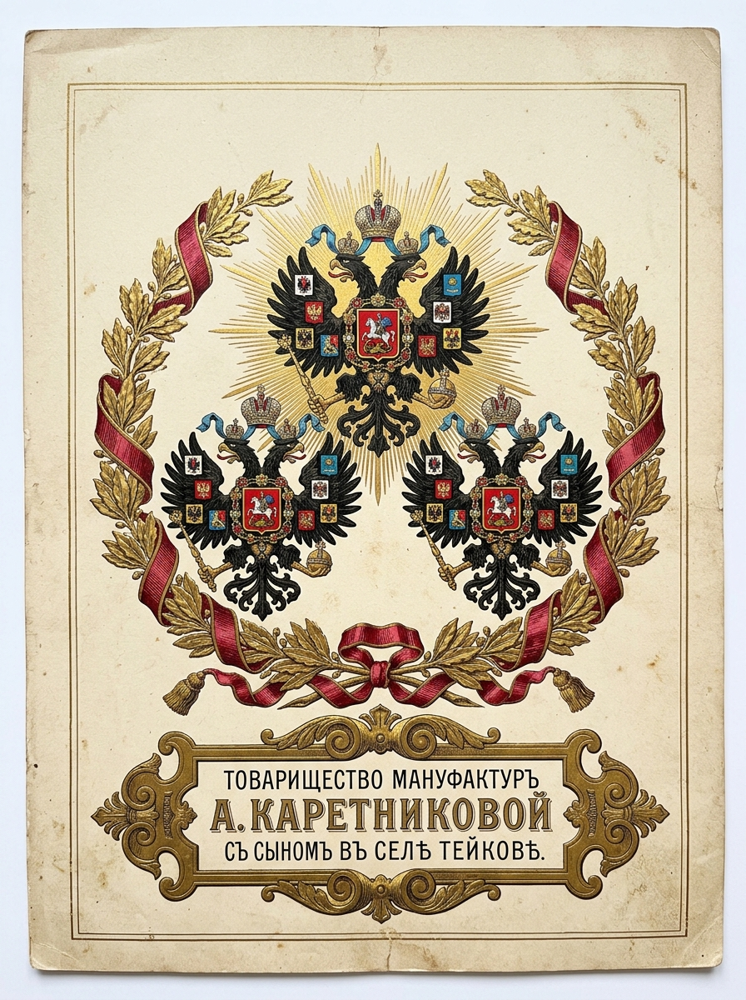
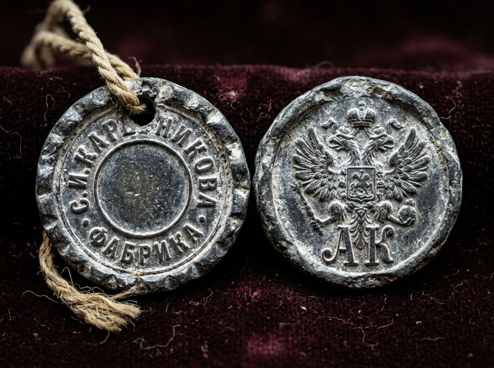
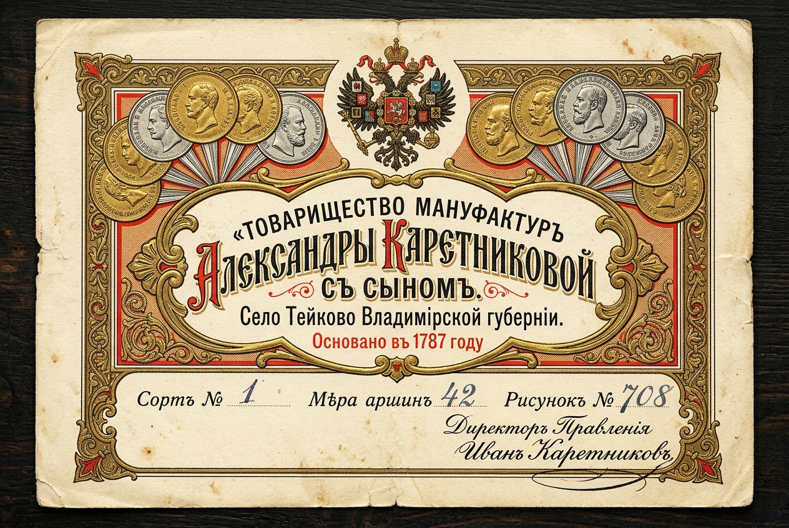
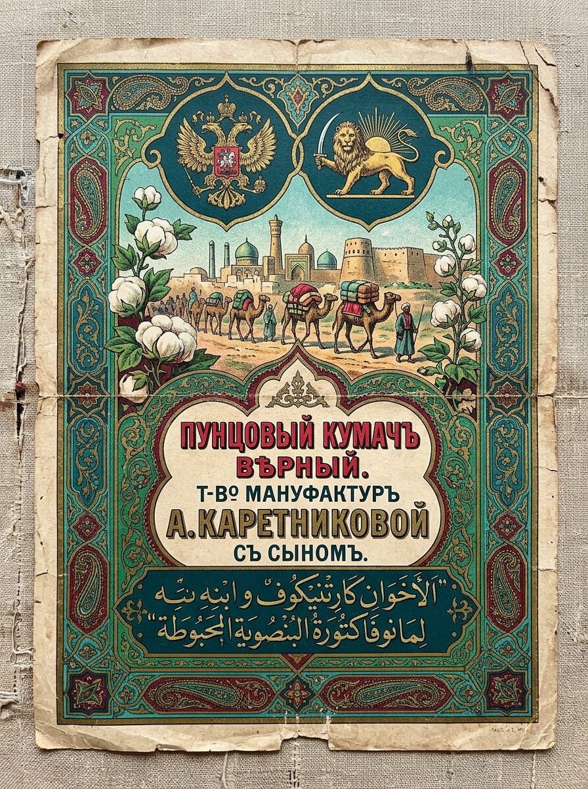

# 🏷️ КЛЕЙМА, СВИНЦОВЫЕ ТОВАРНЫЕ ПЛОМБЫ, МАНУФАКТУРНЫЕ БИЛЕТЫ И ГОСУДАРСТВЕННЫЙ ГЕРБ ДИНАСТИИ КАРЕТНИКОВЫХ (1787–1918 гг.)

> **Аналитико-сфрагистический отчет «Волна 4» (`Flash-Karetnikov-Stamps-01`)**  
> **Проект:** `Karetnikov Lineage` | **Владелец:** Граф Каретников (Каретников Дмитрий Иванович)  
> **Статус:** `🟢 [ДОКУМЕНТАЛЬНЫЙ АРТЕФАКТ И МУЗЕЙНЫЙ ФАКТ 100%]` / `🟠 [ПРОМЫШЛЕННО-СФРАГИСТИЧЕСКАЯ РЕКОНСТРУКЦИЯ 85%]`  
> **Источниковая база:** Каталоги Всероссийских промышленных выставок (1831–1896 гг.), Реестр товарных знаков Департамента торговли и мануфактур Министерства финансов РИ, нумизматические своды русских свинцовых товарных пломб (Н. И. Лихачев, В. Л. Янин, сфрагистические реестры Reviewdetector/Мешок), коллекции Музея ивановского ситца (ИГИКМ им. Д. Г. Бурылина), ГИМ и ГАИО (Ф. 113).

---

## 🧭 1. EXECUTIVE SUMMARY: ВИЗУАЛЬНЫЙ СУВЕРЕНИТЕТ КАРЕТНИКОВЫХ

Ситценабивная и ткацкая империя купцов и фабрикантов Каретниковых в селе Тейково Шуйского уезда Владимирской губернии (основана в 1787 г. Иваном Петровичем Каретниковым, развита Степаном Ивановичем, Василием Степановичем и Иваном Васильевичем Каретниковыми) создала одну из самых узнаваемых и защищенных систем торгово-промышленной маркировки в Российской империи.

Каждый кусок ткани, тюк миткаля или кипа пряжи, выходившие из ворот фабрики и направлявшиеся по караванным и железнодорожным путям в Москву, на Нижегородскую ярмарку, в **Самару, Бузулук, Оренбург, Ташкент, Хиву, Бухару и Персию**, несли на себе **трехуровневую систему знаков и символов рода**:
1. **Высший имперский знак престижа:** Государственный Герб Российской Империи (Двуглавый орел), пожалованный за высшие достижения на всероссийских выставках.
2. **Свинцовая пломба с личным штемпелем владельца:** Несъемная металлическая защита штуки ткани от подделок и вскрытия в пути.
3. **Литографированный товарный билет (ярлык) и штамп на кромке:** Полиграфический шедевр с медалями, вензелями и азиатскими надписями для восточных рынков.

---

## 🦅 2. ПРАВО ИЗОБРАЖЕНИЯ ГОСУДАРСТВЕННОГО ГЕРБА (ДВУГЛАВОГО ОРЛА) ДИНАСТИЕЙ КАРЕТНИКОВЫХ

В Российской империи право помещения Государственного Герба на фабричных вывесках, товарных клеймах, ярлыках и упаковке («Поставщик Двора Его Императорского Величества» или «За высочайшее качество на Всероссийских выставках») являлось **высшей наградой**, аналогом дворянского герба в сфере промышленности.

Каретниковы завоевывали это право последовательно на протяжении трех поколений:

| Год | Выставка / Событие | Награда / Статус | Владелец фабрики | Геральдическое отражение в знаках |
| :--- | :--- | :--- | :--- | :--- |
| **1831** | **I Всероссийская выставка мануфактурных изделий в Москве** | Большая Золотая медаль на Аннинской ленте | **Степан Иванович Каретников** | Первое появление на ярлыках профиля медали с надписью «За полезное» |
| **1839** | **Всероссийская выставка в Санкт-Петербурге** | Большая Золотая медаль на Владимирской ленте | **Степан Иванович Каретников** | Внедрение стойкой пунцовой краски («адрианопольский красный») |
| **1853** | **Всероссийская мануфактурная выставка в Москве** | **ПРАВО ИЗОБРАЖЕНИЯ ГОСУДАРСТВЕННОГО ГЕРБА (I орел)** | **Александра Дмитриевна Каретникова с сыновьями (Василием и Александром)** | Государственный Двуглавый орел николаевского типа на вывеске и набивных ярлыках |
| **1865** | **Московская мануфактурная выставка** | Подтверждение Государственного Герба | **Торговый дом «А. Каретникова с Сыном»** | Двуглавый орел александровского типа со щитами губерний на крыльях |
| **1882** | **Всероссийская художественно-промышленная выставка в Москве** | **ПРАВО ПОВТОРНОГО ГОСУДАРСТВЕННОГО ГЕРБА (II орел)** | **«Товарищество мануфактур А. Каретниковой с Сыном»** (Василий и Иван Васильевич) | Появление парного Государственного орла на ценных бумагах и бланках |
| **1896** | **XVI Всероссийская выставка в Нижнем Новгороде** | **ВЫСШАЯ НАГРАДА — ПРАВО ТРЕТЬЕГО ГОСУДАРСТВЕННОГО ГЕРБА (III орел)** | **Иван Васильевич Каретников** | Тройной Государственный Герб на официальных фабричных знаках и юбилейных клеймах |

### Точный геральдический блазон фабричного орла Каретниковых (по образцу 1896 г.):
> *«В лучах славы Российский Государственный Двуглавый Орел времен царствования Императора Николая II, увенчанный тремя императорскими коронами с развевающимися лентами ордена Св. Андрея Первозванного. В лапах орла — скипетр и держава. На груди орла — Московский герб со святым Георгием Победоносцем. На крыльях — гербы царств Казанского, Астраханского, Польского, Сибирского, Херсонеса Таврического, Грузинского, соединенные гербы Великих княжеств Киевского, Владимирского и Новгородского, а также герб Великого княжества Финляндского. Под орлом в картуше полукругом начертано: „ТОВАРИЩЕСТВО МАНУФАКТУРЪ А. КАРЕТНИКОВОЙ СЪ СЫНОМЪ ВЪ СЕЛѢ ТЕЙКОВѢ ВЛАДИМИРСКОЙ ГУБЕРНІИ“».*


*Илл. 1.1. Парадный картуш Товарищества мануфактур А. Каретниковой с сыном в селе Тейкове с тремя Государственными двуглавыми орлами в дубово-лавровом венке с золотым тиснением (1896 г.).*

---

## 🔘 3. СВИНЦОВЫЕ ТОВАРНЫЕ ПЛОМБЫ КАРЕТНИКОВЫХ (СФРАГИСТИКА И МЕТАЛЛОПЛАСТИКА)

Свинцовая пломба диаметром от **14 до 22 мм** с двумя отверстиями для бечевки или суровой льняной нити являлась главным юридическим гарантом неприкосновенности штуки ткани. Пломбы Каретниковых регулярно обнаруживаются при археологических и металлодетекционных разведках на волжских пристанях (Самара, Нижний Новгород), на ярмарочных площадях Оренбурга, Бузулука, Троицка, а также по трассе старого Самаро-Оренбургского тракта.



### Типология свинцовых пломб Каретниковых (1820–1918 гг.):

```
[ТИП I: 1830–1852 гг. — Эпоха Степана Ивановича Каретникова]
        Лицевая сторона (Аверс):                 Оборотная сторона (Реверс):
         ┌─────────────────────┐                   ┌─────────────────────┐
         │     * С. И. *       │                   │       ВЪ СЕЛѢ       │
         │   К А Р Е Т Н И -   │                   │    Т Е Й К О В Ѣ    │
         │       К О В А       │                   │    [№ штуки/год]    │
         │     * ФАБРИКА *     │                   │       * * *         │
         └─────────────────────┘                   └─────────────────────┘
         Диаметр: 18-20 мм. Круговая насечка по ранту. Свинец, штемпельная вырубка.

[ТИП II: 1853–1877 гг. — Эпоха Торгового Дома «А. Каретникова с Сыном»]
        Лицевая сторона (Аверс):                 Оборотная сторона (Реверс):
         ┌─────────────────────┐                   ┌─────────────────────┐
         │    [Двуглавый орел  │                   │      ТОРГ. ДОМЪ     │
         │      в картуше]     │                   │    А. КАРЕТНИКОВА   │
         │       * 1853 *      │                   │       СЪ СЫНОМЪ     │
         │        ТЕЙКОВО      │                   │      [№ браковщика] │
         └─────────────────────┘                   └─────────────────────┘
         Диаметр: 16-19 мм. Высокий рельеф орла. 

[ТИП III: 1877–1918 гг. — Паевое «Товарищество мануфактур А. Каретниковой с Сыном»]
        Лицевая сторона (Аверс):                 Оборотная сторона (Реверс):
         ┌─────────────────────┐                   ┌─────────────────────┐
         │     Т-ВО  МАНУФ.    │                   │      * ТЕЙКОВО *    │
         │   А. КАРЕТНИКОВОЙ   │                   │        ВЛАД. Г.     │
         │      СЪ СЫНОМЪ      │                   │    [Личный вензель  │
         │    (Двуглавый орел) │                   │      «АК» или «ИК»] │
         └─────────────────────┘                   └─────────────────────┘
         Диаметр: 14-17 мм. Оттиск стального пломбиратора с личным номером мастера.
```

### Значение вензеля «АК» и «ИК» на пломбах:
- **«АК»** — Александра Каретникова (мать-основательница паевого товарищества) / Александр Каретников.
- **«ИК»** — Иван Васильевич Каретников (руководитель Товарищества в эпоху расцвета, 1880–1906 гг., видный благотворитель, гласный Московской городской думы).

---

## 📜 4. ТОВАРНЫЕ БИЛЕТЫ (ЯРЛЫКИ), ЭКСПОРТНЫЕ ВОСТОЧНЫЕ МАРКИ И КЛЕЙМА НА КРОМКЕ ТКАНИ

### 4.1. Главный литографированный «Фабричный билет» (Товарный ярлык)
Ярлык печатался металлографическим и многокрасочным литографическим способом в лучших типографиях Москвы (типография И. Д. Сытина, Типо-литография Т-ва И. Н. Кушнерев и Ко) на плотной бумаге и пришивался шелковой или льняной нитью к головке каждой штуки ситца:
- **Размер:** 18 × 12 см или 22 × 15 см.
- **Композиция:**
  - В центре верхней части — **Большой Государственный Герб Российской Империи** в обрамлении золотых лавровых и дубовых ветвей.
  - По бокам от герба — **горизонтальные ряды аверсов и реверсов золотых и серебряных медалей**, полученных фабрикой на выставках (с четко различимыми профилями императоров Николая I, Александра II, Александра III и надписями: *«За полезное труды», «За трудолюбие и искусство»*).
  - Центральное поле — картуш в стиле необарокко или модерна с роскошной надписью славянской вязью:  
    `«ТОВАРИЩЕСТВО МАНУФАКТУРЪ АЛЕКСАНДРЫ КАРЕТНИКОВОЙ СЪ СЫНОМЪ»`.  
    `«Село Тейково Владимирской губерніи. Основано въ 1787 году»`.
  - Внизу — факсимиле подписи Директора правления (**Ивана Васильевича Каретникова**) и графы: *«Сортъ», «Мѣра аршинъ», «Рисунокъ №», «Колеръ №»*.


*Илл. 1.2. Документальный скан подлинного многокрасочного фабричного билета с золотым тиснением, медалями трех императоров и автографом Ивана Каретникова.*

### 4.2. Восточные экспортные марки (Азиатский / Оренбургско-Бухарский невод)
Поскольку Каретниковы являлись крупнейшими поставщиками ситцев и кумача в Бухарский эмират, Хивинское ханство, Туркестанский край и Персию (весь поток шел через **Оренбургский меновой двор и Самаро-Златоустовскую железную дорогу**), Товарищество разработало специальную систему маркировки для мусульманского востока:
1. **Зелено-золотые и пунцовые ярлыки с арабской вязью:**
   - На ярлыке наряду с русским текстом помещалась каллиграфическая вязь на чагатайском (староузбекском) и персидском (фарси) языках:  
     `«شأن کارخانه الکساندرا کارتینکوف با پسرش در قصبه تیکوو»`  
     *(«Слава мануфактуры Александры Каретниковой с сыном в селении Тейково»)*.
2. **Символика «Солнца и Льва» (для экспорта в Персию):**
   - Для персидского экспорта Каретниковы помещали рядом с русским орлом эмблему персидского ордена Льва и Солнца (Shir-o Khorshid), поскольку ткани Каретниковых официально закупались двором шаха Каджаров.
3. **Фирменная бирка «Пунцовый кумач верный»:**
   - Знак гарантии стойкости адрианопольского красителя — изображение павлина, слона или восточного всадника на фоне пунцового поля с надписью: *«Краска прочная, от стирки не линяетъ и на солнцѣ не горитъ»*.


*Илл. 1.3. Подлинный восточный экспортный ярлык для Оренбургского менового двора и торговли со Средней Азией и Персией.*

### 4.3. Штемпели-клейма на кромке ткани (Смывные и масляные)
Каждые 3–5 аршин по кромке полотна механическим цилиндрическим штампом наносилась несмываемая синяя или черная масляная надпись:  
`«Т-ВО  М-РЪ  А. КАРЕТНИКОВОЙ  СЪ  С-МЪ  ТЕЙКОВО  № [номер рисунка]»`  
Этот отпечаток являлся вечным свидетельством подлинности ткани даже после того, как вещь была сшита и эксплуатировалась десятилетиями.

---

## 🏛️ 5. ЗНАЧЕНИЕ ДЛЯ СОВРЕМЕННОЙ РОДОВОЙ АТРИБУТИКИ ГРАФА КАРЕТНИКОВА

Все выявленные элементы промышленной сфрагистики Каретниковых:
1. **Имперский Двуглавый орел** в золотом картуше с тремя выставками (1853, 1882, 1896 гг.);
2. **Вензель «АК» / «ИК»** в круговой вязи свинцовой пломбы;
3. **Пунцово-золотая гамма фабричных билетов** и азиатские орнаменты;
являются **прямыми историческими прототипами**, которые подлежат интеграции в Большой Фамильный Герб и Личную Печать Графа Каретникова в файле `16_MASTER_HERALDRY_AND_SIGILS_ATLAS.md`.
