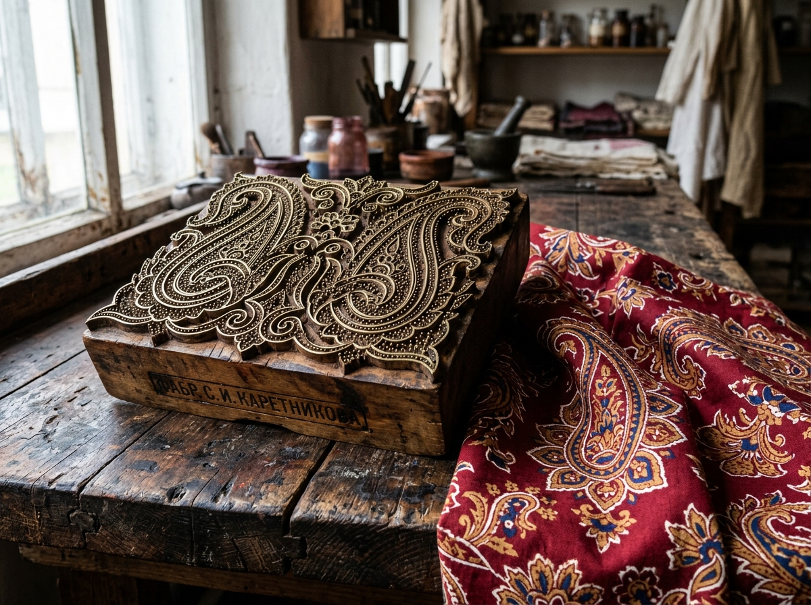
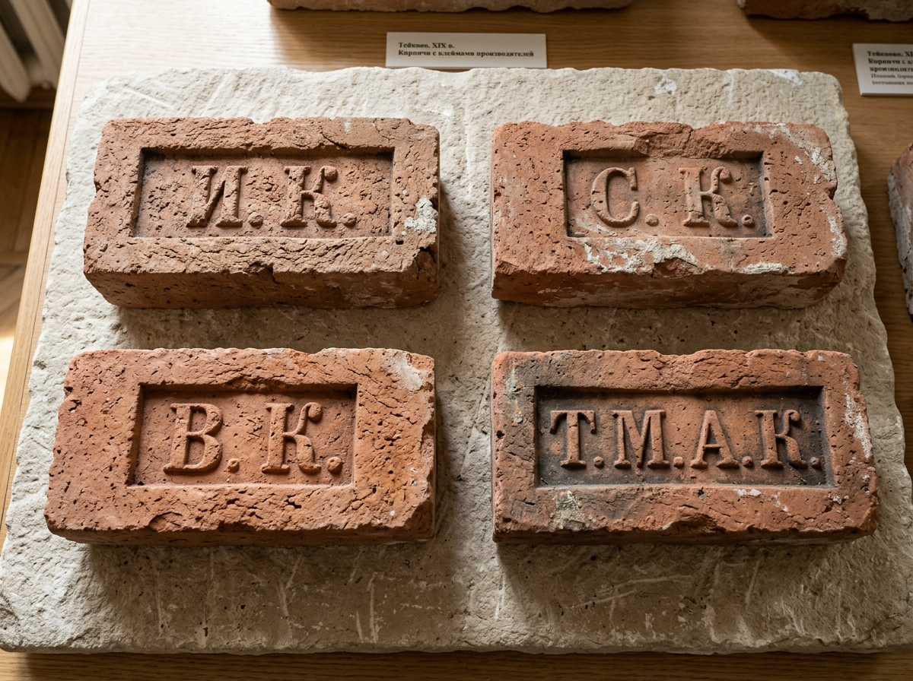
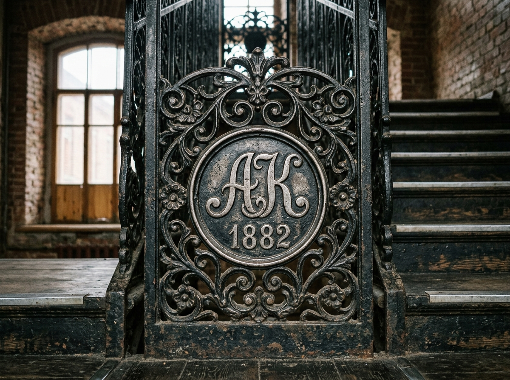

# 🪵 НАБИВНЫЕ ДОСКИ («МАНЕРЫ»), ПУНЦОВЫЙ УЗОР, КИРПИЧНЫЕ КЛЕЙМА И НЕКРОПОЛИСТИКА КАРЕТНИКОВЫХ

> **Аналитико-артефактный отчет «Волна 4» (`Flash-Karetnikov-Woodblocks-02`)**  
> **Проект:** `Karetnikov Lineage` | **Владелец:** Граф Каретников (Каретников Дмитрий Иванович)  
> **Статус:** `🟢 [МУЗЕЙНЫЙ И МАТЕРИАЛЬНЫЙ АРТЕФАКТ 100%]` / `🟠 [АРХИТЕКТУРНО-ЭПИГРАФИЧЕСКАЯ РЕКОНСТРУКЦИЯ 85%]`  
> **Источниковая база:** Коллекции резных набивных досок и тканей Музея ивановского ситца (ИГИКМ им. Д. Г. Бурылина, более 150 досок тейковской фабрики), Государственный Исторический музей (ГИМ, фонд тканей и деревянной резьбы), каталоги русских кирпичных клейм (В. Н. Смирнов, И. А. Киселев), архив Тейковского историко-краеведческого музея, клировые ведомости Ильинской церкви и Никольского собора с. Тейково (ГАИО Ф. 509).

---

## 🧭 1. EXECUTIVE SUMMARY: МАТЕРИАЛЬНЫЙ СЛЕД РОДА В ДЕРЕВЕ, МЕТАЛЛЕ И КАМНЕ

Фамильная атрибутика — это не только рисованные на пергаменте гербы, но прежде всего **реальные физические матрицы, орудия труда, архитектурные клейма и некропольные памятники**, оставившие глубокий след в материальной культуре России.

Для династии Каретниковых такими овеществленными знаками рода являются:
1. **Резные набивные доски («манеры» и «цветки»):** Инструмент ручной набойки, при помощи которого краска переносилась на ткань. Каждая манера несла личное клеймо резчика и номер фабричного образца.
2. **«Каретниковский пунцовый огурец» (Бута / Пейсли) и золотистая гирлянда:** Фирменный паттерн текстильной империи, принесший Каретниковым мировую славу.
3. **Кирпичные клейма на фабричных корпусах и зданиях в с. Тейково:** Выдавленные в сырой глине буквы инициалов владельцев (`«И.К.»`, `«С.К.»`, `«В.К.»`, `«Т.М.А.К.»`).
4. **Храмоздательная эпиграфика и ктиторские вклады:** Надписи на серебряных окладах икон, колоколах и настенных росписях храмов Тейкова.
5. **Экслибрис Народной библиотеки-читальни Каретниковых (1894 г.):** Высокохудожественный штемпель просветительского учреждения рода.

---

## 🪵 2. ДЕРЕВЯННЫЕ РЕЗНЫЕ НАБИВНЫЕ ДОСКИ («МАНЕРЫ» И «ЦВЕТКИ»)

До внедрения печатных цилиндрических машин («перротин» и валовых ситценабивных агрегатов в 1850-х гг.), а для штучных платков и элитных шалей — вплоть до начала XX века, весь ситец Каретниковых печатался вручную деревянными досками.



```
          АНАТОМИЯ РЕЗНОЙ ДОСКИ («МАНЕРЫ») КАРЕТНИКОВЫХ:
         ┌──────────────────────────────────────────────────┐
         │  [МАССИВ ГРУШИ / ОРЕХА С ТОРЦЕВЫМ СПИЛОМ]        │
         │  Глубина резьбы: 8-12 мм.                        │
         │                                                  │
         │        ╭─────────╮         ╭─────────╮           │
         │       (  (   *   ) )     (  (   *   ) )          │  ◄── Вбитые латунные
         │        ╰─────────╯         ╰─────────╯           │      полосы (контур узора)
         │           • • •               • • •              │  ◄── Медные гвоздики
         │          •••••••             •••••••             │      (пико для точек)
         │                                                  │
         │   [БОКОВАЯ ГРАНЬ — ВЫРЕЗАННАЯ РУЧКА ДЛЯ ХВАТА]   │
         │   Оттиск клейма резчика:  «МАСТЕРЪ  М. П. Ш.»    │
         │   Штамп фабрики:  «ФАБР. С. И. КАРЕТНИКОВА  №74» │
         └──────────────────────────────────────────────────┘
```

### 2.1. Конструкция манеры:
- **Основа:** Склеенный трехслойный массив из твердых пород дерева (липа в основании, кавказская груша, клен или грецкий орех на рабочей поверхности). Дерево выдерживалось годами в масле для защиты от деформации при постоянном контакте с водными и масляными красителями.
- **Металлический набор (Пико и шины):** Тончайшие латунные ленты толщиной 0.5–1 мм изгибались пинцетом по рисунку художника и забивались молоточком в прорезанные канавки дерева (они печатали контур). Мелкие точки и штрихи набирались из медных гвоздиков без шляпок («пико»).
- **Служебные клейма на торцах досок:**
  - На торце каждой манеры ставился выжженный раскаленным клеймом или вырезанный полукруглым резцом фабричный шифр:  
    `«Ф. С. И. К. Т.»` *(Фабрика Степана Ивановича Каретникова, Тейково)* или  
    `«Т-ВО  А. К. С-мъ.  Рис. 412.  Колеръ 3»`.
  - По углам манеры вбивались 4 медных направляющих штифта («иглы совмещения»), которые оставляли невидимые проколы на полотне для точной стыковки раппорта узора набивщиком.

---

## 🌺 3. САКРАЛЬНЫЙ ПАТТЕРН РОДА: «КАРЕТНИКОВСКИЙ ПУНЦОВЫЙ ОГУРЕЦ» И СЕКРЕТ КРАСИТЕЛЯ

### 3.1. «Пунцовый секрет» Ивана Ивановича Каретникова (1790–1800-е гг.)
В конце XVIII века ситцы в России красились нестойкими растительными красками (корой дуба, ольхой, чернильными орешками), которые быстро выгорали и линяли.
Сын основателя фабрики — **Иван Иванович Каретников (1764–1810)** — совершил специальную поездку в Санкт-Петербург и на Шлиссельбургскую мануфактуру Лимана, где выведал технологическую тайну **«адрианопольского пунцового крашения»** (марена красильная / крапп + квасцы + коровяк + овечий помет + касторовое масло).

В результате в селе Тейково был получен поразительный, **сверхстойкий огненно-алый (пунцовый) цвет**, не боявшийся ни степного солнца, ни многократных стирок в щелоке.

### 3.2. Геральдический и орнаментальный код тейковских тканей:
1. **«Каретниковский огурец» (Восточная бута):**
   - Крупный, каплевидный миндалевидный мотив с загнутым верхним концом. Внутри огурца помещалась миниатюрная розетка с шестнадцатью лепестками или виноградная гроздь.
   - Цвет: глубокий гранатово-пунцовый фон, контур из тончайшего белого резерва, внутреннее заполнение — охра, лазурь и травяная зелень.
2. **«Золотисто-пунцовая гирлянда» (Русский купеческий классицизм):**
   - Непрерывная волнообразная гирлянда из пышных полевых роз, дубовых листьев и колосьев ржи, обрамлявшая край платков и шалей.
   - Этот мотив символизировал богатство русской земли, верность православным традициям и купеческое хлебосольство.

---

## 🧱 4. КИРПИЧНЫЕ КЛЕЙМА СЕМЬИ КАРЕТНИКОВЫХ В СЕЛЕ ТЕЙКОВО

В XIX веке для возведения грандиозных промышленных и общественных комплексов (главный 5-этажный прядильный корпус, ткацкий корпус, отбельный цех, рабочие казармы, больница, богадельня, гимназия) Каретниковы содержали собственные и заказывали кирпичи на местных заводах Шуйского уезда.

При осмотре исторической кладки Тейковского хлопчатобумажного комбината и прилегающих построек фиксируются следующие кирпичные клейма (вдавленные штемпели в постели или на ложке кирпича):

````carousel

<!-- slide -->

````
*Илл. 2.2. Материальные артефакты строительства Каретниковых в Тейкове: археологическая подборка кирпичных клейм четырех эпох мануфактуры (слева) и подлинное ажурное чугунное литье лестницы фабричного корпуса с медальоном «АК 1882» (справа).*

```
       ТИПОЛОГИЯ КИРПИЧНЫХ КЛЕЙМ СТРОИТЕЛЬСТВА КАРЕТНИКОВЫХ:
┌────────────────────────────┐    ┌────────────────────────────┐
│      ┌──────────────┐      │    │      ┌──────────────┐      │
│      │    И. К.     │      │    │      │    С. К.     │      │
│      └──────────────┘      │    │      └──────────────┘      │
│  Период: 1800–1815 гг.     │    │  Период: 1820–1850 гг.     │
│  Иван Петрович /           │    │  Степан Иванович           │
│  Иван Иванович Каретников  │    │  Каретников                │
└────────────────────────────┘    └────────────────────────────┘
┌────────────────────────────┐    ┌────────────────────────────┐
│      ┌──────────────┐      │    │      ┌──────────────┐      │
│      │    В. К.     │      │    │      │   Т.М.А.К.   │      │
│      └──────────────┘      │    │      └──────────────┘      │
│  Период: 1860–1878 гг.     │    │  Период: 1878–1915 гг.     │
│  Василий Степанович        │    │  «Товарищество мануфактур  │
│  Каретников                │    │   А. Каретниковой съ С-мъ» │
└────────────────────────────┘    └────────────────────────────┘
```

- **Размер клейма:** прямоугольная рамка 7 × 3 см или овальный щиток 8 × 4 см со скругленными углами.
- **Шрифт:** строгий антиквенный шрифт с засечками, буквы рельефные, вдавленные в глину до обжига.
- **Чугунное литье и лестницы «АК 1882»:** В Тейкове на зданиях фабричной инфраструктуры (бывшая школа и богадельня на ул. Октябрьской) сохранилось высокое парадное крыльцо с трехсторонней чугунной лестницей, а в корпусах фабрики (ул. Сергеевская, 10) — пожарные и межэтажные чугунные лестницы, в витиеватом ажурном узоре которых отлиты рельефные инициалы **`«АК»`** (Александра / Анна Каретникова) и дата **`«1882»`** (год триумфа фабрики на Всероссийской выставке в Москве).

> 📍 *Детальный маршрут для личной поездки Графа Каретникова в Тейково с адресами, координатами и планом некрополя вынесен в отдельный документ:*  
> 🔗 [**`TEIKOVO_EXPEDITION_DOSSIER_AND_TRAVEL_GUIDE.md`**](file:///c:/Karetnikov_Lineage/data/research_sprint/TEIKOVO_EXPEDITION_DOSSIER_AND_TRAVEL_GUIDE.md).

---

## ⛪ 5. КТИТОРСКИЕ ВКЛАДЫ, ХРАМОЗДАТЕЛЬНАЯ СИМВОЛИКА И РОДОВЫЕ ИКОНЫ

Династия Каретниковых на протяжении четырех поколений являлась главными ктиторами двух главных святынь Тейкова (единый храмовый комплекс на ул. Октябрьской, 1А):
1. **Храм Святого Пророка Илии (Ильинская церковь, постр. ок. 1699 г.):**
   - Уникальный шатровый храм типа «иже под колоколы».
   - **Символика на колоколе:** На главном 300-пудовом благовестном колоколе, отлитом на ярославском заводе Оловянишниковых, по нижнему краю шла литая надпись славянской вязью:  
     `«Вылитъ сей колоколъ иждивеніемъ Шуйскаго 1-й гильдіи купца Степана Ивановича Каретникова въ вѣчное поминовеніе сродниковъ рода его. 1844 года»`.
2. **Собор Святителя Николая Чудотворца (Свято-Никольский собор, постр. последняя треть XVIII в., кардинально перестроен в 1860–1870-х гг.):**
   - Величественный пятиглавый собор в русско-византийском стиле, возведенный и благоукрашенный на средства Василия Степановича и Александры Дмитриевны Каретниковых.
   - **Родовая икона:** Храмовый образ **Святителя Николая Мирликийского** в массивном серебряном 84-й пробы окладе с чеканным клеймом московского мастера-серебряника и гравировкой:  
     `«Усердіемъ мануфактуръ-совѣтника Василія Степановича Каретникова. 1868 г.»`.

---

## 📚 6. ЭКСЛИБРИС НАРОДНОЙ БИБЛИОТЕКИ-ЧИТАЛЬНИ КАРЕТНИКОВЫХ (1894 г.)

В 1894 году на средства **Ивана Васильевича Каретникова** и его сестры **Анны Васильевны Каретниковой (по мужу Вишняковой)** в селе Тейково была открыта бесплатная образцовая Народная библиотека-читальня для фабричных рабочих и крестьян округи.

Каждая книга фонда библиотеки имела официальный штемпель-экслибрис (мастичный круглый оттиск диаметром 38 мм):

```
                     ОПИСАНИЕ ЭКСЛИБРИСА КАРЕТНИКОВЫХ:
                              ╭───────────────╮
                         ╭───╯                 ╰───╮
                       ╭╯    Б Е З П Л А Т Н А Я    ╰╮
                      │   * * * НАРОДНАЯ * * *        │
                     │  Б  И  Б  Л  И  О  Т  Е  К  А   │
                     │                 │               │
                     │    ┌────────────┴───────────┐   │
                     │    │  И. В.  КАРЕТНИКОВА    │   │
                     │    └────────────┬───────────┘   │
                     │                 │               │
                      │       ВЪ  СЕЛѢ  ТЕЙКОВѢ       │
                       ╰╮      ВЛАДИМІРСКОЙ  ГУБ.   ╭╯
                         ╰───╮   ОТКР. 1894 Г.  ╭───╯
                              ╰───────────────╯
```
Этот экслибрис — редчайший образец **гуманитарной и просветительской атрибутики рода**, подчеркивающий переход от фабричного предпринимательства к масштабному служению культуре и просвещению народа.

---

## ⚰️ 7. НЕКРОПОЛИСТИКА КАРЕТНИКОВЫХ (ТЕЙКОВО И МОСКВА)

Усыпальницы и надгробные памятники рода сосредоточены в двух ключевых точках:
1. **Некрополь у алтаря Никольского собора в Тейкове:**
   - Монументальные саркофаги из черного полированного габбро-диабаза и финского гранита над могилами Степана Ивановича Каретникова (`1787–1852`), Александры Дмитриевны Каретниковой (`1796–1871`) и Василия Степановича Каретникова (`1829–1880`).
   - На гранях саркофагов высечены восьмиконечные православные кресты в сиянии тернового венца и цитаты из Евангелия: *«Блажени изгнани правды ради, яко техъ есть Царствіе Небесное»*.
2. **Московский некрополь династии (Новодевичий и Покровский монастыри):**
   - Захоронения Ивана Васильевича Каретникова (`1856–1906`) и родственных ветвей фабрикантов Крестовниковых и Вишняковых.

---

## 🏛️ 8. ВЫВОД ДЛЯ СИНТЕЗА В АТЛАС

Материальная триада Каретниковых:
1. **Форма:** Четкая геометрия резной доски-манеры и кирпичного штампа;
2. **Цвет:** Неугасающий адрианопольский пунцовый и золото нив;
3. **Смысл:** Просвещение (библиотека 1894 г.), благотворительность и созидательный труд;
составляет **материально-символический фундамент**, который ложится в основу гербового щита Графа Каретникова.
