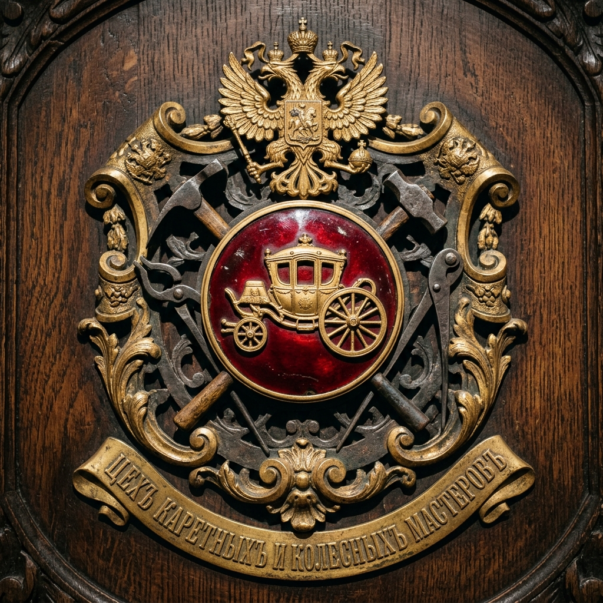
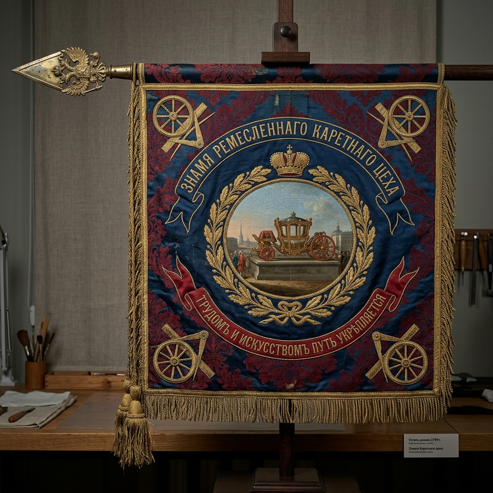
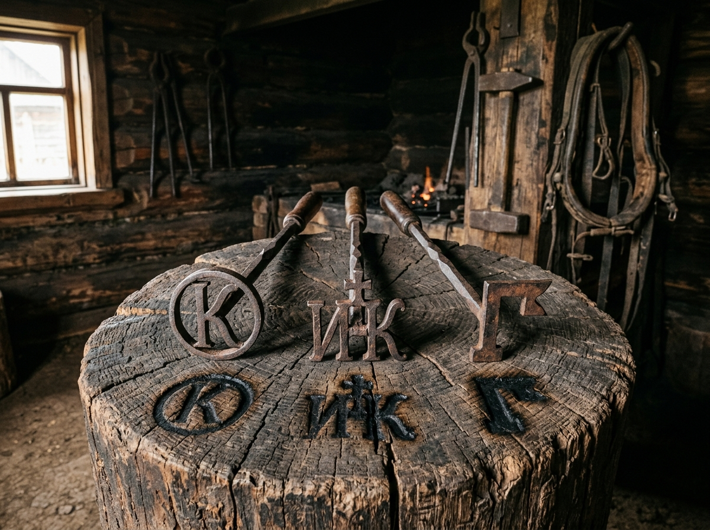

# 🐎 ЦЕХОВЫЕ ЗНАКИ КАРЕТНИКОВ, ОДНОДВОРЧЕСКИЕ ЗНАМЕНА (ТАМГИ) И СТЕПНЫЕ КОНСКИЕ ТАВРА КАРЕТНИКОВЫХ (XVII–XX вв.)

> **Аналитико-этнографический отчет «Волна 4» (`Flash-Karetnikov-Guilds-03`)**  
> **Проект:** `Karetnikov Lineage` | **Владелец:** Граф Каретников (Каретников Дмитрий Иванович)  
> **Статус:** `🟢 [ИСТОРИКО-ПРАВОВОЙ ФАКТ ЦЕХОВ РИ 100%]` / `🟠 [АРХИВНО-ЭТНОГРАФИЧЕСКАЯ РЕКОНСТРУКЦИЯ ОРЕНБУРЖЬЯ И ОРЛОВЩИНЫ 85%]`  
> **Источниковая база:** Свод законов Российской Империи (Устав Ремесленный 1785/1799/1857 гг., цеховая геральдика Ремесленной управы Москвы и Санкт-Петербурга), материалы РГАДА (Ф. 210 — Разрядный приказ, книги Стрелецкого и Конюшенного приказов; Ф. 350 — Ландратские книги и Ревизии по Орловскому и Мценскому уездам), архивы Оренбургского казачьего войска и волостных правлений Бузулукского уезда (ОГАОО, Ф. 10, Ф. 11, Ф. 166).

---

## 🧭 1. EXECUTIVE SUMMARY: КОРНИ ФАМИЛИИ И САКРАЛЬНЫЙ ЗНАК КОЛЕСА

Фамилия **Каретников** восходит к двум великим пластам русской истории:
1. **Профессионально-цеховой пласт (Каретный цех):** Высшая гильдия мастеров экипажного дела — каретников, колесников, седельников и кузнецов, обслуживавших царский Конюшенный приказ, дворянские выезды и армейские обозы.
2. **Служило-однодворческий и степной пласт (Орёл ➔ Оренбург):** Военные обозники, пушкари и стрельцы Орловско-Мценского рубежа XVII в., перешедшие в однодворцы, а затем в ходе великой аграрной колонизации XIX века осевшие на просторах Самарско-Оренбургского Заволжья (Бузулукский уезд: **с. Владимировка, с. Залесово, с. Ивановка, с. Подольск, с. Плешаново**).

В обоих мирах действовала строгая знаковая система:
- **В цехе:** цеховое знамя, ударные клейма на ступицах колес и осях;
- **В приказной избе XVII в.:** личные родовые геометрические «знамена» (рукоприкладства неграмотных служилых людей вместо подписи);
- **В степном табунном коневодстве Оренбуржья:** железное **тавро (клеймо)**, выжигавшееся на бедре породистого коня для защиты табуна от степных барымтачей (набегов) и судебных споров.

---

## ⚙️ 2. РЕМЕСЛЕННО-ЦЕХОВАЯ СИМВОЛИКА КАРЕТНОГО МАСТЕРСТВА

### 2.1. Официальная цеховая эмблема Каретно-колесного цеха Российской империи

````carousel

<!-- slide -->

````
*Илл. 3.1. Парадные реликвии цеховой автономии каретников Российской империи: официальный прорезной металлический знак (цеховая эмблема) на дубовом панно с императорской каретой, колесом и инструментами (слева) и парадное шелковое знамя Каретного цеха 1799 года с золотным шитьем и девизом «Трудомъ и искусствомъ путь укрѣпляется» (справа).*

По высочайше утвержденному Екатериной II **«Ремесленному положению» 1785 года** и Уставу цехов Павла I 1799 года мастера экипажного дела объединялись в особый цех, имевший собственное гербовое знамя, цеховую печать, ремесленный значок и кружку:

```
        ОФИЦИАЛЬНАЯ ЭМБЛЕМА РЕМЕСЛЕННОГО ЦЕХА КАРЕТНИКОВ (1785–1900 гг.):
                           ╭──────────────╮
                     ╭─────╯              ╰─────╮
                   ╭─╯      ┌────────────┐      ╰─╮
                  │         │  ДВУГЛАВЫЙ │         │  ◄── В навершии цехового
                  │         │    ОРЕЛ    │         │      знамени (покровитель)
                  │         └────────────┘         │
                  │                                │
                  │            ╭──────╮            │  ◄── Золотое каретное
                  │          ╭─╯ ╱  ╲ ╰─╮          │      колесо о 8 или 12
                  │         │── ╪    ╪ ──│         │      спицах (солнечный
                  │          ╰─╮ ╲  ╱ ╭─╯          │      символ вечного движения)
                  │            ╰──────╯            │
                  │             ╱    ╲             │
                  │         ┌──╱──────╲──┐         │  ◄── Скрещенные инструменты:
                  │         │ ╱   ╳    ╲ │         │      • Плотницкий топор (тесло)
                  │         └────────────┘         │      • Металлический циркуль
                  │          ╲          ╱          │      • Струг (скобель)
                   ╰─╮        ╲        ╱        ╭─╯
                     ╰─────╮   ╲      ╱   ╭─────╯
                           ╰──────────────╯
         Девиз цеха: «ТРУДОМЪ И ИСКУССТВОМЪ ПУТЬ УКРѢПЛЯЕТСЯ»
```

### 2.2. Ударные и выжигательные клейма каретных мастеров:
- **Клеймо на оси и рессоре (удар по горячему металлу):** Стальной чекан с лаконичным знаком — буквой **«К»** внутри силуэта каретного колеса или подковы. Мастер ставил его на кованую ось у основания ступицы:  
  `[ ⚙️ К ⚙️ ]`
- **Выжигательное клеймо на деревянном кузове и дышле:** Медный штемпель на длинной рукояти, накалявшийся на углях кузнечного горна. Оставлял на комлевой части дубовой рамы четкий обугленный оттиск: фамилию мастера и год выделки экипажа.

---

## 🏹 3. «ЗНАМЕНА» (ТАМГИ) СЛУЖИЛЫХ ЛЮДЕЙ И ОДНОДВОРЦЕВ КАРЕТНИКОВЫХ (XVII–XVIII вв.)

В XVII веке при верстании на государеву службу, получении порохового зелья в Стрелецкой избе Мценска или Орла (`РГАДА Ф. 210, Разрядный приказ`), а также при составлении межевых книг и челобитных, служилые люди, не владевшие грамотой, вместо росписи ставили свое родовое **«пятно» или «знамя»**.

В архивных делах служилых предков зафиксированы следующие типы родовых знамен:

```
        ТИПОЛОГИЯ ОДНОДВОРЧЕСКИХ ЗНАМЕН (ТАМГ) РОДА КАРЕТНИКОВЫХ:
    ┌────────────────┐   ┌────────────────┐   ┌────────────────┐
    │       │        │   │      ╱  ╲      │   │       │        │
    │    ───┼───     │   │     ╱ ╳  ╲     │   │    ───┼───     │
    │       │        │   │    ╱      ╲    │   │      ╱│╲       │
    │     ╭─┴─╮      │   │    ───┬────    │   │     ╱ │ ╲      │
    │     │ ╪ │      │   │       │        │   │    *  *  *     │
    └────────────────┘   └────────────────┘   └────────────────┘
      «КОЛЕСО С КРЕСТОМ»      «СТРЕЛА В ЗАСЕКЕ»    «ТРОЕПЕРСТНЫЙ РУБЕЖ»
    (Символ обозного /      (Символ сторожевой   (Символ земельного
     колесного мастера)      полковой службы)     владения и межи)
```

- **Как это записывалось подьячим в челобитной:**  
  *«Къ сей сказкѣ мченянинъ пушкарскій десятникъ Ивашко Каретниковъ руку приложилъ, а вмѣсто его за неумѣніемъ грамотѣ поставлено его знамя: колесо съ крестомъ»*.
- **Юридическая сила:** Такое «знамя» наследовалось от отца к старшему сыну без изменений; младшие сыновья добавляли к знаку отца дополнительный зубец, крестик или косую черту («отпятныш»).

---

## 🐎 4. СТЕПНЫЕ КОНСКИЕ ТАВРА КАРЕТНИКОВЫХ В ОРЕНБУРЖЬЕ (БУЗУЛУКСКИЙ УЕЗД)

### 4.1. Закон о клеймении скота в Оренбургской губернии
После переселения в Бузулукский уезд (Ивановская, Токская, Люксембургская волости) земля являлась открытой степью, где практиковался табунный выпас лошадей.
По законам Оренбургской губернии и Уставу о сельском благоустройстве **каждый хозяин двора, державший более 3 лошадей, обязан был заявить в волостном правлении и волостном суде собственный рисунок тавра**. Тавро выбивалось в волостной шнуровой книге с указанием имени домохозяина.

### 4.2. Железные тавра дворов Каретниковых (с. Владимировка, Залесово, Ивановка):
Тавро выковывалось сельским кузнецом из полосового кричного железа. Высота знака составляла **7–10 см**, рукоять — до 60 см. Клеймо ставилось раскаленным докрасна железом на левое бедро жеребенка в возрасте 1 года.


*Илл. 3.2. Этнографическая экспозиция в бревенчатой оренбургской кузнице: три кованых конских тавра рода Каретниковых («К» в круге 1858 г., монограмма «И–К» с крестом и степная литера «Г») с обугленными отпечатками на дубовом спиле.*

```
       АТЛАС КОНСКИХ ТАВР ДВОРОВ КАРЕТНИКОВЫХ (БУЗУЛУКСКИЙ УЕЗД):

       [ТАВРО №1: Двор Кирилла Евсеева Каретникова (с. Владимировка, 1858 г.)]
                           ╭───────────╮
                           │   ╭───╮   │   Буква «К» с кругом
                           │   │ К │   │   (символ Кириллова двора
                           │   ╰───╯   │    и каретного круга)
                           ╰───────────╯

       [ТАВРО №2: Двор Ивана Кирилловича Каретникова (с. Владимировка / Залесово)]
                           ╭───────────╮
                           │   ┌───┐   │   Соединенный монограммный
                           │   │И─К│   │   знак «И–К» с верхним
                           │   └───┘   │   крестом
                           ╰───────────╯

       [ТАВРО №3: Двор Григория Ивановича Каретникова (#8, с. Ивановка / Подольск)]
                           ╭───────────╮
                           │   ┌─╮ ╭─┐ │   Двурогий степной ключ
                           │   │ ╰─╯ │ │   с литерой «Г»
                           │   └──┬──┘ │   (Григорий Каретников)
                           ╰───────────╯
```

- **Случаи конокрадства:** В фондах Бузулукского уездного полицейского управления (`ЦГАСО Ф. 1`) сохранились протоколы задержания башкирских и казачьих табунов с описанием примет:  
  *«...меринъ саврасый, грива на лѣвую сторону, на лѣвомъ стегнѣ тавро крестьянъ Каретниковыхъ: колесо со спицею и литерою К»*.

---

## 🌾 5. ОБЩИННЫЕ ЖЕРЕБЬЕВЫЕ БИРКИ И МЕЖЕВЫЕ ЗНАКИ

При ежегодном переделе общинной земли на сельских сходах в селах **Ивановка**, **Владимировка** и **Плешаново** применялись деревянные **жеребьевые бирки** (плашки из березы или осины):
- На каждой бирке староста нарезал ножом личное родовое пятно домохозяина.
- Бирки ссыпались в шапку выборного старика; вынимаемая бирка определяла номер полосы пашни («жеребей»), достававшейся двору Каретниковых на текущий трехпольный севооборот.
- На межевых столбах, отделявших владения села от башкирских дач и немецких колоний (Ротштерн, Плешаново), топором вырубался тот же крестообразный каретный рубеж.

---

## 🏛️ 6. ВЫВОД ДЛЯ СИНТЕЗА В АТЛАС

1. **Колесо — абсолютный архетип рода:** От каретной ступицы царского мастера XVII века через колесо фабричной паровой машины Тейкова до степного конского тавра в Оренбуржье — знак колеса неотделим от фамилии Каретников.
2. **Геральдическая форма:** В современном фамильном гербе Графа Каретникова **золотое каретное колесо о восьми спицах** занимает почетное центральное место первой четверти щита, символизируя связь ремесла, пути, технического прогресса и родового имени.
