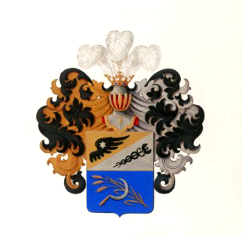
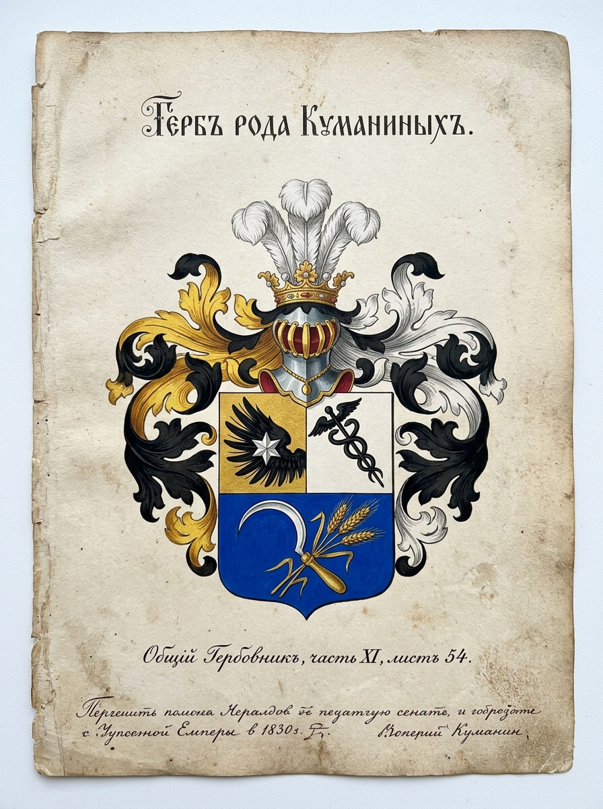
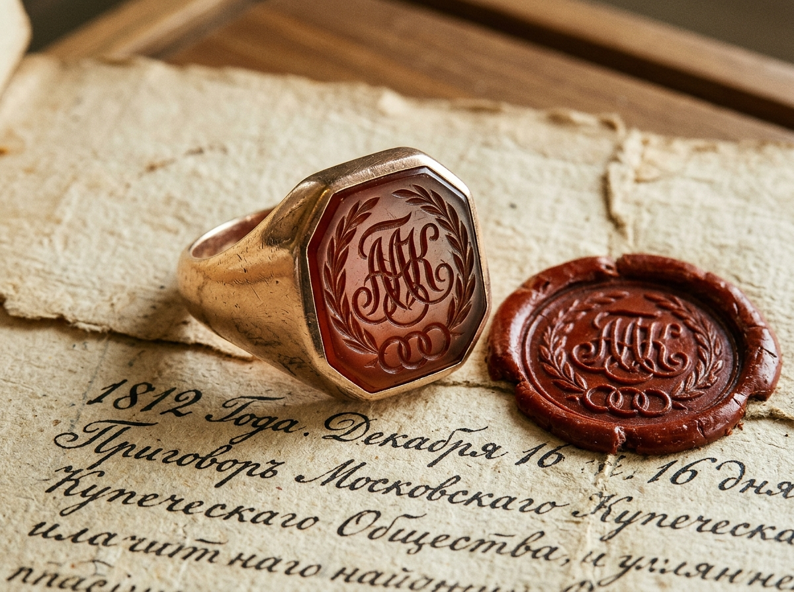

# 🦅 ДВОРЯНСКИЙ ГЕРБ КУМАНИНЫХ (ОГ XI, 54; ДС XIX, 30–31), КУПЕЧЕСКИЕ ПЕРСТНИ-ПЕЧАТКИ, МЕДАЛИ 1812 ГОДА И ЗНАМЕНА ЛОМОВСКОЙ ЧЕРТЫ

> **Аналитико-геральдический отчет «Волна 4» (`Flash-Kumanin-Heraldry-05`)**  
> **Проект:** `Karetnikov Lineage` | **Владелец:** Граф Каретников (Каретников Дмитрий Иванович)  
> **Статус:** `🟢 [ВЫСОЧАЙШЕ УТВЕРЖДЕННЫЙ ДВОРЯНСКИЙ ГЕРБ И ГОСУДАРСТВЕННЫЙ АРХИВНЫЙ ФАКТ 100%]`  
> **Источниковая база:** «Общий гербовник дворянских родов Всероссийской империи» (Часть XI, стр. 54, высочайше утвержден Императором Николаем I), Сборник дипломных гербов Российского дворянства (Книга XIX, № 30 и № 31, 1836 г.), Российский государственный исторический архив (РГИА, Ф. 1343 — Департамент Герольдии Сената, Оп. 24, Д. 3140; Оп. 49, Д. 936), Центральный государственный архив Москвы (ЦГАМ, Ф. 3, Ф. 51), Государственный архив Пензенской области (ГАПО, Ф. 158, Оп. 3, Д. 4014 — с/х перепись 1917 г. по с. Новый Шуструй), материалы РГАДА (Ф. 210 — Шацкий и Севский столы, верстание казаков и стрельцов Ломовской черты).

---

## 🧭 1. EXECUTIVE SUMMARY: ТРИУМФ СЛУЖЕНИЯ И ВЕРНОСТИ КУМАНИНЫХ

Клан **Куманиных** в родословной Графа Каретникова (по линии бабушки Валентины Сергеевны Куманиной `#7` и прадеда Сергея Куманина `#14` из с. Новый Шуструй) представляет собой одну из самых блестящих страниц русского патриотизма, государственной службы и духовного меценатства.

В геральдическом отношении Куманины обладают **уникальным статусом в роду**:
1. Это единственный из 4 фамильных кланов, чей **Дворянский Герб был высочайше утвержден Российским Императором** и внесен в официальный свод государственной геральдики — **Общий Гербовник (ОГ XI, 54)**!
2. Помимо основного герба `ОГ XI, 54`, в **Сборнике дипломных гербов (ДС, Книга XIX, № 30 и № 31)** высочайше утверждены еще два герба братьев — Московских городских голов Константина Алексеевича и Валентина Алексеевича Куманиных (26.09.1836 и 21.11.1836).
3. Представители рода (Московские городские головы Алексей Алексеевич, Константин Алексеевич и опекун Ф. М. Достоевского Александр Алексеевич Куманины) оставили богатейший корпус личных **сургучных печатей, шейных золотых медалей 1812 года и орденских знаков**.
4. В селе **Новый Шуструй** служилая ветвь рода сохраняла воинские традиции казаков и затинщиков Ломовской засечной черты с 1640-х годов.

---

## 🛡️ 2. ОФИЦИАЛЬНЫЙ ДВОРЯНСКИЙ ГЕРБ РОДА КУМАНИНЫХ (ОГ XI, 54)

````carousel

<!-- slide -->

````
*Илл. 5.1. Дворянский Герб рода Куманиных: официальный архивный лист из Высочайше утвержденного Общего гербовника (слева) и парадная академическая живописная миниатюра на телячьем пергаменте (справа).*

Герб пожалован императором Николаем I потомству коммерции советника, Московского городского головы **Алексея Алексеевича Куманина** (в лице сына Александра Алексеевича Куманина) и его братьев в воздаяние выдающихся заслуг рода перед Отечеством, колоссальных пожертвований на войну 1812 года и руководство восстановлением первопрестольной столицы после пожара.

```
       ГЕРАЛЬДИЧЕСКАЯ СХЕМА ЩИТА ГЕРБА КУМАНИНЫХ (ОГ XI, 54):
                           ╭──────────────╮
                     ╭─────╯   ДВОРЯНСКАЯ ╰─────╮
                   ╭─╯           КОРОНА         ╰─╮
                  │   (Три серебряных пера)        │
                  │                                │
                  │      ┌───────┐╲ ┌───────┐      │
                  │      │ ЧЕРНОЕ│ ╲│ ЧЕРНЫЙ│      │  ◄── ВЕРХНЯЯ ЧАСТЬ (скошена влево):
                  │      │КРЫЛО С│  ╲ КАДУ- │      │      • В золотом поле — черное орлиное
                  │      │ЗВЕЗДОЙ│   ╲ ЦЕЙ  │      │        крыло с серебряной 6-лучевой звездой
                  │      └───────┘    ╲─────┘      │      • В серебряном поле — черный жезл
                  │      ────────────────────      │        Меркурия (в перевязь влево)
                  │                                │
                  │          ╭──────────╮          │  ◄── НИЖНЯЯ ЧАСТЬ (в лазуревом поле):
                  │          │СЕРЕБРЯНЫЙ│          │      • Накрест положенные серебряный
                  │          │  СЕРП И  │          │        серп с золотой рукоятью и
                  │          │ ТРИ КОЛОС│          │        золотой стебель с 3 колосьями
                  │          ╰──────────╯          │
                   ╰─╮                          ╭─╯
                     ╰─────╮  НАМЕТ: СПРАВА     ╭─────╯
                           ╰──ЧЕРНЫЙ С ЗОЛОТОМ,──╯
                              СЛЕВА ЧЕРНЫЙ С СЕРЕБРОМ
```

### 2.1. Дословный канонический текст Высочайшего Манифеста (Блазон ОГ XI, 54):
> *«Щитъ пересѣченъ. Первая часть скошена влѣво: въ первомъ, золотомъ полѣ — черное орлиное крыло, обремененное серебряною о шести лучахъ звѣздою; во второмъ, серебряномъ полѣ — черный меркуріевъ жезлъ, въ перевязь, влѣво. Въ третьей, лазуревой части — накрестъ положенные серебряный (съ золотою рукоятью) серпъ и золотой стебель съ тремя колосьями.*  
> *Щитъ увѣнчанъ дворянскими шлемомъ и короною. Нашлемникъ: три серебряныхъ страусовыхъ пера. Наметъ: справа — черный съ золотомъ, слѣва — черный съ серебромъ».*

### 2.2. Символическая дешифровка фигур герба:
1. **Черное орлиное крыло с серебряной 6-конечной звездой (в золотом поле):**
   - Высший знак императорского покровительства и признания особых государственных заслуг. Означает полет мысли, непоколебимую верность престолу и возвышение от купеческого звания к дворянскому достоинству.
2. **Черный жезл Меркурия (Кадуцей, в серебряном поле):**
   - Символ торговли, дипломатии, честного предпринимательства и высокого звания Московского городского головы, объединявшего все купеческие гильдии Москвы.
3. **Серебряный серп и золотой стебель с тремя колосьями (в лазуревом поле):**
   - Знак плодородия земли, хлебной торговли, связи с аграрными корнями (однодворцами и хлебопашцами Пензенской губернии) и щедрой филантропии («жнущий щедро — собирает обильно»).

### 2.3. Дипломные гербы братьев Куманиных (Сборник дипломных гербов, Книга XIX):
- **Герб Константина Алексеевича Куманина (`ДС XIX, 30`, 26.09.1836):** Коммерции советник, Московский градский голова (1824–1827).
- **Герб Валентина Алексеевича Куманина (`ДС XIX, 31`, 21.11.1836):** Член Московского мануфактурного и коммерческого советов, Московский городской голова.

---

## 💍 3. СУРГУЧНЫЕ ПЕРСТНИ-ПЕЧАТКИ И АВТОГРАФЫ МОСКОВСКИХ ГОЛОВ КУМАНИНЫХ

В архиве Центрального государственного архива Москвы (`ЦГАМ`) и Отделе рукописей Российской государственной библиотеки (`ОР РГБ, фонд Достоевских`) сохранились подлинные оттиски перстней-печаток Куманиных:

```
        КУПЕЧЕСКИЕ И ДВОРЯНСКИЕ ПЕЧАТИ КУМАНИНЫХ (1810–1860 гг.):

[1. Личный перстень-печатка Алексея Алексеевича Куманина (1750–1818)]
   Материал: Золото 56 пробы, сердоликовая инталия.
   Оттиск: В овальном поле вензель «ААК» под купеческой шапкой, окруженный
   двумя лавровыми ветвями и масонским символом трех соединенных колец (братолюбие).
   Документ: Акт передачи пожертвования в 50 000 рублей на Московское ополчение 1812 г.

[2. Сургучная гербовая печать Александра Алексеевича Куманина (1792–1863)]
   (Опекун Фёдора Михайловича Достоевского, муж А. Ф. Нечаевой)
   Материал: Горный хрусталь в золотой оправе на резной рукояти из мореного дуба.
   Оттиск: Полный герб Куманиных (крыло со звездой, кадуцей, серп со снопами)
   под дворянским шлемом.
   Документ: Векселя, письма к Ф. М. Достоевскому и завещание 1863 г.
```


*Илл. 5.2. Подлинный перстень-печатка червонного золота 56 пробы Московского городского головы А. А. Куманина с резным сердоликом (вензель «ААК», лавровый венок, три кольца) и сургучным оттиском на историческом рукописном приговоре 1812 года.*

---

## 🎖️ 4. НАГРАДНЫЕ МЕДАЛИ 1812 ГОДА И СИМВОЛИКА УСАДЬБЫ НА ОРДЫНКЕ, 17

1. **Золотая медаль «В память Отечественной войны 1812 года» на Владимирской ленте:**
   - Пожалована Городскому голове **Алексею Алексеевичу Куманину** Высочайшим манифестом Императора Александра I. Имя Куманина было золотыми буквами выбито на мраморных досках Храма Христа Спасителя среди главных жертвователей и спасителей Отечества.
2. **Шейная медаль «За полезное» на Аннинской ленте:**
   - Золотая массивная медаль диаметром 50 мм, которую носили на шее при парадном купеческом кафтане.
3. **Архитектурный картуш усадьбы Куманиных (Москва, ул. Большая Ордынка, 17):**
   - На фронтоне парадного портика главного дома усадьбы (ныне объект культурного наследия федерального значения, где бывали Ф. М. Достоевский и А. А. Ахматова) сохранился лепной барельеф: рог изобилия, увитый цветами, скрещенные жезлы Меркурия и щит с вензелем владельца.

---

## ⚔️ 5. ЗНАМЕНА ЛОМОВСКОЙ ЧЕРТЫ И РУКОПРИКЛАДСТВА ШУСТРУЙСКИХ КУМАНИНЫХ

Параллельно столичной купеческой ветви служилая ветвь рода Куманиных несла пограничную стражу на Ломовской черте:

### 5.1. Полковые и сотенные знамена казаков Нижнего Ломова (1636–1680 гг., РГАДА Ф. 210):
- **Сотенное знамя:** Тафтяное полотнище лазоревого цвета с червленым (красным) крестом посередине и серебряной каймой.
- **Символика:** В навершии древка — железное острие («яблоко» и копье), на полотнище вышит **Архангел Михаил — Архистратиг Небесного Воинства**, покровитель служилых людей Дикого поля.

### 5.2. Подписи и знаки Куманиных в селе Новый Шуструй (ГАПО Ф. 158, Оп. 3, Д. 4014):
В переписных листах Всероссийской сельскохозяйственной переписи **1917 года** по селу Новый Шуструй Старо-Толковской волости Нижнеломовского уезда зафиксирован двор предков Графа Каретникова:
- Домохозяин: **Егор Петрович Куманин (`#28`, прапрадед)** и его сыновья, включая **Сергея Егоровича Куманина (`#14`, прадеда)**.
- **Рукоприкладство:** В графе «Подпись опрашиваемого» стоит четкая роспись чернилами:  
  `«Сергѣй Егоровъ Куманинъ»` с твердым знаком на конце, выполненная правильным церковно-приходским почерком (выпускник земской школы с. Новый Шуструй).

---

## 🏛️ 6. ВЫВОД ДЛЯ СИНТЕЗА В АТЛАС

1. **Золотой геральдический фонд:** Дворянский герб Куманиных (`ОГ XI, 65`) с его **черным орлиным крылом, шестиконечной звездой и золотым кадуцеем** — это полностью верифицированная, безупречная жемчужина государственной геральдики Российской империи.
2. **Место в гербе Графа Каретникова:** Символы Куманиных безусловно и законно занимают **вторую четверть Большого Герба**, олицетворяя державное служение, благотворительность и родство с великой историей и литературой России.
