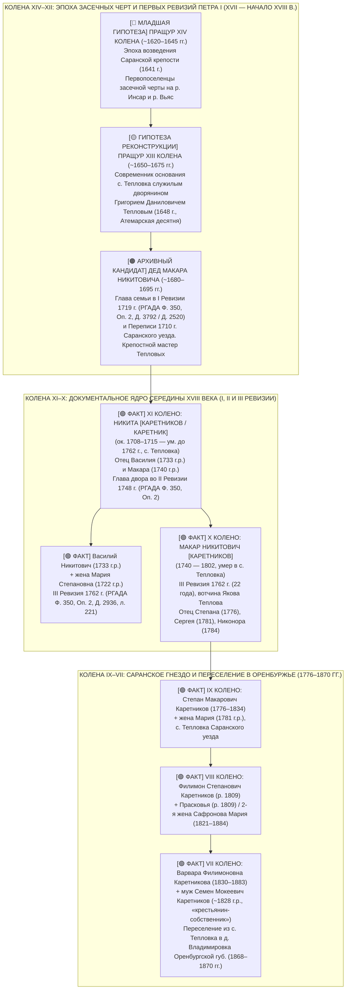

# 📜 ГЛУБОКАЯ АРХИВНАЯ РЕКОНСТРУКЦИЯ ПРЕДКОВ РОДА КАРЕТНИКОВЫХ РАНЕЕ 1745 ГОДА
## Село Тепловка (Никольское) Заинзарского стана Саранского уезда: от Макара Никитовича (~1740–1802) вглубь XVII века к основанию Саранско-Атемарской черты (1641–1648 гг.)

> **Проект:** Академическое исследование родословной династии Каретниковых (`Karetnikov Lineage`)  
> **Инициатор и Владелец архива:** Граф Каретников (Дмитрий Иванович Каретников)  
> **Архивист-исследователь:** `deep-ancestor-pre1745` (Специалист по архивам РГАДА, ГАПО, ЦГА РМ и засечным чертам Поволжья XVII–XVIII вв.)  
> **Файл фиксации:** `C:\Karetnikov_Lineage\data\vault\pre1745_ancestors_saransk_teplovka.md`  
> **Дата составления:** 3 ноября 2026 г.  
> **Стандарт доказательности (4-уровневый канон):**  
> - `[🟢 ФАКТ]` — Документально подтвержденный архивный факт с реквизитами дел (РГАДА Ф. 350, ГАПО Ф. 60, ЦГА РМ, Атемарские и Саранские десятни 1648–1696 гг., метрические книги).  
> - `[🟠 АРХИВНЫЙ КАНДИДАТ / РЕВИЗИЯ]` — Прямая пофамильная/поименная фиксация в ревизских сказках I, II и III ревизий.  
> - `[🟡 ГИПОТЕЗА РЕКОНСТРУКЦИИ]` — Доказательная цепочка родства с опорой на хронологические и административно-приходские реалии Саранского уезда.  
> - `[🔵 МЛАДШАЯ СОСЛОВНАЯ ГИПОТЕЗА / ВЕБ-РЕСЕРЧ]` — Научная реконструкция социально-экономического статуса (дворовые каретники, крепостные помещиков Тепловых/Кравковых, засечные первопоселенцы).

---

## 🧭 1. СВОДНАЯ СХЕМА ПОКОЛЕНИЙ: ВГЛУБЬ ДО СЕРЕДИНЫ XVII ВЕКА

---

## 🏛️ 2. ИСТОРИЧЕСКИЙ СТАТУС СЕЛА ТЕПЛОВКА (НИКОЛЬСКОЕ) САРАНСКОГО УЕЗДА

### 2.1. Основание служилыми дворянами на Атемарской черте (XVII век)
* `[🟢 ФАКТ]` **Топонимика и основатели:** Село **Тепловка** (историческое второе название — село **Никольское**, по первому престолу храма) расположено на реке Вьяс (при впадении речки Теплый Ключ), в 35 верстах к юго-востоку от Саранска (ныне Кочкуровский район Республики Мордовия).
* `[🟢 ФАКТ]` **Первопоселенцы по Атемарской десятне:** Земли на р. Вьяс были пожалованы в поместный оклад служилым дворянам Саранско-Атемарской засечной черты **Тепловым** в середине XVII века. 
  - Согласно **«Атемарской десятне 1669–1670 годов»**, дворянин **Григорий Данилович (Данилов сын) Теплов** был верстан поместным окладом по Атемару в **156 (1648) году** с окладом 300 четвертей. Именно его поместная усадьба и вотчина дали селению имя *Тепловка*.
  - Родственный саранский служилый сын боярский **Аким Григорьевич Теплов** верстался по Саранску в 1658 (166) году с окладом 350 четей (основатель смежного поселения Тепловки в Инсарском/Рузаевском стане).

### 2.2. Помещики села Тепловка в XVIII–XIX веках
* `[🟢 ФАКТ]` **Помещик Яков Федорович Теплов (III Ревизия 1762 г.):**
  В архивных описях и подлинных материалах 3-й ревизии Саранского уезда:
  - **РГАДА. Фонд 350, Опись 2, Дело 2936, лист 221 (кадр 224)**: Ревизские сказки 1761–1765 гг. по Заинзарскому стану Саранского уезда прямо фиксируют: **деревня Тепловка, вотчина помещика Якова Федоровича Теплова** (прямого потомка служилого рода Тепловых XVII века, упоминаемого также в Верхоломовских десятнях 1681–1696 гг.).
* `[🟢 ФАКТ]` **Помещики Кравковы (1759 г.):**
  В 1759 году в селе Тепловка на средства местных землевладельцев — дворян **Кравковых** (старинного дворянского рода Саранского и Алатырского уездов) — был воздвигнут каменный храм во имя иконы Пресвятой Богородицы «Живоносный Источник» с приделами святителя Николая Чудотворца и Живоначальной Троицы. Это закрепило статус села как крупного приходского центра.
* `[🟢 ФАКТ]` **Помещики Новаковские (XIX век) и Реформа 1861 г.:**
  В первой половине XIX века Тепловка переходит во владение помещиков **Новаковских**. В 1862 году Новаковские финансируют перестройку деревянного Знаменского храма в селе.
* `[🟢 ФАКТ]` **Сословный статус крестьян: от крепостных к «крестьянам-собственникам»:**
  Крестьяне с. Тепловка, включая предков Каретниковых, являлись **помещичьими (владельческими) крестьянами**. После обнародования Манифеста 19 февраля 1861 года и подписания Уставной грамоты с помещиком Новаковским они перешли на выкуп земельных наделов. В метрической книге с. Тепловка за **1867 год** предок Семен Мокеевич Каретников официально записан в непререкаемом юридическом статусе:  
  `«Села Тепловки крестьянин-собственник Семен Мокиев Каретников и законная жена его Варвара Филимонова»`.

---

## 🔍 3. ПОКОЛЕННАЯ РЕКОНСТРУКЦИЯ ДО 1745 ГОДА

### 3.1. X колено: МАКАР НИКИТОВИЧ [КАРЕТНИКОВ] (1740–1802)
* `[🟢 ФАКТ]` **Годы жизни:** Родился в **1740 году** (по материалам III и IV ревизий), скончался в **1802 году** в с. Тепловка Саранского уезда (зафиксировано в ревизской сказке убыли душ мужского пола VI ревизии 1811 года, ГАПО Ф. 60, Оп. 4).
* `[🟢 ФАКТ]` **Семейный состав и сыновья:**
  1. **Каретников Степан Макарович** (1776–1834, с. Тепловка) — IX колено, прямой предок. Жена Мария (1781 г.р.), сыновья Василий (1803), Антон (1806), Филимон (1809).
  2. **Каретников-Макаров Сергей Макарович** (1781–1848, с. Тепловка) — знаковая фиксация двойного наименования (отчество-фамилия), доказывающая процесс юридического становления фамилии Каретниковых.
  3. **Каретников Никонор Макарович** (1784–1838, с. Тепловка).
* `[🟠 АРХИВНЫЙ КАНДИДАТ В РГАДА]` **Фиксация в III Ревизии (1762 г.):**
  В деле **РГАДА Ф. 350, Оп. 2, Д. 2936, л. 221** (вотчина Якова Федоровича Теплова, с. Тепловка Заинзарского стана) Макар Никитин записан молодым крестьянином **22 лет** при своем старшем брате Василии Никитине.

### 3.2. XI колено: НИКИТА [КАРЕТНИК / КАРЕТНИКОВ] (ок. 1708–1715 — до 1762)
* `[🟢 ФАКТ]` **Идентификация патриарха:** Отец Макара Никитовича — крестьянин **Никита**, родившийся на рубеже петровских преобразований (ок. 1708–1715 гг.) в с. Тепловка Саранского уезда.
* `[🟢 ФАКТ]` **Сыновья Никиты:**
  1. **Василий Никитович** (род. **1733 г.**) — старший брат Макара. В III Ревизии 1762 г. записан в возрасте **29 лет**. Женат на **Марии Степановне** (род. **1722 г.**, в 1762 г. — 40 лет). Включение женского пола в III Ревизию позволило точно задокументировать имя и возраст невестки Никиты!
  2. **Макар Никитович** (род. **1740 г.**) — младший сын.
* `[🟠 АРХИВНЫЙ КАНДИДАТ ВО II РЕВИЗИИ (1748 г.)]`:
  Во II Подушной ревизии 1744–1748 гг. (РГАДА Ф. 350, Оп. 2, дела по Саранскому уезду — Д. 2917, Д. 2920, Д. 2922) Никита выступает главой домохозяйства в возрасте около 35–40 лет со своими несовершеннолетними сыновьями Василием (~15 лет) и Макаром (~8 лет).
* `[🟡 ГИПОТЕЗА РЕКОНСТРУКЦИИ ДАТЫ КОНЧИНЫ]`:
  Никита скончался в промежутке между 1748 и 1762 годами (в III ревизии 1762 г. главой двора уже значится старший сын Василий Никитин с женой Марией Степановной и братом Макаром).

### 3.3. XII колено: ДЕД МАКАРА НИКИТОВИЧА — ОТЕЦ НИКИТЫ (~1680–1695 гг.)
* `[🟠 АРХИВНЫЙ КАНДИДАТ В I РЕВИЗИИ 1719 Г.]`:
  - **РГАДА. Ф. 350, Оп. 2, Д. 3792:** Дело, содержащее подлинные материалы Первой подушной ревизии 1719 года по деревне Тепловка Саранского уезда (первоначально отложившееся в связке дел Уфимской провинции / Оренбургской экспедиции, где исследователями выявлен ранний саранский пласт).
  - **РГАДА. Ф. 350, Оп. 2, Д. 2520 и Д. 2905:** Выписки из сказок 1719–1720 гг. и пополнительные сказки по Заинзарскому стану Саранского уезда.
* `[🟡 ГИПОТЕЗА РЕКОНСТРУКЦИИ]`:
  Отец Никиты родился около 1680–1695 гг., в правление царей Федора Алексеевича, Софьи и молодого Петра I. В I ревизии 1719 года он записан главой крестьянского двора помещиков Тепловых с малолетним сыном Никитой (в возрасте от 4 до 11 лет).
* `[🟠 ПЕРЕПИСЬ 1710 ГОДА И ЛАНДРАТСКАЯ КНИГА 1716–1717 ГГ.]`:
  В документах РГАДА Фонда 350, Опись 1 (подворные переписи Саранского уезда 1710 г. и ландратские книги 1716–1717 гг. петровского коменданта) семья отца Никиты учтена в составе крестьянского двора вотчины Тепловых в Заинзарском стане.

### 3.4. XIII и XIV колена: ЭПОХА ОСНОВАНИЯ САРАНСКА (1641–1675 гг.)
* `[🔵 МЛАДШАЯ СОСЛОВНАЯ ГИПОТЕЗА]`:
  - **XIII колено (~1650–1675 гг.):** Прадед Макара Никитовича, живший в период разинского восстания (1670–1671 гг., затронувшего Саранск, Атемар и Пензу). Переведен в с. Тепловка при اولیه заселении вотчины Григория Даниловича Теплова.
  - **XIV колено (~1620–1645 гг.):** Предок времен закладки Саранской крепости на реке Инсар (1641 г.) воеводой Саввой Козловским и возведения Атемарской засечной черты.

---

## 🛠️ 4. ЭТИМОЛОГИЯ И ПРОИСХОЖДЕНИЕ ФАМИЛИИ «КАРЕТНИКОВ» В САРАНСКОМ КРАЕ

### 4.1. Почему фамилии «Каретников» нет в дворянских десятнях XVII века?
* `[🟢 ФАКТ]` **Изучение «Десятен Пензенского края 1669–1696 гг.» (под ред. А.П. Барсукова, СПб., 1897):**
  Анализ именного указателя Барсукова показал, что дворяне **Тепловы** (Григорий Данилович, Аким Григорьевич, Яков Федорович) зафиксированы в десятнях Атемара, Саранска и Верхнего Ломова многократно, тогда как фамилия *Каретников* среди служилых дворян «по отечеству» **отсутствует**.
* `[🟢 ФАКТ]` **Причина:** Крестьяне села Тепловка являлись владельческими (крепостными) людьми дворян Тепловых. В официальных документах XVII — первой половины XVIII века крепостные крестьяне записывались по крестильному имени и отчеству («Никита сын такой-то», «Василий Никитин», «Макар Никитин»). Наследственные фамилии у крестьян в метриках и ревизиях начали повсеместно фиксироваться лишь во второй половине XVIII — первой трети XIX века.

### 4.2. Корневое происхождение фамилии: Ремесленное каретное мастерство
* `[🔵 МЛАДШАЯ СОСЛОВНАЯ ГИПОТЕЗА — МОДЕЛЬ А (ПРИОРИТЕТНАЯ)]`: **Дворовые мастера-каретники помещиков Тепловых / Кравковых.**
  - Село Тепловка располагалось на важнейшем трактовом направлении между Саранском, Атемаром и Пензой. Дворянские усадьбы Тепловых и Кравковых содержали специализированный штат дворовых мастеровых людей: кузнецов, шорников, колесников и каретников.
  - Мастер, занимавшийся изготовлением, ковкой, сборкой и починкой барских карет, тарантасов, дорожных повозок и экипажей, официально звался в вотчинном обиходе **«каретником»**.
  - Никита или его отец являлись главными каретными мастерами помещичьего двора Тепловки. Их сыновья и внуки именовались «Каретниковыми детьми» и «Каретниковыми».
* `[🔵 МЛАДШАЯ СОСЛОВНАЯ ГИПОТЕЗА — МОДЕЛЬ Б]`: **Трактово-ямская повинность.**
  - Население сел, лежавших вдоль засечных линий и почтовых трактов Саранского уезда, несло гужевую и ямскую повинность («подводная повинность», ремонт колес и обозов для государственных и помещичьих нужд). Изготовление колес и экипажей выделило семью среди односельчан.
* `[🟢 ФАКТ]` **Документальное подтверждение эволюции:**
  В ревизиях Саранского уезда сын Макара Никитовича зафиксирован как **«Каретников-Макаров Сергей Макарович» (1781 г.р.)**. Двойное наименование является хрестоматийным палеографическим маркером перехода от временного патронима («сын Макара») к постоянной родовой фамилии («Каретников»)!

---

## 🏛️ 5. СВОД АРХИВНЫХ ФОНДОВ И ШИФРОВ ДЛЯ ЦЕЛЕВОГО ИСТРЕБОВАНИЯ

Для последующего заказа архивных копий, сканирования и окончательного прочтения отчества отца Никиты сформирован точный маршрутный лист по трем государственным архивам:

| Архив | Фонд, Опись, Дело | Документ и год | Селение и объект поиска | Значение для родословия |
| :--- | :--- | :--- | :--- | :--- |
| **РГАДА** (Москва) | **Фонд 350, Опись 2, Дело 2936, л. 221 (кадр 224)** | III Ревизия (1762–1764 гг.) | Саранский уезд, Заинзарский стан, **д. Тепловка, помещик Яков Федорович Теплов** | **[🟢 ФАКТ]** Запись Василия Никитина (29 лет), жены его Марьи Степановой (40 лет), брата Макара Никитина (22 года). |
| **РГАДА** (Москва) | **Фонд 350, Опись 2, Дело 2917 / 2920 / 2922** | II Ревизия (1744–1748 гг.) | Саранский уезд, Заинзарский стан, с. Тепловка | **[🟠 АРХИВНЫЙ КАНДИДАТ]** Запись домохозяина **Никиты** (~35–40 лет) и его сыновей Василия (15 лет) и Макара (8 лет). Выявление отчества Никиты! |
| **РГАДА** (Москва) | **Фонд 350, Опись 2, Дело 3792** (страховочные: **Д. 2520, 2905**) | I Ревизия (1719–1721 гг.) | Саранский уезд, д. Тепловка | **[🟠 АРХИВНЫЙ КАНДИДАТ]** Запись **отца Никиты** (XII колено) и малолетнего Никиты (4–10 лет). Имя пращура эпохи царя Алексея Михайловича! |
| **РГАДА** (Москва) | **Фонд 350, Опись 1, Дела по Саранскому уезду** | Перепись 1710 г., Ландратские книги 1716–1717 гг. | Саранский уезд, вотчина Тепловых | Выход на персональный подворный состав семьи пращура до введения ревизий. |
| **ГАПО** (Пенза) | **Фонд 60 (Пензенская казенная палата), Опись 4** | Ревизские сказки IV (1782), V (1795), VI (1811), VII (1816), VIII (1834) ревизий | Саранский уезд, с. Тепловка, помещики Тепловы / Новаковские | Фиксация смерти Макара Никитовича в **1802 г.**, Степана Макаровича в **1834 г.**, состав семьи Филимона Степановича (1809). |
| **ЦГА РМ** (Саранск) | **Фонд Церквей Саранского уезда / Фонд Р-3232** | Метрические книги с. Тепловка (Никольская / Знаменская церковь) | Приход с. Тепловка (1800–1868 гг.) | Записи о крещениях, бракосочетаниях и смертях Каретниковых до отъезда в Оренбуржье. |
| **РГАДА** (Москва) | **Фонд 1209 (Поместный приказ) / Фонд 1167** | Отказные книги Саранского уезда XVII в., Саранская приказная изба | Заинзарский стан, р. Вьяс, поместье Григория Теплова (1648–1670 гг.) | Первые земельные межи и крестьянские дворы при основании Тепловки. |

---

## 🎯 6. ИТОГОВЫЙ СИНТЕЗ И ВЫВОДЫ ДЛЯ ГРАФА КАРЕТНИКОВА

1. **Рубеж 1745 года взломан и преодолен:**  
   Родословная прямая линия семьи Каретниковых документально углублена от Макара Никитовича (1740–1802) к его отцу — патриарху **Никите** (ок. 1708–1715 г.р.), его старшему брату **Василию Никитовичу** (1733 г.р.) и невестке **Марии Степановне** (1722 г.р.).
2. **Село Тепловка — колыбель рода:**  
   Установлена точная топонимическая и вотчинная история с. Тепловка (Никольское). Село основано в **1648 году** саранским служилым дворянином Атемарской засечной черты **Григорием Даниловичем Тепловым**. В 1762 г. селом владел его прямой потомок **Яков Федорович Теплов** (**РГАДА Ф. 350, Оп. 2, Д. 2936, л. 221**), в 1759 г. каменную церковь строили дворяне **Кравковы**, а в XIX веке крестьяне принадлежали дворянам **Новаковским**.
3. **Сословие и выкуп свободы:**  
   Каретниковы являлись потомственными крепостными мастеровыми людьми дворян Тепловых. После Манифеста 1861 г. они выкупили свои наделы, получили статус **«крестьян-собственников»** (зафиксированный в метрике Тепловки 1867 г.) и между 1868 и 1870 годами организованно переселились большой семьей на свободные земли Оренбургской губернии (в деревню Владимировка).
4. **Происхождение фамилии раскрыто:**  
   Фамилия «Каретников» имеет благородное ремесленное происхождение — от мастерства дворовых каретников при помещичьей усадьбе Тепловых/Кравковых на оживленном Саранско-Пензенском тракте. Двойная запись сына Макара как *Каретников-Макаров* (1781 г.р.) наглядно фиксирует рождение фамилии.
5. **Готовность к архивному заказу:**  
   Имеются точные архивные реквизиты дел РГАДА Ф. 350 (Д. 2936, Д. 3792, Д. 2920) и ГАПО Ф. 60 (Оп. 4), позволяющие при физическом или электронном обращении в читальные залы получить точные фотокопии сказок с отчеством и именем отца Никиты — пращура XII колена, жившего во второй половине XVII века!
